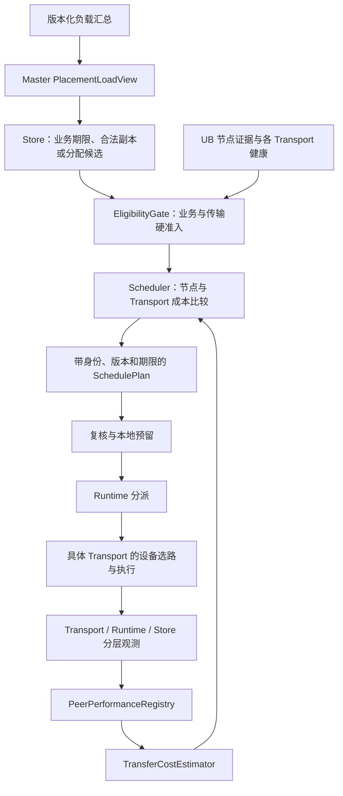
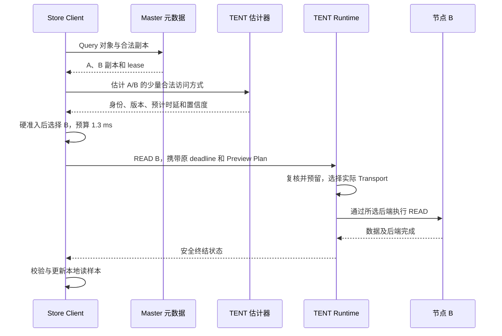
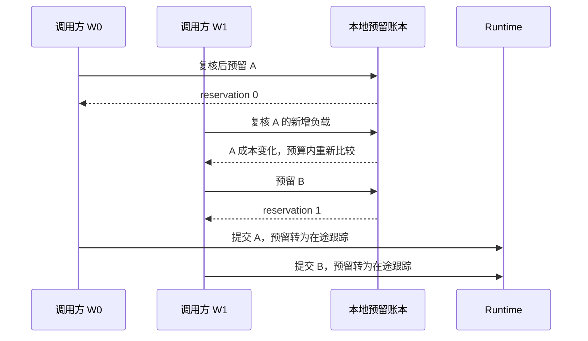

# TENT 与 Mooncake Store 的节点级负载及时延调度方案

> 日期：2026-10-24。
>
> Supercache 分析基线：`main_learn`，`856422a30f1cc7af9df2af35dc14ec750efa2eb2`。
>
> 本文为待实现设计，不表示新增类型、API、配置或调度行为已经合入。表格中的预测值是算法示意，不是硬件测试结果。
>
> 首轮范围：CPU DRAM、普通 READ/WRITE、远端内存副本，以及策略允许且实际可用的 UB/RDMA/TCP 等后端。文件、NoF、GPU/staging 等路径先保留现有合法选择，不套用未经验证的模型。
>
> 硬隔离与恢复依据沿用 [UB 节点级故障隔离方案](ub-node-fault-isolation-design.md)。资源生命周期与重放语义见 [物理 UB 可靠性设计](tent-physical-ub-reliability-design.md)，UB 当前设备选路见 [路径选择算法图解](../../learn/tent-ub-path-selection-algorithm.md)。

## 1. 目标与核心决策

### 1.1 需要解决的问题

当前 Runtime 按请求属性匹配 policy，再按配置顺序选取适用 Transport。UBTransport 能在后端内部依据拓扑和资源压力逐 slice 分流，但这不等于能够：

- 在节点 A、B 的现有对象副本之间比较读取成本。
- 在同一目标的 UB、RDMA、TCP 之间比较预计完成时间。
- 根据读负载、容量与新增预留，为新对象选择放置位置。
- 让期限、健康、模型新鲜度和重试预算贯穿一次业务操作。

本方案增加观测、预测和动态选择闭环，同时保留既有策略、对象语义和故障隔离边界。

### 1.2 核心决策

```text
业务先提供合法候选
→ 对候选执行硬准入
→ 使用身份与代次匹配的健康/性能快照估计成本
→ 在期限和亲和约束下选择节点与 Transport
→ 只为被选中方案预留本地调度额度
→ 提交前复核
→ 完成后反馈实际成本
```

三层职责不得混淆：

| 层次 | 决定什么 | 不应自行决定什么 |
| --- | --- | --- |
| Store | 从哪个合法副本读、新副本分配在哪里、是否迁移 | 不构造 UB 原生 WR，不绕过 TENT 排空 |
| TENT Runtime | 对已选目标使用哪个合法 Transport、何时分派 | 不将地址请求改发到未经业务确认的其他副本 |
| UB/RDMA 等 Transport | 设备、连接、配额、分片、完成和安全恢复 | 不改变对象所有权和副本发布状态 |

### 1.3 成功标准与非目标

成功标准：

1. 单端口故障可降权，节点 UB 硬阻断不能被评分、探索或 fallback 绕过。
2. 读副本与后端选择可以利用测得的时延、负载和不确定性，而不是只看标称带宽。
3. 纯读、低流量、后台迁移和节点恢复场景都有可解释的反馈与更新机制。
4. 动态决策只在既有策略允许的范围内发生，预算和资源记账有界。
5. 对模型未知、反馈过期和预留竞争定义明确行为。
6. 通过影子决策和灰度证明业务收益，同时验证数据、DMA 和副本约束不劣化。

非目标：

- 不承诺预测值等于真实完成时间，也不凭历史 P99 保证未来 99% 请求满足期限。
- 首轮不默认启用 hedged read、并发重复 WRITE、自动降低副本数或任意跨节点重放。
- 不把性能差等同于节点故障，不因模型过期改变 membership。
- 不修改设备 provider 的 WQE/doorbell 实现，也不代替 UB 节点隔离中的证据管理。
- 首轮不改变本地内存、NoF、磁盘等既有类型优先级；扩展这些路径需独立验收。

## 2. 分层模型与状态所有者

### 2.1 总体组件

以下均为建议新增或扩展的逻辑组件，可按实现规模合并：



### 2.2 状态所有权

| 状态 | 唯一所有者 | 主要读者 |
| --- | --- | --- |
| UB 端口事实与节点阻断 | 故障隔离方案中的 Manager/Admission | EligibilityGate、Store 健康表 |
| 本端访问 peer 的性能 | 发起端 PeerPerformanceRegistry | Runtime、Store Client 估计器 |
| 节点自报资源与后台负载 | 资源所属服务实例 | 汇总器、Master |
| 业务副本与 lease/版本 | Store 元数据与业务流程 | Store ReplicaScheduler |
| 本地计划预留 | SchedulingReservationLedger | Runtime 调度器、完成路径 |
| 已分配但未完成的放置负载 | Master PlacementReservationLedger | AllocationStrategy |
| 原生设备/rail 配额 | 各 Transport 的 Quota/队列管理 | 对应 Worker |
| 模型与软调度配置快照 | Runtime 或 Store 各自的配置发布者 | 同层调度器 |

不能用一份无类型的“node score”替代以上状态。尤其本地软件预留不等于远端真实可用额度。

### 2.3 身份与性能键

```text
NodeIdentity = service_instance_id + incarnation
RouteIdentity = target_segment + registration_generation + network/profile scope

PeerPerfKey =
    observer_scope
    + NodeIdentity
    + Transport
    + READ/WRITE
    + size_bucket
    + local/remote memory_class
    + intent_class
    + relevant topology/profile generation
```

`observer_scope` 表示本端或网络观测范围，避免把 Client X→B 的坏链路直接推成所有客户端访问 B 都慢。

拓扑、设备、注册和 profile 变化后，应失效相关性能样本或降低其可信度，不能直接把旧物理路径能力转给新实例。同一主机的多个服务实例也不自动合并。

### 2.4 三类候选

| 调度 | 候选来源 | 选择后提交 |
| --- | --- | --- |
| 读副本 | 当前 Query 返回的合法副本 | 选定 Segment 和地址，再提交 READ |
| 同节点 Transport | 当前 policy 允许且能力适用的后端 | 原 target_id/offset 不变 |
| 新副本放置 | Master 可分配的 Segment 与故障域 | Master 分配地址后，Client 执行 WRITE |

迁移同时包含源、目标和后台预算，使用同一硬准入与观测，但单独进行业务规划。

## 3. 合法候选与硬准入

### 3.1 与现有策略衔接

当前 policy 使用首个匹配规则，后端列表来自该规则或 buffer 元数据。动态调度不得扫描其他规则来扩大本次候选。

将选择拆成：

```text
matchPolicy
→ buildAuthorizedCandidates
→ checkEligibility
→ estimate
→ rank
→ commitPlan
```

`buildAuthorizedCandidates` 应由静态与动态选择共用，避免两种模式对注册、能力和位置的理解不一致。

现有 `policy_name` 会跳过若干普通匹配条件；但业务合法性、能力、健康、范围和提交门禁必须独立执行。命名策略不能成为硬准入的旁路。

### 3.2 硬准入清单

| 检查 | 内容 |
| --- | --- |
| 业务合法性 | 对象版本、COMPLETE 状态、lease、访问范围和权限 |
| 身份有效性 | 节点 incarnation、Segment/注册/设备相关 generation |
| 策略约束 | Transport、设备 mask、业务 intent、用户指定约束 |
| 后端适用性 | 编译/启用、内存组合、同机/进程要求、必要注册描述 |
| 健康准入 | 对应 Transport 未被有效硬隔离；请求级路径可验证 |
| 资源准入 | 本地队列/预留预算允许；原生配额由后端最后确认 |
| 期限约束 | 按所选 deadline 模式处理，不能把无限等待当可行 |

预估不能强制创建所有 Endpoint、导入所有 Segment 或同步查询所有节点。元数据不足时返回 NeedsRefresh/Unknown，在有界控制路径补齐，不在热路径执行无界 RPC。

### 3.3 健康状态如何影响调度

- 同一实例完整相关端口集合均具有有效 status 4 等 BAD 证据时，本地可直接阻断 UB；证据不必全来自 provider 查询。
- 远端传播、独立核验、阻断锁存和恢复，沿用关联故障隔离方案。
- UB 被阻断，只排除相应 UB 访问；其他 Transport 满足条件时仍可使用该副本。
- 部分端口故障可减少可用能力估计，但不自动隔离整节点。
- 性能样本成功、TCP 成功、模型变新不能解除硬隔离。
- 健康 UNKNOWN 不自动构造全故障，但仍需满足初始化和请求级验证。

如果使用容量因子，只统计独立可用资源组。多个 EID 共享一个物理端口不能重复相加；不同容量端口也不能简单按个数折算带宽。

### 3.4 hint、亲和与设备限制

`transport_hint` 继续遵循现有约束：只能来自允许集合，首次选择不能把不可用 hint 当普通软偏好忽略。首轮对带 hint 请求不重新动态排序其首选，后续恢复服从明确的既有 failover 契约。

`device_mask`、QP pool 等约束随 Plan 保留。当前设备名全部解析失败时可能回退为全设备；启用新的严格动态模式前应校验并拒绝未生效的设备限制，不能误以为已经按指定资源估计。

亲和分成两种：

- 硬亲和：业务或部署要求，直接限制候选。
- 软亲和：偏离原首选的成本或收益门槛，不能压过硬隔离。

## 4. 观测模型与有效性

### 4.1 分层计时

| 层次 | 建议时间/指标 | 语义 |
| --- | --- | --- |
| Transport | 建链、导入、quota 等待、post、完成、drain、重试 | 解释设备与路径成本 |
| Runtime | admission 等待、dispatch、首个 post、attempt 终结、逻辑终结 | 后端预测与任务进展 |
| Store | Query、buffer 分配、数据传输、校验、PutEnd 等 | 业务剩余预算和实际 SLO |

必须为每个样本写明 `measurement_scope`。Runtime 模型不能直接把单个 64 KiB WR 的延迟当成整个 4 MiB 对象的完成时间。

结束时间优先采用内部状态转换事件，而不是调用方某次晚到的 getStatus 时间。没有硬件时间戳时，poll 处理延迟仍可能包含在观测中，必须标明口径，不能称作纯链路延迟。

只计算目标范围的逻辑字节一次；重试发送字节、多个 slice 和多个副本写入量另计，不能重复进入对象读吞吐分母。

### 4.2 建议样本与快照

以下为设计示意，不是当前接口：

```cpp
struct TransferObservation {
    OperationId operation;
    AttemptId attempt;
    NodeIdentity target;
    TransportType actual_transport;
    RequestOp opcode;
    uint64_t logical_bytes;
    IntentClass intent;
    uint64_t runtime_queue_ns;
    uint64_t dispatch_to_terminal_ns;
    uint64_t safe_drain_ns;
    Outcome outcome;
    uint32_t retries;
    SampleScope scope;
};

struct PeerPerformanceSnapshot {
    PeerPerfKey key;
    uint64_t version;
    uint64_t sample_count;
    uint64_t sample_age_ns;
    QuantileSnapshot latency;
    RateEstimate throughput;
    FailureCounters failures;
    LoadReference reference_load;
    ConfidenceClass confidence;
};
```

时间、大小和计数使用足够宽的字段与饱和保护；不能用 32 位纳秒字段承载长期超时。

### 4.3 采样规则

1. CPU READ/WRITE、大小桶、intent 和实际 Transport 分开。
2. 本地 memcpy、TCP fallback 不作为 UB 成功样本。
3. transport attempt 与最终逻辑请求分开；只有未合并的测量范围一致时才进入同一桶。
4. 同一 operation/attempt 至多结束一次采样令牌。
5. 使用有界采样配额和窗口，允许丢弃软性能样本并记录丢样。
6. 有新样本时设置最长刷新间隔，不能要求每周期采满才刷新。
7. 小样本 P99 标为低置信度，不能仅因满足一个计数阈值就声称尾部已可靠。
8. 失败/超时进入独立计数。超时是受删失观测，不把超时阈值当作一次成功完成时延。
9. 长时间 drain 与结果未知单列，不混入正常成功服务时间。

### 4.4 状态与时效

```text
Cold → Learning → Fresh
Fresh --超过有效时间--> Stale
任意状态 --实例/注册/模型范围改变--> Invalidated
Stale --取得新合格样本--> Learning 或 Fresh
```

| 模型状态 | 普通 latency 模式 | 严格 deadline 模式 |
| --- | --- | --- |
| Fresh 且置信度足够 | 可参与动态比较 | 可用于预测可行性 |
| Cold/Learning | 有限探索或合法静态回退 | 不宣称可满足期限 |
| Stale | 降置信度、刷新；按策略回退 | 不把旧数据当合格期限证据 |
| Invalidated | 不复用旧模型 | 不复用旧模型 |
| 硬隔离 | 无论性能多好都不能使用对应访问 | 相同 |

性能过期不解除节点硬隔离。冷启动回退也只能在硬准入通过的候选中进行。

跨节点反馈携带测量年龄、窗口和 owner 版本；接收时间不等于测量时间。使用接收端本地单调时钟计时，保守扣减传输/等待开销，避免旧报告显示为新鲜。

### 4.5 汇总不能平均 P99

发起端保存本端 peer 直方图。Master 聚合节点负载时接收可合并的直方图桶或独立版本快照，不直接平均各 Client 的 P50/P99。

保留 observer/network scope：

- 节点自报的设备与后台资源是节点事实。
- Client 端到端样本是该 Client/范围的访问事实。
- 单个 Client 的高时延不能直接转为节点全局故障或全部用户的统一惩罚。

## 5. 成本模型、算法与计划状态机

### 5.1 首轮默认模型：按桶的服务尾时延

首轮建议使用 `bucket_tail`：

```text
S_q = 同 peer、Transport、opcode、大小桶、负载桶、
      内存类型与连接状态下的 dispatch_to_terminal 分位数

T_hat = Q_runtime + S_q + U
```

- `Q_runtime` 只估计尚未进入后端的同资源组等待。
- `S_q` 包含被测后端自身的排队、连接或执行阶段，按连接状态等分类。
- `U` 表示模型误差、新鲜度和置信度的保守裕量，统一为时间单位。

不能再将 S_q 已经包含的 quota 等待、网络耗时或冷连接建立时间重复相加。已经 dispatch 的在途字节也不能全部当作 Q_runtime 再算一次。

新预留改变估计时使用对应负载特征/桶；不能把所有预留字节机械叠加到已经包含相同负载的历史尾延迟上。

### 5.2 可选组件模型：用于校准后扩展

需要大小外推、冷启动先验或更细预测时，可以使用：

```text
S_component(D) = L_setup + D / B_effective + Q_backend
T_hat = Q_runtime + S_component(D) + U
```

`L_setup`、`B_effective`、`Q_backend` 要有明确计时或经过验证的拟合范围。无法区分时返回低置信度，不把未知 Q_backend 直接当作已知零等待。

两种模型择一形成服务时间。不能把完整 S_q 与完整组件模型同时相加。WR EWMA、节点峰值带宽和端口数只可用于先验或辅助特征，不能自动当作有效吞吐。

### 5.3 调度目标

| 目标 | 主要规则 |
| --- | --- |
| static | 保留策略顺序，在当前硬准入范围内选择 |
| latency | 最小化带风险裕量的预计完成时间 |
| deadline | 在剩余预算内预测可行的候选优先，再比较成本 |
| throughput | 对大请求比较有效吞吐与可用资源，仍遵守期限和业务约束 |
| affinity_guarded | 原首选合法且替代收益未达门槛时保持首选 |

deadline 的剩余传输预算：

```text
remaining = absolute_business_deadline - now
budget = remaining - application_reserve
predicted_feasible = estimate_qualified AND T_hat <= budget
```

`application_reserve` 覆盖未包含在测量范围中的校验、返回、提交等阶段。队列等待、重试、换节点和 failover 不重置业务绝对期限。

预测可行不是硬实时保证。若只有不合格模型：

- best_effort 模式可以合法静态回退，并标明预测未知。
- 显式 fail_fast 模式可以返回调度不可行，但不能伪造节点故障或对象不存在。
- fail_fast 不作为默认上线行为，需先完成误拒绝率和期限收益验收。

### 5.4 有界选择算法

```text
candidates = 业务合法候选与匹配 policy 的允许集合
eligible = 硬准入过滤(candidates)
if eligible 为空:
    返回明确的无合法访问方式

固定本次健康、模型与配置快照
保留合法原首选，按容量/亲和构造至多 K 个比较候选
对候选做纯读取估计，不创建原生资源、不预留每个候选
按 objective、期限、置信度和亲和收益门槛排序

尝试为最佳方案提交本地计划预留
若状态/额度已变化:
    回滚本次临时状态，在有限 replan_budget 内重评估
若成功:
    返回有版本的 SchedulePlan
否则:
    有界等待、合法静态回退或明确失败
```

K 有上限，不在每次请求扫描整个集群。可以采用有界随机采样或两候选比较；本地先验、原首选和真实备用应有合理覆盖。

不能因为抽样没找到候选就越过硬隔离回退原首选。业务候选很少时直接完整比较，无需额外随机化。

### 5.5 亲和、防振荡与探索

改变首选建议同时满足收益与稳定性条件：

```text
原首选仍合法时：
    improvement_ns >= absolute_gain_threshold
    AND improvement_ratio >= relative_gain_threshold
    AND 满足适用的 hold-down 规则
```

硬故障、明确不可行期限不受软 hold-down 阻止。普通读请求可以各自选择，不要求维护每个对象的永久会话黏着；新放置与迁移使用各自稳定性策略。

探索采用独立小预算，仅在业务语义、硬准入和期限模式允许时进行。高延迟节点若缺样本，应通过限额恢复评估补充；不能无限因旧 P99 被排除，也不能绕过 UB 阻断探测业务内存。

恢复性能评估使用专用注册区域，并标记探测类型、大小与负载范围。一个小包健康探测成功不能生成 4 MiB 业务读取的合格 P99；没有代表性样本时继续 Unknown，或使用明确低置信度的先验。

调度随机性使用请求关联值、实例扰动和选择序号，避免多个 Client 同序选点高度相关。采样扰动不改变对象身份和幂等键。

### 5.6 Plan 与本地预留状态机

```text
Estimated（无预留）
→ Reserved（仅选中方案记账）
→ Submitted（转交实际任务）
→ Terminal / Released

Reserved --超时/取消/复核失败--> Released
Submitted --取消/超时--> Draining → Terminal / Released
```

`SchedulePlan` 至少包含：

| 字段 | 用途 |
| --- | --- |
| decision_id、operation_id | 关联选择、执行与反馈 |
| 目标实例、Segment/注册版本、业务副本 token | 防止换错对象或使用陈旧描述 |
| Transport、device mask、QP pool | 保留策略约束 |
| policy/config/model/health generations | 提交复核与解释 |
| predicted_ns、confidence、reason | 影子决策和误差校准 |
| absolute_deadline、plan_expiry | 阻止计划无限复用 |
| reservation_id、resource_group | 本地计划占用与一次性释放 |

本地计划预留与原生 quota 是不同阶段的账本。Submitted 时应移出尚未分派负载，转为实际在途跟踪，不能在同一个成本特征里重复计费；设备硬额度仍由原生 QuotaManager 负责。

本地预留不保证其他进程或节点也保留额度。若未来需要全局硬容量保证，新增目标节点签发的 admission token，不能把本地 reservation 冒充远端令牌。

## 6. TENT 的具体改造点

### 6.1 新增纯读取估计与计划执行接口

建议先在 C++ 层增加能力，名称仅为设计示意：

```cpp
Status estimateTransferOptions(
    const TransferEstimateQuery& query,
    std::vector<TransferEstimate>& estimates);

Status submitPlannedTransfer(
    BatchID batch,
    const Request& request,
    const SchedulePlan& preview);
```

`estimateTransferOptions` 从本地缓存快照读数据，不为每个候选建连接或预留 quota。Query 包含 opcode、目标 Segment/范围、本地内存位置、intent、策略约束和剩余预算。

Preview Plan 无权改变对象目标。`submitPlannedTransfer` 校验目标、版本和策略，内部获取一次性预留，再转交任务；外部不能提交伪造 reservation ID 来绕过容量。原 `submitTransfer` 仍可用，并在启用动态模式时内部走同一规划器。

Store 选择副本时，可以批量估计少量已缓存 Segment。Segment 首次打开和元数据补齐走有界控制路径，不能让一次读请求为全集群逐个 openSegment。

### 6.2 TransportSelector 与上下文

扩展上下文或引入单独 ScheduleContext：

- opcode、目标实例与范围版本。
- Request deadline、业务保留预算。
- 当前健康、性能与策略快照引用。
- 尚未提交的本地计划负载。
- objective、候选数量、未知模型策略及 replan 预算。

保留首个 policy 匹配与允许集合，静态模式不改变原顺序。动态模式只排序允许且合格的候选，继续输出 device mask、QP pool 与 staging 参数等约束。

首轮对 GPU/staging 等不支持建模的路径返回 ModelUnsupported，再进入相应合法静态路径；不能假装只有 CPU 中转数据量就已覆盖完整阶段时延。

### 6.3 动态排序后的 failover

当前 Runtime 以 `xport_priority/failover_count` 索引后续候选。若每次模型变化都重新排列，然后继续使用旧索引，可能重复尝试已失败的后端或跳过真正备路。

建议为逻辑任务保存：

```text
AttemptHistory:
    target/version
    Transport
    attempt_generation
    failure_scope
    execution_outcome
    dma_safety
    retry_action
```

首次计划冻结允许集合与软评分版本。恢复时：

1. 先确认旧尝试的执行结果与安全排空条件。
2. 从允许集合中排除本轮不应重试的后端/实例。
3. 在剩余集合中有限次重估，不依赖“新数组中的第几个”代表原来候选。
4. 只有明确的元数据刷新或新资源代次等原因，才允许同 Transport 的受控再试。
5. 继续消耗统一 failover/retry 预算，并保留原绝对 deadline。
6. 更新 TaskInfo、派生任务、reservation 与统计一次性。

普通 TIMEOUT、端口隔离或调度换目标不能自动授权 WRITE 重放。Store 负责合法副本/版本与发布，Transport 负责旧 DMA 安全，Runtime 负责继承两者的决策。

### 6.4 Runtime 准入与期限

队列统计拆分为同资源组状态，避免“全局 dispatching bytes / 当前某个后端带宽”的错误组合。

资源组至少区分 Transport 与真实共享瓶颈；peer 标签用于定位业务，但不同 peer 共用一块 NIC 时不能各获得一份完整物理容量。没有足够细资源信息时采用保守共享组并标低置信度。

队列需要识别：

- 尚未分派的计划预留。
- 已分派但未 post 的任务。
- 真正在途任务与等待 drain 的任务。

模型不重复计费；总内存/并发上限仍保留。排队后 dispatch 前复核模型、健康和预算，并限制重新规划次数，避免每次刷新都把任务放回队首。

Store 内部引入可选 TransferOptions，将业务剩余期限转换成本进程 `Request.deadline_ns`。C++ Request 已有该字段；当前普通 Store 转换尚未传递。现有 C request 布局没有相同字段，使用版本化 options/新入口，不能直接破坏既有 ABI。

取消只阻止未接受工作或请求安全终结。期限到达并不意味着可以提前复用仍被 DMA 使用的内存。

### 6.5 Transport 观测挂接

UB/RDMA 等后端增加轻量观测点：

- 进入调度队列、获得 Endpoint/注册资源、quota 等待结束。
- 第一次实际 post、最后一个分片安全终结。
- attempt 失败、重试、排空和资源保留。
- 实际设备/rail 与模型范围，用于解释预测偏差。

Runtime 记录逻辑请求与后端 attempt 关联，避免 poll 多次就重复采样。快照只保存数值与稳定标识，不持有原生资源句柄来延长 Context/Segment 生命周期。

当前 `TENT_METRICS_ENABLED` 默认关闭。调度需要的最小内部 Recorder 应与 Prometheus/日志导出解耦；启用 scheduler 时必须有可用观测能力。构建缺少能力时显式拒绝 active 或退到声明的静态/影子模式，不能让所有模型永久冷启动却声称动态优化已生效。

## 7. 反馈传播与统计汇总

### 7.1 本地与集中视图分工

| 数据 | 保留位置 | 传播方式 |
| --- | --- | --- |
| 本端 peer 访问分布 | 发起端 Runtime/Client | 默认本地使用，按预算汇报 |
| 节点设备、容量与后台占用 | 所有者实例 | 自报给 Master/汇总器 |
| Placement 预留 | Master | 由 Master 自己更新 |
| 健康隔离事实 | 健康所有者/核验链路 | 沿用健康协议，不从性能统计推导 |
| 高基数原始请求日志 | 本地受控诊断 | 不作为全量节点广播 |

Master 没有 TENT 实例时，不为放置评分创建一批引擎去连接所有节点；只使用已汇总负载、容量与必要的 writer 亲和提示。

### 7.2 纯读与低流量反馈闭环

Store 常见内存 Get 由 Client 发起 READ。被动读源节点不一定获得每次对象读取的业务完成事件。

因此：

1. Client/Runtime 在读取结束时记录实际目标和 Transport。
2. 本地模型立即更新或提交后台刷新。
3. 独立后台任务批量上报活跃 peer 的有界统计，不依赖成功 Put/Publish。
4. 没有足够样本时按最大刷新时间发布 Learning/无新样本状态。
5. 统计过期后降置信度，进行合法探索或静态回退。

业务 response 可加速传播节点自身负载，但不能成为唯一反馈通道。

### 7.3 报告版本与去重

建议版本化报告包含：

```text
schema_version
reporter_identity / reporter_incarnation
target_identity / target_incarnation
measurement_scope / key
window_id / report_sequence / model_version
sample_age / sample_count / histogram
failure_counts / resource_snapshot
```

优先使用每 reporter/window 的累计快照替换，或带明确 ACK/序号的增量合并。重复报告不重复计数，旧 report 不覆盖新值，进程重启不与旧序号空间混淆。

报告丢失可以导致性能模型过期，不能导致硬隔离被清除。使用有界队列、批量、限频与压缩，不能因指标发送阻塞 post/poll 或业务线程。

### 7.4 协议与扩展能力

当前 Store RPC 包含反射序列化结构，不应假设给旧结构直接增加字段就自动兼容。

建议：

- 新增带 schema/capability 的报告和快照 RPC，或使用经过兼容测试的扩展封套。
- 旧端点缺少能力时明确返回 Unsupported，使用既有合法静态路径。
- 沿用现有通道身份、安全与租户边界，只接收报告者有权报告的自身观测。
- 性能报告不是健康权威，不能让单个客户端的“慢”报告隔离其他节点。
- callback 与 RPC 回调不持有调度或原生队列锁。

### 7.5 规模约束

仅报告活跃 peer/资源组，设定每进程的条目、桶数、采样和带宽上限。冷条目通过 TTL/有界 LRU 等机制回收，不保留原生资源。

汇总节点自有负载可接近 O(N) 规模；端到端观测在活跃关系很密时仍可能接近 O(N²)。需使用每 observer 的有限活跃集、分组或采样，不能宣称整个方案无条件 O(N)。

## 8. Mooncake Store 的配合

### 8.1 增加有上下文的读副本调度

现有 `ReplicaScorer` 只接收副本描述，缺少本次长度、deadline、intent 等信息，且注入状态为进程级。不能仅放一个捕获某个 Client 裸指针的全局回调来承担新方案。

建议新增 per-client `ReplicaSelectionContext` 与 ReplicaScheduler，包含业务候选 token、对象版本、lease、长度、目标约束、deadline 和 TENT 估计器引用。

首轮保持本地快速路径与非内存类型优先级，主要在多个 remote MEMORY 合法副本之间动态选择：

```text
Query 合法副本
→ 检查版本、状态、lease
→ 对每个候选查询少量合法 Transport 的估计
→ 比较候选对 (replica, Transport)
→ 复核业务 token
→ 提交预览计划
→ 成功后校验数据与 lease
```

当前 `SelectBestReplica` 的 `first_memory` 回退和底层 `FindFirstCompleteReplica` 都需要接入统一 eligibility。不能只修改某一个 RealClient 入口；single、batch、range/session 等需要各自核对。

### 8.2 批量读取

按目标/Transport 分组可以节省开销，但不能用一个组的成功掩盖其他 key 失败。

对每个 key 保留 deadline 与结果，估计共享瓶颈上的新增总负载。分组与合并后，将公共等待和服务时间按明确范围记录；不能把同一次组传输重复作为每个 key 的完整独立带宽样本。

一次 batch 的候选比较、计划数与并发有上限。为减轻负载而换组不能绕过 lease 或让旧 READ 继续写已交给新请求的接收区。

### 8.3 Master 新副本放置

当前调用链为 PutStart 分配地址、Client 写入、PutEnd/PutRevoke。新位置必须由 Master 分配，Client 不得自行改写目标地址。

Master 维护 PlacementLoadView 与已分配未完成的预留，先执行：

- 容量、owner 活跃和 Segment generation 检查。
- 目标访问方式的 eligibility。
- 请求副本数量及配置的故障域约束。
- tenant、部署亲和与允许的降级契约。

当前不同 Segment 并不自动等于不同物理主机/故障域。若新增 host 反亲和要求，应显式配置并验收，不伪称现有策略已经提供。

### 8.4 放置评分与预留

Master 不能直接把某个 Client 的 TENT 时延预测当全局节点性能。使用节点自报和汇总负载估计未来服务压力，例如：

```text
C_place =
    a × normalized_read_pressure
  + b × normalized_write_pressure
  + c × normalized_reserved_pressure
  + d × space_pressure
  + e × soft_affinity_penalty
```

各项均为有定义的无量纲量，权重可配置并经影子实验校准。越小越优；当前 RankedAllocationStrategy 是越大越优的比较器，复用时需显式转换方向或替换比较器。

preferred、评分和随机回退都执行同一过滤。静态/亲和模式保留合法首选；latency/load 模式不能在评分之前总把 preferred 分配完，导致评分永远不生效。

成功分配后，在同一事务/锁定边界记录 Placement reservation，再向 Client 返回。额度不足、注册代次改变或 owner 不可服务时有限重选；不可在持有 allocator 锁时执行性能 RPC。

Placement reservation 通过 PutEnd、PutRevoke 或安全清理结算。协议重试使用相同 operation/reservation 身份，不能重复记账。预留过期只是待核验信号，不能在旧 WRITE 仍可能 DMA 时提前释放或复用注册地址。

### 8.5 复制与迁移

默认不因一次高延迟自动迁移已有对象。启用主动再平衡需同时有持续退化窗口、迁移成本阈值、目标容量和后台预算。

迁移源/目标复用健康与负载视图，使用 `MIGRATION` intent；前台 Get 的观测和队列不被后台任务样本混淆。迁移完成与副本发布继续遵守原协议，性能变好不意味着可以删除旧合法副本。

### 8.6 错误、期限与未知完成

保留既有 SDK 业务返回形式时，新增内部调度详情区分：

```text
NoEligibleCandidate
ModelUnknown / ModelUnsupported
PredictedDeadlineMiss
PlanStale / ReservationBusy
TransportFailed / OutcomeUnknown
```

这些都不能映射为对象不存在。业务期限从 Store 入口扣减 Query、分配与处理耗时，再交给 TENT，重试不重新获得完整预算。

当前 TransferEngineOperationState 的普通 switch 未将 TIMEOUT 当失败终态，需要修正，同时保留旧 DMA 安全约束。WRITE 结果未知时，不能直接 PutRevoke 复用地址；READ 换副本也须结束旧接收区访问。

## 9. 关键场景时序与算例

### 9.1 两个读副本：较慢链路反而更快完成

假设 A、B 都有当前合法副本，请求为 4 MiB。为直观看算术，本例采用已校准组件模型，U 暂取 0，生产不应据此取消风险裕量：

本例假设 A/B 对应可分别调度的资源组或队列。若两者共享瓶颈，应采用共享组的等待和容量约束，不能仅因 peer 不同就把排队成本和可用容量独立计算。

| 项目 | A | B |
| --- | ---: | ---: |
| Q_runtime | 2 ms | 0.1 ms |
| L_setup | 0.1 ms | 0.1 ms |
| B_effective | 10 GiB/s | 5 GiB/s |
| Q_backend | 0 ms | 0 ms |
| D/B | 0.390625 ms | 0.78125 ms |
| T_hat | **2.490625 ms** | **0.98125 ms** |

剩余业务期限 1.5 ms，保留应用时间 0.2 ms，则预算为 1.3 ms。B 预测可行，A 不可行。B 吞吐较低，但其等待更少。

使用 bucket_tail 时，应直接使用对应服务分位数。例如合格桶样本的 S_q 恰为 A=0.490625 ms、B=0.88125 ms，再加各自 Q_runtime，可得到同样算术结果；不能把表中启动和传输成本再加一遍。组件示意数本身不能推导出实测 P99 或真实成功概率。



图中 READ 的数据路径由后端执行，不表示节点 B 必须有对象服务线程处理每次单边 READ。

### 9.2 同一节点 UB 与 RDMA 比较

假设 policy 允许 UB、RDMA、TCP，UB 预计 2.49 ms，RDMA 预计 1.2 ms：

- static 模式仍按原顺序优先尝试 UB。
- latency 模式且无强制 hint 时，可以选择 RDMA。
- hint 指定 UB 时保留其首选契约，不因 RDMA 更快静默改写。
- UB 硬阻断时，只有符合 hint/恢复契约且已具备注册与能力的替代方式才能使用。
- 选择 RDMA 后，具体 QP/NIC 仍由 RDMA 后端决定。

### 9.3 全端口 status 4 与恢复

节点 B 相关 P0/P1 均有有效 status 4，健康模块确认 UB 阻断：

1. B/UB 从硬准入候选排除，不计算“给它多高风险分才足够”。
2. B/RDMA 若实际独立可用且被允许，可继续作为访问方式；不能仅凭名称认为独立。
3. 没有替代方式则考虑另一合法副本 A。
4. B 的性能样本过期或新的 TCP 成功都不解除 UB 阻断。
5. B 按健康方案取得合格恢复证据，节点准入解除；请求级路径验证仍要完成。
6. 新模型在新代次重新 Learning，有限恢复流量，避免所有 Client 瞬间切回。

### 9.4 两个 Client 同时涌向低负载节点

同一进程的 W0/W1 都看到 A=1 ms、B=1.1 ms：



这只协调当前账本覆盖的调用方。两个不同进程仍可能同时选择 A，通过随机采样、报告和目标 admission 减少竞争；不能声称本地锁解决了全局羊群效应。

### 9.5 纯读、低流量与恢复性探索

没有成功 Put 时，Client 的 READ 结束事件仍更新本地统计，并由后台报告推进 Master 的相关视图。每周期只有一个样本，也必须在最长刷新间隔内发布。

样本太少时维持 Learning，而不是伪造稳定 P99。节点长期高时延被降权后，使用合法且有预算的探索更新性能；硬故障的恢复则由健康模块完成，二者不能互相替代。

### 9.6 Plan 过期、取消与 failover

提交前模型或健康 generation 改变时，Preview Plan 过期，释放临时预留并消耗 replan 预算。预算耗尽后执行明确的静态合法回退或失败，不无限重排。

已 Submitted 的请求不能只删除 Plan 当作取消完成。旧 Transport 安全终结前保留必要资源；允许的 failover 继承原 deadline、对象版本与重放决策。新的性能估计不能把 OutcomeUnknown 改为 NotExecuted。

## 10. 并发、资源、配置与观测

### 10.1 并发与锁

- 完成回调写入有界采样队列或轻量计数，不同步计算全量分位数。
- 模型快照原子发布，选路不持锁做 RPC、建链或 allocator 慢操作。
- 健康事实、软模型、计划预留、原生 quota 分别拥有状态，按单向依赖访问。
- commitPlan 对同一本地账本原子复核和记账；不能持该锁调用原生 post。
- 原生 post 的接受结果决定任务归属，失败必须按 accepted/not-accepted 契约处理。
- reservation 使用唯一 ID 与一次性状态机，取消/完成/析构竞争不能重复释放。
- 配置变化使未提交计划重新评估；已接受尝试按原生命周期完成，不强制重发。
- shutdown 停止新计划与报告，完成必要 drain，再回收账本和底层资源。

### 10.2 资源上限与公平性

设定模型 key、大小桶、直方图、报告队列、candidate 数、Plan 数、预留字节和探索额度上限。内存满时可以逐出冷模型，不能逐出仍被任务使用的资源控制状态。

保留租户/优先级与前后台队列约束。吞吐优先不能无限饿死短请求；deadline 模式也不能靠持续抛弃某类请求换取漂亮尾延迟。评价时同时报告接纳率和拒绝率。

### 10.3 建议配置

以下 JSON 仅表示新增配置结构，不是当前分支可运行配置。数字是示例；新功能的实际默认值应为 disabled，并由实验确定参数。

```json
{
  "runtime_scheduling": {
    "mode": "shadow",
    "objective": "latency",
    "service_model": "bucket_tail",
    "max_candidate_pairs": 4,
    "max_replans": 1,
    "unknown_model_action": "static_eligible",
    "deadline_action": "best_effort",
    "sample_report_interval_ms": 200
  },
  "store_scheduling": {
    "read_mode": "shadow",
    "placement_mode": "disabled",
    "migration_mode": "disabled"
  }
}
```

启用 active 时检查相应 Transport 的硬准入能力、观测能力和协议版本。UB 节点隔离尚未具备闭环的部署只能开展声明范围内的 shadow/静态验证，不能宣称已满足同等节点级可靠性。

灰度从 disabled → shadow → 有限 active。回滚软 scheduler 不清除健康隔离，不释放仍在途资源，不改变已分配对象地址；已有任务继续按原契约安全结束。

### 10.4 观测指标

| 维度 | 必需指标 |
| --- | --- |
| 模型 | Fresh/Learning/Stale 条目、样本量、丢样、过期、范围错配 |
| 决策 | static/动态/探索/回退来源，过滤原因，候选数，replan 次数 |
| 预测 | predicted 与同范围 actual 的误差、低估率、分位数校准 |
| 业务 | 完成 P50/P95/P99、吞吐、接纳/拒绝率、deadline miss |
| 健康 | 硬隔离被过滤次数、恢复后的流量；不能由模型推导恢复 |
| 资源 | 预留与在途字节、账本大小、报告 CPU/网络开销 |
| 稳定性 | 切换频率、亲和偏离、各节点/租户分布、探索份额 |
| 写与迁移 | 放置预留、部分失败、发布耗时、后台带宽与前台干扰 |

operation ID、对象键和任意 peer 组合不全部放到 Prometheus 标签。高基数细节放到有采样和保留上限的关联日志。

影子决策没有执行替代路径，不能直接知道其反事实真实时延。先比较同候选后续观测、受控探测或离线回放，再通过小流量随机 A/B 验证收益，不能把模型自评当作收益证明。

## 11. 验证矩阵与交付顺序

### 11.1 确定性验证

| 场景 | 必须验证 |
| --- | --- |
| 首个 policy 与命名 policy | 不扩大候选；硬准入不被名称或顺序绕过 |
| hint、设备 mask、QP pool | 动态比较保留约束；无效限制显式处理 |
| 本地、远端与不同内存类型 | 支持范围准确；不支持路径合法回退 |
| 部分端口 BAD、完整有效 status 4 | 前者可退化，后者 UB 硬排除 |
| 查询失败、证据过期、旧 GOOD | 遵守健康锁存，不由软评分恢复 |
| Cold/Stale/Unsupported 模型 | 未知路径行为明确，不自动变最优或故障 |
| 纯读、低流量和失败样本 | 独立刷新；没有成功样本时不伪造健康性能 |
| 迟到/重复报告与实例重启 | 不回退、不重复合并、不串用 incarnation |
| 组件模型与 bucket_tail | 同一成本不重复相加，单位和大小桶正确 |
| shared NIC、多个 peer | 不重复配置物理容量，不混全局队列估时 |
| 两个并发 Plan、取消/过期 | 原子记账、一次释放、有限重评估 |
| 动态列表重排后的 failover | 不按旧数组索引重复尝试，不重置 deadline |
| READ 换副本、WRITE 未知完成 | 先满足 DMA/版本/发布契约 |
| scorer 与 preferred/random 回退 | 每个分支都执行 eligibility |
| batch、range/session、迁移 | 候选和观测范围一致，结果不串用 |
| 超出条目/采样/报告预算 | 有界退化，不阻塞完成线程 |
| 配置回滚与 shutdown | 不清除隔离、不提前释放资源、不丢在途 owner |

### 11.2 硬件与端到端实验

至少覆盖：

- 同节点与跨节点、多个合法 Transport、不同大小与读写比。
- 队列拥塞、单 Client 坏链路、节点后台负载、部分/全部端口故障。
- 长故障、恢复抖动、反馈丢失、纯读与极低频写。
- 多 Client 羊群效应、shared NIC、CPU/日志/指标开销。
- 写分配失败、目标重启、晚到 DMA、迁移对前台干扰。
- strict deadline 的误拒绝、best effort 的超期和接纳率。

固定 policy、物理资源、业务版本契约和日志级别，对比 static 与 active。验收前确定目标收益与开销预算，不能只报告成功请求的尾延迟。

### 11.3 阶段与门槛

| 阶段 | 交付 | 门槛 |
| --- | --- | --- |
| A：准入与观测 | 统一 eligibility、身份、轻量 Recorder、状态适配 | 不绕过隔离，数据/资源契约正确 |
| B：模型与 shadow | 本地 Registry、bucket 模型、版本报告、影子日志 | 纯读与低流量更新正确，误差可解释 |
| C：读副本灰度 | per-client ReplicaScheduler、计划提交、deadline 传递 | 多入口覆盖，收益与拒绝率均验收 |
| D：动态 Transport | policy 内排序、预留、attempt history、队列资源组 | 不重复 failover，不扩大策略范围 |
| E：写放置与后台 | Master 负载/预留、preferred/回退过滤、迁移预算 | 副本契约、容量和前后台隔离通过 |
| F：扩展优化 | 组件外推、其他内存/文件类型、可选全局 token | 按新增范围独立验收 |

组件模型或迁移优化不是首轮阻断条件；硬准入、观测语义、资源安全、有限预算和业务版本契约是 active 前必需项。

## 12. 源码依据与本次交付范围

路径与函数按文首基线核对。下表中的“缺口”说明本方案需要扩展的位置，不表示本次已修改代码。

| 编号 | 源码 | 当前事实或扩展位置 |
| --- | --- | --- |
| T1 | [transport_selector.h](../../mooncake-transfer-engine/tent/include/tent/runtime/transport_selector.h) | SelectionContext/Result；缺完整 peer 性能与估计计划 |
| T2 | [transport_selector.cpp](../../mooncake-transfer-engine/tent/src/runtime/transport_selector.cpp) | 首个匹配 policy、能力检查、hint 与固定候选顺序 |
| T3 | [transfer_engine_impl.cpp](../../mooncake-transfer-engine/tent/src/runtime/transfer_engine_impl.cpp)、[transfer_engine_impl.h](../../mooncake-transfer-engine/tent/include/tent/runtime/transfer_engine_impl.h) | prepare/dispatch、TaskInfo、failover、逻辑尝试与配置代次 |
| T4 | [admission_queue.cpp](../../mooncake-transfer-engine/tent/src/runtime/admission_queue.cpp) | 已有按后端带宽 provider；dispatching bytes 仍为公共账本 |
| T5 | [types.h](../../mooncake-transfer-engine/tent/include/tent/common/types.h)、[transfer_engine.h](../../mooncake-transfer-engine/tent/include/tent/transfer_engine.h) | C++ Request 有 deadline；现有 C 布局需兼容扩展 |
| T6 | [ub_transport.cpp](../../mooncake-transfer-engine/tent/src/transport/ub/ub_transport.cpp) | NIC 在途与 rail EWMA 导出，不是完整 peer 端到端预测 |
| T7 | [workers.cpp](../../mooncake-transfer-engine/tent/src/transport/ub/workers.cpp) | UB 选路、post、completion、timeout 与 drain 观测点 |
| T8 | [metrics/CMakeLists.txt](../../mooncake-transfer-engine/tent/src/metrics/CMakeLists.txt) | 指标编译开关；内部调度 Recorder 需明确能力 |
| T9 | [control_plane.h](../../mooncake-transfer-engine/tent/include/tent/runtime/control_plane.h) | 可复用的控制面框架，新统计协议需版本化 |
| S1 | [replica_selection.h](../../mooncake-store/include/replica_selection.h) | 全局 scorer 仅收描述；first_memory 回退需统一准入 |
| S2 | [client_service.cpp](../../mooncake-store/src/client_service.cpp)、[real_client.cpp](../../mooncake-store/src/real_client.cpp) | Get/Batch、底层首个副本、PutStart/End/Revoke 与多业务入口 |
| S3 | [transfer_task.cpp](../../mooncake-store/src/transfer_task.cpp) | 当前普通转换未填 deadline；TIMEOUT 终态适配需完善 |
| S4 | [master_service.cpp](../../mooncake-store/src/master_service.cpp)、[allocation_strategy.h](../../mooncake-store/include/allocation_strategy.h) | Master 分配、preferred、排名和随机回退 |
| S5 | [rpc_types.h](../../mooncake-store/include/rpc_types.h)、[master_client.cpp](../../mooncake-store/src/master_client.cpp) | 当前 RPC 结构与客户端，报告协议需要兼容设计 |

本次仅新增调度设计文档，没有实现上述组件、改变运行时配置或执行代码/硬件验收。第 11 节是未来实现的验证要求，不能据此宣称调度收益或可靠性已经通过测试。

本文件位于 docs/analyze，未加入 Sphinx 导航。交付检查覆盖引用、源码路径、格式、图示结构、JSON 语法和数值算例。

已尝试 `docs/make.bat html`，本机缺少 `sphinx-build`，未完成 HTML 构建；`pre-commit` 及其 Python 模块未安装。本机也未找到 Mermaid CLI，图示仅检查源码结构，未做实际渲染验证。
