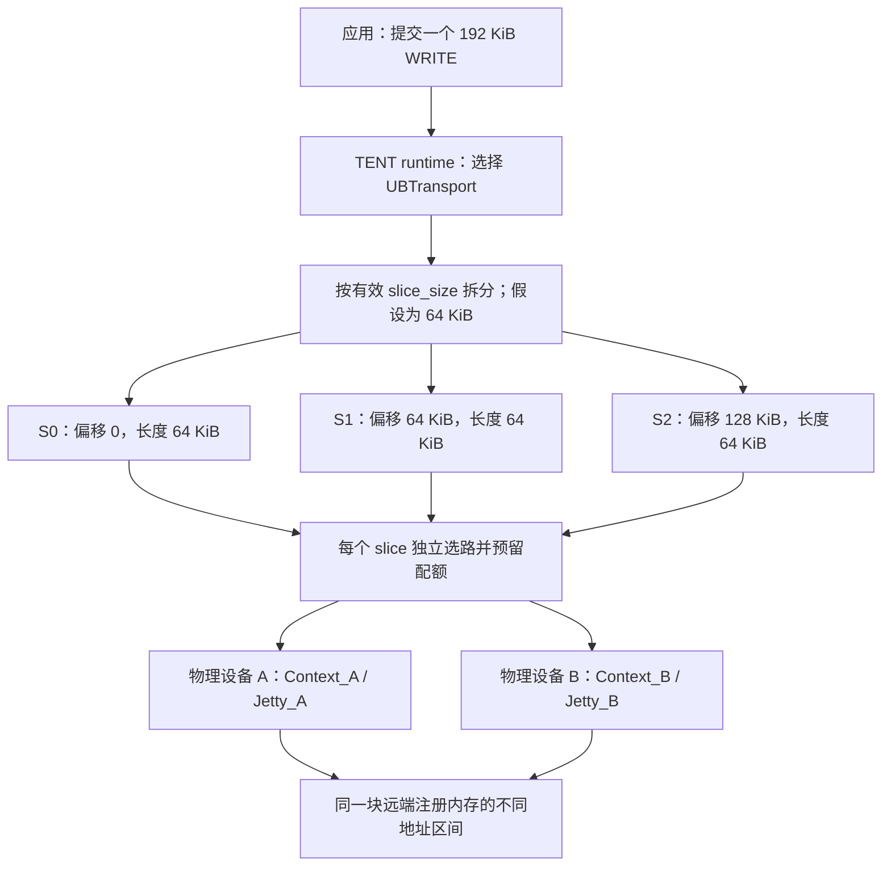
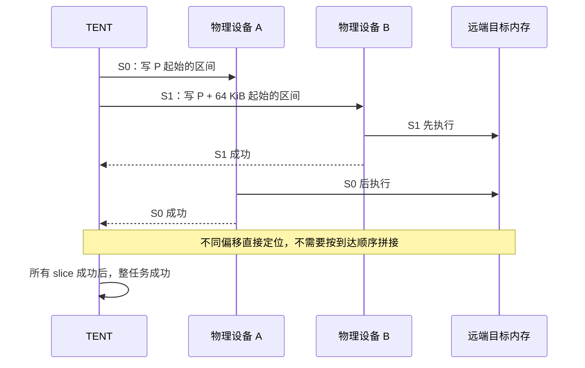
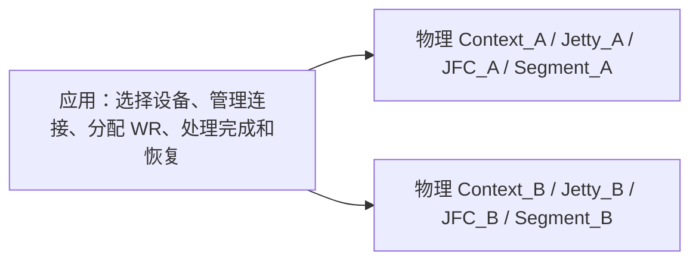
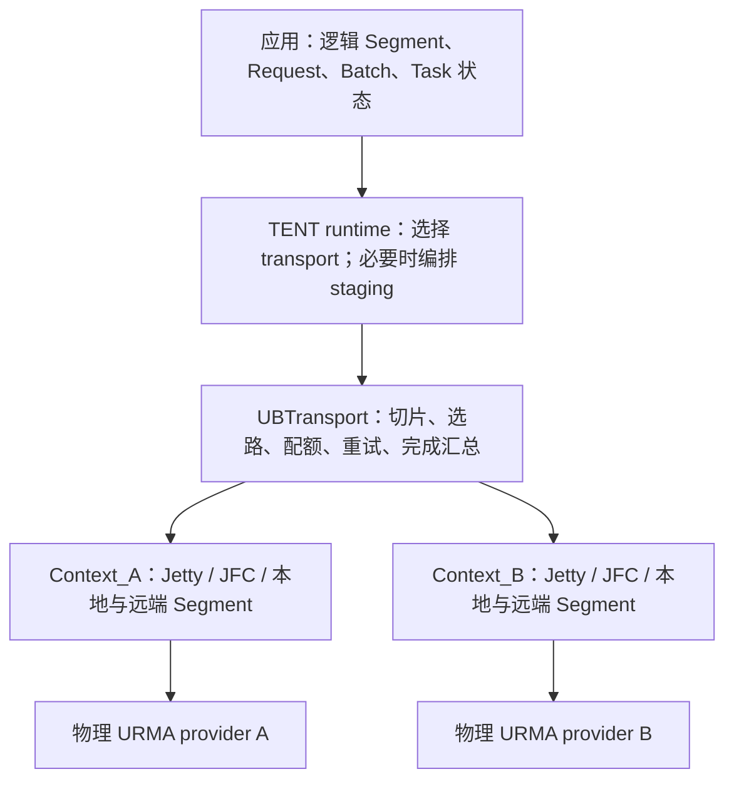
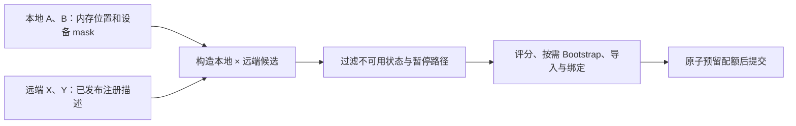
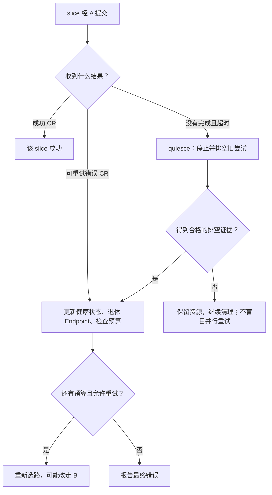
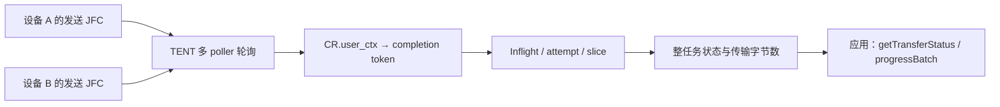
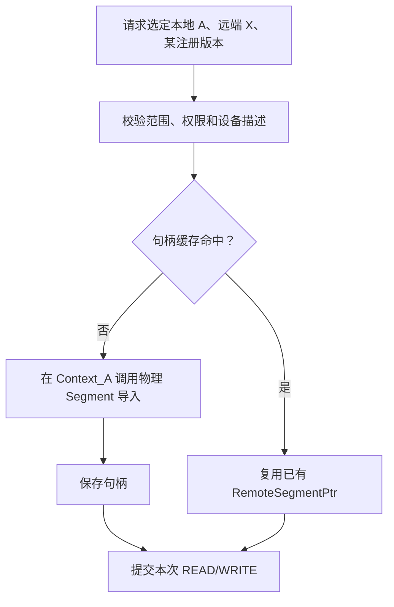
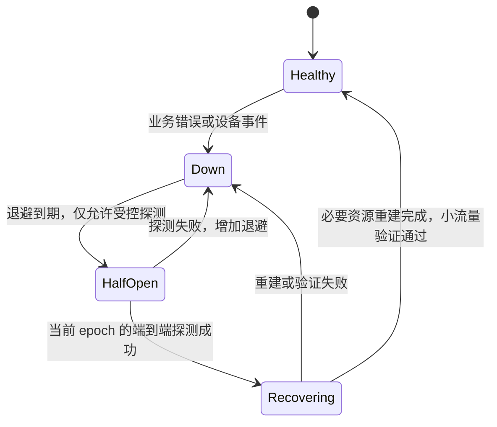

# TENT 直接使用物理 UB 设备：分片、bonding 能力对照与可靠性增强设计

> 更新日期：2026-10-22。
> Supercache 分析快照：`main_learn`，`a1784076bac3f0901af353d062d33ee5c8078cec`。
> 同级 UMDK 分析快照：`09086da5d86c53f83eb395109d636957d3efcc79`。
> 本文以 CPU DRAM 上的普通单边 READ/WRITE 为主，区分当前实现与待实现方案；不代表已经通过真实 UB 性能或故障测试。

节点级故障隔离详见 [UB 节点级故障隔离方案](ub-node-fault-isolation-design.md)：完整相关端口集合的有效 status 4 证据可以直接触发节点 UB 阻断，不要求全部来自 provider 查询；节点准入与本文的路径恢复、排空机制分层处理。

## 1. 先看 TENT 如何把一次读写分给物理 UB 设备

### 1.1 一单运输任务，拆成多个独立包裹

把物理 UB 设备想成运输站点，设备之间可达的路径想成运输通道。应用给 TENT 一单任务，TENT 把它拆成多个 slice，每片再转换成设备执行的 WR。

| 对象 | 通俗理解 | 当前代码中的作用 |
| --- | --- | --- |
| Request / Task | 一单完整运输任务 | 记录本地地址、远端 Segment、远端地址、长度和最终状态 |
| Slice | 任务中的一个包裹 | 有独立地址范围、重试次数和状态 |
| Attempt | 这个包裹的某次投递 | 记录本次路径和尝试编号，隔离迟到完成 |
| WR | 交给设备的一张作业单 | 携带 READ/WRITE、SGE、长度和完成 token |
| Context / Jetty | 某个站点的设备资源与通信端点 | 属于具体本地设备/EID，不能跨设备随意混用 |
| JFC / CR | 完成队列与具体回执 | 告知某次作业成功、超时或报错 |

`WRITE` 将本地 `Request.source` 写到远端 `target_offset`；`READ` 则从远端 `target_offset` 读到本地 `source`。因此 READ 的 `source` 是本地接收地址。本文内存场景中的 `target_offset` 按远端注册地址值理解，不是默认从零开始的数组下标。



这张图表示允许的分流方式，不保证每次均分。TENT 会综合拓扑、配额、在途负载、Endpoint 状态和带宽样本选择路径。

### 1.2 分片大小如何确定

当前 UB 的 `slice_size` 默认是 `64 * 1024` 字节。初始化时，TENT 遍历所选设备，把它收紧到这些设备上报的非零能力限制之内：

```text
有效 slice_size = min(
    配置的 slice_size,
    各设备非零的 max_message_size,
    各设备非零的 max_read_size,
    各设备非零的 max_write_size
)
```

这是当前代码使用的共同上限，同时考虑 READ 和 WRITE；不是按每个 opcode、每条路径单独选择最大长度。设备能力值为零时，这里不据此收紧，不能把零直接解释成实际无限支持。

提交长度为 L 的非空请求时：

```text
片数 = ceil(L / 有效 slice_size)
每片长度 = min(有效 slice_size, 剩余长度)
本地地址 = Request.source + 片内起始偏移
远端地址 = Request.target_offset + 同一偏移
```

例如有效大小为 64 KiB，一次 150 KiB WRITE 拆成 64、64、22 KiB 三片。UB 当前不会套用 RDMA 的小尾片合并算法。片数超过 `max_slices_per_task` 会拒绝提交，默认上限是 65536 片。

源码：[T1] `UbTransport::install()`、`submitTransferTasks()`；[T2] `UbParams`；[T3] `convertCapabilities()`。

### 1.3 slice 大小不等于线上包大小

需要分清三个层次：

| 长度 | 例子 | 由谁决定 |
| --- | --- | --- |
| 应用请求长度 | 一次 WRITE 1 MiB | 应用 |
| Slice / WR 长度 | 每片 64 KiB，或者被能力限制收紧 | TENT 与设备能力 |
| 实际线上报文长度 | 底层分包后的报文 | 协议、provider、设备与链路配置 |

UMDK 的聚合设备说明列出过 CTP 多路径的 `Max Send Pkt Size = 4 KB`、RTP 单路径的 `64 KB`。这是相应设备/版本的规格，不能直接当作所有物理设备的 READ/WRITE 上限，也不能用它直接计算线上包数。当前 TENT 依据查询结果切片，没有写死“CTP 一律 4 KB”。参考 [U8]。

若最终有效 slice 分别是 4 KiB、64 KiB，同一个 1 MiB 请求会产生 256、16 片；这是 TENT 切片数量，不是抓包得到的报文数量。

### 1.4 每一片真正执行了什么

以 WRITE 为例，当前 Worker 的主要流程如下：

1. 从元数据中定位远端缓冲区和各设备的注册描述。
2. 枚举本地设备与远端设备组合，排除不可用 Context、暂停路径和不允许的设备。
3. 对候选排序，按需获取或建立 Endpoint，并原子预留设备/路径配额。
4. 在选中的本地 Context 查找本地注册 Segment，导入或复用该路径的远端 Segment。
5. 生成本次 attempt 和 completion token，持有 Endpoint、Segment 等资源引用。
6. 构造一条普通 URMA READ/WRITE WR，当前 Worker 每次提交一条。
7. 后台 poller 轮询 JFC，根据 token 找到这次投递，释放记账并推进 slice 状态。
8. 全部分片成功，整任务才变成 `COMPLETED`；中间失败可能先进入有界重试。

数据面实际调用 `urma_post_jetty_send_wr()` 和 `urma_poll_jfc()`。建链使用 `urma_import_jetty()`、`urma_bind_jetty()`；内存导入最终使用 `urma_import_seg()`。直接物理设备与 bonding 设备都可沿用这些 URMA API，具体句柄和 provider 行为不同。[T3][T4][T5]

### 1.5 顺序、完整性与重试必须分开理解



不同分片的完成顺序可以不同，当前实现没有建立跨设备的全局顺序屏障。对互不重叠的地址区间，乱序本身不会改变最终内存布局，但还需要满足：源数据在传输及重试期间稳定，目标范围有合适的写入所有权，底层成功完成语义成立。

不能据此承诺：

- 整个大 WRITE 原子生效。某片失败时，之前写入的片不会回滚。
- 接收方随时读取都能看到完整对象。必须等全部成功后，通过正确的可见性与发布协议让读者消费。
- 并行 READ 自动得到一致快照。远端数据并发变化需要上层版本/同步机制。
- 一次超时意味着远端未执行。旧写可能已生效，重试可能再次写入。
- 收到成功 CR 就额外获得了端到端校验。当前路径没有整对象校验和接收方确认协议。

当前 `UbTask::maybeFinalizeLocked()` 等待所有 slice 终结，只有全成功才报告 `COMPLETED`。[T6] 这是一条完成汇总规则，不能替代 provider 的可靠性语义。尤其不能仅凭 `RC` 名称，推断所有 `RC + CTP` 组合都有 RTP 同等的确认、重传能力。

## 2. TENT 与 bonding 分别在哪一层工作

### 2.1 不使用 TENT，直接调用物理 URMA



用户表格中的“应用自行管理”，在接入 TENT 后，大部分变成了“由 UBTransport 替应用管理”。因此不能拿“裸用物理设备缺什么”，直接推导出“TENT 也缺什么”。

### 2.2 TENT 直接管理物理设备



bonding 则在更低的 provider 层，用虚拟 URMA 资源包装多套物理资源。两者可以覆盖相似职责，但不要求暴露相同对象：TENT 可以统一逻辑任务，而不创建一个新的 bonding EID 或虚拟 URMA JFC。

### 2.3 保留原来“四项核心能力”的定位

TENT 是 Transfer Engine NEXT。四项能力与本文主线的关系如下：

| 核心能力 | 实现位置 | 与物理 UB 的关系 |
| --- | --- | --- |
| 按请求选择 transport | `TransportSelector`、`TransferEngineImpl` | 在 UB、RDMA、TCP 等可用候选中选择；不等于同时使用所有 transport |
| 切片与多 rail 调度 | 各 transport 的 Workers、Quota、Slice | 本文重点；UB 有自己的评分与资源管理，不能套用 RDMA 算法 |
| 通过中转缓冲组织 staging | `ProxyManager` | 需要时先组织设备/主机拷贝，再把网络阶段交给后端；不是任意多跳图搜索 |
| 故障处理与恢复 | transport 内部与 runtime 两层 | UB 可重试 slice；后端任务失败后，runtime 在条件与预算内尝试其他候选 |

staging chunk 与 UB slice 也不是同一粒度。前者用于多阶段流水线和缓冲复用，后者用于具体设备上的传输、配额与重试。

本文后续只讨论 UBTransport 能否承担表格中的职责，不将其他后端的主动探测或排序实现算作 UB 已有能力。[T10]

## 3. 十项能力总览：裸物理设备与 TENT 接入后不同

“已有”表示当前代码有相关机制，不表示与 bonding 的所有模式等价，更不代表已完成真实硬件验收。

| 功能 | bonding 实现的部分 | 裸用物理 URMA 时调用方承担 | 接入 TENT 后的判断 |
| --- | --- | --- | --- |
| 统一设备身份 | 一个 bonding EID 隐藏成员 EID 和拓扑 | 选择设备和 EID | 逻辑 Segment/Task 已隐藏应用侧设备选择；无需再造 bonding EID |
| 资源虚拟化 | 虚拟 Context/Jetty/JFC/Segment 展开到物理资源 | 分设备管理句柄与生命周期 | TENT 已管理多套资源；无需复制虚拟句柄层 |
| 拓扑选路 | 聚合 EID 展开成可通信路径 | 明确物理 EID 的可达关系 | 已有候选与选路；精确可达性、profile 和故障域仍需增强 |
| 带宽聚合 | Balance 在成员路径间分配工作 | 自行调度多设备 | 已有逐 slice 分流；不保证均分或达到带宽之和 |
| 主备切换 | 在支持的配置下保存 WR、故障换路重发 | 准备备路并处理重试 | 已有错误分类、分片重试与排空；严格主备策略及重放契约待增强 |
| 健康检查、故障回切 | 周期探测、重建 Jetty、恢复路径 | 自行检测和恢复 | 有被动反馈、冷却与按需重建；主动探测和完整回切需要补齐 |
| 软件 RNR 重试 | 硬件 RNR 耗尽后软件再提交 | 硬件处理后自行决策 | 耗尽错误已有通用重试；专用退避与流控尚缺 |
| 完成和事件聚合 | 汇集 JFC/JFCE、恢复虚拟身份和 user_ctx | 分别处理完成与事件 | 完成汇总已有；JFCE 事件等待尚未完整接入 |
| MSN 去重 | 对支持 MSN 的接收消息过滤重复完成 | 自行定义消息身份与去重 | 普通 READ/WRITE 不适用；未来 SEND/通知需要等价机制 |
| Segment 导入缓存 | 缓存聚合 Segment 的物理展开描述 | 保留或缓存物理导入句柄 | 已有按设备与 generation 区分的句柄缓存 |

注意：这是 bonding 能力类别的对照，不是当前 TENT 使用 bonding 时的默认行为清单。当前 Adapter 对 bonding Context 设置 `STANDALONE + IODIE`，不能把假设的 Balance/Active-Backup 能力直接算作本项目默认基线。[T3] bonding 的健康检查、回切、软件 RNR、MSN 还受版本、资源类型和开关约束。[U1][U3][U4]

## 4. 逐项解释实现原理与边界

### 4.1 统一设备身份：应用认识目标，不必认识每个窗口

bonding 给调用方一个聚合 EID；TENT 给应用的是逻辑 Segment、地址范围和任务 ID。应用提交同一个请求时，具体由哪个本地设备访问哪个远端设备，可在 UBTransport 内选择。

当前发现逻辑枚举设备 EID；不同 EID 可以形成不同拓扑 NIC，并按设备及 EID index 创建原生 Context。EID 描述进入元数据与 Bootstrap，而不要求应用每次读写自己挑选。[T3][T9]

**为何无需复制：** 统一应用入口已经存在，没必要仅为隐藏物理 EID 再发明一个虚拟 EID。

**仍需增强：** 同一物理设备的两个 EID 不等于两个独立设备；device/EID index 也不能替代跨重启稳定身份。故障域、实例 epoch、双端可达性需要显式表达，见第 7 节。

### 4.2 资源虚拟化：TENT 已经是资源管理员

TENT 为所选设备/EID 管理 `UbContext`、`UbJfc`，通过 `EndpointStore` 持有 Jetty 连接，通过 `UbBufferManager` 管理注册与导入资源。一个应用缓冲区可在多个 Context 注册，得到不同原生句柄。[T5][T7][T8]

选路后，TENT 使用该 Context 对应的 Jetty 和 Segment；Adapter 在提交前校验它们属于同一 Context。不能把 A 的 Segment 句柄直接交给 B 的 Jetty。

提交前保留 Segment 引用，完成/排空后再释放；清理失败的对象进入保留或隔离状态，避免仍在 DMA 时销毁。

**为何无需复制：** 需要的多资源所有权与生命周期已经存在；TENT 无需同时维护一套仅用于模拟 URMA ABI 的虚拟句柄。

**仍需增强：** 致命设备故障后，重新创建 Context/JFC、重新注册内存、发布新 generation 的完整流程还没有闭环。不能把按需重建 Jetty 当成整个设备已重建。

### 4.3 拓扑选路：会挑路线，但不能把候选当成已证明可达

当前 `orderedLocalDevices()` 根据内存位置、设备 mask、Context 活跃状态和拓扑优先级生成本地候选；远端候选来自目标缓冲区已发布的设备注册描述。

`chooseAndResolveEndpoint()` 枚举本地与远端组合，排除暂停 rail，进行预评分，再按需解析 Endpoint。解析顺序优先覆盖不同本地设备，避免所有候选都集中在同一设备。[T4]



建链通过控制面交换 EID、Jetty ID、UASID 和代际信息。控制面的 RPC 可达，不等于实际 UB 数据路径可达。

**为何无需复制：** 已经有多设备候选和选路执行器，不需要再做一次“bonding EID 展开”。

**仍需增强：** 活跃端口、NUMA 接近或存在元数据，都不证明某对物理 EID 可通信。当前缺少完整的 peer-specific 可达矩阵和双端 `trans_mode / tp_type / priority / ordering` 协商。Adapter 当前创建 RC，导入描述指定 CTP；不能仅改一个枚举就假设支持任意 RTP/CTP 组合。[T3]

### 4.4 带宽聚合：TENT 可以替应用把包裹分给 A、B

假设两条独立路径都可用，各有 100 GB/s 能力。应用直接把所有 WR 发给 A，B 不会自动帮忙；接入 TENT 后，每个 slice 都会经过选路，因此可并行使用 A、B。

当前评分是按以下顺序逐项比较，不是简单轮询，也不是按峰值带宽固定五五分：

```text
配额是否可用 → 拓扑优先级 → 归一化在途压力
    → Endpoint 未完成 WR/字节数 → 带宽样本 → 确定性排序
```

源码：[T4] `betterUbPathScore()`、`chooseAndResolveEndpoint()`；[T11] `QuotaManager`。

**为何无需复制：** 逐 slice 的调度与负载反馈已经承担多设备分流职责；一个大应用 WRITE 拆开后，也可以利用多设备。

**边界：** 拓扑优先级先于负载。A 更近且仍有配额时，B 可能长期不被优先选择。并发不足、内存带宽瓶颈、对端瓶颈、路径共享物理资源都会限制总带宽；不能据此承诺 200 GB/s。

若目标是优先追求总吞吐，可以增加可选的预计完成时间策略，而不是默认改变当前拓扑优先行为。

### 4.5 主备切换：从“应用自己重试”变成“TENT 内部重试”

当前成功、超时、本地设备、远端路径、Endpoint、内存和未知错误分别分类。Worker 对部分错误安排重试；slice 默认最多额外重试 8 次。[T2][T3][T4][T6]



`scanTimeouts()` 对没有完成的旧 WR 先做排空。成功后才回收残留 token、释放配额并推进重试；失败则保留资源，继续尝试。当前单条 WR 已接受时，即使 post 同时返回错误，也按已提交处理，不立即重复提交。[T4]

**为何无需复制：** 应用不必自己保存原生 WR 并重放；TENT 保留逻辑 slice、地址范围和本次资源，必要时构造新的 WR。

**仍需增强：** 这不是明确的主备策略，也不保证每次一定选 B。原始错误分类仍较粗，部分远端权限/不支持操作错误被归为可重试路径错误。排空证明与“远端是否已执行”也是两件事，WRITE 的安全重放契约、永久错误分类及真实 provider 的 fence 语义仍需完善。

### 4.6 健康检查、故障回切：已有冷却重试，没有完整探路闭环

当前 UB 有两种基础恢复：

| 层次 | 当前恢复条件 | 不能推出什么 |
| --- | --- | --- |
| 物理 rail | 错误窗口达到阈值后暂停；冷却到期解除暂停 | 不能证明链路已恢复 |
| 本地 Context | 旧 Endpoint 清理完成、无在途 WR、各 JFC 在故障 epoch 下 poll 成功、冷却到期 | 不能证明到某个远端 EID 可达 |

`RailMonitor::refreshCooldownLocked()` 按时间解除暂停并增加 `recoveries`。这里计数表示重新开放尝试，不是独立探测成功次数。[T12]

JFC 空 poll 也可能正常返回，因此“本地队列能轮询”与“道路能到对端”必须分开。之后再次选择该路径时，失效 Endpoint 可按需重建；没有业务时，未见独立周期数据面探测来确认恢复。[T4][T7][T8]

同级 bonding 的健康检查和故障回切主要围绕 Jetty 组织；不能假定独立 JFS/JFR 也具备同等能力。比较两组方案时，应保持资源模型一致。[U3][U8]

**为何不能说完全无需补齐：** 当前相当于“封路一会儿，再允许试着走”；用户期待的是“派探路车确认通了，再开放业务”。主动探测、Half-Open、设备重建和回切防抖见第 7 节。

### 4.7 软件 RNR 重试：已接入通用重试，缺少专用流控策略

RNR 表示接收端未就绪。以 SEND 为例，接收端未补足接收 WR 时可能触发；不能把普通 READ/WRITE 的所有错误都解释为 RNR。

当前 Jetty 配置会传入 `rnr_retry`，默认字段值为 7。这个编码不能直接写成“重试七次”，应以对应 URMA/provider 定义为准。

如果实际返回 `URMA_CR_RNR_RETRY_CNT_EXC_ERR`，Adapter 会归为 `REMOTE_PATH_ERROR`，Worker 记录路径错误、退休 Endpoint，再通过普通 slice 预算重试。[T3][T4]

**为何无需从零补齐：** 硬件耗尽后软件再提交的入口已经存在，且不依赖开启 bonding 的软件 RNR 开关。

**仍需增强：** 暂时缺接收资源不一定是链路故障；换路也未必解决。当前没有 RNR 独立等待、退避、预算和指标，可能较快消耗重试次数或反复重建。若 provider 要求错误后重建 Jetty，仍须重建，不能一概保留旧实例。未来支持 SEND 时还要设计接收 WR 补充和流控。[U3]

### 4.8 完成和事件聚合：回执汇总已有，通知铃还没完整接上



TENT 将内部 token 写入原生 WR 的 `user_ctx`，CR 返回后查找 Inflight。Slice 检查 attempt 和路径代际，Task 用已结算 slice ID 防止重复计数。[T3][T4][T6]

**为何无需复制：** 应用看到的是逻辑任务，不直接消费物理 CR；无需把物理 Jetty ID 再改成一个虚拟 Jetty ID，也无需另建可供应用 `urma_poll_jfc()` 的虚拟 JFC。

JFC 存放具体回执；JFCE 用于事件唤醒。当前 Adapter 有创建 JFCE 和返回 FD 的基础代码，但 `enable_completion_events` 默认为 false，Workers 没有完整的 wait/rearm/ack 事件处理流程，主要轮询 JFC，空闲时短暂休眠。

**仍需增强：** 若要求低空闲 CPU 的事件模式，需要补齐多 JFCE 等待与丢唤醒竞态处理。TENT 的 `sendNotification()/receiveNotification()` 是业务通知，不等于 JFCE 完成事件；不能把两者混用。

### 4.9 MSN 去重：当前普通读写不适用，未来消息交付才需要

bonding 的相关实现会为支持的 SEND 类操作及 WRITE_IMM 等编码消息序号，接收侧用滑动窗口识别重复，并处理被重复消息消耗的接收资源。普通 READ/WRITE、CAS、FADD 不使用这套 MSN 编码。[U4]

当前 TENT UB 数据面只生成普通 `URMA_OPC_READ`、`URMA_OPC_WRITE`；`enable_notifications=true` 会返回未实现。没有 SEND 接收交付过程，因此没有必要为了当前范围照搬 MSN。[T1][T3]

| 相似名称 | 当前是否有 | 实际保护对象 |
| --- | --- | --- |
| 完成去重 | 有 | 发送端状态不重复结算 |
| 消息交付去重 | 当前无对应 SEND 路径 | 同一消息不重复向接收应用交付 |
| 远端副作用去重 | 没有通用机制 | 防止重复 WRITE、原子或业务执行 |

**为何当前无需补齐：** 不属于本次普通单边读写语义，增加一个 MSN 计数器不能阻止远端重复写。

**条件性补齐：** 未来加入可重试 SEND/通知时，需要跨 attempt 不变的消息 ID、发送方会话代次、去重窗口和重复确认；保证“只交付一次”仍不等于业务恰好执行一次。

### 4.10 Segment 导入缓存：TENT 复用的是已导入句柄

`UbBufferMetadata` 保存同一缓冲区在不同远端设备上的描述。`importRemote()` 校验范围、权限和元数据，然后在选中的本地 Context 中导入相应远端 Segment。[T5]

缓存键为：

```text
local_topology_id + remote_segment_id + remote_topology_id
    + buffer_base + generation
```



与前面描述的 bonding 信息缓存不同，TENT 命中时不再调用 `adapter_->importRemoteSegment()`。同级 UMDK 的 `bondp_import_seg()` 即使命中物理展开信息缓存，后面仍会调用 `bondp_import_pseg()`。[U5]

**为何无需复制：** 多设备注册描述与按路径句柄复用均已有；缓存的不是远端数据，READ 仍然经过设备读取。

**仍需增强：** 新 generation 只有在元数据刷新后才能被看到；旧版本会尝试清理，但在途引用或释放失败会延后。当前缓存未见容量/TTL 策略，大量短生命周期远端缓冲区需要考虑容量与撤销通知。设备重建也必须使关联注册和导入失效。

## 5. 当前部署时要先确认的配置与契约

### 5.1 显式选择物理设备，避免实际仍选了 bonding

当 `device_filter` 为空且发现 bonding 设备时，TENT 默认优先选择 bonding。验证物理设备方案应显式过滤；原生设备名可能选中该设备多个 EID，需要精确选择时使用发现日志中的完整拓扑名。[T1][T2][T9]

下面是配置结构示例，两个 `PHYSICAL_*` 字符串是占位符，必须替换成实际发现的物理设备/拓扑名：

```json
{
  "transports": {
    "ub": {
      "enable": true,
      "device_filter": ["PHYSICAL_A_TOPOLOGY_NAME", "PHYSICAL_B_TOPOLOGY_NAME"],
      "slice_size": 65536,
      "max_retries": 8,
      "slice_timeout_ms": 5000,
      "endpoint_cooldown_ms": 1000
    }
  }
}
```

还需保证构建包含真实 URMA 支持、拓扑列出了相应设备、任务 device mask 允许使用、两端注册与通信参数匹配。仅设置过滤器不等于完成可达性验证，也不能保证两个 EID 对应独立故障域。

### 5.2 当前普通读写应明确的使用约定

- 等整个任务完成，不把 `submit` 成功当成数据已就绪。
- 保持缓冲区有效，WRITE 源数据在在途与重试期间不变化；按约定管理 READ 的远端数据稳定性。
- 对目的范围建立写入所有权，避免超时重放覆盖另一笔新数据。
- 使用任务完成后的同步/版本发布，让接收方只消费完整对象；跨设备写一个标志不天然就是全局屏障。
- 永久故障允许安全失败；资源无法排空时，不以强制释放换取表面上的快速返回。
- 不把普通读写推广为原子操作、GPU 内存或 exactly-once 业务执行的保证。

这些约定不应仅要求物理设备方案遵守；与 bonding 对照时，两组应采用相同业务契约和实际传输模式。

## 6. 源码索引与现有验证入口

以下 T 编号链接均相对本文所在目录，函数名用于在代码变动后继续定位。

| 编号 | 源码 | 重点入口 |
| --- | --- | --- |
| T1 | [ub_transport.cpp](../../mooncake-transfer-engine/tent/src/transport/ub/ub_transport.cpp) | 初始化、slice 收紧、`submitTransferTasks`、`getTransferStatus`、Bootstrap |
| T2 | [params.h](../../mooncake-transfer-engine/tent/include/tent/transport/ub/params.h) | 实际支持的 UB 配置与默认值 |
| T3 | [urma_adapter.cpp](../../mooncake-transfer-engine/tent/src/transport/ub/urma_adapter.cpp)、[urma_adapter.h](../../mooncake-transfer-engine/tent/include/tent/transport/ub/urma_adapter.h) | 原生资源、RC/CTP、RNR、WR、CR、JFCE、排空 |
| T4 | [workers.cpp](../../mooncake-transfer-engine/tent/src/transport/ub/workers.cpp)、[workers.h](../../mooncake-transfer-engine/tent/include/tent/transport/ub/workers.h) | 选路评分、post、poll、重试与超时 |
| T5 | [buffers.cpp](../../mooncake-transfer-engine/tent/src/transport/ub/buffers.cpp)、[buffers.h](../../mooncake-transfer-engine/tent/include/tent/transport/ub/buffers.h) | 多 Context 注册、导入缓存、generation、延迟释放 |
| T6 | [slice.h](../../mooncake-transfer-engine/tent/include/tent/transport/ub/slice.h) | `resolveAttempt`、attempt 校验、任务完成汇总 |
| T7 | [context.cpp](../../mooncake-transfer-engine/tent/src/transport/ub/context.cpp)、[jfc.cpp](../../mooncake-transfer-engine/tent/src/transport/ub/jfc.cpp) | Context/JFC 生命周期、`recordPollSuccess` |
| T8 | [endpoint.cpp](../../mooncake-transfer-engine/tent/src/transport/ub/endpoint.cpp)、[endpoint_store.cpp](../../mooncake-transfer-engine/tent/src/transport/ub/endpoint_store.cpp) | 创建、绑定、退休、quiesce、隔离 |
| T9 | [device_selection.h](../../mooncake-transfer-engine/tent/include/tent/transport/ub/device_selection.h)、[topology.cpp](../../mooncake-transfer-engine/tent/src/runtime/topology.cpp)、[control_plane.h](../../mooncake-transfer-engine/tent/include/tent/runtime/control_plane.h) | 设备优先、拓扑身份与 UB 握手结构 |
| T10 | [transfer_engine_impl.cpp](../../mooncake-transfer-engine/tent/src/runtime/transfer_engine_impl.cpp)、[transport_selector.cpp](../../mooncake-transfer-engine/tent/src/runtime/transport_selector.cpp)、[proxy_manager.cpp](../../mooncake-transfer-engine/tent/src/runtime/proxy_manager.cpp) | 四项核心能力在 runtime 的编排 |
| T11 | [quota.cpp](../../mooncake-transfer-engine/tent/src/transport/ub/quota.cpp) | 路径/设备配额与幂等释放 |
| T12 | [rail_monitor.cpp](../../mooncake-transfer-engine/tent/src/transport/ub/rail_monitor.cpp) | 被动健康反馈、冷却到期解除暂停 |

UMDK 是独立的同级仓库，以下路径不属于 Supercache，需在开头记录的 UMDK 快照中查找：

| 编号 | UMDK 内路径 | 重点 |
| --- | --- | --- |
| U1 | `src/urma/lib/urma/bond/bondp_datapath_schedule.c` | Balance 等模式的路径分配，不应笼统描述成固定轮询 |
| U2 | `src/urma/lib/urma/bond/bondp_datapath.c` | WR 保留、重试、完成转换与接收去重 |
| U3 | `src/urma/lib/urma/bond/bondp_dp_health.c`、`bondp_dp_failback.c`、`bondp_dp_rnr_retry.c`、`bondp_env.c` | 主动探测、回切、软件 RNR 与默认开关 |
| U4 | `src/urma/lib/urma/bond/bondp_datapath_convert.c`、`bondp_provider_ops.c` | `encode_jfs_wr_msn` 与默认关闭的 MSN |
| U5 | `src/urma/lib/urma/bond/bondp_cp_seg.c` | `bondp_import_seg`、信息缓存与物理导入 |
| U8 | `doc/ch/urma/URMA User Guide.ch.md`、`doc/ch/urma/URMA API Guide.ch.md` | 聚合设备能力、传输类型及 API 约束 |

TENT 按请求选择后端、中转流水线等更广泛的能力，可参考 [TENT 四项核心能力](../../learn/tent-four-core-capabilities.md)。本文聚焦物理 UB 的职责对照与可靠性增强；第 7 节的方案仍属于待实现设计。

现有测试可帮助核对实现，但本次文档更新没有执行这些 C++ 测试或硬件测试：

| 测试文件 | 已有案例方向 |
| --- | --- |
| [ub_core_test.cpp](../../mooncake-transfer-engine/tent/tests/ub_core_test.cpp) | 重复/迟到完成、幂等配额、选路评分、冷却恢复、设备过滤 |
| [ub_teardown_test.cpp](../../mooncake-transfer-engine/tent/tests/ub_teardown_test.cpp) | 旧 generation 清理、失败资源保留、Context 恢复屏障 |
| [ub_native_data_path_test.cpp](../../mooncake-transfer-engine/tent/tests/ub_native_data_path_test.cpp) | 原生接口适配、缺失完成后的 fence、Endpoint 代际与自读写路径 |

Fake provider 能证明状态转换和资源计数，不能替代真实 UDMA 的 DMA 停止、远端可见性、链路失效或吞吐验证。

## 7. 最后需要补齐什么，以及怎样实现

下面均为建议方案，尚未实现。P0 表示将物理设备方案作为可靠生产替代前的安全/进展门槛；P1 表示目标高可用闭环所需；P2 表示按性能或规模需要增强。未来消息能力单独标为条件项。

### 7.1 优先级清单

| 优先级 | 待补齐内容 | 关联上面的功能 | 建议实现位置 |
| --- | --- | --- | --- |
| P0 | 物理身份、EID 对可达性、双端 profile 与严格绑定校验 | 身份、拓扑、主备 | Topology、Bootstrap、Adapter、路径管理 |
| P0 | 明确重放语义、永久错误分类与真实 fence 契约 | 主备、RNR、完整性 | Adapter、Workers、Slice、上层发布协议 |
| P0 | Endpoint 候选租约与小缓存下的有界进展 | 资源、选路、恢复 | EndpointStore、Workers |
| P1 | 主动探测、Half-Open、回切策略与设备重建 | 健康检查、故障回切 | 路径管理、Context、BufferManager |
| P1 | 统一请求期限，覆盖排队、配额、建链和重试 | 主备、RNR、资源等待 | Workers、Slice、runtime |
| P1，出现 RNR 或增加 SEND 时 | RNR 专用分类、退避、预算与接收流控 | 软件 RNR | Adapter、Workers、消息接收层 |
| P2，按吞吐目标启用 | 可选的总吞吐优先调度 | 带宽聚合 | Workers、Quota |
| P2，按 CPU 目标启用 | JFCE 驱动或混合轮询/事件等待 | 完成和事件聚合 | Adapter、Jfc、Workers |
| P2，按规模启用 | 导入缓存容量、撤销通知与淘汰 | Segment 导入缓存 | BufferManager、元数据层 |
| 条件项：未来 SEND/通知 | 消息 ID、会话代次、接收窗口与重复确认 | MSN 等价能力 | 新消息协议；无需复制 bonding 编码格式 |

### 7.2 方案 A：先把“哪条路能走”建模清楚

新增物理路径管理组件，复用现有 Workers/EndpointStore，避免在 Adapter 内再实现一套调度：

```text
PathKey = 本地稳定设备/EID身份 + 对端进程代次/设备/EID身份 + profile
PathSnapshot = PathKey + 拓扑版本 + health epoch + 可用状态
profile = RC/RM + RTP/CTP + ordering + priority/SL 等必要参数
```

1. 控制面发布部署可达关系和故障域；未知可达性只允许受控建链/探测，不能直接等同健康备路。
2. 双端协商兼容 profile；当前固定 RC/CTP 的合法性由具体 provider 验证，不能仅靠端口活跃判断。
3. 提交前复核身份、代次和 profile，防止对端重启或本地资源重建后继续用旧句柄。
4. 处理 `URMA_EEXIST` 时校验实际绑定目标；相同目标才幂等成功，不同目标应拒绝并清理。
5. 路径必须区分共享故障域，两个同设备 EID 不能自动算作独立备路。

### 7.3 方案 B：安全重试与统一期限

不要只返回一个 `retryable=true/false`。建议将决策拆成：

```text
RetryDecision：
  原始 CR / opcode / metadata generation
  远端执行结果：NotExecuted / Completed / Unknown
  旧尝试是否已排空：DMA 安全状态
  是否允许业务重放、是否需刷新元数据、是否需重建 Endpoint
  剩余重试预算、退避时间、整请求截止时间
```

具体步骤：

1. 永久权限、范围和不支持操作错误直接失败；只有有依据的注册过期才刷新元数据。
2. 超时保留 `Unknown` 语义。合格 fence 证明不再 DMA，不自动改成“远端确定未执行”。
3. READ 重试需满足远端数据稳定性；WRITE 重试需满足稳定源数据与目的范围所有权。无法满足时，使用新版本缓冲区写完再发布，或报告未知结果。
4. 保留现有排空与隔离机制，并在真实 provider 上验证错误 CR、flush-done、RESET 等边界。
5. 将请求期限带到排队、配额等待、Endpoint 解析、导入与 RNR 退避。到期先停止新尝试，再排空；不能为了到期返回而提前释放仍在 DMA 的内存。
6. runtime 跨 transport 恢复也要继承重放决策与总期限。当前主要针对 `FAILED` 的恢复，不能假定任意 `TIMEOUT` 都自动切后端。

为解决小 Endpoint 缓存下候选可能被后续候选构造淘汰的问题，建议让解析结果返回短期候选租约：选路结束前保护实例；提交时原子转成 outstanding；失败释放租约。候选数要感知容量，不能让 `max_endpoints=1` 反复退役刚选中的对象。

### 7.4 方案 C：从“冷却放行”升级为“探测确认后回切”



这是建议新增的 UB 状态机，不是当前 `RailMonitor` 的已有状态机。

实现要点：

- 为指定 EID 对准备独立的小型探测资源。可选用读取远端只读探测区并检查期望值，具体需验证 provider 语义；不能写业务内存探路。
- 探测绑定 peer incarnation、profile、health epoch，旧探测结果不能恢复新故障实例。
- 单个路径限制并发探测数，失败指数退避并加抖动；没有业务时也能执行，但全局探测开销有上限。
- 区分完成事件 JFCE 与设备异步故障事件；后者用于尽早发现设备/端口异常，不能靠 JFCE 代替。
- Jetty 级故障按需重建 Endpoint；设备级故障由恢复协调器排空旧资源，重开 Context/JFC、重新注册内存、使旧导入失效，再原子发布新代际元数据。
- 主备策略配置主路径和 hold-down，避免刚恢复又反复切换；均衡策略让恢复路径逐步增加流量，不强制所有请求切回 A。
- 原有 `recoveries` 与新探测成功、设备重建成功指标分开，避免把冷却到期误报为修复成功。

### 7.5 方案 D：按场景补 RNR、事件、调度与缓存

**RNR：** 保留原始错误码，新增独立类别和延时队列，配置重试间隔、退避与预算。暂时缺接收资源不直接惩罚整条物理路径；是否重建 Jetty 仍遵守 provider 错误状态要求。未来 SEND 必须持续补充接收 WR，并采用接收额度等流控。

**完成事件：** 增加经过验证的事件等待模式，统一等待各 JFCE FD 与软件停止/超时唤醒源。按 URMA 约定实现 poll、通知使能、复查、wait、消费/确认事件的闭环；队列非空时继续排空，避免丢唤醒。保留高负载轮询模式，不用事件模式替代完成状态检查。

**带宽：** 在保持当前拓扑优先默认策略的前提下，增加可选评分，例如以 `(在途字节 + 本片字节) / 估计带宽` 加拓扑成本估计完成时间；带宽估计要处理冷启动、并发与过期样本，不能把一次 WR 的字节/延迟直接当成稳定链路峰值。

**Segment 缓存：** 增加容量和空闲淘汰，按 peer 退出、buffer 撤销、generation/device epoch 变化失效。只能淘汰无在途使用的对象；释放失败进入有上限、可观测的延迟清理，不能丢句柄。

### 7.6 方案 E：未来消息去重及验收顺序

若增加 SEND/通知，使用跨重试不变的逻辑消息 ID，加发送方会话代次限定作用域；接收端维护有界去重窗口，对重复消息返回确认但不重复交付，正确补回接收资源。窗口还要处理乱序、回绕、进程重启和超出保留范围的迟到消息。

若要求跨接收进程重启也只交付一次，去重状态必须持久化或由上层事务协议承接；单机内存滑动窗口不具备这一保证。原子或业务副作用同样不能靠完成层 MSN 解决。

建议依次验收：

| 阶段 | 关键案例 | 通过标准 |
| --- | --- | --- |
| 确定性资源测试 | 重复/迟到 CR、部分 post、fence 失败、取消、缓存释放失败 | 不重复终结/释放，不提前放开内存使用权 |
| 路径与进展测试 | 跨 plane 错配、同设备多 EID、对端重启、小 Endpoint 缓存、配额满 | 严格过滤不可用候选，期限覆盖所有等待路径 |
| 恢复与语义测试 | A 失效转 B、A 恢复、旧 epoch 探测、重复 WRITE、RNR 耗尽 | 有证据再恢复，未知结果不伪装未执行，遵守业务重放契约 |
| 真实硬件对照 | 相同 profile、独立故障域、业务约定下比较 bonding 与物理 TENT | 检查数据正确性、内存安全、检测/切换/回切时间、吞吐与尾延迟 |

物理 UB 方案可以复用 TENT 已有的大部分管理和调度框架；需要补齐的是路径证明、恢复闭环和明确的安全契约，而不是重新实现全部 bonding provider。
