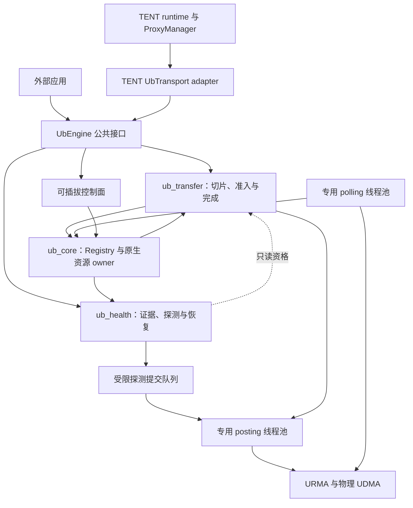
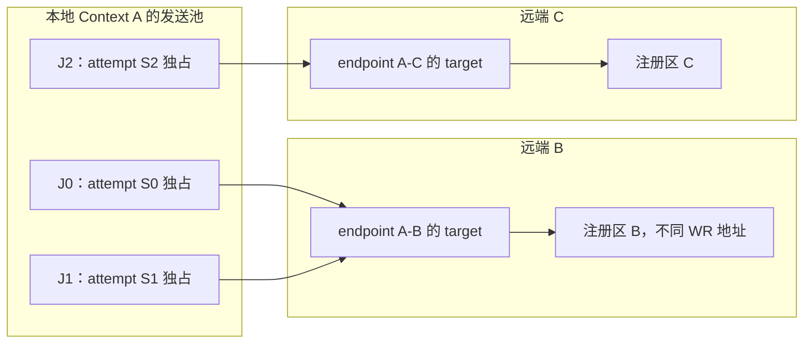
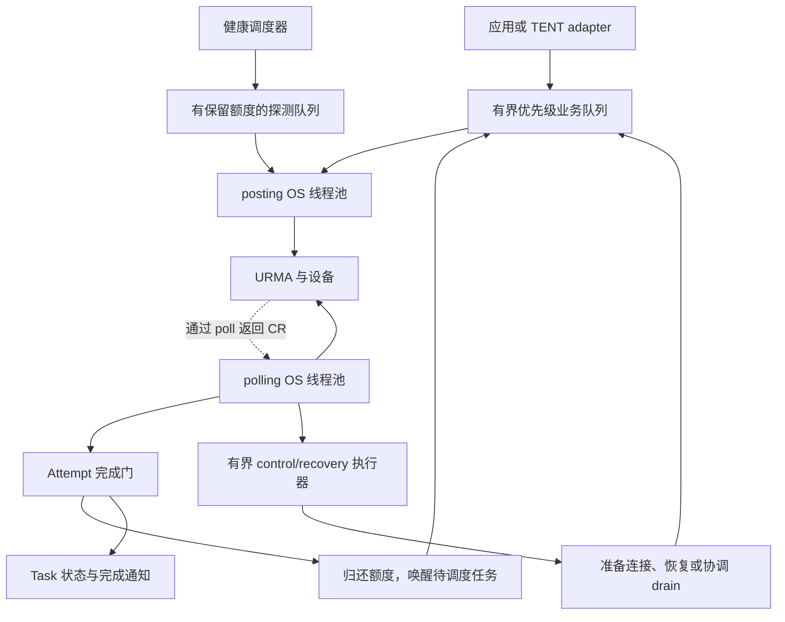
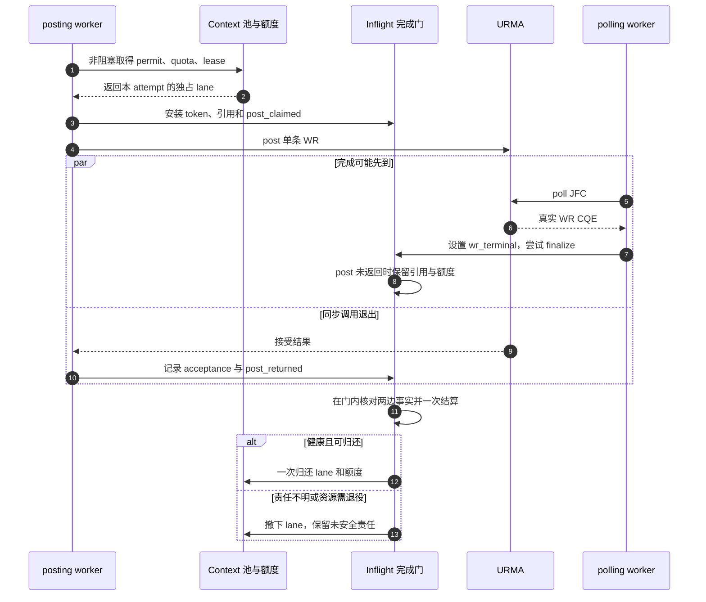
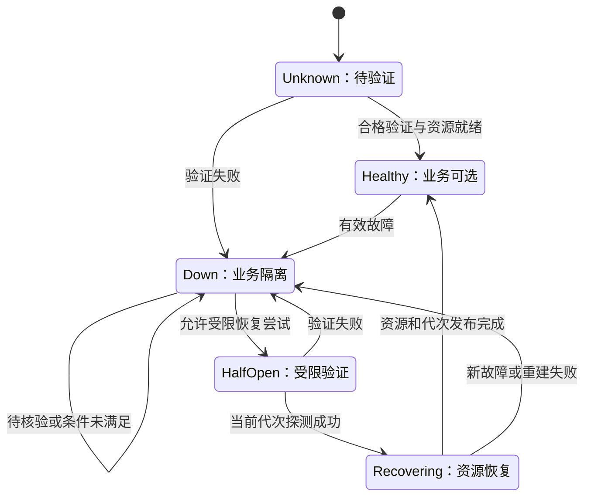
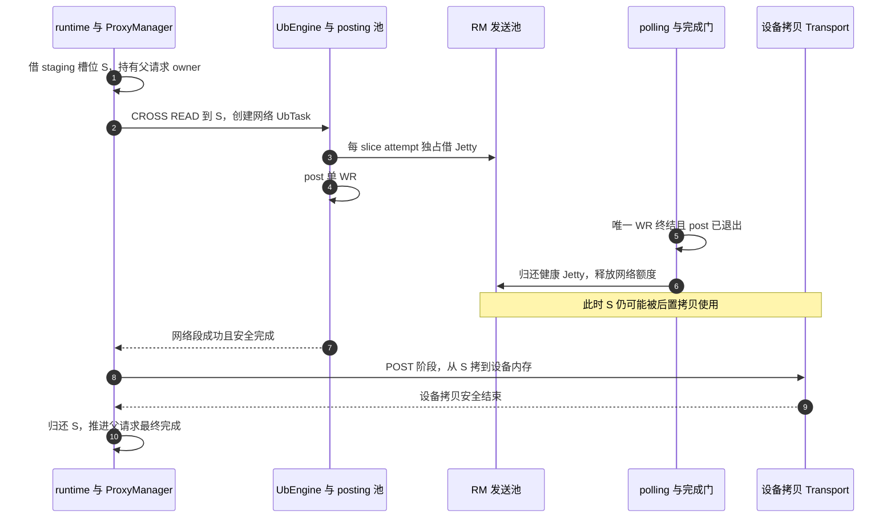
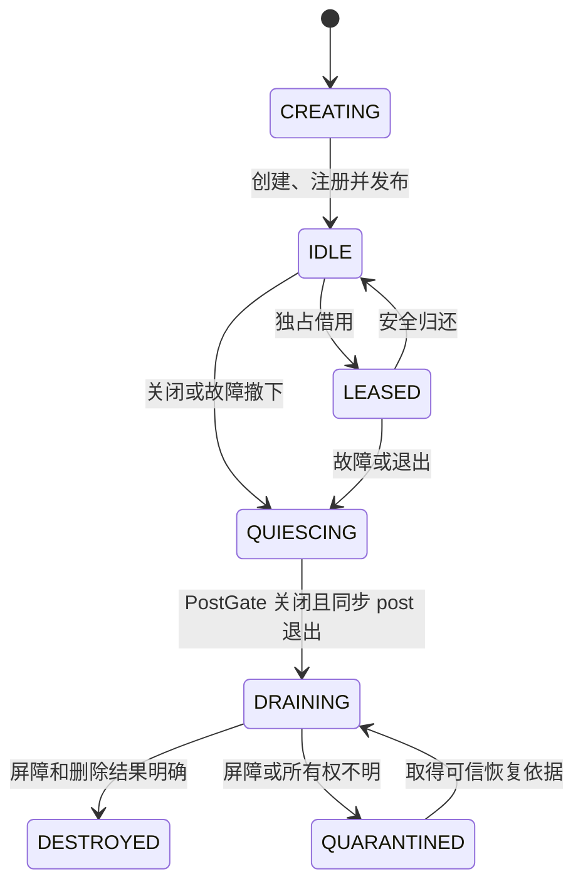
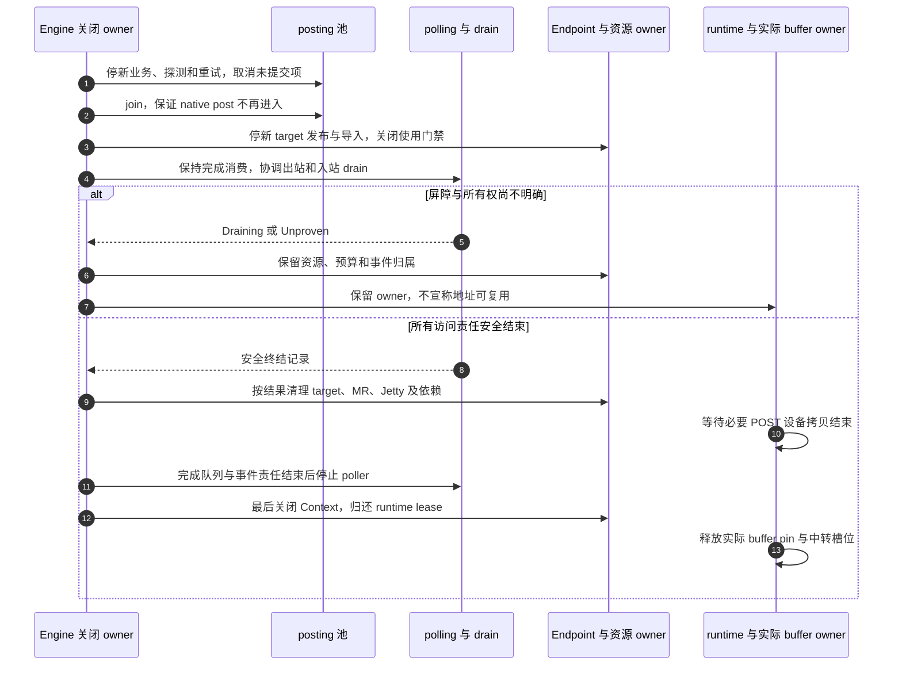

# TENT 物理 UB RM 通信组件一体化设计

> 日期：2026-10-29。
>
> 代码分析基线：Supercache `main_learn`，`1e17d44c08dc32e31d85350160789c91ac983f19`。
>
> 状态：完整设计提案，尚未实现、构建或完成物理 UB RM 实机验收。图中的新增模块、API 与能力均不代表当前已存在。
>
> 范围：仅面向 TENT；非 bonding 物理 UB、URMA RM、CPU DRAM 网络 READ/WRITE。TENT runtime staging 可以在其已支持的设备组合上调用该网络段，不扩展为 UB 原生访问设备内存。
>
> 本文统一组件化、Jetty 池化、线程、完成、健康与回收契约。与历史分项文档冲突时，以本文的目标设计为准；历史文档中的当前代码事实仍按各自基线理解。

## 1. 已确认决定与非目标

| 事项 | 最终决定 |
| --- | --- |
| 项目接入 | 仅 TENT，不补充或实现 Classic 映射 |
| 组件形态 | 独立 UbEngine；TENT UbTransport 是适配层，共用一套数据面 |
| 首版执行模式 | 专用 posting 和 polling OS 线程池；不提供 Manual progress 或调用者直接 native post |
| 路由粒度 | 每个 slice attempt 独立选择本地 Context＋远端设备，获取对应 endpoint |
| WR 粒度 | 每 slice 描述一个逻辑 READ/WRITE；每 attempt 最多一次 native post，输入严格一条 WR |
| 重试 | 创建新 attempt；不向旧 attempt 追加 WR，不与未排空旧 DMA 重叠 |
| 池边界 | 物理设备＋EID＋本地 Context incarnation |
| 发送 lease | 一个 attempt 独占一个发送 Jetty；正常归还后允许顺序服务其他 endpoint |
| target | 每个 endpoint 管理自己的本地目标和导入远端 target；不使用 Context 全局共享 target |
| 同 target 并发 | 同 endpoint 多个 attempt 可使用不同发送 Jetty 访问同 target，必须先通过 provider 验证 |
| 单请求限额 | K 约束每个网络 UbTask 在所有 Context 上的准入 attempt 合计 |
| Group / window / producer Seal | 不引入；由 one-WR 和一次提交认领证明没有后续生产者 |
| staging | 复用 ProxyManager；Jetty、staging 槽位和应用 buffer 分层释放 |
| RC | 不设计 RC 池化；独立组件默认 RM_ONLY，TENT legacy RC 只保留显式兼容路径 |
| 健康 | 路径主动探测＋端口事实；准确 status 4 可作为端口 BAD，节点全故障判断遵循完整清单 |
| 生效门槛 | 阶段零、所有权与真实 provider 的 RM/fence/target 契约通过后才能 enforce |

不包含 SEND/RECV、atomic、原生远端通知、RC 跨 peer 重绑、动态扩池、节点放置权重和跨 peer 全局公平框架。物理 Jetty 数量不是物理链路数量，池化不承诺必然提高吞吐。

关联分项：

- [组件化原始设计](ub-transport-component-design.md)。
- [RM Jetty 池分项设计](tent-ub-rm-jetty-pool-design.md)。
- [线程使用分析](ub-threading-model-analysis.md)。
- [物理 UB 可靠性](tent-physical-ub-reliability-design.md)。
- [端口和节点隔离](ub-node-fault-isolation-design.md)。

## 2. 当前基础与目标差异

| 当前 TENT 代码事实 | 本文新增或调整 |
| --- | --- |
| UbTransport 依赖 ControlService、Topology、Config | 提取独立类型和控制面接口，adapter 完成转换 |
| Workers 依赖 SegmentManager，逐 slice 选路径 | 改用 Region/Peer Registry，保留路由粒度 |
| Endpoint 拥有 RC Jetty 数组，按 worker_index 取模 | Context 拥有 RM 发送池，worker 编号不再决定 lane |
| RealJetty 本地资源和固定 remote 体现 RC bind 模型 | 独立发送资源与 imported target，逐 WR 指定 tjetty |
| 当前 Worker 每次 post 一条 WR | 将其提升为不可放宽的 attempt 契约 |
| posting/polling 两组 std::thread 已存在 | 保留线程分工；补控制、健康与回收边界 |
| token、attempt、Inflight、quota 已存在 | 复用完成系统，加入 lease、permit 与 owner pin |
| JFC poll/冷却及超时 quiesce 已存在 | 增加真实主动探测、事件归属和物理设备恢复 |
| ProxyManager 有 staging 池和延迟清理 | 接入 RM 的安全终结，不重做 H2D/中转池 |
| freeBatch 已有 free_requested 与延迟回收 | 明确回收请求、物理安全及实际 buffer 所有权的区别 |

当前代码仍固定 RC，本次不是通过调整 jetty_per_endpoint 就能启用 RM。所有“支持 RM”的表述均指待实现、待验证的目标。

## 3. 组件边界与依赖

### 3.1 组件拆分

| 组件 | 职责 |
| --- | --- |
| ub_core | 类型、URMA runtime lease、Device/Region/Endpoint Registry、原生资源 owner、完成分发 |
| ub_transfer | Task/Slice/Attempt、路径选择、Task K、quota、lease、期限与重试 |
| ub_health | 端口证据、路径探测、Half-Open、恢复请求与只读资格快照 |
| ub_engine | 公共 API、线程和各组件装配、生命周期 |
| ub_control，可选实现 | BootstrapChannel、健康查询、描述发布/撤销；可复用应用 RPC |
| tent_ub_adapter | TENT 请求、Segment、Topology、状态、owner 和控制面转换 |
| TENT runtime | staging、批次推进、跨 Transport 策略与延迟回收 |
| 应用 / Store | 实际内存所有权、对象发布、读副本与新写放置策略 |

ub_transfer 通过核心定义的窄接口读取健康资格，不链接健康实现；ub_health 通过 posting 队列提交探测，不反向链接 ub_transfer 的业务调度。两个模块由 Engine 注入与装配，避免循环依赖。

核心公共头文件不包含 `tent/runtime/*`。Status、日志和序列化可迁移到轻量公共层或适配转换，不为一个类型强制引入完整 TENT。

### 3.2 图一：整体架构



图为运行关系。所有 `urma_post_jetty_send_wr` 由 posting 池执行，包括探测。同步 read/write API 的含义是入队后等待，不是让应用线程直接调用 native post。

## 4. 阶段零：物理 RM 启用门槛

### 4.1 必须完成的清单

1. 物理模式显式选择设备/EID，拒绝误选 bonding。
2. 真实物理-only 构建不强制包含 `urma_ubagg.h`；BONDP 能力移到可选 backend。
3. RM 使用标准 `urma_jfs_wr_t`，不要求 BONDP WR 扩展。
4. 按实际 EID 值和 index 重新核验 Context，不把列表第一项当成任意部署的有效选择。
5. 注册完整请求区间，校验返回的实际范围；超能力时显式失败或按可描述的 MR 分段，不静默截短。
6. provider 支持 RM READ/WRITE、target import、逐 WR tjetty，以及同发送 Jetty 顺序访问不同 endpoint。
7. provider 支持本方案需要的 target 并发和可证明的入站/出站清理契约。
8. 完成 post 接受、真实 WR CQE、实体 marker、AE、delete 所有权和 native ID 重用的语义核验。
9. profile、UASID、注册 ABI、权限、传输与排序配置经过双端校验。
10. 物理健康事实能力可检测；缺少可靠事实时不启用依赖它的节点硬隔离。

其中 EID 重新匹配、标准 WR 和注册传参已有 TENT 基础；仍需检查目标 provider。不要把 Classic 的首项 EID 或显式截短问题当作 TENT 已存在同样实现。

### 4.2 能力矩阵

| 能力 | 不满足时 |
| --- | --- |
| RM 单边操作及 target 模型 | 不启用 RM 池 |
| 完整注册或显式可验证分段 | 拒绝相应范围请求 |
| 可信 WR 终结/出站 fence | 保留可能接受责任，禁止不安全归还 |
| target 入站 drain | 禁止宣称 target/MR 已可安全回收；正式启用前补齐 |
| 可靠端口归属/事实 | 路径级保护仍可工作，相关节点事实 enforce 关闭 |
| ABI/身份/模式协商 | 首个 WR 前失败，不静默降级 |

mock 只能验证软件状态机，不能证明物理 DMA fence、target 入站排空或硬件资源上限。

## 5. 对象、身份与资源所有权

### 5.1 角色

| 对象 | 持有与责任 |
| --- | --- |
| UbContextResource | Context incarnation、EID/UASID、JFC/JFR、发送池及物理预算 |
| RmJettyResource | 一个发送 Jetty 的唯一 native owner、PostGate、registry、退役责任 |
| SendJettyPool | 空闲成员索引和非阻塞借还，不持池锁做 provider/RPC |
| SliceJettyLease | 某 attempt 对某 lane generation 的独占使用权 |
| UbEndpoint | 当前路径/peer 的本地 target、remote imported target、target epoch |
| RegionRegistry | 注册/导入、范围/权限/ABI、generation 与撤销 |
| Inflight | token、attempt、lease、target/MR 引用、permit、quota、实际 buffer pin |
| TaskAttemptLimiter | 一个网络 UbTask 跨 Context 的 K 计数 |
| TransferLifetimeOwner | Task/batch 与实际内存 pin 的安全回收记录 |
| RecoveryRegistry | 退役、quarantine、tombstone、迟到事件与后台清理 |

### 5.2 身份

```text
ContextKey = stable_device + EID + context_incarnation
EndpointKey = local ContextKey + peer_incarnation + remote EID + profile
TargetKey = EndpointKey + target_epoch + native EID/UASID/Jetty ID
LaneKey = ContextKey + native Jetty ID + lane_generation
AttemptKey = task_id + slice_id + attempt_generation
CompletionToken = 进程内单调唯一 token，关联 AttemptKey
```

eid_index 不是端口号，native Jetty ID 不是全局唯一身份。primary EID 可能覆盖多个端口；同一 EID 的不同 Context 不混池。

所有旧代次在途引用保留到责任收敛，新代次不会清零旧配额。软件 generation 只帮助有相应上下文的事件归属，不能凭空区分缺少代次信息的 native 迟到事件。

## 6. 路由、发送池和 endpoint target

### 6.1 逐 slice 路由保持不变

```text
slice attempt
→ 本地 Context ＋ 远端设备候选
→ 路径健康、拓扑、quota 和负载评分
→ 对应 endpoint / remote target
→ 从选中 Context 借一个发送 Jetty
→ 本次 WR 指定该 target 和 Region 地址
```

不同 slice、重试可以落到不同 Context/endpoint，不为整个 Task 固定 EID。选中 Context 确定其创建使用的 EID，但不一定唯一确定出口物理端口。

### 6.2 图二：发送池与 target 解耦



同一时刻 J0/J1 不出租给其他 attempt；同一个 target 可以同时承接来自它们的 WR。这不是“每 slice 一个远端 Jetty”，也不是全 Context 的单一共享 target。

发送 Jetty 归还后，可以在新的 attempt 中顺序访问另一个 endpoint。首版不让多个在途 attempt 同时占据同一个发送 Jetty，即使其 SQ 深度大于 1。

### 6.3 target 及 JFR/JFC 归属

每个本地 endpoint 创建一个目标 Jetty，其 native 归属、JFR/JFC 关联和资源数量由受验证的 TargetResourceProfile 描述。首版不依靠未验证的跨 endpoint 接收资源共享；可选共享须单独能力开关和验收。

RM target 必须验证多个本地发送 lane 对同 endpoint 的并发访问。单 target 故障至少影响该 endpoint 的全部相关访问；共享 Context/JFC/JFR 故障可能扩大影响范围，不能只按一条发送 lease 处理。

目标数随 endpoint/path 数增长，因此 endpoint cache 大小、target 上限及 native 预算均需限制。缓存淘汰只撤销可发现性，不能删除仍被 Inflight 或入站访问使用的资源。

## 7. 模式协商与 Region 协议

### 7.1 RM 与 legacy RC

独立 Engine 默认 RM_ONLY。RM 不支持时直接返回不支持，不自动切到 RC。

TENT adapter 可显式选择已验证的 legacy RC 策略，但仅允许在逻辑请求没有任何已接受或可能接受 WR 时选择，使用独立 RC 资源和握手。RC 不进入本 RM 池，不做跨 peer 重绑；一次请求不能在可能有旧 DMA 时偷偷切模式。

双方模式一旦进入接受阶段固定。能力名称使用新版本，例如 `rm_single_wr_attempt_pool_v1`，不得复用旧 Group/shared-target 名称而改变语义。

### 7.2 握手字段及校验

| 字段 | 必须校验 |
| --- | --- |
| 协议版本与能力 | 双方明确支持；未知关键能力拒绝 |
| peer/Context/endpoint incarnation | 与期望实例和资源图一致 |
| EID、UASID、Jetty ID | 完整传递、准确匹配；UASID 是否可为 0 由 provider/context 契约决定，不丢弃非零值 |
| target_epoch、lane/注册代次 | 不接受退休实例或陈旧 target |
| mode/profile | RM、tp_type、priority/SL、ordering、资源配置兼容 |
| raw segment | schema、API 版本、ABI 大小、实际编码长度、范围、溢出、权限与保留位 |
| Region 注册范围 | 完整覆盖本次请求；分段描述必须逐段可验证 |
| 授权信息 | 经应用可信控制面传递，按导入权限使用 |

raw descriptor 首版可限定相同已验证 ABI，不宣称跨任意驱动版本可移植。没有可靠访问属性和范围，不以“provider 最后会拒绝”代替公共层校验。

先交换 Contact/profile，准备双方端点目标，再交换 target 描述并导入。RM 不执行 RC bind，不要求发送池成员数量与对端目标数量一一对应。

## 8. 线程模型：专用 post/poll 池

### 8.1 职责

| 执行方 | 职责 |
| --- | --- |
| 应用 / TENT 提交上下文 | 校验、拆片、建立 Task、入队；可以等待逻辑完成 |
| posting 池 | 所有 native WR post，包括业务与受限健康探测 |
| polling 池 | 分片负责正常 JFC poll、token 分发、轻量完成结算 |
| control/recovery 执行器 | 慢握手、导入、查询、设备重建、退役与 drain 协调 |
| runtime ProgressWorker，可选 | TENT batch/队列推进，不代替 JFC poll |
| 回调执行器 | 锁外通知应用，不阻塞完成热路径 |
| ProxyManager worker | staging PRE/CROSS/POST，不归入 UB posting 池 |

慢握手/导入缺失时，posting 调度器提交准备工作并延后，不持发送 lease 等 RPC。control/recovery 不直接发探测 WR，而是投递到带预算的 posting 队列。

当前 pollingLoop 会执行 timeout quiesce 等较重工作；目标设计将慢处理交给协调器，poller 只生成恢复任务。数据完成分发仍只有一套。

### 8.2 图三：线程和队列



### 8.3 线程数量和等待

现有 UbParams 内置 worker_count=6、poller_count=2；示例 JSON 为 4/1。新 Engine 提供同等强类型参数，实际 polling 数为 min(poller_count, JFC 数)。所有 Context 的 JFC 按稳定下标分配，不是一 Context 一 poller。

保留可配置的空闲等待起点：posting 无任务用条件变量，polling 一轮无 CR 时可 sleep 20 µs；资源等待使用有界延迟。它们不是实时延迟保证，不在此承诺固定性能。

目标延迟队列使用资源可用性 epoch 等有效条件响应唤醒，避免 quota notify 后 predicate 不变导致无效唤醒。超时、取消和关闭都能打断等待。

### 8.4 唯一正常 poll 与特殊 drain

每个 JFC 只有一个正常 poller。应用 API、Future、控制线程不得无协调地抢 poll。

quiesce 可能需要原生 poll：通过 JfcDrainLease/现有 pollMutex 协调，临时暂停该 JFC 的正常消费，独占处理 marker 和真实完成，再经统一 dispatcher 分发。不能出现“drain 吃掉了业务完成但没有结算”的第二通路。

所有相关 Jetty 的真实完成都必须分发，不能只处理本次 drain 的 token。持有 drain 权时不做 RPC 或用户回调；完成解析与慢资源销毁分离。

## 9. one-WR attempt、准入和完成门

### 9.1 不变量

每个 slice 代表一个逻辑 READ/WRITE，retry 创建新的 attempt。每 attempt：

- 通过 CAS/锁最多认领一次提交。
- native post 入参恰好一个 WR，不形成 WR 链。
- worker、grant、timer、callback 均不得追加第二次 post。
- native 接受状态为 NotAccepted、Accepted、Unknown。
- 重试不复用旧 token、旧 lease 或旧完成门。
- UbTask::seal 仅封闭 slice 集合，不参与 lease 的生产者证明。
- 不设计未来同 attempt 多 WR 扩展；需要时另立协议与生命周期设计。

不需要 producer counter/Seal，但保留 active_post 或 post_returned 屏障，解决 CQE 先于 post 返回。

### 9.2 非阻塞准入与回滚

顺序固定为：

1. 检查节点/路径资格、取消、期限；准备 endpoint、target 和 Region 描述。
2. 取得 Task attempt permit。
3. 取得 device/path quota 与所选 JFC 必需 credit。
4. 从所选 Context 池非阻塞借一个 Jetty，并取得目标使用引用和实际 buffer pin。
5. 任何失败都回滚已取得且未 post 的责任，不持部分额度阻塞等待其他额度。
6. 创建 Inflight，安装唯一 token 和 attempt，再通过 PostGate 进入 native post。

若一个 Context 的池跨多个 JFC，步骤 3 先选定 JFC shard，步骤 4 只从该 shard 借 lane；不能预留 JFC A 的 credit 却在 JFC B 产生完成。无可用成员时整次准入回滚。

进入 native post 前，在有序 gate 协议中再次核验 Engine/Context/lane、endpoint target epoch、Region generation 和准入资格，取得本次 active-use 票据。关闭 gate 与取得票据必须可线性化，退役等待已有票据退出；只在队列入队时检查一次 stopping 不足以防止关闭后发包。锁顺序固定，池/registry 锁在调用 provider、RPC 或用户回调前释放，资源销毁等待 active-use 而非持锁等待。

资源不足不当作路径故障，不消耗硬件错误重试预算。队列和等待有上限与总 deadline，不通过临时创建 Jetty 绕过静态池大小。

### 9.3 完成门与正常归还

Inflight 至少记录：

```text
post_claimed / post_returned
acceptance = NotAccepted | Accepted | Unknown
wr_terminal / terminal_evidence
logical_result / native_status
lease / Task permit / device-path quota / JFC credit
target / Region / actual-buffer pins
finalize_claimed / return_claimed
```

正常归还条件：

```text
post_returned
AND acceptance 已明确
AND（NotAccepted 或唯一 WR 取得可信硬件终结）
AND lane ACTIVE、pool OPEN、未要求退役
AND finalize/return 一次性认领成功
```

接受不明保留最多一条 WR 的责任，进入 drain/退役；不能因 Adapter 缺少 bad_wr 信息就默认零接受。one-WR 接口若报告接受数大于 1，视为契约违规，不进入正常归还路径。

post 返回与 CQE 双方都尝试推进同一个完成门。Inflight 在 post 调用栈仍会访问时必须被强引用持有，不因 map 移除或早到 CQE 发布而释放。

匹配当前 token 的真实 WR CQE 可以证明该单 WR 曾被接受；post 若同时声称确定零接受，视为契约矛盾，进入隔离和诊断，不能各自走回滚与完成路径。drain 屏障只能证明责任终结，不能据此把执行结果改成成功。

### 9.4 图四：早到 CQE 与 post 返回竞争



### 9.5 K 的精确范围

K 附属网络 UbTask，所有 EID/worker 合计统计。permit 从发送准备开始持有，直到确定零接受回滚或物理责任结束且 post 退出。逻辑 timeout/cancel 不提前归还 permit。

K 不限制 Store 整个 GET/PUT 或 runtime 父 staging 请求。若有 C 个并行 CROSS 子 Task：

```text
单网络 Task 的准入 attempt <= K
父请求贡献的准入 attempt <= C × K
实际数量还受发送池、设备 quota 和 JFC 限制
```

首版明确采用每网络 Task 上限，不增加跨子 Task Group、窗口或共享 producer。后续如需父请求限额，可以传递 origin admission budget，但属于独立策略增强。

### 9.6 一次典型 READ 与 WRITE

假设 A 从 B 的注册区读取 1 MiB 到本地 DRAM，slice_size=64 KiB、K=4，且对齐和注册边界不再产生额外切片：建立 16 个 slice，最多同时准入 4 个 attempt。每个 attempt 独立选本地 Context 与 B 的远端设备，从对应池借 lane；WR 携带本地目的 Segment、远端源 Segment、各自地址与长度，以及该 endpoint 的 imported target。所有 native post 在 posting 池执行，polling 池处理完成；安全结算后逐个归还 lease 和额度，再准入剩余 slice。16 个 slice 全部成功且安全终结，网络 Task 才成功完成。

WRITE 使用相同线程、路由和借还流程，区别如下：

| 项目 | READ | WRITE |
| --- | --- | --- |
| 本地 buffer | 目的，成功完成前不可当作有效数据 | 源，非 inline 时在安全终结前保持内容不变 |
| 远端 buffer | 源，应用保证快照与生命周期 | 目的，应用保证写入范围授权及对象发布时机 |
| 对端逐请求 post recv | 不需要 | 普通单边 WRITE 不需要 |
| 未知执行结果 | 旧 DMA 排空后才可重读同一目的区 | 默认报告 Unknown，不透明重放 |
| 应用可见性 | 成功且安全后消费或进入 POST 拷贝 | 完成不等于 Store 对象已发布，仍需上层提交协议 |

不同 slice 可以访问不同 target，不提供整个 1 MiB 的原子可见性。对端若需知道“完整对象已写好”，由应用控制面或既有 Store 协议通知，不能假设本方案提供远端业务通知。

## 10. CQE、AE 与错误语义

### 10.1 统一分类

| 输入 | 归属 | 结算规则 |
| --- | --- | --- |
| 真实业务 WR CR | CompletionToken → Inflight/Attempt | 核对身份，唯一标记 WR 终结 |
| 真实探测 WR CR | 独立 probe token 与相同 dispatcher | 不推进业务 Task，遵守相同安全门 |
| flush/suspend/done 实体 marker | Context/JFC、对象类型、native ID 与 registry | 不解引用无效业务 user_ctx，不作为额外 WR 完成 |
| 带有效 WR 上下文的 CR flag | 对应 API/provider 契约 | 不能仅因名字有 done 就丢弃真实 WR |
| AE | 原生事件对象映射到 Context/Jetty/JFR/JFC | 按 API 要求 ACK，投递故障/生命周期任务 |
| 原生 post 返回 | 当前 Attempt 的同步提交责任 | 与 CQE 共同进入完成门，不重复释放 |
| drain 记录 | 经验证的 WR 终结或资源屏障 | 真实完成仍走 dispatcher；屏障不伪造成功 |

WR credit 根据“确定未接受”或对应 WR 终结事实释放，不按 poll 返回数整体扣减。marker 不代表一个业务 WR；UNKNOWN token 不能直接当成指针使用。

当前 Adapter 已对实体 marker 清零 token，此规则需保留并扩展到 RM/AE registry，不另建绕开 token 的完成体系。

### 10.2 错误作用域

区分 Request/Memory、Lane、EndpointTarget、JFC/Context、Port/Device。失败 WR 取得可信终结且 lane 仍健康，可以归还 lane；不是每个操作错误都要销毁 Jetty。

接受状态未知、ACK timeout 或某些连接错误可能已经在远端执行。WRITE 只有在目的区域独占、源不变、上层发布受控等显式契约下才允许新 attempt 重放。默认不透明重放未知 WRITE。

READ 重试前旧尝试不得继续写同一目标，远端数据快照由应用保证。多路径 ordering 不提供跨 Jetty 的全局写顺序。

### 10.3 三类额度的释放不同

| 责任 | 释放时机 |
| --- | --- |
| WR/JFC credit、path quota、Task attempt permit | 确定未接受或 WR 已安全终结，且相应同步 post 访问已退出 |
| pool idle 成员 | 还须 lane 健康、池开放、没有退役要求 |
| native 资源预算 | 原生对象创建责任或删除责任明确终结；不能因 WR 完成提前清零 |

例如 lane 已完成 WR 但 delete 结果 UNKNOWN：可以在安全证据充分时结束该 WR 的 Task permit，却必须继续保留该 native 资源预算和 tombstone。不能让 native 删除不确定无限占住业务 Task，也不能把它误认为设备资源已释放。

## 11. 端口、路径与节点健康

### 11.1 三层事实

- 端口：完整 inventory、准确 status 4/事件/查询事实，按 incarnation 和有效期归并。
- 路径：指定双端 EID、profile、Region/Endpoint 代次的实际可达性。
- 节点：完整非空相关端口集合全部当前有效 BAD 时，锁存 UB 节点阻断。

一个 EID 不一定等于一个物理端口。无法准确归属的 status 4 不扩散为所有端口 BAD；status 9 只触发核验。准确归属的 status 4 可以直接计入 BAD，不要求再经 provider 查询确认。

物理设备不得调用 BONDP 四端口查询或伪造 GOOD/BAD。provider 不支持可靠端口事实时，报告能力缺失，关闭相关端口/节点事实 enforce；仍可基于经验证的路径结果保护具体路径。

### 11.2 主动探测

每条相关路径使用专用注册探测区、受限额度和独立 token。探测走 posting 池，完成走 polling 池。业务满载时预留有限控制资源，不能让全故障节点因业务门禁而完全无法探测。

READ 探测校验 magic、peer incarnation 和 Region generation。需要双向能力时分别验证；READ 成功不自动证明所有业务 WRITE 权限。探测不修改业务区。

无业务也会调度探测；有周期、超时、抖动、并发与恢复预算。冷却只允许进入验证，不直接恢复；旧 epoch 的探测不解封新故障。

### 11.3 图五：健康恢复状态机

图为路径状态。端口证据和节点锁存分开维护，恢复某路径不自动宣称整设备健康。



节点锁存只有在取得任一相关端口的合格新 GOOD 后才能解除，查询失败或 BAD 过期不自动解除。远端通过独立 IP Query 核验 owner 证据账本，Query 不强制重新查询 provider。

节点解除只恢复请求级检查资格；仍须检查路径、target、注册和额度。设备级故障隔离相关 EID，重建 Context/JFC/MR 后发布新代次，不复活旧 native 实例。

## 12. 实际 buffer owner、batch 与 staging

### 12.1 分层所有权

MR/target 引用不能阻止应用 free 原始地址。严格接口需要真实 MemoryOwner 或可验证的 pin/unpin 协议；不能用一个无实际所有权的 shared_ptr 或空 deleter 假装已保护 buffer。

| owner/引用 | 持有什么 | 何时释放 |
| --- | --- | --- |
| RegionBackingOwner | 整块已注册内存的真实 backing | 注册和全部授权访问安全撤销后 |
| AttemptBufferPin | 本次 WR 访问区间 | 该 attempt 同步及硬件责任安全结束 |
| TransferLifetimeOwner | 逻辑 Task、Slice、batch 关联与实际内存 pin | 本层全部访问责任结束 |
| StageBufferOwner | runtime staging 槽位、local/remote 操作 | 网络及使用该槽位的拷贝全部安全结束 |
| ApplicationOwner | 外部源/最终目标、设备对象或 Store BufferHandle | 应用契约与所有相关 DMA/拷贝完成 |

为无需模块接管分配器的应用保留显式 Borrowed 模式，但调用者须持有 backing 到 unregister/ResourcesSafe，不能宣称组件自动延长其寿命。TENT/Store 严格接入必须传递真实 owner 或遵守明确的借用完成契约。

### 12.2 逻辑结果与内存安全分离

结果至少区分：

```text
LogicalState：Queued / InFlight / Draining / Completed / Failed / Canceled
ExecutionOutcome：Succeeded / NotExecuted / Unknown
ResourceSafety：SafeToReuse / Draining / Unproven
```

取消或超时可以先产生逻辑失败通知，但不触发实际 backing 的释放。普通最终 wait 默认满足本 API 覆盖范围的 ResourcesSafe；等待期限先到返回 WaitExpired，handle 与 owner 仍有效。

旧接口若不能表达“失败但仍不可复用内存”，不得把这种状态包装成普通最终完成。适配层保留内部 owner，延后最终安全完成；早期错误提示使用独立通知通道。

独立 Engine 的 ResourcesSafe 只覆盖该网络操作，不包括应用自己随后发起的 H2D。TENT 父 staging 请求的最终安全范围由 runtime 聚合。

### 12.3 复用现有 staging

ProxyManager 已有 PRE → CROSS → POST → FINISH、按 location 的中转池和延迟清理。当前默认 chunk=4 MiB、64 个槽位，每个已创建 location 合计 256 MiB；每个请求每个需要 staging 的端最多借 min(chunk_count,16) 个槽位。

一个 CROSS 子请求可继续被 UB 切成 64 KiB slices。4 MiB chunk 默认对应 64 个 slice，各 slice attempt 一个 WR；不能把一个 staging chunk 当成一个 native WR 或一条 lease。

### 12.4 图六：Jetty 先归还，staging 后归还



不要求持有 Jetty 等待 H2D。READ 必须在网络成功且安全后进入 POST；网络失败内容无效，不启动后置拷贝。

### 12.5 异常移交协议

1. Task/batch 提交前挂接实际 owner 和注册引用，不能等超时后再尝试找回已释放内存。
2. timeout/cancel 停止后续生产；未 post 责任回滚，已 post 转入 Draining。
3. Inflight 保留网络责任；不能释放的 staging、remote operation 和子 batch 交给 ProxyManager 待清理记录。
4. 析构或关闭时，未排空记录移交引擎延迟回收 owner；移交成功前不销毁其依赖。
5. 网络、POST/远端设备操作均安全结束后，再释放相关槽位和父请求内存 pin。
6. freeBatch/freeBatchID 的“已接受回收请求”不等于实际资源已释放；Busy 或延迟状态保留 owner，不能重复 free 造成 ABA。

当前 runtime 已有 free_requested、deferred stage teardown 等基础。需要实现的是 RM 安全完成与这些机制的衔接，不是重写中转池。

当前 ProxyManager 的逻辑失败发布不能单独充当外部内存可释放证据。严格 adapter 需维护安全完成 sidecar/owner gate，使 Store state 析构、父 batch 回收及 H2D 异常也不提前释放实际 backing。这是待实现契约，不是当前代码已证明的保证。

UB 当前只声明 dram_to_dram。TPU staging 策略明确包含 UB；CUDA 等组合必须按现有策略逐项验收，不能承诺所有设备内存＋UB 都已接通。

## 13. 退役、delete 与 native ID ABA

### 13.1 lane 状态



pool 不在空闲表中保留待退役资源。native 创建、fence、delete 和 unimport 均在 owner 协调下执行，不持池锁。

### 13.2 delete 结果类型

| 结果 | 允许动作 |
| --- | --- |
| HANDLE_RETAINED | 对象明确仍有效且 API 允许重试时，保留同一 owner 重试 |
| HANDLE_CONSUMED | 清除可解引用指针，不再调用旧 handle；保留必要事件 tombstone |
| UNKNOWN | 不再解引用旧指针，不推定资源已释放；预算与归属进入 quarantine |

不能只按返回码成功/失败猜测所有权。delete 成功也不自动等于所有迟到事件已不可能出现，必须按 provider 契约完成事件归属屏障。

### 13.3 tombstone 与重用

tombstone 至少记录 provider、device/context incarnation、对象类型、native ID、lane/target generation、事件归属和未结束的预算责任。

迟到事件在 object registry/tombstone 中路由，不直接匹配“当前同 ID”的对象。缺少 generation 的 AE/CQE 若无法与新旧资源区分，就不能仅靠新建软件 generation 解决。

provider 自动分配了仍有歧义的 ID 时，不能把该新资源直接发布到池；按 provider 的屏障/Context 边界解决，无法解决则保留隔离并背压，不无限创建以碰运气。

### 13.4 target 入站屏障

退役 endpoint：

1. 撤销可发现性和新的 target 使用准入。
2. 让相关 peer 停止产生指向该 target epoch 的新 WR。
3. 等本地同步使用退出，保留已导入 target 与 Region 引用。
4. 根据 provider 契约取得入站访问已结束的证据。
5. 再清理目标、JFR/JFC 依赖；MR 注销还需覆盖其所有授权 peer/target。

peer 的“已经停发”ACK 只是协议事实，不能替代硬件入站 fence。peer 崩溃或不可达时不能凭超时假定远端未访问。

endpoint 退休不得遍历 reset 属于 Context 池、可能已服务其他 endpoint 的发送 Jetty。只对当前仍持有的相关 lease 生成明确处置；共享资源故障按实际故障域扩大。

## 14. 预算、容量与背压

### 14.1 native 资源账本

按物理设备 d 汇总所有 EID/Context，包括旧代次未清理对象：

```text
N_jetty(d) =
  P_idle + P_leased
  + T_active
  + L_active
  + C_creating
  + R_retiring
  + Q_quarantine
  + O_other

N_jetty(d) <= B_component(d) <= max_jetty(d)
```

各集合互斥：idle/leased 只统计正常发送成员；target/legacy 只统计活跃项；所有角色进入 creating/retiring/quarantine 后只在相应集合计一次。不能把一个退役池成员在 pool 和 retiring 重复加总。

B_component 是部署给本组件的预算，不等于进程必能分到全部设备容量。其他进程占用或 provider 限制仍可能使创建失败，必须有界处理。

### 14.2 其他资源分别核算

| 资源 | 核算要求 |
| --- | --- |
| JFC 数量、JFCE/事件资源 | 使用本地 API 的实际能力字段，不照搬其他版本名称 |
| JFC slot | 按真实可能完成责任计数，包含探测保留；marker 不按业务 WR 扣减 |
| JFR | 计入发送 Jetty/target 所需原生依赖，不能只数 target |
| MR/token/import | 每 Context 的注册展开、远端缓存及旧代次保留 |
| Target | endpoint/path 的独立上限，不能只靠 endpoint cache 总项数 |
| 软件对象 | 队列、Inflight、事件、回调、tombstone 与清理记录均有界 |

每个资源 profile 应给出创建一类对象消耗的 native 依赖数量，按实际 owner 统计，而不是假设一个 Jetty 永远只耗一个 Jetty 名额。

四 Context 各 50 个发送成员，只能得出正常发送成员名义总数 200；它不是可用 Task 数，也不是已经证明设备可分配的容量。

### 14.3 拒绝与补池

池目标大小静态配置，lane 退役后可补建，但仍受总预算约束。创建前预留，发布前复核 stopping/代次，失败按真实所有权结果释放或保留账本。

quarantine 达到阈值时停止扩大资源，拒绝或延后新连接/注册/任务并告警，不能通过提前释放未排空句柄维持表面计数。

Task K 防止单网络 Task 无限占池，但不承诺应用级公平。保留现有优先级、有界队列和 deadline，验收多 Task 不发生无界等待。

## 15. 公共 API、TENT 接入与关闭

### 15.1 API 草案

以下为新增语义示意，并非当前已提供的头文件：

```cpp
open(EngineOptions);  // 首版仅 Threaded，默认 RM_ONLY
registerMemory(address, length, MemoryOwner);
connectPeer(PeerContact, BootstrapChannel);
importRemoteRegion(PeerHandle, RegionDescriptor);

submitRead(Operation);       // 一个逻辑 WR，内部入 posting 队列
submitWrite(Operation);
submitTransfer(Request);     // 自动切片，每 attempt 一 WR

getStatus(TransferHandle);    // 包含资源安全状态
wait(TransferHandle, WaitOptions);
cancel(TransferHandle);
drain(TransferHandle);
subscribeHealth(Callback);
getFailureDetail(TransferHandle);

disconnectPeer(PeerHandle);
unregisterMemory(RegionHandle);
close(CloseOptions);
```

单次操作超单 WR 能力时明确拒绝，任意长度走 submitTransfer。参数拒绝发生在接受前；任何 WR 一旦可能接受，必须返回/保留可查询的 handle，不能只返回错误让调用者释放地址。

API 不公开 native JFC 给应用独立 poll，也不公开绕过 PostGate 的直接 post。可选 C ABI 使用 opaque handle、struct_size/version，不暴露 C++/URMA 原生 ABI 作为稳定接口。

### 15.2 TENT adapter

adapter 负责：

- SegmentManager/Topology/Request 转换为 Peer/Region/Path/Task。
- 将公共 batch 与 UbTask 生命周期接到 runtime 延迟回收。
- 将现有控制面实现 BootstrapChannel。
- 将跨网络完成安全事件交给 ProxyManager，而非让 Jetty owner 执行 H2D。
- 统一重试总预算和 deadline，避免 runtime 与组件各自无限叠加。
- 对旧 TransferStatus 使用安全 sidecar/兼容策略，不修改已有 ABI 含义。
- 在需要时向 Store 传递 failure scope、Unknown 与 ResourcesSafe。

不实现第二套 URMA 数据通路，不补 Classic 映射。

### 15.3 Store 与节点隔离配合

Store 接入 TENT adapter，不直接取得 Jetty 或另开 JFC poll。对每次 GET/PUT，将实际 BufferHandle/对象 owner 与 Task/batch 关联；state 析构、freeBatch 请求和超时都须服从第 12 节的安全门。

节点服务维护本实例完整端口 inventory 和证据账本。client 收到可归属的 status 4 时隔离对应路径，并通过 IP 控制面向 owner 核验相关端口状态；节点全 BAD 时停止对该实例的新 UB 准入。Store 的新写放置与读副本选择同步排除该实例的 UB 资格，但不把它解释为对象已丢失，也不自动移除仍可工作的其他传输能力。

恢复证据解除节点门禁后，先验证当前 endpoint/Region/profile，再恢复请求级选择；不重新发布旧 target epoch。调度器仅把成功且身份有效的传输样本用于带宽反馈，区分池等待、staging 拷贝和网络传输时间，不把 pool 空闲数作为端口带宽。放置权重算法沿用上层策略，本组件只提供资格、故障范围和可解释的测量。

### 15.4 图八：关闭与失败保留



node gate、post gate、target gate 与清理器的状态分开。close 失败时 facade/内部 owner 仍有效，可继续清理。析构不能返回错误，应将未排空责任移交仍存活的进程级回收 owner 并告警，不能只丢最后一个 shared_ptr。

多个 Engine 和外部 URMA 初始化共存时，runtime lease 区分 own/attach。只有拥有最终反初始化责任的一方执行 uninit，且必须晚于全部 native 依赖释放。

## 16. 构建、配置、指标与实施

### 16.1 构建和配置

独立 CMake 项目导出 SDK 目标与安装元数据，不强制引入 TENT runtime、Store 或其他 Transport。TENT adapter 单独链接两者。

真实物理 provider、可选 bonding backend、默认 TCP 控制面、C ABI 和测试分别配置。stub 只能用于测试，真实 RM 模式不能以 stub 初始化成功。

| 参数组 | 契约 |
| --- | --- |
| mode / physical_only / profile | RM_ONLY 默认，物理身份和能力先校验 |
| worker_count / poller_count | 专用 OS 线程组，按有效 JFC 数收紧 poller |
| slice_size / max_slices | 当前 64 KiB/65536 为配置起点，按设备能力收紧 |
| send_pool_size | 每 Context 静态目标；50 仅为算例 |
| max_inflight_attempts_per_task | K>0，跨 Context 合计 |
| target/cache/queue/quarantine budgets | 受设备级 native 总预算约束 |
| request/probe/drain deadlines | 不用期限替代 DMA fence |
| health inventory / evidence profile | 无能力时明确 Unsupported/Unknown，不伪造事实 |

参数命名和新默认值在实现中版本化；以上新增项不是当前已经存在的配置键。

### 16.2 指标

- 每 Context idle/leased/creating/retiring/quarantine，endpoint target 数和 native 预算。
- 每网络 Task 准入 attempt、K 等待、pool/quota 等待、预留回滚。
- post 调用次数、接受 0/1/Unknown、早到 CQE、重复 token、契约冲突。
- post 返回到归还、WR 完成到归还、原生清理耗时。
- marker/AE 分类、ACK、tombstone 命中与 native ID 歧义。
- 端口事实来源、路径探测、实际恢复、被拒绝旧 epoch。
- staging 父请求/子 Task 数、槽位保留、POST 拷贝与延迟释放。
- posting/polling CPU、队列时延、吞吐和 p99；不把空闲池数当链路带宽。

### 16.3 分阶段实施

| 阶段 | 内容 | 门槛 |
| --- | --- | --- |
| 0 | 物理 RM、target、注册、事件/delete/fence 能力矩阵 | 无明确契约不 enforce |
| 1 | core 类型、注册表、owner 与模式协议 | 跨 peer/代次不会串用句柄 |
| 2 | Context 池、one-WR、Task K、完成门、预算 | 早到完成和回滚确定性通过 |
| 3 | 专用 post/poll 装配、控制/drain 协调和健康探测 | 无额外消费者，无业务时可恢复 |
| 4 | TENT adapter、batch/Store owner、staging 衔接 | 网络和 H2D 责任不提前释放 |
| 5 | 独立 SDK、真实硬件故障注入与灰度 | 明确版本/profile 下正式验收 |

阶段拆分不改变最终安全契约。未完成 target 入站屏障或实际 buffer owner 时，只能作为受限验证版本，不能宣称生产可靠性等价。

## 17. 验收矩阵

| 场景 | 必须证明 |
| --- | --- |
| 独立最小应用只链接 SDK | 不依赖 TENT runtime/Store；真实模式不会走 stub |
| 无 bonding 头/私有调用的物理构建 | 物理-only 路径和标准 WR 可用 |
| 有效 EID/UASID、ABI/权限/完整范围 | 不匹配拒绝；跨 MR 分段边界正确 |
| 一个 slice attempt | native post 最多一次、输入只有一 WR，第二次认领失败 |
| 新 attempt 重试 | 旧 token/lease 不复用，无未排空 DMA 重叠 |
| early CQE / post 返回 / cancel 交错 | 完成门一次结算，调用栈引用不被提前释放 |
| accepted 0/1/Unknown | 0 回滚，1 保留，Unknown 不按零处理 |
| 多 Context、worker、Task | K 跨 EID 原子生效，不以 worker_index 固定池成员 |
| 多 CROSS 子 Task | K 仅单网络 Task，父请求放大范围被观测且受总预算约束 |
| 同 endpoint 多 lane 并发 | target、JFR/JFC 和完成正确，不只测试顺序访问 |
| 同 lane 顺序跨 endpoint | 不依赖 RC bind 或残留 remote 成员 |
| target 退役与 peer 崩溃 | 不清理其他 peer 的池成员；入站无屏障不删目标/MR |
| marker、真实 WR flag、AE | 不按 poll 数量扣 credit，不解引用无效 user_ctx |
| delete retained/consumed/unknown | 旧指针使用规则正确，预算与 tombstone 不提前清除 |
| native ID ABA 与迟到事件 | 缺少身份时不错误归属新实例 |
| pool 空、quota 满、小 cache | 有界等待和回滚，不临时扩池或当链路故障 |
| timeout/cancel/freeBatch/析构 | Task/batch/backing owner 持续有效，回收请求不伪装回收完成 |
| READ staging 与 POST/H2D | 网络安全后才拷贝，Jetty 可先还，槽位和目标 buffer 仍被保护 |
| deferred teardown 与关闭失败 | 未排空责任能移交并继续清理，内存不提前复用 |
| status 4、status 9、未知健康 | 按归属形成事实，无 BONDP 物理查询假设，无未知解封 |
| idle 探测和恢复 | 专用 posting/polling 仍能推进受限探测与新代次发布 |
| RM_ONLY 与显式 legacy RC | 首个可能接受 WR 前确定，不混池、不跨模式重放 |
| shutdown/post/poll/refill 并发 | 无新提交越界，无屏障不强制释放 |

UT 使用注入 Adapter、时钟与线程交错验证软件状态机。Integration 覆盖 SDK、TENT、Store/batch 和 staging。ST 在目标 UDMA/驱动/profile 上证明 DMA fence、入站 target 排空和 native ID/事件契约；mock 不能替代 ST。

性能比较保持相同物理资源、业务重放契约、日志配置和故障域。单 attempt 独占牺牲 Jetty 队列利用率、增加借还开销，不保证高于当前 RC 或 bonding。验收应同时比较正常与故障吞吐、尾延迟、恢复、CPU 和长期隔离资源上限。

## 18. 源码索引与交付范围

| 当前源码 | 本文对应内容 |
| --- | --- |
| [ub_transport.h](../../mooncake-transfer-engine/tent/include/tent/transport/ub/ub_transport.h)、[ub_transport.cpp](../../mooncake-transfer-engine/tent/src/transport/ub/ub_transport.cpp) | Transport 接口、安装、切片、dram_to_dram |
| [workers.h](../../mooncake-transfer-engine/tent/include/tent/transport/ub/workers.h)、[workers.cpp](../../mooncake-transfer-engine/tent/src/transport/ub/workers.cpp) | post/poll 两池、逐 slice 路由、单 WR、Inflight、timeout/stop |
| [endpoint.h](../../mooncake-transfer-engine/tent/include/tent/transport/ub/endpoint.h)、[endpoint.cpp](../../mooncake-transfer-engine/tent/src/transport/ub/endpoint.cpp) | 当前 RC 所有权、bind 和 worker 下标选 Jetty |
| [urma_adapter.h](../../mooncake-transfer-engine/tent/include/tent/transport/ub/urma_adapter.h)、[urma_adapter.cpp](../../mooncake-transfer-engine/tent/src/transport/ub/urma_adapter.cpp) | 原生资源、描述、post/poll、marker 和 quiesce |
| [buffers.cpp](../../mooncake-transfer-engine/tent/src/transport/ub/buffers.cpp)、[slice.h](../../mooncake-transfer-engine/tent/include/tent/transport/ub/slice.h) | 注册、generation、Task/Slice 与 attempt |
| [quota.cpp](../../mooncake-transfer-engine/tent/src/transport/ub/quota.cpp)、[params.h](../../mooncake-transfer-engine/tent/include/tent/transport/ub/params.h) | 配额和当前参数起点 |
| [control_plane.h](../../mooncake-transfer-engine/tent/include/tent/runtime/control_plane.h) | 当前 Bootstrap v1，需新 RM 协议 |
| [proxy_manager.h](../../mooncake-transfer-engine/tent/include/tent/runtime/proxy_manager.h)、[proxy_manager.cpp](../../mooncake-transfer-engine/tent/src/runtime/proxy_manager.cpp) | staging 默认池、阶段推进和延迟清理 |
| [transfer_engine_impl.cpp](../../mooncake-transfer-engine/tent/src/runtime/transfer_engine_impl.cpp) | free_requested、deferred stage teardown、设备 staging 策略 |
| [Store transfer_task.cpp](../../mooncake-store/src/transfer_task.cpp) | 普通 Future、batch 释放与 Store 适配 |
| [UB CMakeLists.txt](../../mooncake-transfer-engine/tent/src/transport/ub/CMakeLists.txt) | 当前构建边界，待拆独立 SDK |

本次只交付一体化设计及历史分项文档的关联说明，不实现 RM 池、SDK、owner gate 或线程改造。所有新 API、配置、状态机和实施验收均为目标设计，不表示已经通过构建、测试或真实 UB 验收。

文档校验：8 张 Mermaid 图已使用本地 Mermaid 11.14.0 与 headless Chrome 渲染并检查；源码/关联文档的相对链接、代码围栏及空白格式通过检查。尝试运行 docs/make.bat html 和 Python pre_commit 时，环境分别缺少 sphinx-build 和 pre_commit，未完成这两项检查；本次未执行 C++ 构建或物理 UB 测试。
