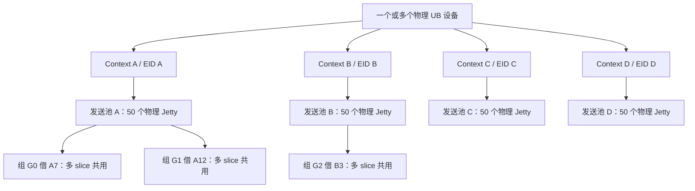
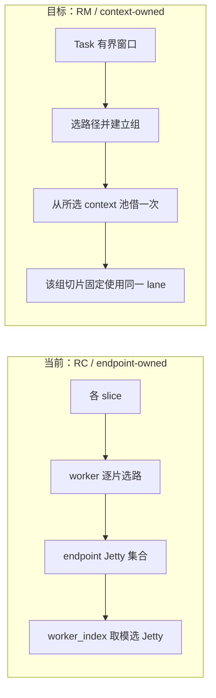
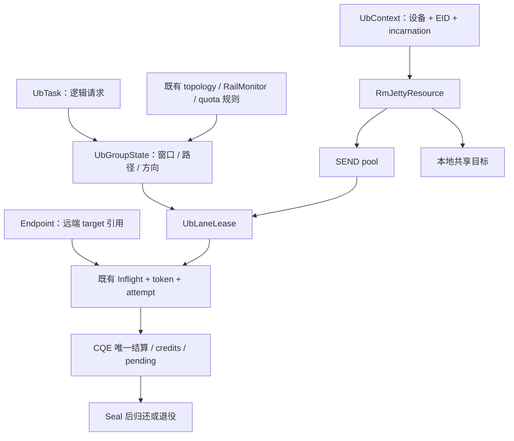
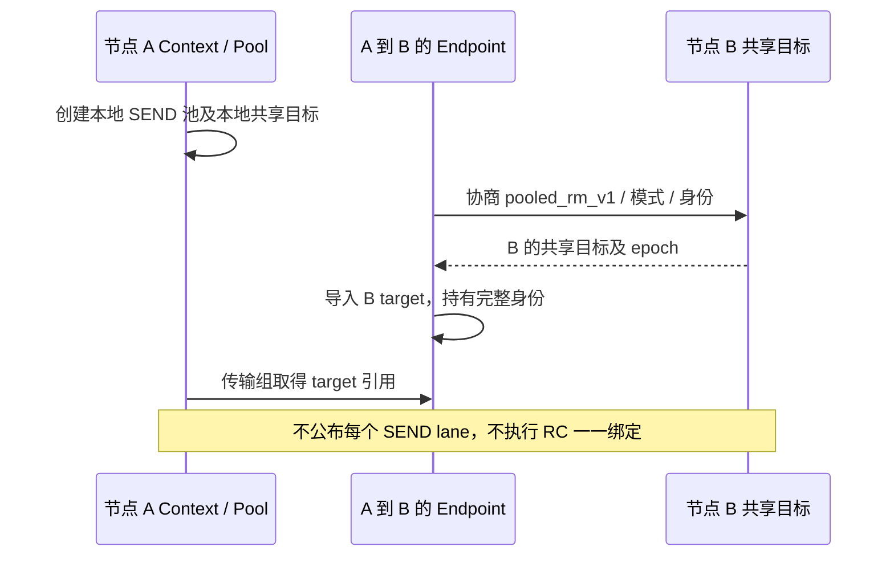
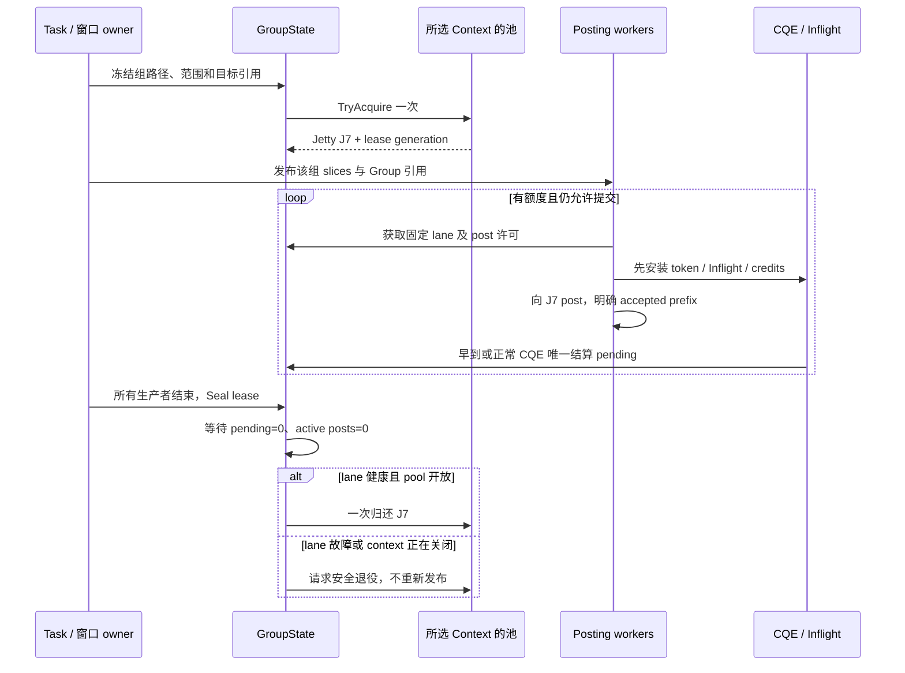
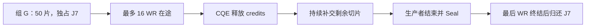
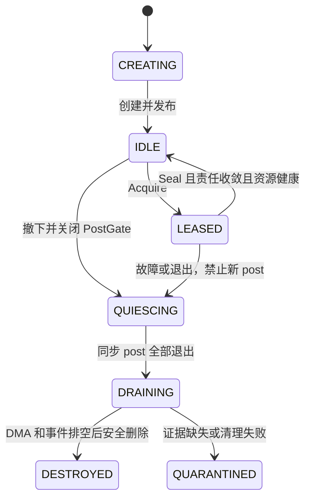
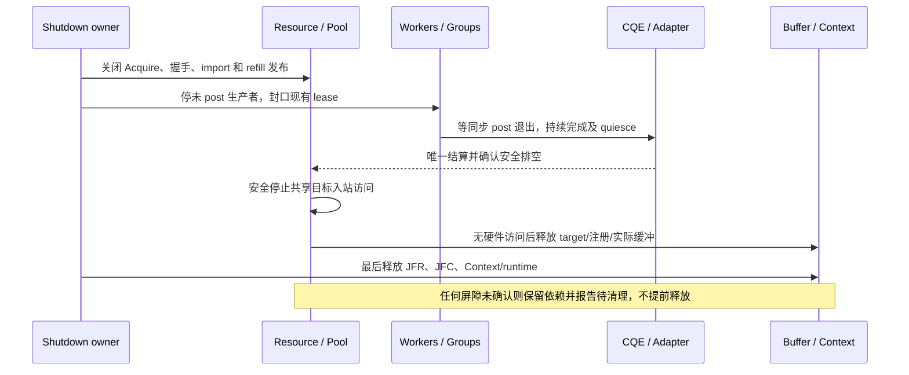

# TENT 物理 UB：按 EID/Context 建立 RM Jetty 池与传输组复用设计

> 日期：2026-10-28；状态：待实现，未完成物理 UB RM 实机验收。
> 代码分析基线：Supercache `main_learn` / `fe9155c9`。
> 本文承接此前《非 bonding 物理 UB Jetty 复用与生命周期设计（RC / RM）》的 RM 分支，细化最新 TENT 接入；不要求本分支存在旧文档，也不修改当前 RC 实现。
> 关联：[物理 UB 分片与可靠性](tent-physical-ub-reliability-design.md)、[UB 节点隔离](ub-node-fault-isolation-design.md)、[UBTransport 组件化](ub-transport-component-design.md)、[线程模型](ub-threading-model-analysis.md)。

## 1. 核心结论与交付范围

**每个本地物理 EID/Context 拥有一个有界 RM 发送 Jetty 池。先选合法路径，再按有界传输组借一个 Jetty，同组多个 slice/WR 共用该 Jetty，封口且硬件责任收敛后一次归还。**

这是 RM 资源组织方案，不是把当前 jetty_per_endpoint 改成 50。当前真实 adapter 使用 RC、endpoint 拥有绑定 Jetty；RM 的创建、目标导入、握手和资源所有权均需修改。

| 项目 | 本文决定 |
| --- | --- |
| 设备范围 | 非 bonding 物理 UB，CPU DRAM 单边 READ/WRITE |
| 池边界 | 物理设备 + EID + 本地 context incarnation |
| 池大小 | 每 context 静态配置；50 为算例，非已验证默认值 |
| 借用粒度 | 同 task 的有界窗口、同本地 context、同远端目标、同方向组成的传输组 |
| slice 与 Jetty | 一个组一个 lease；组内多 WR 占队列深度，不各借一个 Jetty |
| 池归还 | 生产者封口、pending=0、同步 post 退出、资源仍 ACTIVE、一次结算 |
| RC 兼容 | 保留当前连接绑定模式，不混入 RM 池；零 WR 阶段确定协议 |
| 本轮非目标 | bonding 虚拟化、RC 跨 peer 重绑、动态扩池、新节点评分或全局公平框架 |

不承诺仅因池化提高带宽，也不把物理 Jetty 与端口画成一一对应关系。

## 2. EID、Context、端口与池的边界

Context 在创建时选择设备 EID，Jetty 继承其 EID/UASID。一个 context 可以创建多个不同 ID 的 Jetty；相同 EID 的不同 context 仍是独立注册和资源域，不能按 EID 字符串直接混池。

| EID 类型 | 端口含义 | 池化含义 |
| --- | --- | --- |
| port EID | 按相应部署契约受限于对应端口 | 多个池成员共享该可达范围，不是增加物理链路数 |
| primary EID | 可访问所属 IODie 的允许端口集合 | 选定 context 不等于唯一确定出口物理端口 |
| bonding EID | 聚合层虚拟身份 | 不属于本设计，不能把其逻辑 Jetty 当作本池物理成员 |

拓扑节点采用当前 `ub:设备名:eid索引` 标识，但 eid_index 是设备 EID 表索引，不是端口号。完整池身份另带实际 EID 与 context incarnation；远端资源还需完整 EID/UASID/Jetty ID 和目标代际。



四个 context 各 50 个 SEND Jetty，正常池成员共 200 个。若每 context 一个独立共享目标，再加 4 个目标 Jetty；retiring、quarantine、creating、legacy 和其他用户均另计。四个 EID 若共享同一设备，必须在设备级合并核算 max_jetty、JFC 及注册上限，不能各用一份完整设备额度。

## 3. 当前实现、目标行为与差异

| 环节 | 当前 TENT | 目标 RM 池化 |
| --- | --- | --- |
| 设备/context | 发现 EID，按 topology entry 创建 context | 保留，补 context 代际和池 owner |
| Request 拆分 | UbTransport 拆成 slice，入队前 UbTask::seal | 保留逻辑 task；新增有界组和 lane 生产者封口 |
| 选路 | worker 对每个 PendingSlice 选择本地/远端组合 | 组/窗口首次选择；组内固定路径，故障或新窗口再选择 |
| Jetty 所有权 | endpoint 创建自己的 Jetty 集合，默认 6 个 | context 拥有发送池，endpoint 只持远端目标和身份 |
| 发送 lane | endpoint->jetty(worker_index)，内部取模 | GroupState 持有 lease，worker 从组取得固定 Jetty |
| provider 模式 | JFR/Jetty/import 固定 RC，并 bind | 显式支持 RM、导入 target、不执行 RC bind |
| 握手 | 双方 endpoint Jetty 数量一致，逐个绑定 | 公布共享目标，发送池大小与对端目标数量解耦 |
| 完成 | token、attempt、Inflight、quota 结算 | 在现有机制上增加 lease 引用及单 lane credits，不重建第二套完成系统 |

代码依据：[UbTransport](../../mooncake-transfer-engine/tent/src/transport/ub/ub_transport.cpp)、[Workers](../../mooncake-transfer-engine/tent/src/transport/ub/workers.cpp)、[Endpoint](../../mooncake-transfer-engine/tent/src/transport/ub/endpoint.cpp)、[UrmaAdapter](../../mooncake-transfer-engine/tent/src/transport/ub/urma_adapter.cpp)、[参数](../../mooncake-transfer-engine/tent/include/tent/transport/ub/params.h)。

当前不是一个 slice 独占一个 Jetty。多个 WR 可共用同一 Jetty；一个请求的 50 片不必占用 50 个 Jetty。现有默认 6 个 posting worker，若只把每 endpoint 数量改成 50，按 worker_index 取模也不会自动使用全部 50 个。



组内固定路径会改变原逐 slice 动态调度粒度。本文保留现有候选、健康和 quota 规则，但不声称调度行为完全不变；以窗口边界限制长期固定和独占。

## 4. 公共架构与所有权

| 对象 | owner / 职责 |
| --- | --- |
| UbContext | 持有该 EID/context 的 RmJettyResource、JFC 和原生 context |
| RmJettyResource（新增） | SEND/共享目标唯一 native owner，预算、成员 registry、创建/退役和补池 |
| SendJettyPool（新增） | 空闲索引、Acquire/Return/Remove；不发 RPC、不调用 provider |
| UbJettyLane（新增） | native Jetty、generation、绑定 JFC、PostGate、WR depth 和状态 |
| UbGroupState / UbLaneLease（新增） | 冻结路径、窗口、生产者计数、pending、归还一次性状态 |
| UbEndpoint | RM 远端目标、远端 generation、导入缓存和就绪状态；不拥有本地 SEND Jetty |
| Workers / Inflight | 沿用唯一 token/attempt 完成入口，持有 lane、target、注册与组引用 |
| UrmaAdapter | 标准 RM 操作及真实 provider 排空契约；RC 原接口继续兼容 |



Pool、Group、Inflight 的锁不包围 metadata/RPC/provider 调用。不同 worker 可以处理同组切片，但只从 Group 读取同一 lease，并通过 lane PostGate 和 adapter 的线程安全契约协调 post，不能因 worker 不同而改选 Jetty。

共享目标与发送 lane 是软件角色，底层仍用标准 Jetty API。JFR/JFC 的共享属性和接收资源按物理 provider 配置，不假设单边请求不需要这些 native 资源。

## 5. RM 原生能力与握手改造

当前 RealJetty::remote 和 BOUND 状态围绕 RC 绑定构建。RM 不能只是将 trans_mode 常量改成 RM：

1. 在 Context/JFR/Jetty 创建参数中显式携带模式，并确认 provider 支持实际 RM READ/WRITE。
2. 将 remote target 作为独立导入句柄和引用，不固定存成发送 Jetty 唯一远端。
3. RM post 接收本组 target，逐 WR 设置对应原生 tjetty；local/remote Segment 必须与 context 和目标兼容。
4. RC bind/unbind 保留为独立分支；RM 就绪条件不再是“RC 已绑定”。
5. 一个健康 SEND lane 可在前组完成归还后顺序访问不同 target，首版不在不同 lease 之间并发共用。

握手增加独立版本/能力，例如 `pooled_rm_v1`，交换 context incarnation、完整目标 EID/UASID/ID、target_epoch、注册/协议兼容信息。发送池数量是本地预算，不要求对端有 50 个目标。



首个 WR 前完成协商。旧 peer 或 RM 能力不满足时，只能在零 WR、未持有数据责任时选择明确支持的 legacy RC 路径；不满足则报错。已 post 后不能自动切协议或重放。RC 和 RM 资源不能混池，双方模式必须一致。

## 6. 分组与选路：先路径，后 lane

推荐组键：

```text
(task identity, window sequence,
 local context incarnation,
 remote context/target identity + target epoch,
 direction)
```

| 请求情况 | 分组与 lane |
| --- | --- |
| 一请求 50 片，同 context、同 target、同方向且窗口容纳 | 一个组借一个 Jetty，50 片消耗 WR credits |
| 一请求分别选择两个 EID | 至少两个组，各借对应 context 的一个 Jetty |
| 一个 batch 有多个 peer | 分别建组；不共享一个全局 batch lane |
| 长请求有多个窗口 | 每个窗口独立 Seal/收敛/归还，再竞争下一窗口 |
| 同组出现连接/target 代际变化 | 旧组停止，保留旧责任；合法后续工作使用新组 |

窗口按最大切片数/字节数给出显式上限，参数在实现和实机验证时确定，不虚构已存在配置。实际每轮提交量还受单 lane 深度、JFC 和路径/设备 quota 限制，窗口不是一次性无限提交许可。

路径选择沿用当前合法性、topology rank、RailMonitor 和 quota 优先规则。用窗口内代表范围提出候选后，必须检查组内所有范围的注册/可达性；跨缓冲区或能力边界应拆组，不能只验证第一片。

路径确定后从对应 context 池 Acquire，租约覆盖组内窗口推进。池空不等于路径故障，不为获得 lane 自动改变 EID；通过有界排队、取消和请求 deadline 结束等待。新窗口可重新选路，不在每个 slice 上重新抢占路径。

一个窗口涉及多个组时，try-acquire 全部所需 lane；任一不足立即归还已取得但未 post 的 lease，不能部分持有并等待。窗口的同时需求必须能装入配置预算，超出时先拆小；其他独立 task 不要求整个 batch 原子预留。

## 7. 借用、提交、封口与归还



**两个 Seal 必须分开：**

| 操作 | 当前/拟新增含义 | 时点 |
| --- | --- | --- |
| UbTask::seal() | 当前逻辑 slice 集合构造完成，允许完成聚合 | 当前在入队前执行，继续保留 |
| UbLaneLease::Seal() | 不再生成该组的新提交、重试或窗口工作 | 所有组生产者退出、未 post 后缀处理完成后 |

不能拿 UbTask 已 seal、一次 submit 返回或队列暂时为空作为 lane 可归还证据。记录 producer count、sealed、pending_wrs、active_post_calls、retire_requested、settled。

归还条件：

```text
producer_count == 0 && sealed
&& pending_wrs == 0 && active_post_calls == 0
&& lane ACTIVE && !retire_requested && pool OPEN
&& settlement_claimed_once
```

一次 lease 只归还一次，归还与 retire 通过同一锁/原子线性化；先退役不能再发布，先归还则退役必须从空闲集合撤下。生产者、post 返回与 CQE 可任意交错，不依赖图中的固定先后。

## 8. 三层容量与例子

| 约束 | 管理内容 | 不足时 |
| --- | --- | --- |
| Pool lane 名额 | 同 context 同时独占使用的组数 | 入队/背压，不按每 slice 借 lane |
| Lane WR credits | 该 Jetty 真实在途 WR + 正在 post 的预留 | 当前组等完成后推进窗口 |
| JFC / device / path quota | 完成队列、现有设备/路径在途字节与 WR | 保留既有 quota 规则，不放大额度 |

所有预留采用非阻塞 try-acquire 和确定的回滚路径。只有确定未接受或真实完成才归还 WR credits，不能按队列出队数扣减。等待 quota 时不持有状态锁或同步 provider 调用。

例如一个组 50 片，lane 深度 16，且其他额度充足：



这是一个 lane 的队列流水，不需要 50 个 Jetty。50 个池成员代表最多 50 个独占租约；一请求多组会占多个租约，不能称为固定支持 50 个请求。大窗口可能增加独占时间，需要通过窗口上限和现有优先队列验证公平性，不新增跨 peer 配额系统。

设备级总预算包含 SEND、共享目标、RC legacy、retiring/quarantine、creating 和其他相关资源；JFC 深度按绑定到该 JFC 的实际在途责任核算，不能把 50 乘以 lane depth 直接当成可用总额度。

## 9. 完成身份、partial post 与故障收敛

复用当前 UbCompletionToken、UbAttemptToken 和 Workers::Inflight 的唯一入口，新增组/lane generation、target 与注册强引用。不得另建与现有 inflight 平行的业务完成 registry。

每 WR 先安装完成记录并预留 credits，再进入 provider。明确区分 accepted 结果和 CQE 到达，允许 CQE 早于 post 返回。最终 lane 归还还要求同步调用退出，不能提前回收 post 使用的描述内存。

| 结果 | 处理 |
| --- | --- |
| 全部接受 | 等待真实 CQE，按 token/attempt 唯一结算 |
| 可信 posted_count / bad_wr 前缀 | 保留已接受前缀，只取消确定未接受后缀 |
| 接受范围不明 | 保留可能接受责任，封闭组并退役，不包装为整体可重试 |
| 特殊 flush/done、未知或重复 token | 先按类型分类，不能当成新业务 WR 重复扣减 |

READ 失败内容不交付业务；重试前确保旧 WR 不再写同一缓冲，注册与 lease 仍有效。WRITE 可能已接受时报告相应失败/结果未知，不盲目沿用当前一般重试预算重放整个组。安全重试必须由明确的未接受事实或上层重放契约支持。



池成员故障只退役该资源和受影响组，不因一个 lane 故障关闭整个 EID 池；确认 context/JFC 故障时按对应域关闭。健康恢复不复活旧 lane，补池创建新身份。

物理 provider 必须提供可信 quiesce 屏障。沿用当前 quiesceJetty 的无后续发送 DMA 契约并验证 RM，不能推导它必然排空共享目标的所有入站访问。delete 非零后的句柄是否保留，也须按实际 provider 明确，不能从 bonding wrapper 推断。

## 10. endpoint、共享目标与退出

RM endpoint eviction 只撤销远端连接可发现性；持有 target/segment 的组和 Inflight 继续存活，引用排空后后台 unimport。当前 endpoint::quiesce 遍历自身发送 Jetty 的逻辑不能直接用于 RM：endpoint 不再拥有池成员，不得顺带 reset 正服务其他 peer 的 lane。

本地共享目标由 context resource 唯一拥有。目标故障更新 target_epoch 并撤下旧身份，远端刷新握手/import；已 post 责任保留旧引用。注销注册前必须确认入站 DMA 不再发生，不能只检查本地 SEND pending=0。



Store/调用方仍须保留实际用户内存，token/MR 引用不等于保留原始 buffer。逻辑 timeout、取消与可释放许可分离；现有 TENT 对外完成、缓冲责任若不足，先补生命周期接入，不能靠 lane pool 隐藏风险。完成线程不能等待必须由自身消费的事件。

补池使用静态目标和有限额外退役窗口，锁外创建、锁内复查 stopping/代际后发布。不能靠不断补池掩盖 quarantine，预算耗尽产生背压。

## 11. 最新 TENT 的具体修改位置

| 文件/模块 | 改动 |
| --- | --- |
| [context.h / context.cpp](../../mooncake-transfer-engine/tent/include/tent/transport/ub/context.h) | 持有 context 发送池、共享目标和代际；保持已有故障状态与 JFC 生命周期 |
| RmJettyResource / SendJettyPool / UbLaneLease（拟新增） | 静态预算、Acquire/Return、组生产者、lane credits、退役和补池 |
| [slice.h](../../mooncake-transfer-engine/tent/include/tent/transport/ub/slice.h) | Task 保留原 seal，切片关联 Group；重试不能丢失旧 attempt 责任 |
| [workers.cpp](../../mooncake-transfer-engine/tent/src/transport/ub/workers.cpp) | 从逐片任意选路改为组/窗口固定；删除 RM 的 worker_index 选 Jetty；Inflight 持 lane 引用 |
| [endpoint.h / endpoint.cpp](../../mooncake-transfer-engine/tent/include/tent/transport/ub/endpoint.h) | RM 只管理远端目标/身份，拆分 RC 绑定与 RM 导入，调整 eviction/quiesce |
| [urma_adapter.h / .cpp](../../mooncake-transfer-engine/tent/include/tent/transport/ub/urma_adapter.h) | 模式能力、RM create/import/post、独立 target 句柄、RM drain/delete 契约 |
| [ub_transport.cpp](../../mooncake-transfer-engine/tent/src/transport/ub/ub_transport.cpp) | 安装资源、握手能力、组 owner 与 shutdown；资源不在每请求热路径创建 |
| [quota.cpp](../../mooncake-transfer-engine/tent/src/transport/ub/quota.cpp) / JFC | 复用 quota 算法，衔接 lane/JFC credits 及幂等回滚，避免重复/遗漏统计 |
| [params.h](../../mooncake-transfer-engine/tent/include/tent/transport/ub/params.h) / tests | 显式 RM 开关、每 context 池目标和窗口上限；50 不写成未经验证默认值 |

可与组件化设计共用这些实现，但本方案不以抽出独立 UbEngine/SDK 为前提，不复制两份 UB 数据面。健康模块提供硬准入，池只执行结果；时延上报使用完成值，不把池等待、Jetty 空闲数或队列转换成新的节点权重。

## 12. 实施与验收

实施按依赖推进：

1. 验证物理 RM 单 Jetty 顺序访问不同 target、READ/WRITE、完整身份及安全排空；不满足则保持 RC。
2. 实现模式分支和版本化 RM 目标握手，RC 原路径保持；关闭池化时不改变 RC 行为。
3. 接入 context owner、静态池和 lane credits，复用既有完成路径。
4. 实现窗口/组、固定路径和 lease 生产者封口，完成背压、取消、重试与故障退出。
5. 单/多 EID、多 peer 及真实故障验收后启用 RM；记录与当前逐片选路的性能和公平差异。

| 验收场景 | 必须证明 |
| --- | --- |
| 4 个 EID/context，各配 50 | 200 个 SEND 池成员，目标/退役等另计；共享物理设备预算不越界 |
| 50 片同组 | Acquire 一次，使用同一个 lane，不消耗 50 个 lease |
| 一个请求跨两个 EID/多个目标 | 正确分组，不把跨 context 注册和 lane 混用 |
| lane depth=16、50 片 | 以不超过额度的队列流水完成，无额外 lane 借用 |
| 超大 task、多优先级、小请求 | 有界窗口释放竞争，验证长请求不会无限占用 |
| worker_count=6、pool=50 | 获取实际空闲成员，不再固定只有前 6 个可选；活跃数由组并发决定 |
| 空池、quota/JFC 满、多组预留失败 | 有界背压、预留回滚，无持有部分 lane 等待死锁 |
| Task seal 早于 post、CQE 早于 post 返回 | 不误作 lease 封口，不提前归还 |
| partial post、重复/迟到 token、特殊完成 | 不重复结算，不释放可能接受责任 |
| WRITE 结果未知、READ 重试 | 不整体重放不确定写，旧 READ 不与新操作争写缓冲 |
| endpoint eviction / peer 重启 | 不删除其他组正在使用的池 Jetty，旧 target 引用正确收敛 |
| lane/context/JFC/共享目标故障 | 故障域准确，安全排空后才释放，恢复不复活旧身份 |
| shutdown/refill/timeout 并发 | native、buffer、注册和 context 依赖有界保留，无提前释放 |
| RM/RC、旧 peer、不同池大小 | 首个 WR 前协商；RM 不要求两端 SEND 数量匹配 |

UT 用 fake adapter、可控完成和确定性线程交错验证状态机；integration 覆盖 Task 到组、握手和唯一结算；ST 使用真实物理 UB 验证 RM 复用与屏障。mock 不证明驱动 DMA 安全。此处列的是待执行验收，不是当前测试结果。

指标包括每 context idle/leased、每组 Acquire 次数、lane/JFC 在途、retiring/quarantine、背压时间、窗口等待、创建次数、吞吐和 p99。50 个 Jetty 是资源预算示例，最终容量由并发、硬件额度和实测决定，不以扩大池替代生命周期正确性。
