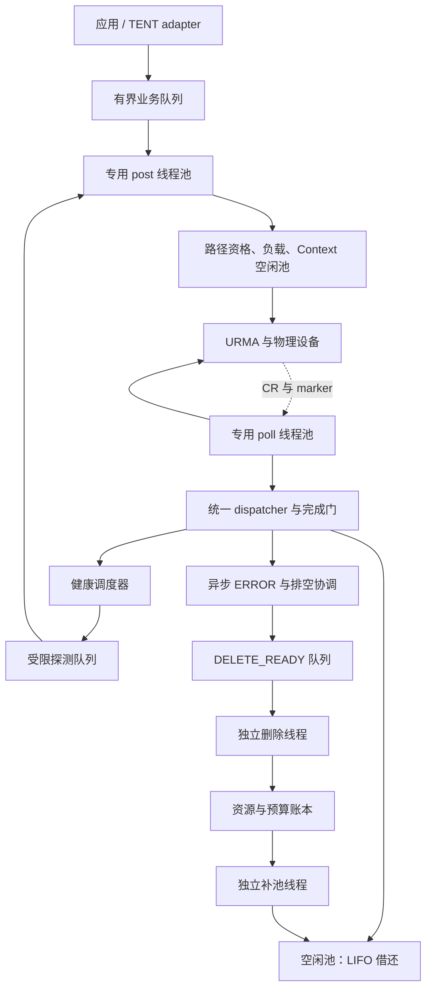
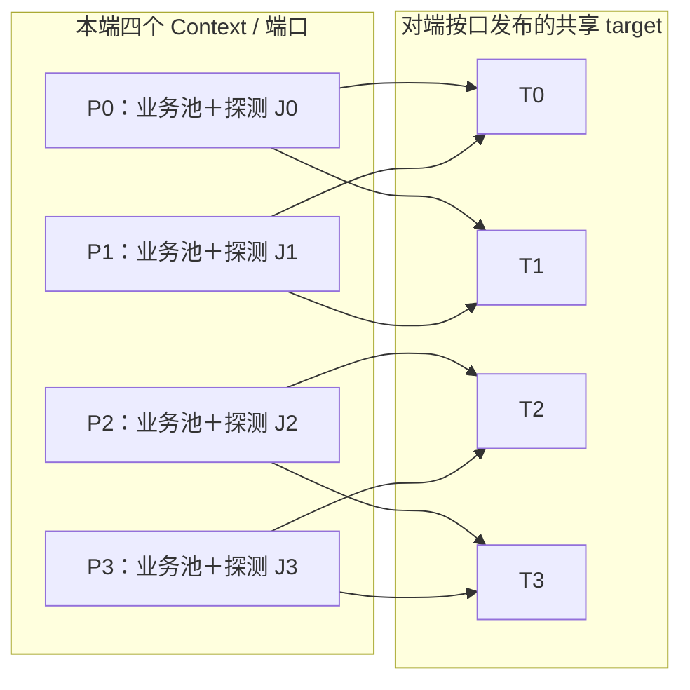
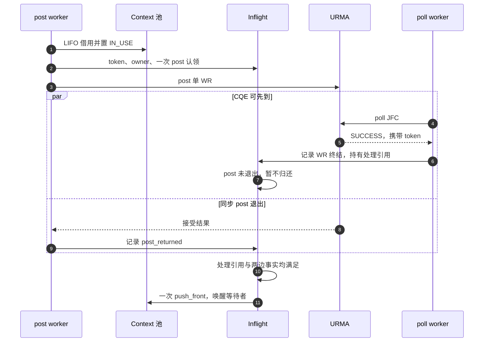
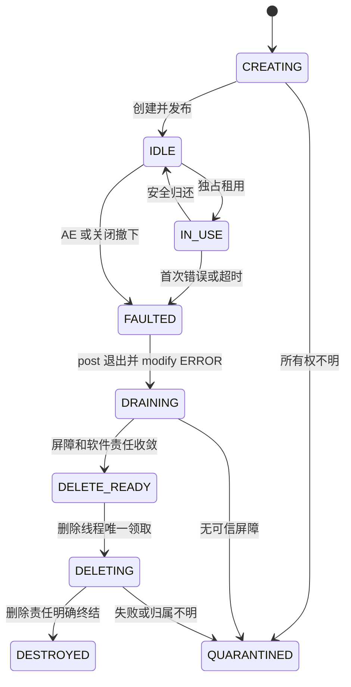
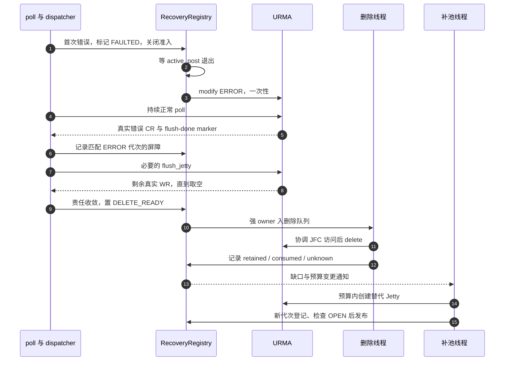
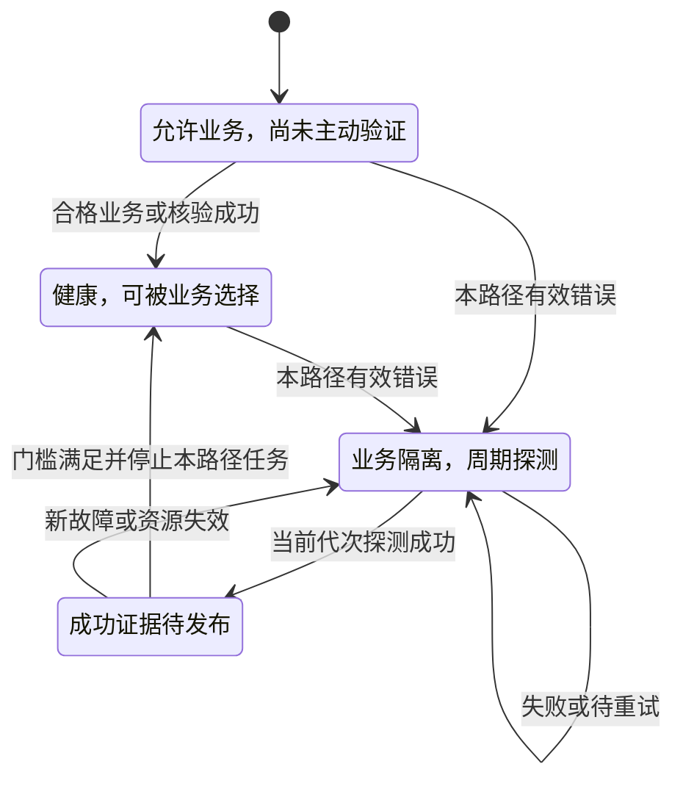
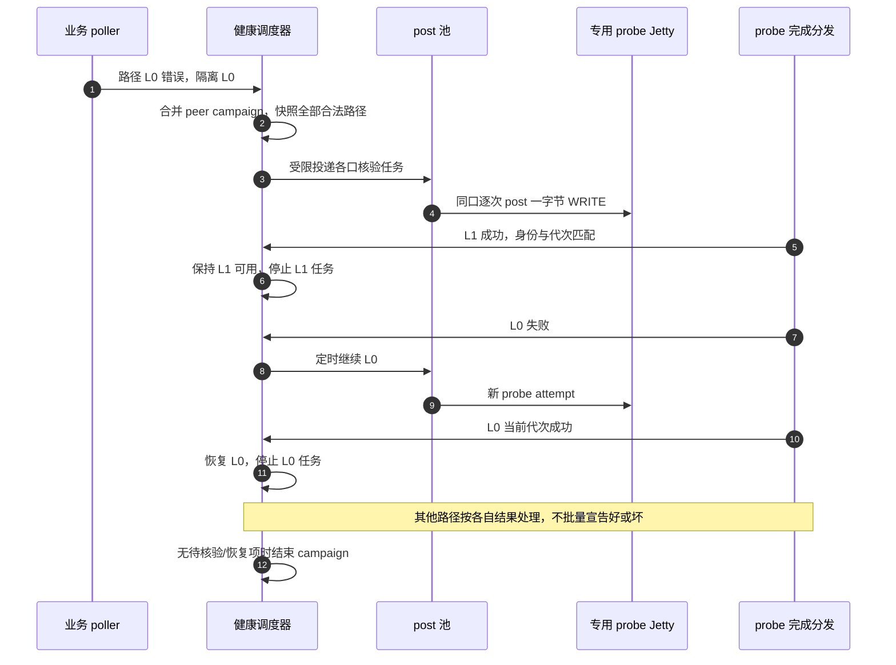
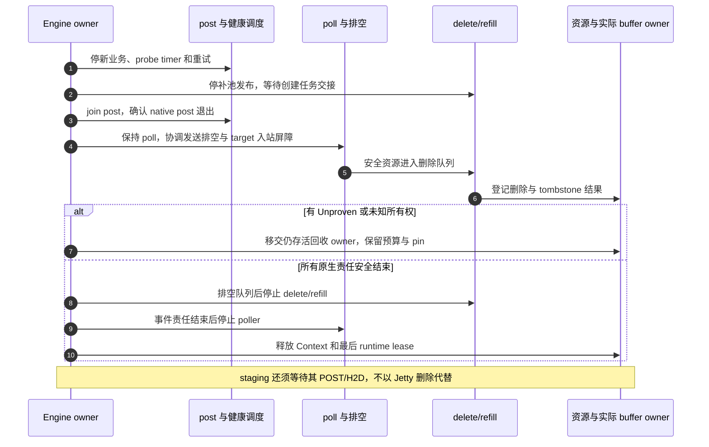

# TENT 物理 UB RM Jetty 池化与线程池管理详细设计

> 日期：2026-11-02。Supercache 代码基线：`main_learn / 822d7d83716269a186198997b95ad349ed377324`；同级 UMDK 参考基线：`09086da5`。
>
> 状态：待实现的 V3 设计，不表示当前 RC 代码已经支持 RM 池或完成物理 UB 验收。本次仅修改文档。
>
> 范围：TENT / 独立 UbEngine 的非 bonding 物理 UB、URMA RM、CPU DRAM 单边 READ/WRITE。设备内存 staging 仍由 TENT runtime 管理。
>
> 本文替代本文件上一版池化方案；并覆盖[综合设计](tent-ub-rm-integrated-design.md)中关于 target 归属、探测启动、错误 Jetty 归还、线程分工、删除补池和资源预算的旧结论。综合设计中的组件化、实际 buffer owner、协议校验和 DMA 安全原则继续适用。

## 1. 已确认约束与实现边界

| 项目 | 本版决定 |
| --- | --- |
| 选路 | 每个 slice attempt 独立选择本地 Context/EID＋远端按口 target，不按 Group/Task 汇聚 Jetty |
| 发送池 | 每个 Context 建池；先选路，再从对应池租用一个空闲发送 Jetty |
| WR | 每 attempt 最多一次 native post，输入恰好一条 WR；重试是新 attempt |
| 独占 | 一个业务发送 Jetty 同时只服务一个 attempt；正常归还后可顺序访问其他 peer |
| 空闲顺序 | 同池 LIFO，刚归还的成员优先下次使用；不改变路径选择顺序 |
| 远端目标 | 节点每个配置端口发布一个共享 target，业务与探测共同使用；endpoint 只引用 |
| 探测资源 | 每个本地端口一个专用 RM 发送 Jetty，不进入业务发送池 |
| 拓扑 | 从端口清单和合法邻接关系计算路径；每口两个邻居时，4 口为 8 路、6 口为 12 路 |
| 探测启动 | 业务错误立即隔离出错路径，同时对该 peer 的配置路径集合发起受限核验 |
| 探测停止 | 某条路径取得当前有效成功证据并恢复后，停止该路径的周期任务 |
| 错误 Jetty | 首次真实错误 CQE 对应的发送 Jetty 强制退役，不因后续探测成功回到业务池 |
| 排空 | 关闭 post 门禁，modify ERROR，持续 poll，识别 flush-done，再结算剩余 WR |
| 删除 | 独立删除线程消费 DELETE_READY 队列，不能在 poll 热路径直接销毁 |
| 补池 | 独立补池线程扫描并响应缺口事件；恢复静态目标容量，不无限扩池 |
| 线程 | 专用 post 池和 poll 池；探测也交 post 池，应用不直接 native post/poll |
| 请求限额 | K 约束单个网络 UbTask 跨 Context 的准入 attempt，不是父 staging 请求窗口 |
| 可靠性 | timeout/cancel 不等于 DMA 结束；保留实际 buffer owner、quarantine 和事件归属 |

不引入 Group、window、producer Seal、RC 池化、原生业务 SEND/RECV/atomic、跨 Jetty 的全局写顺序或请求原子可见性。`UbTask::seal` 仅封闭 slice 集合，不能代替 post 退出或 DMA 屏障。

## 2. 当前代码与 UMDK 参考的适用范围

| 已有事实 | 本版设计如何使用 |
| --- | --- |
| TENT 原生 UB 已有 post/poll 两组线程、逐 slice 路由和单条 WR 提交 | 复用框架，新增 Context 发送池与租用完成门 |
| 当前 TENT Jetty/导入仍按 RC 建立 | 必须新增明确 RM profile，不能仅改变数量参数 |
| TENT Adapter 已区分实体 marker，quiesce 会等待 flush-done 并调用 flush_jetty | 改为异步状态推进，由正常 poller 和统一 dispatcher 完成 |
| UMDK health 每本地资源使用独立 RM 探测 Jetty | 保留业务与探测发送资源隔离 |
| UMDK 按 connected 矩阵导入可达 target | 使用动态邻接表，不照搬固定四口数组 |
| UMDK 探测为专用注册区的一字节 WRITE | 采用相同操作类型；不写业务内存，不宣称验证了远端数据内容 |
| UMDK 在创建 Jetty 时启动周期探测 | 本版改为业务错误触发，恢复后停止对应路径任务 |

UMDK health 所在位置是 bonding provider。这里只参考其探测资源、WR 和拓扑组织；物理模式不调用 BONDP 控制接口、不依赖 bonding provider，也不直接照搬其同步重建及 poll 数量扣计数方法。

## 3. 资源模型与组件边界

### 3.1 原生资源的唯一 owner

| 对象，均为目标设计名 | 归属与责任 |
| --- | --- |
| PortBinding | 配置 port_id 到 device、EID/index、Context 的准确映射 |
| UbContextResource | Context、JFC/JFR profile、业务池和设备预算 |
| SendJettyPool | IDLE 栈、租用状态和容量账本；不持锁调用 provider |
| RmSendJetty | 唯一 native owner、generation、PostGate 和退役状态 |
| SliceJettyLease | 一个业务 attempt 对一个发送成员的独占使用权 |
| LocalPortTarget | 每端口一个本地共享 target，发布给多个 peer；拥有 target 原生依赖 |
| PeerTargetDescriptor | peer 按口发布的 target、EID/UASID、profile 和 target_epoch |
| ImportedTargetRegistry | 按本地 Context 导入远端 target；多个 endpoint、业务和探测可引用 |
| UbEndpoint | 路径视图、目标和注册引用，不拥有或直接销毁共享 target |
| ProbeResource | 每本地端口一个专用发送 Jetty、探测源内存和独立额度 |
| PathRegistry / PathHealth | 合法路径及各自业务资格、fault_epoch、探测结果 |
| PeerProbeCampaign | peer 的一次核验轮次、待核验路径与周期任务去重 |
| Inflight / TransferLifetimeOwner | token、post/WR 责任、lease、额度、Task/batch 与实际 buffer pin |
| RecoveryRegistry | 排空、DELETE_READY、quarantine、tombstone 和删除任务 |

发送 Jetty 不因服务不同 endpoint 而重复创建。target 数量也不再随 endpoint 数增长；但导入句柄仍按本地 Context 和远端 target 展开。

### 3.2 身份与代次

```text
ContextKey = device_identity + EID + context_incarnation
LocalTargetKey = node_incarnation + port_id + target_epoch + profile
ImportedTargetKey = local ContextKey + peer LocalTargetKey + native EID/UASID/ID
PathKey = local ContextKey + peer_incarnation + remote_port_id + profile
PathVersion = PathKey + topology_epoch + target_epoch
LaneKey = ContextKey + native Jetty ID + lane_generation
AttemptKey = task_id + slice_id + attempt_generation
ProbeKey = PathVersion + fault_epoch + campaign_id + probe_sequence
```

CompletionToken 在进程内唯一，映射到业务 attempt 或 probe；不直接复用地址。eid_index 不是端口号，native ID 不是全局身份。没有代次的原生事件不能靠软件 generation 自动消除 ABA。

### 3.3 图一：组件、线程与队列



箭头表达运行关系，不表达链接依赖。组件化仍采用 ub_core 定义窄接口、ub_transfer 读取健康资格、ub_health 经 post 队列发探测，由 UbEngine 装配；TENT adapter 不复制第二套数据面。

## 4. 配置拓扑：4 口 8 路与 6 口 12 路

### 4.1 数量与含义

定义本地端口集 L，远端 target 端口集 R，合法邻接集合 E：

```text
E = {(local_port, remote_port) | 配置允许且双方资源身份校验通过}
link_count(A→B) = |E| = Σ degree(local_port)

每本端口恰好两个合法远端邻居时：
N 个本端口 → N 个本地探测 Jetty、2N 个导入关系、2N 条有向路径
```

对称部署下，远端发布 N 个原生 target，并非 2N 个。A→B 与 B→A 分别建表；8 条不是来回合计，不是 8 根物理线缆，也不保证底层物理路由完全独立。

| 部署条件 | 远端原生 target | 本地探测发送 Jetty | 本方向导入关系 / 路径 |
| --- | --- | --- | --- |
| 双方 4 口，每本端口两个邻居 | 4 | 4 | 8 |
| 双方 6 口，每本端口两个邻居 | 6 | 6 | 12 |
| 双方端口数不等或邻接不规则 | 远端已验证端口数 | 本地端口数 | 实际合法邻接总数 |

import 的作用域是本地 Context，不是探测 Jetty 绑定两个 target。业务和探测在 WR 中逐次指定 imported tjetty，RM 不做 RC bind。

### 4.2 图二：四口共享目标示例

下图仅演示合法邻接配置，不声称任意物理部署都具备这些连接；实际按配置模板与发现结果校验。



### 4.3 配置草案与启动校验

以下是待实现的 topology 子配置示例；device/EID 为占位值，不可直接运行：

```json
{
  "port_count": 4,
  "ports": [
    {"id": "P0", "device": "<device0>", "eid": "<eid0>", "eid_index": 0},
    {"id": "P1", "device": "<device1>", "eid": "<eid1>", "eid_index": 0},
    {"id": "P2", "device": "<device2>", "eid": "<eid2>", "eid_index": 0},
    {"id": "P3", "device": "<device3>", "eid": "<eid3>", "eid_index": 0}
  ],
  "peers": [{
    "id": "<peer-id>",
    "adjacency": {
      "P0": ["R0", "R1"],
      "P1": ["R0", "R1"],
      "P2": ["R2", "R3"],
      "P3": ["R2", "R3"]
    }
  }]
}
```

port_count 校验 ports 长度，不用于猜测远端端口编号。若使用自动拓扑模板，模板必须明确可达关系，展开结果与显式邻接表走同一验证链。6 口部署更新 ports 与模板/邻接即可，代码不出现固定 4、8 或定宽四口掩码。

启动核验：ID 唯一、每邻居有效且去重、数量和上限无溢出；配置端口与发现设备/EID匹配；对端公布完整 inventory、target epoch 和权限；导入 profile 兼容。失败项为 INVALID/UNAVAILABLE，不能伪造 Healthy。

一个 primary EID 可能覆盖多个物理端口。若部署不能把配置口与所需路径事实准确关联，应拒绝相应物理口隔离能力；不能把多个配置别名指向同一资源后宣称独立四口。首版启动时固化拓扑，运行中变更需要新 topology_epoch、撤销旧准入并排空，不原地改写旧 PathKey。

## 5. 节点共享 target 的发布、导入与退役

首版每端口使用一个双方验证兼容的 RM profile；不在“四口四 target”的数量结论中暗含多个 profile 的额外目标。若未来每口需多个不同 profile，必须相应扩展发布协议和数量预算。

1. 节点按每个 PortBinding 创建一个 LocalPortTarget，配置关联的 JFR/JFC、RM profile 和授权。
2. 发布节点 incarnation、端口清单、EID/UASID/ID、target_epoch、注册描述 ABI 与能力。
3. 本地按邻接关系在相应 Context 导入；ImportedTargetRegistry 唯一持有 native import。
4. endpoint 和 ProbeResource 持引用，WR 带对应 target；endpoint 淘汰只释放引用，不直接 unimport 共享句柄。
5. 本地发送成员顺序跨 peer 复用不触发 target 重建；共享 target 故障则隔离所有引用它的路径。
6. target 重建发布新 epoch，所有 peer 更新相关导入；旧导入保留到其在途责任结束。

共享故障域明确扩大：同一目标被多个业务 endpoint、探测和 peer 使用。LocalPortTarget ERROR 不能按一个发送 lease 的流程就地删除；必须撤销发布、停止相关 peer 新 WR，并取得 provider 定义的入站屏障。peer 停发 ACK 或超时都不能替代入站 DMA fence；MR 注销覆盖所有授权 target/peer。

探测仍使用独立注册区。多个 peer 可使用分配给各自的探测槽位或经验证的无业务语义探测区，禁止写入业务地址。WRITE 探测成功只证明当前探测配置的可用性，不证明所有业务 READ/WRITE 权限。

## 6. 物理 RM 阶段零与协议门槛

| 门槛 | 必须满足 |
| --- | --- |
| 物理构建 | 不强制依赖 urma_ubagg.h，物理模式不调用 BONDP，不使用私有 WR 扩展 |
| RM 原生能力 | 标准 urma_jfs_wr_t，逐 WR tjetty，同发送成员顺序跨 peer |
| 共享 target | 多发送 Jetty、多 peer、业务与探测并发访问均验证 |
| 身份 | 完整 EID/UASID、Context/节点/target 代次和 profile；不丢弃非零 UASID，零是否合法按 provider 契约 |
| 注册 | 实际返回范围覆盖请求；超限明确拒绝或显式 MR 分段，不静默截短 |
| ABI | raw segment 编码长度、schema、ABI、访问权限、范围与溢出逐项校验 |
| 排空与事件 | modify ERROR、send JFC flush-done、flush_jetty、AE ACK 和 delete 语义明确 |
| 并发 | poll 与 delete/clean_jfc、import/unimport 的并发契约可验证 |
| 健康事实 | 物理端口归属明确；能力缺失不伪造 GOOD/BAD，不调用 BONDP 四口查询 |
| 资源 | 发送、探测、共享 target、JFC/JFR/MR 与替换余量均可分配 |

独立 Engine 默认 RM_ONLY，不透明切 RC。TENT 显式 legacy RC 仅可在逻辑请求尚无任何可能接受 WR 时选择，资源、协议和验收分开；不进入本池，不跨 peer 重绑。

## 7. post 调度：路径负载与 LIFO 租用

### 7.1 两级选择

```text
slice attempt
  → 排除 INVALID / 故障路径及无效 target/Region
  → 依据拓扑等级、在途负载、带宽反馈、quota 选择路径
  → 确定本地 Context 与远端 imported target
  → 从所选 Context 的 IDLE 栈取最近归还的 Jetty
  → 安装 Inflight 与门禁票据，post 唯一 WR
```

沿用当前路径评分的分层结构，不以“刚归还”覆盖负载均衡，不以池空闲数伪装物理带宽。队列等待、quota 等待和 staging 时间不进入网络带宽样本。路径共享端口时同时计 device/Context 负载，避免把两个邻接关系误当两倍独立带宽。

评分采用当前 UbPathSelectionScore 的分层比较起点：可准入优先，其次拓扑等级、归一化在途字节/WR、相关目标的本进程在途压力、有效带宽样本，最后按 retry_order 与稳定设备 ID 打破平局。资源预留后再复核，防止多个 post worker 根据过时的空闲快照同时过量准入。

共享 target 后，原 endpoint_outstanding 不再是目标总压力：应把路径计数集中到 PathRegistry，把本进程所有路径对同一远端 TargetKey 的 WR/字节聚合到 ImportedTargetRegistry，再用于相应比较项；endpoint 视图切换不能把同一目标负载重置为零。远端其他进程/peer 的未知负载不伪装成已知，未来可由上层反馈补充。

候选排序阶段不为全部组合发握手 RPC；优先使用已就绪 target 描述，并按本地设备分散、限额准备冷路径。缺失目标由控制执行器异步握手/导入，post worker 延后该候选，不能持 lease 等待网络控制调用。

路径没有空闲成员时，可尝试同策略允许的其他合格路径；不反复选空池忙等，不把容量不足当路径故障，也不创建临时 Jetty 绕过预算。

### 7.2 原子准入与回滚

1. 准备已验证 endpoint、imported target 与 Region。
2. 非阻塞取得网络 UbTask 的 K permit 和 device/path quota。
3. 在 Context 的统一 LIFO 栈中，优先选择最近归还且其 JFC 尚有 credit 的成员；非阻塞预留该 JFC credit，再原子弹出 IDLE、改为 IN_USE，绑定本 attempt。竞争失败时释放预留并重选。
4. 保留 target/Region 引用和实际 buffer owner，发布唯一 completion token。
5. 在有序 gate 协议中复核 stopping、PathVersion、fault_epoch、target 和注册代次，再认领一次 post。
6. 任何确定未 post 的失败逆序回滚；不得持部分资源阻塞等待其他资源。

pool mutex 只保护 IDLE 栈、成员状态和计数；credit 只执行非阻塞原子预留，不在锁内等待。provider/RPC 不在该锁内执行。使用互斥锁栈作为首版实现，避免无证据的无锁栈 ABA。归还 push_front、租用优先取栈首；新建成员放栈尾。多个 JFC 不各自无条件分流而破坏 Context 的最近归还优先；优先级只在本轮可准入成员集合内成立。

### 7.3 K、切片与典型读写

当前 UB 默认 slice_size=64 KiB，max_slices_per_task=65536，参数为 transports/ub/*；MC_SLICE_SIZE 当前只兼容映射 TENT RDMA，不控制原生 UB。这里不引入 TENT RDMA 的 32/64 片自适应规划。

例如 1 MiB DRAM READ 默认为 16 个 slice，K=4 时最多准入 4 个业务 attempt。每个 attempt 独立选路、借一个 Jetty，成功安全结算后归还并推进后续分片。WRITE 使用相同调度，但非 inline 源保持不变；READ 目的在成功完成前无效。

K 不是总片数、Jetty 池大小或父 Store GET/PUT 的上限。若 runtime 同时产生 C 个 CROSS 子 Task，父请求可能贡献 C×K 个准入 attempt，仍受实际池和设备额度限制；首版不引入 Group/窗口。

## 8. 正常完成门与归还竞争

Inflight 至少记录 post_claimed、post_returned、acceptance、wr_terminal、handler_refs、fault_seen、finalize_claimed、lease_return_claimed 及所有 owner/credit。

```text
正常成功归还 =
  post_returned
  AND acceptance == Accepted
  AND 当前唯一真实 WR CQE == SUCCESS
  AND 完成处理不再访问本次可复用状态
  AND 未见故障/退役要求、pool OPEN
  AND 一次性归还认领成功
```

确定零接受且成员未故障时可以回滚后归还；接受 Unknown 则保留可能责任并走排空。真实错误 CQE 不走正常归还。真实 WR CQE 可证明被接受，若 post 同时报告确定零接受，按契约冲突隔离。

先在 registry 安装 token，再 native post；post 调用栈强持有 Inflight。post 返回和 CQE 处理都推进同一完成门。归还与 FAULTED 转移共享状态同步，不能先入 IDLE 栈、再异步决定它出错。

### 图三：CQE 先于 post 返回



pool 对成员的复用必须晚于旧 attempt 对成员可变状态的最后访问，不能只靠 shared_ptr 保住内存就认为没有新旧 attempt 的逻辑竞争。

## 9. 错误 Jetty 的异步退役

### 9.1 图四：业务发送成员状态机



DELETED 不是“回池”，补建得到新 native 对象和新 generation。路径恢复不使 FAULTED/DRAINING 成员重新 ACTIVE。

### 9.2 第一次真实错误

poller 根据 token 找到 attempt，再核对 LaneKey。首次错误原子标记 fault_seen，关闭该发送成员 PostGate，撤销可租用资格；出错路径立即隔离，并触发 peer probe campaign。

该策略对真实业务错误 CQE 采取保守重建，不宣称每种错误都证明物理链路故障。因退役产生的 WR_FLUSH_ERR、WR_UNHANDLED、重复 CQE、实体 marker 只结算现有责任，不递归创建 campaign 或再次入删除队列。

AE 可按对象 registry 触发 lane、JFC/Context 或设备故障；共享域异常才扩大隔离范围。没有准确实体身份时，不根据错误码猜一个 Jetty 删除。

### 9.3 modify ERROR 与非阻塞排空

poller 尝试推进 beginError：关闭准入后确保 active_post==0，再按 JETTY_STATE 设置 URMA_JETTY_STATE_ERROR。若需等待同步 post 退出或 provider 调用不适合热路径，交 control/recovery 执行器推进，poller 继续消费完成。

不在 poll 回调内执行“modify 后循环等待 flush-done”的同步 quiesce。每个资源只认领一次 ERROR 操作；modify 失败按保留/不明语义处理，不能提前进入 DELETE_READY。

## 10. 排空记录、flush 与可删除条件

### 10.1 事件分类

| 输入 | 归属和动作 |
| --- | --- |
| SUCCESS / 首次真实错误 WR CR | token → attempt；唯一结算业务责任 |
| URMA_CR_WR_FLUSH_ERR | 普通 WR 错误，不是排空屏障 |
| URMA_CR_WR_FLUSH_ERR_DONE | 实体控制 marker，user_ctx 无效；按 JFC/类型/local_id/代次归属 |
| suspend-done 实体 marker | 控制事件，不当额外 WR 完成 |
| CR flag 中 flush_err_done / suspend_done | 按该版本契约可能仍是真实 WR，不能仅凭名称清除 token |
| urma_flush_jetty 返回的 WR_UNHANDLED | 真实未处理 WR，使用其 token 结算，不能计成功 |
| AE | 按 native 实体 registry 处理并按 API ACK，不当业务 token |

“flush error down”在当前 UMDK 的准确名称为 URMA_CR_WR_FLUSH_ERR_DONE。send JFC 承载该 marker，不能等待 recv JFC 产生相同记录。marker 不按 poll 数量扣 WR/JFC credit。

### 10.2 不能跳过软件 flush

UMDK send CQE 解析收到 fd 后置 flush_flag；udma_u_flush_jetty 再取出 SQ 剩余软件记录。因此：

```text
DELETE_READY =
  PostGate CLOSED，active_post == 0
  AND 当前 ERROR epoch 的 send flush-done 已记录
  AND 必要的 urma_flush_jetty 已取空并统一分发真实 WR
  AND native 操作及完成 handler 不再访问旧对象
  AND 相关在途责任已结算、依赖 owner 均可交接
```

marker 可以先到，先记账再等待其他条件；没有 marker 的空 poll 不能当完成。flush 超时进入 quarantine，不因为任务已经失败而强制 delete。

poller 持有统一 JFC 消费权。flush 软件提取由其执行有限批次，或移交协调任务后持有明确消费 lease；返回记录仍经同一 dispatcher。其他 Jetty 的真实完成不得被此次排空吞掉。

### 10.3 图五：错误、排空、删除与补池



图中补建放在删除后便于说明；若存在替换余量，可在旧成员退役后提前补建，仍须计入旧成员预算。

## 11. 独立删除线程与 native ID 归属

### 11.1 删除队列协议

DELETE_READY 队列是有界 MPSC 队列，由一个删除 OS 线程消费；条目持有资源强 owner、LaneKey、ERROR epoch、原因、依赖引用和重试信息，不保存孤立裸指针。

生产者 CAS 认领 delete_enqueued。队列满时资源留在 RecoveryRegistry 的 pending 集合并唤醒删除线程扫描，不能丢失安全责任；pending 总量受原生资源上限约束。消费者唯一领取后改为 DELETING，复核没有活跃 native 操作和未交接的完成访问。

delete 会触及 provider 的 JFC 清理与对象表。每个相关 JFC 使用一致的消费/删除协调协议：poller 退出当前临界区后确认暂停，删除线程取得排他访问，执行 native delete 后释放并恢复 poll。多 JFC 按稳定 ID 顺序申请，不能持 resource/pool 锁等待 poller。该暂停可能增加尾延迟，必须测量；未经验证的 provider 并发安全不能靠“单独删除线程”推定。

### 11.2 删除结果

| 分类 | 处置 |
| --- | --- |
| HANDLE_RETAINED | 仅当 provider 明确旧对象仍有效且允许重试时，原 owner 退避重试，不再发业务 |
| HANDLE_CONSUMED | 立即清除可解引用指针，不再调用旧 handle； native 预算是否释放仍按实际销毁证据 |
| UNKNOWN | 不再解引用旧指针，不推定资源已释放；保留预算与 tombstone，进入 quarantine |

原生 API 返回失败不等于句柄完好。当前 UDMA delete 的失败分支还会操作对象表，因此实现前必须逐版本核验，不在 SDK 中凭返回码猜测重试是否合法。

### 11.3 tombstone 与 ABA

registry/tombstone 保留 device/Context incarnation、实体类型、native ID、generation、ERROR epoch、事件责任和预算。迟到 CQE/AE/marker 不能映射到同 ID 的新对象；不会因清理 token map 就安全。

没有原生 generation 的事件需要 provider 定义的事件屏障或 Context 边界。若新对象重用了仍有歧义的 ID，不得发布；保留隔离、背压和诊断。tombstone 达预算时停止新增资源，不能仅按 TTL 强制删除未证明安全的归属记录。

## 12. 独立补池线程与资源预算

### 12.1 扫描目标与缺口

一个补池 OS 线程按 Context/shard 扫描，同时接收退役、删除和容量变化通知。目标是静态配置容量，不是“空闲始终达到配置值”。

```text
Serving = IDLE + IN_USE
Creating = 已预留预算、尚未发布的业务替代成员
Deficit = max(0, DesiredServing - Serving - Creating)
```

IN_USE 必须计入，否则满负载时会错误扩池。FAULTED、DRAINING、DELETE_READY、DELETING、QUARANTINED 不可服务，但继续占硬件账本。probe/target 不计入业务 Serving，按独立角色目标补建。

创建前原子预留 creating 和物理预算，创建失败按真实所有权清理；成功后先登记 registry，再复核 Context/Engine OPEN、代次、JFC profile 与 ID 归属，最后发布 IDLE。若 stopping 已发生，转退役，不能入栈。

创建失败指数退避并加抖动，不忙循环；端口被确认不可用时暂停无效补建，保留必要控制预算。删除线程失败或 quarantine 积压时不能无上限创建替代对象。

### 12.2 物理设备账本

```text
N_jetty(device) =
  D_business_serving
  + H_probe_active
  + T_shared_target_active
  + C_creating_all_roles
  + R_retiring_all_roles
  + Q_quarantine_all_roles
  + L_legacy_active + O_other

N_jetty <= component_native_budget <= provider/device 可用上限
```

集合互斥：任意角色进入 C/R/Q 后不再计入其 active 项，FAULTED 和删除队列项属于 R。跨 EID、旧 Context 代次和替换对象都按同一物理设备汇总。HANDLE_CONSUMED 但原生销毁未证实的对象仍在 Q 或相应保留账本中。

对称四口每 Context 业务容量 50，仅能算出正常业务成员 200；再加 4 个探测发送成员、4 个共享 target 才是 208 个活跃 Jetty 的名义起点，还需创建/退役余量与其他资源。六口相同容量对应 300＋6＋6＝312。均不是设备可分配结论。

target 不随 peer 数量增加，但 imported target、peer 探测槽位和 MR 授权会随合法邻接和 peer 数增长，必须单独限额。

| 其他额度 | 必须分别核算 |
| --- | --- |
| JFC/JFCE/JFR | 原生数量和依赖 profile；不认为一个 target 只占一个 Jetty 名额 |
| JFC slot | 真实 WR 完成责任＋控制保留；禁止按所有 poll 记录统一扣减 |
| MR/token/import | 每 Context 注册与导入、旧代次留存、探测页和业务范围 |
| 替换余量 | 可以在旧成员未删除时补建，但创建前完整计数 |
| 软件队列 | Task、probe、delete pending、callback、tombstone 总量有界 |

Task K、WR credit 和 native 预算释放时间不同：WR 安全结束且 post/处理访问退出，可归还 attempt permit，即使旧 Jetty 尚未 delete；native 预算必须等原生销毁责任明确。

## 13. 故障触发的 peer 核验与路径恢复

### 13.1 启动与结束策略

初始化完成配置、握手、注册和能力校验后，路径为 ELIGIBLE_UNVERIFIED：可尝试业务，但不声称已主动验证。正常业务成功可以成为合格路径证据。不要求启动时周期发探测，避免“必须先探测才发业务、必须业务出错才探测”的死循环。

首次业务错误执行：

1. 原子隔离实际出错 PathVersion，递增其 fault_epoch。
2. 为该 peer 创建或合并 campaign，快照其当前合法路径集合。
3. 全集合各获得受限核验机会；未出错路径继续使用原资格，不被批量置故障。
4. 某路径核验失败，独立隔离并周期探测；未发出、资源不足、其他 probe Jetty 出错造成的取消记 Pending/Unknown，不记该路径物理故障。
5. 当前有效探测成功且资源/策略门槛满足时恢复该路径，停止该路径周期任务。
6. 所有快照路径完成首轮核验，且没有待恢复/待核验路径时，campaign 退出。

新的业务错误可重新激活已停止的路径核验；同一时刻只保留一个 peer campaign 和每路径一项待执行任务，禁止按每条错误无限创建 timer。

### 13.2 图六：路径状态与任务停止



INVALID/REMOVED 是拓扑资格，不通过探测恢复；配置变化走新代次流程。对正常路径的首轮核验无需先变成 ISOLATED。

### 13.3 消除“旧成功覆盖新故障”

ProbeKey 包含 topology_epoch、peer/target incarnation、fault_epoch、campaign_id、probe_sequence。poller 校验该 probe 的 native 与软件责任，health 模块在同一状态同步中比较证据代次：

```text
probe_success 可恢复 =
  探测属于当前 PathVersion
  AND 提交时 fault_epoch == 当前 fault_epoch
  AND 目标、探测区和 Context 未撤销
  AND 没有更晚业务故障
  AND 外层节点/端口门禁允许、业务能力 profile 有效
```

验证通过后原子发布 Healthy 并取消本路径 timer。排队尚未 post 的旧任务丢弃；已 post 的探测保留 Inflight 到安全完成，但旧结果不再恢复资格。新故障与恢复发布使用同一线性化规则，避免 timer cancel 后丢失新故障。

如果探测成功但其他门禁仍阻断，进入 RECOVERING 并移交门禁核验；不直接取消全部进展责任造成永久停滞。

## 14. 专用探测 Jetty 与 WRITE 探测协议

### 14.1 每端口一个，跨路径仲裁

每个本地 PortBinding 常备一个 ProbeResource，业务与探测共享对端 LocalPortTarget，但不共用本地发送 Jetty。健康时可保留资源，不投递周期探测 WR；资源创建与周期任务启动分离。

首版每个 ProbeResource 最多一个在途 probe，包含 post 未退出或责任不明阶段；该口多个 peer/path 公平轮转，不同口并行。这样两个 target 的探测不同时占同一发送队列，避免其中一个故障使同口多个在途探测被连带 flush。该串行约束只作用于探测资源，不把业务 slice 聚成 Group。

### 14.2 探测 WR 与安全边界

使用标准 urma_jfs_wr_t，URMA_OPC_WRITE、complete_enable=1、next=null，一字节 payload 写入对端授权的专用探测区；本地源缓冲区保持不变。注册范围按页对齐和 provider 要求分配，不能把 payload=1 误当注册长度也必为 1。

Probe Inflight 持有独立 token、ProbeKey、target/Segment 引用和实际 buffer pin。probe 不占业务 Task K，但占专用控制配额和真实 JFC credit；即使业务节点门禁关闭也允许受限恢复探测。相同物理 Context 已毁坏时不强行 post，由控制面与资源重建先恢复条件。

WRITE probe 不校验远端内存 magic 内容，也不证明业务 READ 权限或任意长度能力。身份由握手、导入授权和代次检查保证，业务 READ/WRITE 能力由阶段零 profile 验证；不以一次小 WRITE 成功掩盖业务权限错误。

### 14.3 probe 本身失败

真实 probe 错误对应的专用 Jetty 也经过 ERROR、flush、delete 和补建，ProbeResource 的角色容量仍为 1。旧对象未删时若用替换余量创建新代次，只有新对象发布后可继续 post；旧对象不能被重新租用。

probe 失败只对明确归属的路径更新证据。其他同口待探测路径仍为 Pending，不因探测发送资源坏了就全部 BAD；新 probe Jetty 就绪后继续轮转。无完成超时属于责任不明，必须保留 pin 并排空，不能只减 inflight 重新发。

### 14.4 图七：一个错误触发 peer 核验，逐路径停止



## 15. 路径、端口、节点与共享 target 故障域

| 证据 / 故障 | 作用域 |
| --- | --- |
| 某次真实业务 CQE 出错 | 对应发送 Jetty 强制退役；该业务路径隔离并触发核验 |
| 该路径 probe 成功 | 当前路径恢复资格，不能复活旧错误发送成员 |
| LocalPortTarget ERROR/重建 | 所有访问该 target 的 peer/path 暂停，更新 target_epoch |
| JFC/Context 故障 | 关联业务成员、探测和目标按实际共享域处置 |
| 完整非空端口集全部有效 BAD | 才能形成该实例物理 UB 节点全故障阻断 |

“路径禁止业务”是保守调度策略，不等于证明某物理端口坏了。status 数字依目标版本映射并结合准确端口归属使用；只有已验证事实 profile 才能把特定状态计为端口 BAD。不能把任意 CQE、ACK timeout、pool 空或所有 probe Pending 汇总成全部端口故障。

沿用[节点隔离设计](ub-node-fault-isolation-design.md)：完整清单、实例代次、有效证据与锁存恢复。BAD 过期或查询失败不自动解封；任一相关端口的合格新 GOOD 可解除全坏锁存，但业务仍经过路径、target、Region 与额度检查。WRITE probe 成功如何映射物理 GOOD 须有准确端口事实契约，无该契约只恢复路径状态并继续控制面核验。

## 16. 线程、锁、队列与退出协议

### 16.1 执行职责

| 执行方 | 唯一职责边界 |
| --- | --- |
| API / TENT adapter | 校验、建 Task、挂 owner、入队或等待，不 native post/poll |
| post 池 | 业务选路、K/quota/lease、单 WR；受限执行 probe |
| poll 池 | JFC 唯一正常消费者，统一 CR/marker/AE 分发和有界完成推进 |
| health/control 执行器 | 定时器、握手、代次、beginError 协调、target 入站恢复 |
| delete 线程，1 个 | DELETE_READY 消费、provider 删除及结果登记，不自行 poll 抢完成 |
| refill 线程，1 个 | 周期扫描＋事件唤醒，预算内补业务/probe/target 的角色缺口 |
| callback 执行器 | 锁外调用应用，不能阻塞 poll 热路径 |
| runtime ProgressWorker / ProxyManager | batch 与 staging 推进，不等于 UB poller |

新增独立 Engine 的线程由它唯一拥有，TENT adapter 不再另开一套 UB post/poll。当前 UbParams 的 worker_count=6、poller_count=2 只是起点，实际 poller=min(配置值,JFC 数)；另外的控制、删除和补池线程需单独计 CPU。

每个 JFC 唯一正常 poller，业务与 probe JFC 均分配 owner。首版可为 probe 预留独立 JFC shard，避免业务满载耗尽控制完成额度；这种资源隔离必须计入预算。

### 16.2 锁和有界执行

- pool/registry 只做短状态变更；不跨 native、RPC 或应用 callback 持有。
- post 门禁的 ticket 与 close 线性化；退役等 active_post 退出，不在 poller 中忙等。
- 使用 JFC 消费/删除 lease，按固定顺序协调多个 JFC；事件归属全程保留。
- 所有 provider 对象独立统计 native_ops 与 handler_refs，删除前不能只看 shared_ptr 个数。
- 业务、probe、beginError、delete 和回调队列有界；重复任务合并，等待可被 cancel/stop 打断。
- 资源归还、补建和代次变化更新 availability_epoch 后唤醒 post 调度，避免 predicate 不变的无效 notify。
- provider delete 失败和 drain 超时不阻塞唯一清理线程永久等待；记录后退避或 quarantine。

### 16.3 图八：关闭与未排空保留



close 可返回 Draining/Unproven 并保持内部 owner；析构无法返回错误时，移交进程级仍存活回收 owner，不能遗失最后责任。多 Engine 或外部初始化共存时，URMA runtime lease 的最终 uninit 晚于所有原生依赖释放。

## 17. 结果、重试、实际 buffer 与 TENT/Store 接入

### 17.1 错误结果不等于硬件责任

保留 LogicalState、ExecutionOutcome 和 ResourceSafety 三层。错误 CQE/flush 可以结束 WR 责任，但未知 WRITE 可能已在远端生效；排空成功不能把 Unknown 改成 NotExecuted 或 Succeeded。

READ 重试前旧尝试不得继续写同一目的内存。WRITE 默认不透明重放可能已执行的请求；仅确定未接受或上层明确提供幂等/独占目的与发布契约时重试。参数/权限错误应返回原因，不能通过无限重建 Jetty、探测成功、再重试形成循环。总 deadline 与重试预算只由一层负责聚合。

### 17.2 owner 与分层回收

| 资源 | 释放门槛 |
| --- | --- |
| 业务发送 lease | 成功完成门通过才 LIFO 归还；错误成员交退役 owner |
| Task permit / WR quota | 确定未接受，或硬件责任结束且 post/handler 不再访问 |
| target/Segment 引用 | 全部相关使用责任结束，注销还需全部授权访问撤销 |
| 实际应用 buffer | 真实 backing owner 持有到所有相关 DMA/拷贝安全结束 |
| staging 槽位 | CROSS 网络及使用该槽位的 POST/远端操作全部安全结束 |
| native 预算 | 实际原生销毁责任明确，不能随逻辑失败归零 |

MR shared_ptr 不能阻止应用 free 地址。提交前挂接真实 MemoryOwner/pin，显式 Borrowed 模式要求调用者遵守安全完成契约。网络最终完成默认包含本网络操作的 ResourcesSafe，WaitExpired 不解除 owner 责任。

ProxyManager 现有 PRE→CROSS→POST→FINISH、4 MiB×64 槽位/已建 location、每请求每 staging 端最多 min(chunk_count,16) 槽位继续复用。一个 CROSS chunk 仍会被 UB 切片。Jetty 可在网络完成后归还，不能因归还就复用仍被 H2D 读取的 staging。

TENT adapter 接上安全完成 sidecar、free_requested、deferred teardown；Store state 析构、freeBatch/freeBatchID 的“已接受回收请求”均不能提前释放实际 BufferHandle。共享 target 生命周期由核心 owner 管理，应用不直接 delete。

### 17.3 节点调度接口

向上层提供 PathVersion、失败作用域、节点资格、Unknown 和 ResourcesSafe。Store 新写放置/读副本选择排除被阻断实例的 UB 资格，但不直接认定对象丢失或其他传输不可用。恢复后重验新 target/Region/profile；不能恢复旧 epoch。

节点放置权重算法不纳入池实现，反馈区分网络、池等待、staging 与上层处理时间。独立 UbEngine 提供同一套事件/状态，TENT 只是 adapter。

## 18. 配置、接口与实施切分

以下新增键和接口均为草案，不是当前已支持的配置。

| 参数组 | 语义 |
| --- | --- |
| topology ports / peers / adjacency / template | 动态端口清单、合法连接和拓扑代次 |
| mode / physical_only / profile | 首版 RM_ONLY，拒绝误选 bonding |
| send_pool.desired_per_context | 静态业务 Serving 目标，不是 idle 目标 |
| native_budget / replacement_reserve | 按物理设备核算所有角色和旧代次 |
| worker_count / poller_count | 专用线程池，按实际 JFC 限制 |
| slice_size / max_slices_per_task / K | UB 切片、单请求总片数与网络 Task 准入上限 |
| probe.interval / timeout / peer_budget | 故障触发、同口最多一个在途、peer 公平轮转 |
| probe.stop_on_recovery | 首版固定 true，不依靠业务再次触发来推进故障探测 |
| drain.timeout / delete.retry / refill.scan | 超时不代替 fence；事件唤醒与周期扫描结合 |
| queue / quarantine / tombstone budgets | 满时合并、背压与告警，不丢安全责任 |

建议核心内部接口：

```text
PathRegistry.snapshotEligible(peer, task_policy)
SendJettyPool.tryLease(context, attempt)  // 内部选择成员及匹配的 JFC credit
AttemptGate.onPostReturn(...) / onRealCr(...)
RecoveryRegistry.beginErrorOnce(lane, error_epoch)
RecoveryRegistry.onFlushDone(entity_key, error_epoch)
DeleteQueue.enqueueReadyOnce(resource_owner)
RefillController.reserveAndCreate(role, context)
PeerProbeCampaign.triggerOrMerge(peer, failed_path)
PathHealth.tryRecover(probe_key, evidence)
```

独立 SDK 公共 API 保留 register/import、submitRead/Write/Transfer、status/wait/cancel/drain、health 和 close，不暴露 native JFC 给调用方抢 poll。

| 阶段 | 内容 | 进入下一阶段条件 |
| --- | --- | --- |
| 0 | 物理 RM、共享 target、flush/delete/并发契约 | 真实 provider 支持矩阵明确 |
| 1 | Port/Path/Target Registry 与版本握手 | 4/6 口配置、导入与故障域验证 |
| 2 | 单 WR lease、LIFO、K、完成门与 owner | 软件交错与回滚测试通过 |
| 3 | 异步 drain、delete/refill 和预算 | marker、删除失败及 ABA 不提前释放 |
| 4 | 故障触发 campaign、probe 资源 | 无业务恢复、逐路径停止、新故障不丢失 |
| 5 | TENT/Store/staging 与独立 SDK | buffer、H2D、关闭及真实故障注入通过 |

## 19. 验收矩阵与观测

| 场景 | 必须证明 |
| --- | --- |
| 4 口 / 6 口 / 不对称拓扑 | 路径来自合法邻接，分别可为 8/12，不固定数组 |
| 重复端口、缺 target、错误 EID | 启动拒绝或明确不可用，不猜测可达 |
| 共享 target 多 peer、多业务 lane、探测并发 | 无 RC bind、资源不随 endpoint 重复创建，授权正确 |
| endpoint 淘汰 | 不 unimport 仍被其他 endpoint/probe 引用的共享目标 |
| target 重建 | 所有关联路径更新 epoch，入站无屏障不删目标/MR |
| 一个 attempt | 最多一次 post、恰好一 WR，无第二生产者 |
| LIFO 与并发归还 | 刚归还优先，租用唯一；旧 handler 不访问新 attempt 状态 |
| 路径负载不均、空池 | 健康与负载先选路，LIFO 不覆盖选路；容量不足不计故障 |
| early CQE / post 返回 / cancel | 完成门只结算一次，实际 owner 不提前释放 |
| 首次真实错误 | 对应发送成员强制退役，出错路径立即隔离 |
| flush error / flush done / real CR flag | 正确分类，不解引用无效 user_ctx，不按 poll 数量扣 credit |
| marker 早到 / 丢失 / 重复 | 代次归属正确，未收敛不入 DELETE_READY |
| flush_jetty 返回 WR_UNHANDLED | 统一 dispatcher 结算，不算业务成功 |
| delete 与 poll/clean_jfc 并发 | 排他协调无死锁，不吃掉其他 Jetty 的完成 |
| delete retained/consumed/unknown | 旧 handle、预算、tombstone 按契约保留 |
| native ID ABA、迟到 AE/CQE | 不误路由到新对象，无身份依据不发布新资源 |
| 业务满负载 / 全部 IN_USE | 不把在用成员当容量缺口，probe 控制额度仍可进展 |
| quarantine 堆积、创建失败 | 不无限补建，退避与告警，无硬件预算穿透 |
| 一个业务错误触发 peer 核验 | 其他路径继续按自身证据，不能一次置全部故障 |
| 恢复后无业务 | 本路径 timer 停止，不再周期发包；其他故障路径继续 |
| 恢复与新故障交错 | fault_epoch 阻止旧成功解封，新任务不被旧 cancel 丢掉 |
| probe Jetty 故障 | 仅明确路径更新结果，其他路径 Pending，资源重建后继续 |
| Unknown WRITE / READ 重试 | 结果不被 fence 改写，旧 DMA 不与新写目的重叠 |
| Batch/free/Store 析构、staging/H2D | 网络、batch 和实际 buffer 分层安全 |
| shutdown/refill/post/delete 交错 | stopping 后不发布资源，未排空责任可移交 |

UT 注入 Adapter、时钟和线程交错；Integration 覆盖 TENT/SDK/Store/staging；ST 在指定 UDMA/驱动/profile 上验证真实 DMA 屏障、共享 target、入站排空及 native ID/事件行为。mock 不能证明物理 fence。

观测至少包含各 Context IDLE/IN_USE/creating/retiring/quarantine、各角色原生预算、delete 队列和暂停 poll 耗时、补池缺口、K/池/quota 等待、早到完成、marker/未知 token、path fault_epoch、campaign pending、probe 成功/失败/停止次数、staging 延迟回收、吞吐/p99 和线程 CPU。

对比保持相同业务语义和原生预算。单 WR 独占、LIFO、共享 target 和异步删除都需测量，不能预先承诺比 RC/bonding 更高性能。

## 20. 源码依据、关联与交付范围

仓库内依据：

- [workers.cpp](../../mooncake-transfer-engine/tent/src/transport/ub/workers.cpp)：当前 post/poll 两池、路径选择、单 WR 与 Inflight。
- [urma_adapter.cpp](../../mooncake-transfer-engine/tent/src/transport/ub/urma_adapter.cpp)：当前 RC 资源、marker 分类、beginError、quiesce/flush。
- [endpoint.cpp](../../mooncake-transfer-engine/tent/src/transport/ub/endpoint.cpp)：当前 endpoint 的 RC Jetty 所有权，待替换。
- [params.h](../../mooncake-transfer-engine/tent/include/tent/transport/ub/params.h)：当前 UB 切片和线程参数。
- [config.cpp](../../mooncake-transfer-engine/tent/src/common/config.cpp)：MC_SLICE_SIZE 映射 RDMA block_size。
- [proxy_manager.cpp](../../mooncake-transfer-engine/tent/src/runtime/proxy_manager.cpp)、[transfer_engine_impl.cpp](../../mooncake-transfer-engine/tent/src/runtime/transfer_engine_impl.cpp)：staging、free_requested 和延迟清理。

同级 UMDK 参考，路径只适用于同级源码布局，不是 Supercache 构建依赖：

- [bondp_dp_health.c](../../../umdk/src/urma/lib/urma/bond/bondp_dp_health.c)：RM probe、WRITE、路径 token 与周期任务。
- [bondp_cp_tjetty.c](../../../umdk/src/urma/lib/urma/bond/bondp_cp_tjetty.c)：connected 邻接导入。
- [bondp_cp_jetty.c](../../../umdk/src/urma/lib/urma/bond/bondp_cp_jetty.c)：当前 Jetty 创建时启动 health，与本版策略有别。
- [udma_u_jfc.c](../../../umdk/src/urma/hw/udma/udma_u_jfc.c)：flush-done 与真实 WR 解析。
- [udma_u_jetty.c](../../../umdk/src/urma/hw/udma/udma_u_jetty.c)：flush 剩余记录、delete 与 JFC 清理。
- [urma_opcode.h](../../../umdk/src/urma/lib/urma/core/include/urma_opcode.h)、[urma_types.h](../../../umdk/src/urma/lib/urma/core/include/urma_types.h)：状态和 CR flag/user_ctx 契约。

继续关联[组件化设计](ub-transport-component-design.md)、[线程使用分析](ub-threading-model-analysis.md)、[物理 UB 可靠性](tent-physical-ub-reliability-design.md)、[节点隔离](ub-node-fault-isolation-design.md)与[综合设计](tent-ub-rm-integrated-design.md)。这些文档中的旧 target/探测策略以本版为准，当前代码事实仍按各自基线解释。

本次交付仅包含设计、图表和关联文档的版本说明，不实现池化、线程、协议、健康或 Store 代码。正式启用必须通过第 6 节 provider 门槛和第 19 节实机验收。

文档验证：8 张 Mermaid 图已通过本地 Mermaid 11.14.0/headless Chrome 渲染并逐张检查；相对链接、JSON/四口八路径算例、UTF-8、代码围栏和空白检查通过。尝试 docs/make.bat html 与 Python pre_commit 时分别因缺少 sphinx-build、pre_commit 未能运行；没有执行 C++ 构建或物理 UB 测试。
