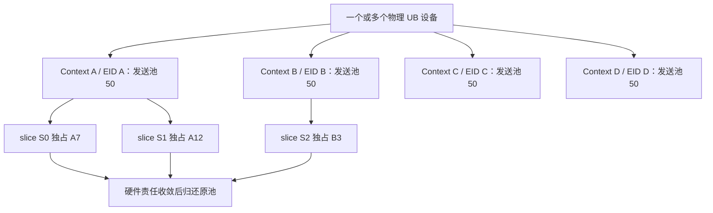
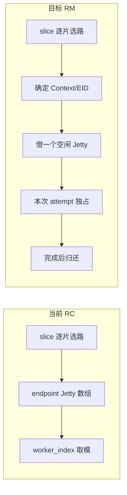
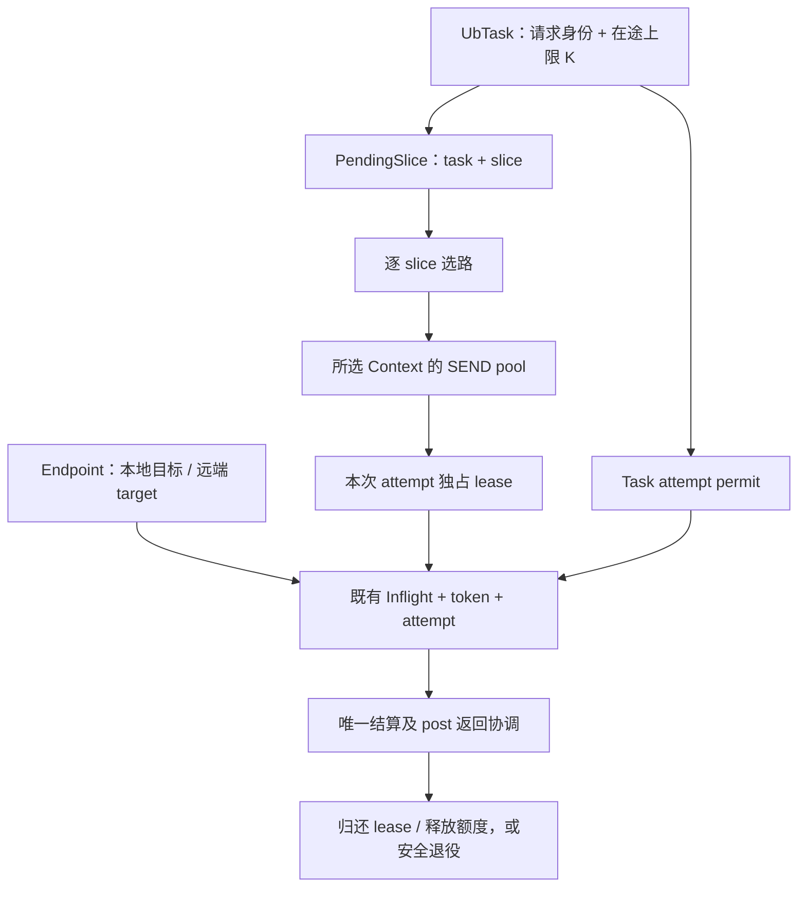
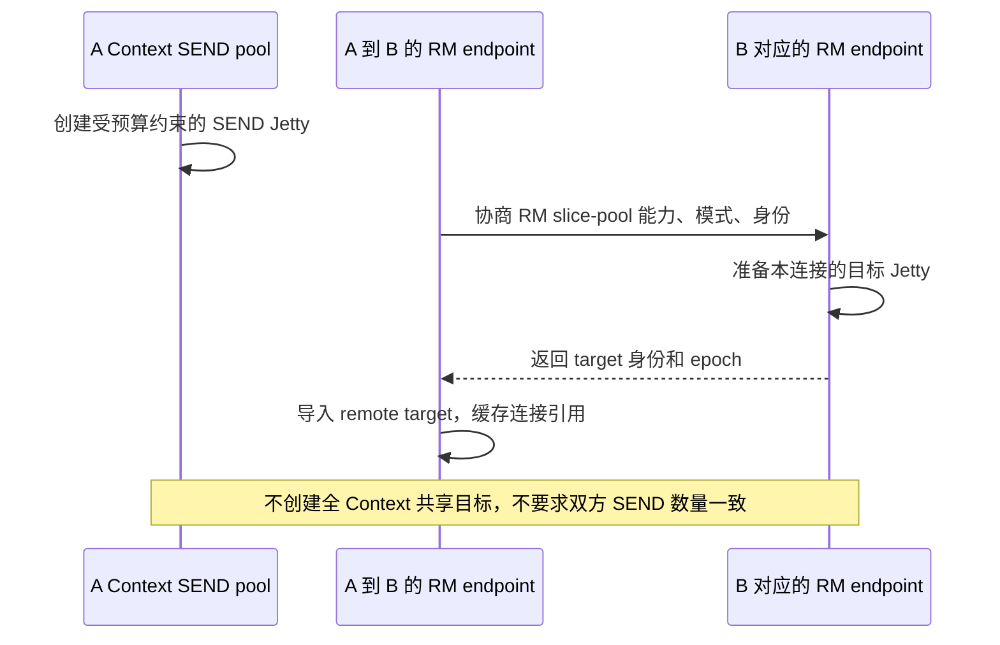
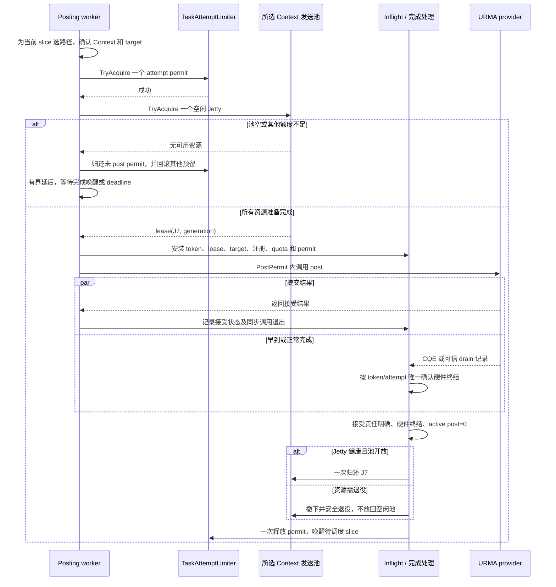
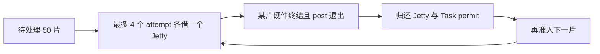
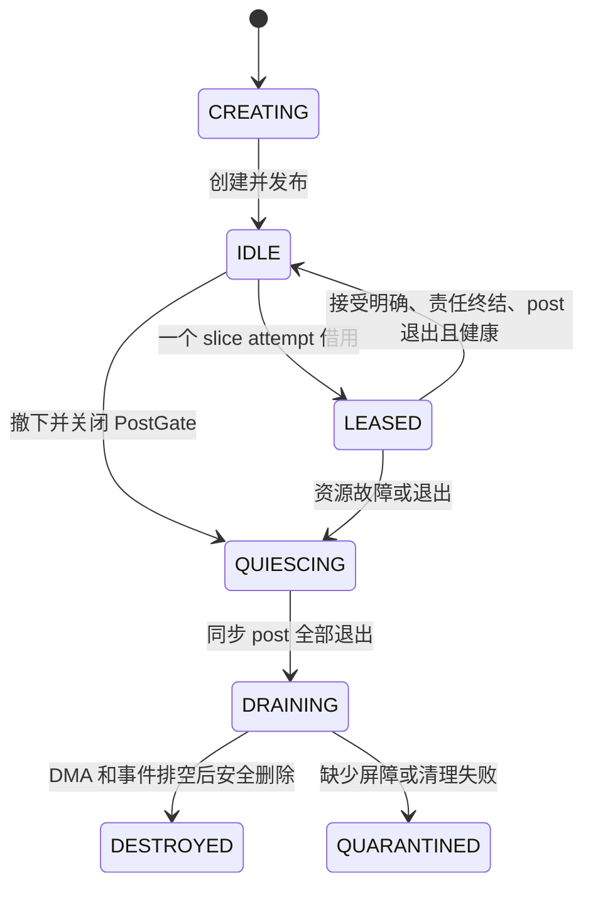
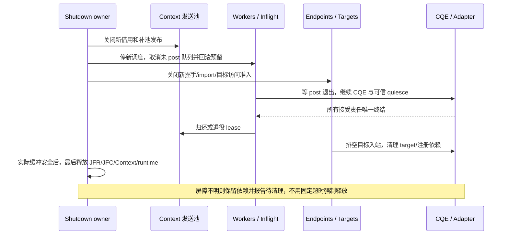

# TENT 物理 UB：RM Jetty 池与 slice 级独占借还设计

> 日期：2026-10-29；状态：待实现，未完成物理 UB RM 实机验收。
> 代码分析基线：Supercache `main_learn` / `fe9155c9`；本次只更新设计文档。
> 本文替代上一版传输组共用 lane 方案：保留逐 slice 选路，每个在途 slice attempt 独占一个发送 Jetty，通过单请求在途上限控制池占用。
> 关联：[物理 UB 分片与可靠性](tent-physical-ub-reliability-design.md)、[UB 节点隔离](ub-node-fault-isolation-design.md)、[UBTransport 组件化](ub-transport-component-design.md)、[线程模型](ub-threading-model-analysis.md)。

## 1. 核心决定与范围

**每个物理 EID/Context 建立有界 RM 发送池。每个 slice 独立选择路径，确定 Context 后独占借一个 Jetty，完成本次 attempt 的硬件责任且同步 post 退出后归还。**

不采用 Group、组窗口、请求内 lane 映射或 lease 生产者 Seal。不同在途 slice 不并发共用发送 Jetty；同一 native Jetty 可在不同 slice 之间顺序复用。

| 项目 | 本文决定 |
| --- | --- |
| 设备范围 | 非 bonding 物理 UB，CPU DRAM 单边 READ/WRITE |
| 池边界 | 物理设备 + EID + 本地 Context incarnation |
| 池大小 | 每 Context 静态配置；50 仅为算例 |
| 借用粒度 | 一个 slice 的一次 attempt，当前实现通常提交一个 WR |
| 防止请求占满池 | 一个 Task 在所有 EID 上合计最多 K 个已准入 attempt |
| 远端目标 | 每个 endpoint 管理自己的目标 Jetty，不设置全 Context 单一共享目标 |
| 正常归还 | 接受范围明确、全部硬件责任终结、同步 post 退出、资源健康、一次认领 |
| RC 兼容 | 保留原连接绑定路径，与 RM 分池，首个 WR 前确定协议 |

这里的“不公用”有两个明确边界：本地发送 Jetty 不同时出租给两个 slice；远端取消全 Context 共享目标，但同一个 endpoint 的目标仍可接收该连接的多个 WR，不为每个 slice 创建远端 Jetty。

代价是借还频率提高，且不再保证同请求、同 EID 的切片使用同一个 Jetty。池化不承诺提高带宽，不增加动态池大小、节点权重或跨 peer 公平框架。

## 2. Context、EID、端口和资源预算

Context 由设备和 eid_index 创建，Jetty 关联该 Context 的 EID/UASID。eid_index 是设备 EID 表索引，不是端口号；Jetty ID 也不能脱离设备、EID/UASID 和代际识别资源。

| EID 类型 | 与端口关系 | 对池的影响 |
| --- | --- | --- |
| port EID | 按部署契约受限于对应端口 | 多个 Jetty 共享该端口可达范围，不增加物理链路数 |
| primary EID | 可使用所属 IODie 允许的多个端口 | 选定 EID 不等于指定唯一出口端口 |
| bonding EID | 聚合层虚拟身份 | 不属于本方案，不使用其成员或 chip 扩展契约 |

相同 EID 的不同 Context 仍不能混池；池键包含 Context incarnation。当前拓扑名 `ub:设备名:eid索引` 可用于选择和诊断，不能单独承担资源代际围栏。



四个池各 50 个，正常 SEND 池成员为 200 个。endpoint 目标数量随连接数增长，不再是固定增加 4 个 Context 共享目标；目标、legacy RC、创建中、退役/quarantine 和其他资源均纳入总预算。

四个 EID 可能属于同一物理设备，max_jetty、JFC 和注册资源上限必须合并核算，不能每个 EID 各领取一份完整设备额度。endpoint 目标创建也必须有界，缓存上限不能代替真实 native 资源预算。

## 3. 当前 TENT 与目标行为

| 环节 | 当前实现 | 本方案 |
| --- | --- | --- |
| Task/Slice | 每个 TE Request 创建 UbTask，再拆 slice | 保留，不引入 Group |
| 选路 | Workers 对 PendingSlice 选择本地/远端组合 | 保留逐 slice 路由规则和健康过滤 |
| 发送 Jetty | endpoint 所有，按 worker_index 取模 | 从选中 Context 池为本次 attempt 独占借用 |
| 远端目标 | RC Jetty 数组一一绑定 | RM endpoint 发布自身目标，不与 SEND 池数量对应 |
| 模式 | 真实 adapter 固定 RC，执行 bind | 增加明确的 RM 创建/import/post 分支 |
| 完成 | token、attempt、Inflight、quota 唯一结算 | 增加 slice lease 和 Task attempt 额度，不另建完成体系 |
| Seal | UbTask::seal 表示切片集合构造完毕 | 原样保留，不作为 Jetty 归还条件 |



当前不是每 slice 独占 Jetty。默认 6 个 worker 和每 endpoint 6 个 Jetty；仅将 jetty_per_endpoint 改成 50，仍按 worker_index 选择，不能形成 Context 池。本方案把容量名额与 worker 编号解耦。

代码依据：[UbTransport](../../mooncake-transfer-engine/tent/src/transport/ub/ub_transport.cpp)、[Workers](../../mooncake-transfer-engine/tent/src/transport/ub/workers.cpp)、[Endpoint](../../mooncake-transfer-engine/tent/src/transport/ub/endpoint.cpp)、[Adapter](../../mooncake-transfer-engine/tent/src/transport/ub/urma_adapter.cpp)、[参数](../../mooncake-transfer-engine/tent/include/tent/transport/ub/params.h)。

## 4. 状态与所有权

| 对象 | 职责 |
| --- | --- |
| UbContext | 持有该 EID/Context 的 RmJettyResource、JFC 和 native Context |
| RmJettyResource（新增） | SEND Jetty 唯一 native owner；预算、registry、退役和补池 |
| SendJettyPool（新增） | 空闲成员、TryAcquire/Return/Remove，不发 RPC、不调用 provider |
| UbJettyLane / SliceJettyLease（新增） | native 身份、PostGate；一次 attempt 的独占使用权和归还认领 |
| UbTask | 原逻辑聚合，加 TaskAttemptLimiter；不保存 Context 到 lane 的映射 |
| PendingSlice / Inflight | 已有 Task/Slice 关联；Inflight 保留 lease、Task permit、target 和注册引用 |
| UbEndpoint | 自己的 RM 本地目标、remote imported target、连接代际及清理责任 |
| UrmaAdapter | RM/RC 模式、target import、post 和真实排空/删除契约 |



每个 TE Request 对应一个 Task；一次 Store GET/PUT 或 batch 可能包含多个 TE Request。现有 PendingSlice 带 UbTask::Ptr，UbSlice 内部保留父 Task 弱引用；slice_id 只在 Task 内唯一。TaskAttemptLimiter 直接附属 Task，用现有对象关联，不用 slice_id 充当全局请求 ID。

资源、Task、endpoint 和 Inflight 各自锁不包围 metadata/RPC/provider 调用。正常资源借还只修改容器状态；native 创建/删除留在受预算控制的准备或后台路径。

## 5. RM 能力与 endpoint 目标协议

现有 RealJetty 的 BOUND 状态及 remote 成员是 RC 模型。RM 必须拆开本地发送句柄与远端目标：

1. Context/JFR/Jetty 参数明确携带模式，真实 provider 验证 RM READ/WRITE。
2. endpoint 为相应本地 Context 和 peer 连接准备自己的 RM 目标，握手公布完整 EID/UASID/Jetty ID、context/endpoint incarnation、target_epoch 和注册兼容信息。
3. remote target 作为独立引用导入；post 接收本次 slice 的 target，逐 WR 设置 tjetty，不依赖发送 Jetty 的固定 RC remote。
4. 不执行 RC bind；不同 slice 在先后归还后，可用同一 SEND Jetty 顺序访问不同 endpoint target。
5. 保留 RC 独立分支与旧握手，不混用 native 资源和描述符。



endpoint target 可服务同连接多个 slice，其生命周期与每个发送 lease 分开，不因一次归还而 unimport。目标创建数量按 endpoint 数增长，这是取消全 Context 共享目标的明确成本。

新能力应使用能区分旧“共享目标/组 lease”含义的协议标识，不能只复用同名能力却改变语义。首个 WR 前协商；不支持时只在零 WR 阶段选择明确支持的 legacy RC 路径，或返回不支持。已接受 WR 后不切协议、不重放。

## 6. 逐 slice 准入与单请求上限

每个 Task 在所有 EID、所有 worker 上合计最多 K 个已准入 attempt。计数从实际发送准备阶段获取 permit 开始，覆盖同步 post、已接受 WR 及安全清理，不仅统计逻辑未完成 slice。

单次流程：

1. 检查取消、deadline、节点/路径可用性，沿现有规则获取或准备候选 endpoint，确认注册范围。慢握手/导入不持有发送 lease。
2. 按 slice 候选选路径并非阻塞取得 Task permit、路径/设备 quota、JFC/lane 必需额度。选路与 quota 若仍使用当前组合接口，后续失败须归还它已产生的预留。
3. 确定 Context 后 TryAcquire 一个 Jetty；全部必要预留可用才提交。任一失败立即回滚全部已取得且未 post 的责任，不持有部分额度等其他资源。
4. 原子确认取消与提交边界，创建 attempt/token/Inflight，并持有 target/注册和实际 buffer 责任，取得 PostPermit 后调用 provider。
5. 根据接受结果与真实完成唯一结算，再归还 Jetty 和额度。

预留为非阻塞操作，具体顺序统一并有对应回滚。没有 Group、多组原子预留、请求固定 EID 或整 batch 的资源原子性。

Task 上限或池不足时走有界延后/唤醒和 deadline，不新建临时 Jetty、不消耗硬件故障重试预算。池空不记为 rail 故障；后续未 post 的重新调度仍沿原 slice 选路规则，不因一个 slice 改变其他 slice 路径。

K 是新增配置契约，不是当前已有参数。应大于零，结合单池及设备资源确定；例如池 50、K=4 可防止一个 Task 在该池同时独占 50 个发送 Jetty。该限制只约束单个 TE Task，不能保证应用拆成多个 Task 后仍只有 K 个，也不能替代全局公平策略。

## 7. 借用和归还时序



正常归还条件：

```text
acceptance_resolved
&& all_accepted_or_possibly_accepted_wrs_terminal
&& active_post_calls == 0
&& lane ACTIVE && pool OPEN && !retire_requested
&& return_claimed_once
```

确定零 WR 被接受时，仍需 post 退出且资源健康，才可直接归还。接受结果不明时保留责任并退役；CQE 与 post 返回必须共同驱动同一个完成门，不能发布逻辑完成后仍无保护地访问 Inflight。

UbTask::seal 仍只表示切片集合已构造。此方案没有 lease 生产者 Seal：一次 attempt 的提交范围在 post 前明确，归还取决于该 attempt 的接受和硬件终结事实，不等待整个 Task 完成。

## 8. 容量、排队与算例

| 额度 | 作用 | 释放时机 |
| --- | --- | --- |
| Task attempt permit | 限制一个请求合计占用的发送准备/硬件责任 | 未接受回滚，或已接受责任安全结束且同步 post 退出 |
| Pool lease | 同 Context 一个 slice attempt 独占一个发送 Jetty | 安全归还；坏资源只撤下并进入退役 |
| Lane/JFC credits | 限制真实 native 队列和完成责任 | 确定未接受或真实终结，恰好一次 |
| device/path quota | 保留当前在途 WR/字节上限和选路依据 | 对应 attempt 责任结算，幂等归还 |

当前 worker 通常每 slice 提交一条 WR，因此每次 lease 通常只消耗一条 WR 的深度。即使 Jetty depth=256，本方案也不把其他 slice 填到同一已借 lane。这牺牲队列利用率，换取简单的独占模型；若吞吐不足，应评估该取舍，不能悄悄恢复 slice 共用。

例如一个 Task 有 50 片，均选同一 Context，池容量 50、K=4：



这个请求最多同时占 4 个发送 Jetty，不是 1 个，也不是 50 个；后续 slice 可借到相同或其他空闲成员。若选择不同 EID，合计仍受同一个 K 约束。

四个池各 50 不代表只能或必然支持 200 个 Task；容量由活跃 attempt、endpoint 目标、JFC/设备 quota 和原生上限共同决定。多个 Task 仍可能同时打满池，需保留有界队列、现有优先级和公平性验收，不额外建立跨 peer 调度系统。

## 9. 完成、失败与重试

复用 UbCompletionToken、UbAttemptToken 和 Workers::Inflight。每次重试建立新 attempt 身份，新旧责任不能共用同一 lease 状态；slice_id 只在 Task 内唯一，不能作为全局 native token。

| provider/完成结果 | 处理 |
| --- | --- |
| 成功接受 | 保留 lease/permit/注册，等待真实终结 |
| 确定零接受 | 回滚对应额度；健康 Jetty 归还，否则退役 |
| 可信 accepted prefix | 前缀保留，确定未接受后缀取消；若一 slice 将来对应多 WR，全部责任终结后才归还该 lease |
| 接受范围不明 | 保留所有可能责任、停止该 attempt，进入安全退役 |
| 重复/迟到 CQE、未知 token | 不重复完成、归还或扣减 |
| flush/done 等控制记录 | 先分类，不作为新的业务完成直接解引用 user_ctx |

Jetty 有可信终结 CQE 且资源仍健康时，失败操作也可安全归还；失败结果不自动等于 Jetty 故障。资源确实不可用时才退役。

READ 失败内容无效，重读前旧 WR 不得继续写同一 buffer，注册和访问契约仍须有效。WRITE 可能已接受时保留结果不确定性，不盲目沿用一般重试预算重放。仅明确未接受或上层提供安全重放契约时才重试；重试重新取得 Task permit、路径额度和 lease。

逻辑 timeout/cancel 不提前释放已接受责任。未 post 且提交边界确认取消时立即回滚；post 中或已 post 则等真实 CQE/drain。物理未终结的超时 attempt 继续占 Task permit，不能靠逻辑重试绕过 K。

## 10. 资源退役、endpoint 目标与退出



一个 lane 故障只影响其 attempt 和资源，不直接关闭整个 EID 池。Context/JFC 故障按对应域停止新借用。节点恢复不复活退役 Jetty，补池创建新 identity，静态总预算包括退役、quarantine 和创建中责任。

补池在锁外创建、发布前复查 stopping/代际；资源不足不无限扩建。delete 失败后的句柄有效性必须按物理 provider 明确；只有确认 retained 且允许重试才再次调用，consumed/unknown 不解引用旧指针。未排空的事件和 native ID 归属继续保留，不能让迟到事件命中新资源。

endpoint 持有本连接的本地目标和导入远端 target，目标退役更新 epoch。缓存移除只撤销可发现性；已 post Inflight 继续持有 target/segment 引用，安全后后台 unimport/delete。不能让 endpoint::quiesce 遍历并 reset 属于 Context 池、可能服务其他 peer 的发送 Jetty。

目标不在 Context 范围共享，不等于其入站 DMA 已可枚举。销毁 endpoint 目标或注销内存前仍需 provider 停止新访问并排空入站的屏障，不能只看本地 SEND pending=0。当前 quiesceJetty 的发送 DMA 契约须验证 RM，不能直接推导入站保证。



token/MR 引用不能阻止调用者释放实际 buffer；现有对外超时与清理契约若不足，先落实实际 buffer owner。发布逻辑结果、释放 lease 与可释放用户内存是不同事件，不能互相代替。

## 11. 最新 TENT 的接入点

| 文件/模块 | 修改职责 |
| --- | --- |
| [context.h](../../mooncake-transfer-engine/tent/include/tent/transport/ub/context.h) / context.cpp | 持有该 EID/Context 的发送资源 owner，核对设备级总上限 |
| RmJettyResource / SendJettyPool / SliceJettyLease（新增） | 独占借还、代际、PostGate、预算和安全退役，不增加 Group 类型 |
| [slice.h](../../mooncake-transfer-engine/tent/include/tent/transport/ub/slice.h) | Task 内新增原子/锁保护的 attempt 上限，保留原 seal/聚合语义 |
| [workers.cpp](../../mooncake-transfer-engine/tent/src/transport/ub/workers.cpp) | 保留逐 slice 选路；Task/quota/池预留协调；Inflight 持 lease 和 permit，唯一释放并唤醒 |
| [endpoint.h](../../mooncake-transfer-engine/tent/include/tent/transport/ub/endpoint.h) / endpoint.cpp | 连接级 RM 目标和 remote target，拆分 RC bind 与 RM import，调整回收范围 |
| [urma_adapter.h](../../mooncake-transfer-engine/tent/include/tent/transport/ub/urma_adapter.h) / .cpp | 模式能力、独立 target、RM post、accepted 范围、drain/delete 契约 |
| [ub_transport.cpp](../../mooncake-transfer-engine/tent/src/transport/ub/ub_transport.cpp) | 安装池、协议协商、Task 初始化与 shutdown；不引入请求窗口规划 |
| [quota.cpp](../../mooncake-transfer-engine/tent/src/transport/ub/quota.cpp) / JFC | 复用现有配额，衔接额度回滚，不重复统计硬件责任 |
| [params.h](../../mooncake-transfer-engine/tent/include/tent/transport/ub/params.h) / tests | 显式 RM 开关、每 Context 池目标、Task 在途上限 K 和有界等待；名称/默认值待落地 |

健康模块仍决定节点和路径准入，池不制造端口故障；时延模型只消费合格完成样本，不把池空闲数或等待计入新调度权重。实现可以服务未来独立 UbEngine，但不要求先抽 SDK，不复制两套 UB 数据面。

## 12. 实施和验收

实施顺序：验证物理 RM 及端点目标能力 → 模式/握手与独立 target → Context 池和 attempt lease → Task K 与原 quota/完成衔接 → 超时、故障、兼容和实机验收。RC 在功能关闭时保持原行为；未验证 RM 则不启用。

| 场景 | 必须证明 |
| --- | --- |
| 四 EID 各配 50 | 200 个 SEND 正常成员，endpoint 目标等另计，共享设备预算不越界 |
| 50 片、单 Context、K=4 | 同 Task 合计最多 4 个准入 attempt，各自独占；完成释放后继续 |
| 同 Task 跨 EID、并发 worker | K 原子生效，合计不超限，不按 slice_id 混淆 Task |
| 一个 Jetty depth 大于 1 | 首版仍只租给一个 attempt，不暗中并发混入其他 slice |
| 多 Task、多优先级 | 单 Task 不无限占池，等待和队列有界，明确不承诺应用级全局公平 |
| worker_count=6、pool=50 | 空闲池选择不由 worker_index 固定，活跃资源取决于准入 attempt |
| 池空、quota 满、握手失败、提交前取消 | 没有硬件接受时全部预留准确回滚，等待不耗故障重试预算 |
| Task seal、CQE 早到、post 尚未返回 | 不提前归还或发布后访问已释放记录 |
| 零接受、partial/模糊接受、重复 token | 确定后缀回滚，可能接受责任保留，一次归还 |
| timeout 后物理仍在途 | lease/permit/实际缓冲保留，新 attempt 不能绕过 K |
| WRITE 结果未知、READ 重试 | 不盲目重放，不与旧操作争写同一缓冲 |
| endpoint eviction、目标换代、peer 重启 | 不清理其他 endpoint 的 lane，旧 target 引用正确收敛 |
| lane/Context/JFC 故障及补池 | 故障域明确、身份不复活，native 总量有界 |
| shutdown 与 post/CQE/refill 并发 | 无屏障不释放 native、注册、buffer 或 Context |
| RM/RC、旧 peer、两端池大小不同 | 零 WR 阶段确定协议，RM 无 SEND 一一匹配要求 |

UT 使用可控 adapter/clock/线程交错验证状态机；integration 验证 Task 来源、协议和唯一结算；ST 验证真实物理 RM、端点目标入站屏障与并发性能。此处均为待执行计划，不是已完成测试结果。

重点指标：每 Task 准入 attempt、每 Context idle/leased、借还次数、回滚/等待、endpoint 目标数量、retiring/quarantine、吞吐和 p99。相比上一版，增加了每 slice 借还开销并减少单 Jetty 队列利用率，换取与逐 slice 路由一致、无需 Group/Seal 的简单模型。
