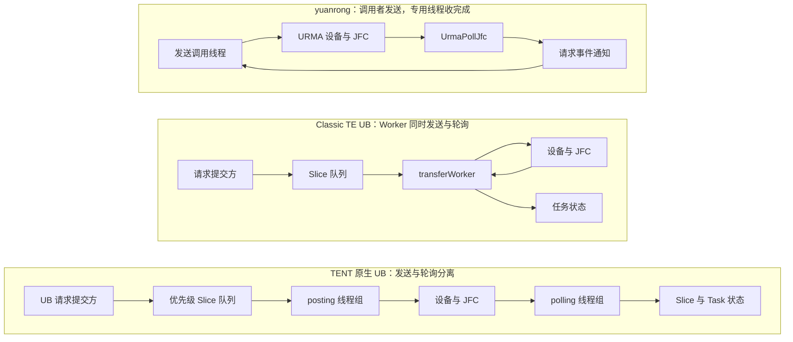
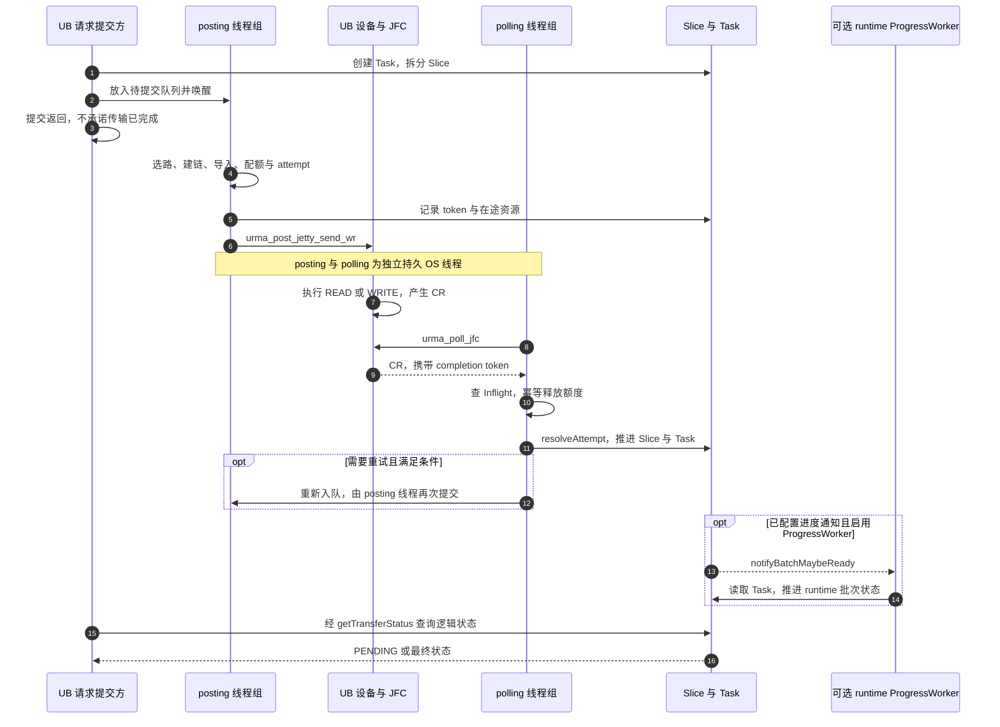
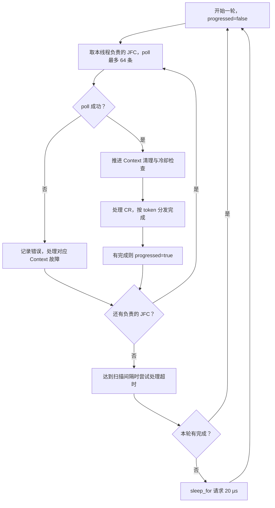
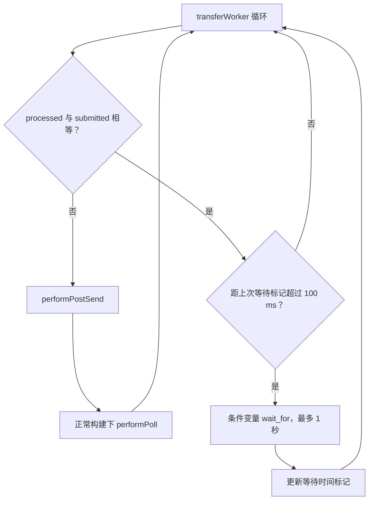

# Mooncake UB 线程模型：提交、轮询、等待与退出

> 日期：2026-10-28。
>
> Mooncake/Supercache 分析基线：`main_learn`，`a84c19915bfbf9e6683d41ea55044b9cd6440acf`。
>
> 对照仓库：同级 yuanrong-datasystem，HEAD `eacc985721d483b861b42aa6cbba840088c209f9`；本文核对其 URMA 线程创建、post、poll 和事件通知源码。
>
> 范围：TENT 原生 UBTransport 为主，同时对照 Classic TE Kunpeng UB 和 yuanrong 的 UrmaManager。本次仅形成分析文档，不修改线程实现或配置，不提供未经实测的性能结论。

## 1. 先看结论：三个实现不是同一种线程模型

```text
yuanrong：
调用线程直接 post + 专用 UrmaPollJfc 线程 poll + 请求事件等待

Classic TE UB：
调用方入队 + 同一组 transferWorker 交替 post/poll + 独立 monitorWorker

TENT 原生 UB：
提交方拆片入队 + 专用 posting 线程组 + 专用 polling 线程组
```

这里的 post 是实际调用 URMA 接口提交 WR，poll 是实际消费 JFC。它们不同于“把任务交给 SDK”和“查询逻辑任务状态”。

| 维度 | yuanrong | Classic TE UB | TENT 原生 UB |
| --- | --- | --- | --- |
| 普通数据 WR 由谁 post | 发送接口调用线程 | transferWorker | postingLoop 线程 |
| 正常 CR 由谁 poll | UrmaPollJfc | 同一个 transferWorker | pollingLoop 线程 |
| 共享范围 | 进程内 UrmaManager 单例 | 每个 Context 的 UbWorkerPool | 每个已安装 UBTransport 的 UbWorkers |
| 是否每请求创建线程 | 否 | 否 | 否 |
| 完成如何关联 | 请求 ID 与 UrmaEvent | Slice/任务状态 | token、Inflight、attempt、Slice、Task |
| 空闲等待 | 无 CR 时 nanosleep 请求 1 µs | 按工作计数及等待时间标记决定是否条件变量等待 | posting 条件变量等待；polling 一轮无完成时请求 sleep 20 µs |
| 异步设备事件 | 本文主要比较数据完成线程 | monitorWorker 处理相关事件 | 当前不能把 pollingLoop 当作完整异步事件/主动健康模块 |

关闭或排空时可能由控制流程临时消费 JFC，具体见第 7 节。因此上表限定普通提交和正常完成路径。

## 2. 图一：三种线程分工总览



箭头表示数据或完成处理方向，设备不会主动调用图中的线程函数；CPU 线程通过 post/poll 与设备交互。

TENT runtime 若开启准入队列，真正进入 UBTransport 的提交上下文可能是运行时进度线程，而不总是最初的应用调用线程。但无论由谁进入 UBTransport，普通 WR 的原生 post 仍交给 UB posting 线程执行。

## 3. yuanrong：UrmaPollJfc 的对应关系

### 3.1 线程创建

本地源码 `src/datasystem/common/rdma/urma_manager.cpp` 中，初始化创建：

```cpp
serverEventThread_ =
    std::make_unique<Thread>(
        &UrmaManager::ServerEventHandleThreadMain, this);
serverEventThread_->set_name("UrmaPollJfc");
```

它在初始化后持续运行，供多个连接和请求使用，不是每次发送时创建。

### 3.2 提交和完成

发送路径直接调用 `ds_urma_post_jetty_send_wr()`。执行该接口的线程可以来自 SDK 调用方或业务执行上下文；这里只能确认该路径没有统一转交给一个专门 posting 线程池。

`ServerEventHandleThreadMain()` 调用 `PollJfcWait()` 收取 CR，再通过 `CheckAndNotify()` 按 request ID 查找事件并通知。需要同步完成的发送调用方在自己的事件等待路径上等待。

### 3.3 1 µs 睡眠的含义

`PollJfcWait()` 取得 0 条 CR 时执行：

```cpp
const struct timespec ts{0, 1000};
nanosleep(&ts, nullptr);
```

睡眠的是 UrmaPollJfc。它与调用方的事件等待是两个独立等待位置。

1 µs 是请求的休眠时长，不是 OS 保证的实际唤醒延迟，也不是每个操作的完成通知延迟。不能仅比较 sleep 参数大小就得出两个系统的端到端延迟差。

## 4. TENT：两组持久线程如何创建和配置

### 4.1 所有者和生命周期

`UbTransport::install()` 创建 Context/JFC、BufferManager、EndpointStore、Quota 和 UbWorkers，随后调用 `workers->start()`。

`UbWorkers` 持有两组 `std::thread`：

```cpp
std::vector<std::thread> posting_threads_;
std::vector<std::thread> polling_threads_;
```

创建逻辑：

```cpp
for (uint32_t i = 0; i < params_.worker_count; ++i) {
    posting_threads_.emplace_back(
        &UbWorkers::postingLoop, this, i);
}

const size_t poller_count =
    std::min<size_t>(params_.poller_count, all_jfcs_.size());

for (size_t i = 0; i < poller_count; ++i) {
    polling_threads_.emplace_back(
        &UbWorkers::pollingLoop, this, i);
}
```

创建路径没有设置 yuanrong 的 `UrmaPollJfc` 线程名。分析时应按函数与线程组识别，不应要求在系统线程列表中一定找到该名字。（T1、T2）

### 4.2 配置与实际数量

| 参数 | UbParams 内置默认 | 仓库示例 JSON | 作用 |
| --- | --- | --- | --- |
| transports/ub/worker_count | 6 | 4 | posting 线程数 |
| transports/ub/poller_count | 2 | 1 | polling 线程数上限 |
| transports/ub/jfc_per_context | 6 | 1 | 每 Context 的逻辑 JFC 包装数量 |

只有实际加载示例文件时，其中值才会覆盖内置默认。不能把 JSON 示例值和所有程序入口的默认值混为一谈。（T3、T4）

```text
posting 数量 = worker_count
polling 数量 = min(poller_count, all_jfcs.size())
```

例如两个 Context 各有 6 个 UbJfc，all_jfcs 共 12 项，poller_count=2：

| 线程 | 正常负责的 JFC 下标 |
| --- | --- |
| polling 0 | 0、2、4、6、8、10 |
| polling 1 | 1、3、5、7、9、11 |

这是对 UbJfc 包装对象的分配，不是在统计底层所有 native 队列对象。两个 polling 线程可以各跨多个 Context 工作，不是一设备一个线程。

上述数量不包含应用线程、runtime ProgressWorker、控制面、指标以及 provider 自己可能创建的线程，不能当作进程总线程数。

## 5. TENT：一次请求从提交到完成

### 5.1 请求提交与切片

`submitTransferTasks()` 为逻辑请求建立 UbTask，并按有效 slice_size 拆成 UbSlice。随后 `workers->submit()` 将 Slice 放入优先级队列，调用 `queue_cv_.notify_all()`。（T5）

这一步主要是构建并入队逻辑任务，没有在这个函数中直接调用原生 URMA post。

postingLoop 持续取出 PendingSlice，进入 `processPending()`，依次处理：

1. 目标 Segment/Buffer 元数据和范围解析。
2. 本地、远端设备候选与路径选择。
3. Endpoint 解析或握手、物理额度预留。
4. 本地注册查找、远端 Segment 导入。
5. Endpoint outstanding 与 Slice attempt。
6. completion token、Inflight、Segment 引用和截止时间。
7. `adapter_->post()`，最终调用 `urma_post_jetty_send_wr()`。（T2、T6）

模块还会处理部分 post 接受、失败退休与重试。线程分工并不意味着发送阶段只有一个轻量函数，冷连接可能包含建链或元数据相关工作。

### 5.2 图二：TENT 提交与完成时序

下图以一次正常完成的分片传输为例；线程可以并行运行，不表示所有片必须逐片串行完成。



CR 的 token 先定位 Inflight，再核对 attempt 并推进 Slice。迟到、重复完成不能重复释放或把旧尝试的结果套到新尝试上。

重试提交也经过 posting 队列，不是 polling 线程收到错误后直接在正常完成分支调用原生 post。排空期间的特殊操作另见第 7 节。

### 5.3 正常完成归属与锁

pollingLoop 按 JFC 下标步进分工，每次对一个 JFC 调用 `poll(64, completions)`。这里的 64 是单次调用请求的完成数量上限，不是一次整个逻辑请求最多 64 片。

调用链为：

```text
pollingLoop
  → UbJfc::poll
  → UrmaAdapter::poll
  → urma_poll_jfc
  → handleCompletion(token)
  → resolveInflight / resolveAttempt
```

真实 Adapter 在 poll 时持有 JFC 的 `pollMutex()`。正常线程分工减少抢消费，锁还负责与异常排空同步。（T7、T8）

## 6. 等待与睡眠：究竟是谁在停下来

### 6.1 posting 队列为空

`popPending()` 使用 `queue_cv_.wait()`，等待队列有任务或线程停止。没有新待提交任务时，posting 线程不会持续从空队列忙取。

### 6.2 配额或容量不足

`deferPending()` 使用约 50 µs 的条件变量等待，再根据取消/停止状态重新入队。这是 posting 线程的资源退避，不是 JFC polling 的空闲睡眠。

当前 wait_for 的 predicate 主要检查停止和取消。额度释放虽然会 notify，不能据此承诺等待立即结束并提交；最终仍受 predicate、退避时间与调度影响。（T2）

### 6.3 polling 一轮没有完成

当前正常循环在遍历自己负责的 JFC 后，如果该轮没有取得完成记录，执行：

```cpp
if (!progressed) {
    std::this_thread::sleep_for(
        std::chrono::microseconds(20));
}
```

这 20 µs 睡眠属于 polling 线程。若取得完成，正常路径可以直接进入下一轮。

成功 poll 也会推进 Context 故障清理与冷却检查；约每 1 ms，poller 尝试进行一次 timeout scan。这个间隔受完整循环耗时、锁和 quiesce 等影响，不是独立硬实时定时器。

### 6.4 图三：TENT polling 线程的一轮循环



该图省略停止标志判断。Context 冷却判定不等同于完整端到端链路探测；sleep 20 µs 也不提供 20 µs 的完成时延保证。

### 6.5 等待位置对照

| 位置 | 执行上下文 | 机制 | 条件 |
| --- | --- | --- | --- |
| yuanrong 无 CR | UrmaPollJfc | nanosleep，目标 1 µs | 单次原生 poll 返回 0 |
| yuanrong 同步发送等待 | 发送调用方 | UrmaEvent 等待 | 需要同步完成 |
| TENT 队列为空 | posting 线程 | 条件变量 wait | 无待提交 Slice |
| TENT 资源退避 | posting 线程 | 条件变量 wait_for，约 50 µs | 当前容量/额度等不满足 |
| TENT 一轮无完成 | polling 线程 | sleep_for，目标 20 µs | 遍历后 progressed=false |
| TENT runtime 进度等待 | 可选 ProgressWorker | 条件变量 wait / wait_for | 无通知，或有运行时队列待推进 |
| Store 普通 TENT Future 等待 | 调用 wait/get 的线程 | 循环检查逻辑任务状态 | 本文核对的普通适配路径 |
| Classic monitorWorker | 独立监控线程 | epoll_wait，参数 100 ms | 等待相关异步事件 |

这些等待发生在不同层，不能把它们都归为“URMA 在 sleep”。

## 7. 正常线程模型的例外：排空和卸载

### 7.1 quiesce 也可能原生 poll

`quiesceJetty()` 不是简单设置标志。真实 Adapter 会进入 ERROR、等待 flush-done 并排空 native WR；其中也调用 `urma_poll_jfc()`。

因此：

- 正常 CR 主要由 pollingLoop 线程组消费。
- timeout scan 通常从 pollingLoop 进入，但关闭时的 `stop()/uninstall()` 也会发起 quiesce。
- 调用卸载的控制线程可能在 quiesce 内临时执行原生 poll。
- quiesce 与正常 poll 通过相同 JFC pollMutex 互斥，不允许无协调地抢走完成。
- quiesce 返回的真实完成仍必须经过 handleCompletion，不能丢失 token。

这并不意味着普通应用查询状态会自行 poll JFC；它是资源生命周期中的受控排空。（T7）

### 7.2 退出顺序保护 DMA

UbWorkers::stop 的关键顺序是：

```text
停止接受新任务、停止新 posting/retry
→ 唤醒队列、取消未提交项
→ join posting 线程，保证不再有新 WR 越过原生 post
→ 保持 poller 运行，quiesce 相关 Endpoint
→ 处理已取回完成
→ fence 成功后停止并 join polling 线程
→ 安全结算剩余 token
```

如果 fence 失败，stop 可以返回错误并保留 poller、token、Segment、Endpoint 和额度，以便后续继续安全清理。不能把固定 sleep 或 wait_for 时间当作已停止 DMA 的证明。

因此，线程退出不是“设置一个 bool 后全部立刻销毁”，卸载调用可能执行较重的排空工作。

## 8. 应用查询状态，不等于消费 JFC

### 8.1 UBTransport 的 getTransferStatus

当前方法主要读取：

```cpp
status = ub_batch->task_list[task_id]->transferStatus();
```

它读取逻辑 Task 的快照，不由此调用原生 `urma_poll_jfc()`。（T5）

即使应用线程高频调用 getTransferStatus，硬件完成仍需要 polling 线程取得并推进。应用忙查状态不能替代 JFC 进展。

### 8.2 可选 ProgressWorker

runtime 可以启用 ProgressWorker：

```text
UB Task 进度通知
→ sub_batch notify_progress
→ TransferEngineImpl::notifyBatchMaybeReady
→ ProgressWorker 条件变量唤醒
→ progressBatch / progressRuntimeQueue / 延迟回收
```

它推进批次与运行时队列，不是 UB 的硬件 polling 线程。没有启用它时，也不能假定通知会自动唤醒业务线程；应用仍通过对应 API 推进或查询运行时状态。（T9、T10）

### 8.3 Mooncake Store 普通 TransferFuture

本文核对的 `TransferEngineOperationState::wait_for_completion()` 在 TENT 路径中循环调用 `check_task_status()`，直到结果出现或达到外层约 60 秒超时。

该循环内没有无条件 sleep 或条件变量阻塞，因此不能描述成 yuanrong 那样“每个请求等待事件，poller 直接唤醒它”。

`USE_EVENT_DRIVEN_COMPLETION` 下的条件变量等待分支检查了 `!engine_.isUsingTent()`，不能把该 Classic 分支套到 TENT batch 上。其他 Store 数据通路有自己的 OperationState，不能将本段结论推广为所有 Future 都忙轮询。（S1）

这带来的工程含义是：即使 JFC poller 正在 sleep，调用 Store 普通同步等待的线程仍可能消耗 CPU 检查任务状态。是否成为实际瓶颈需要测量，本文没有进行性能实验。

## 9. Classic TE UB：同一组 Worker 交替 post/poll

### 9.1 创建范围

Classic `UbWorkerPool` 随 Context 建立，创建 `workers_per_ctx` 个 transferWorker，并另加一个 monitorWorker。

transferWorker 的工作分支执行：

```cpp
performPostSend(thread_id);
#ifndef USE_FAKE_POST_SEND
performPoll(thread_id);
#endif
```

所以它不是 TENT 的独立 posting/polling 两组线程，而是同一 Worker 在循环内承担两种工作。这里描述正常构建路径，不将 fake-post 测试分支当作生产数据通路。（C1）

### 9.2 图四：Classic Worker 循环



100 ms 比较的是源码中的等待时间标记，不应擅自解释为“必须连续空闲 100 ms”。条件变量可以提前唤醒，1 秒也不是所有请求必然额外等待的时间。

独立 monitorWorker 使用 epoll 处理相关异步事件，并具有当前实现的 Context active 周期处理。它不是 transferWorker 的 JFC 完成收取线程，也不能仅根据函数名推导出完整端到端健康恢复能力。

## 10. 对延迟、CPU 与组件化设计的意义

### 10.1 额外线程交接在哪里

与调用者直接 post 相比，TENT 的正常路径多了从提交上下文到 posting 队列的交接：

```text
应用/runtime 提交
→ 队列等待与 posting 调度
→ 原生 post 与设备传输
→ JFC poll 与完成分发
→ Task/runtime 进展
→ 应用等待方观察结果
```

分离后可以把多应用线程的提交集中管理，统一处理优先级、配额和切片；也引入队列、锁、调度与跨核访问成本。不能仅凭结构宣称吞吐一定更高或延迟一定更低。

### 10.2 建议分别观测的时间

| 指标 | 目的 |
| --- | --- |
| 逻辑提交到 Slice 入队 | 区分 runtime 准入/准备时间 |
| 入队到开始 processPending | 观察 posting 队列和调度 |
| processPending 到原生 post | 观察冷建链、导入与资源压力 |
| post 到 CR 被取走 | 包含设备传输与轮询发现，不是纯硬件时延 |
| CR 分发到 Task 更新 | 观察锁、聚合和重试处理 |
| Task 更新到应用观察 | 观察 runtime 进度与调用方等待方式 |
| 无完成轮数、sleep 实际耗时、线程 CPU | 区分空闲节能与唤醒成本 |
| timeout scan / quiesce 耗时 | 避免误把排空阻塞归因于普通 poll |

### 10.3 独立组件设计中的 Threaded 与 Manual

[组件化设计](ub-transport-component-design.md) 提出的 Manual progress 尚未实现，不能当作当前 TENT 的默认模式。

独立组件若提供多个模式，应明确：

- Threaded：模块内部拥有 posting/polling；应用 wait 不抢原生 JFC。
- Manual：应用显式调用统一 progress，保证完成与健康任务都有执行机会。
- 若将来增加调用者直接 post 模式，需要单独设计提交门禁、Jetty 并发和完成所有权。
- 不论模式，同一 JFC 的正常完成分发与特殊排空必须协调，不能两个无关消费者各自取走 CR。
- 线程组、runtime 进度和业务回调执行器应分开命名与观测。

## 11. 源码索引与本次验证范围

本仓库链接相对本文定位。yuanrong 文件位于同级仓库，表中路径相对其仓库根目录；不将其文件复制进本仓库。

| 编号 | 文件与入口 | 依据 |
| --- | --- | --- |
| T1 | [ub_transport.cpp](../../mooncake-transfer-engine/tent/src/transport/ub/ub_transport.cpp)：install | UbWorkers 装配和 start |
| T2 | [workers.cpp](../../mooncake-transfer-engine/tent/src/transport/ub/workers.cpp)：start、submit、postingLoop、pollingLoop、deferPending、stop | 两组线程、等待、分发与退出 |
| T3 | [params.h](../../mooncake-transfer-engine/tent/include/tent/transport/ub/params.h)：UbParams | 内置 6 posting、2 polling 等 |
| T4 | [transfer-engine.json](../../mooncake-transfer-engine/tent/config/transfer-engine.json)：transports.ub | 示例 4 posting、1 polling |
| T5 | [ub_transport.cpp](../../mooncake-transfer-engine/tent/src/transport/ub/ub_transport.cpp)：submitTransferTasks、getTransferStatus | 切片入队与逻辑状态读取 |
| T6 | [workers.cpp](../../mooncake-transfer-engine/tent/src/transport/ub/workers.cpp)：processPending、handleCompletion、resolveInflight | 原生提交前处理、token 与重试 |
| T7 | [urma_adapter.cpp](../../mooncake-transfer-engine/tent/src/transport/ub/urma_adapter.cpp)：post、poll、quiesceJetty | URMA 调用、JFC 锁与排空例外 |
| T8 | [jfc.cpp](../../mooncake-transfer-engine/tent/src/transport/ub/jfc.cpp)：UbJfc::poll | poll 包装与计数 |
| T9 | [transfer_engine_impl.cpp](../../mooncake-transfer-engine/tent/src/runtime/transfer_engine_impl.cpp)：attachProgressNotifier、notifyBatchMaybeReady | runtime 通知桥接 |
| T10 | [progress_worker.cpp](../../mooncake-transfer-engine/tent/src/runtime/progress_worker.cpp)：runner | 条件变量等待与逻辑进展 |
| S1 | [transfer_task.cpp](../../mooncake-store/src/transfer_task.cpp)：wait_for_completion | 普通 Store TENT 等待及 Classic 条件分支 |
| C1 | [Classic ub_context.cpp](../../mooncake-transfer-engine/src/transport/kunpeng_transport/ub_context.cpp)：UbWorkerPool、transferWorker、monitorWorker | 同 Worker post/poll 与独立监控 |
| Y1 | `src/datasystem/common/rdma/urma_manager.cpp`：初始化、ServerEventHandleThreadMain、PollJfcWait、CheckAndNotify、WaitForUrmaEvent | UrmaPollJfc、1 µs 请求睡眠、请求事件与直接 post |

本文只描述已核对代码的控制流，未运行 UB 硬件测试或线程性能基准。新文档不改变现有线程数、轮询间隔或 Store 等待方式。

已检查 UTF-8、文件结尾、尾随空白、冲突标记、代码围栏、13 个仓库内相对链接，以及本地 yuanrong 源码路径和示例线程配置。四张 Mermaid 图已使用 Mermaid 11.14.0 在 Chromium 中解析并渲染为 SVG/PNG，检查了布局与可读性；临时渲染文件不纳入提交。

已尝试 `docs/make.bat html`，但本机缺少 `sphinx-build`；`pre-commit` 及其 Python 模块也未安装，相关检查未完成。本文件位于 `docs/analyze/`，未修改站点导航；本次仅新增分析文档，不运行无关的 C++ 测试。
