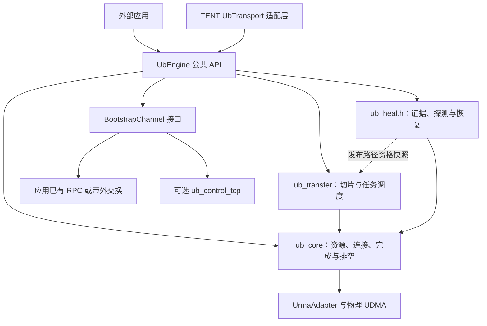
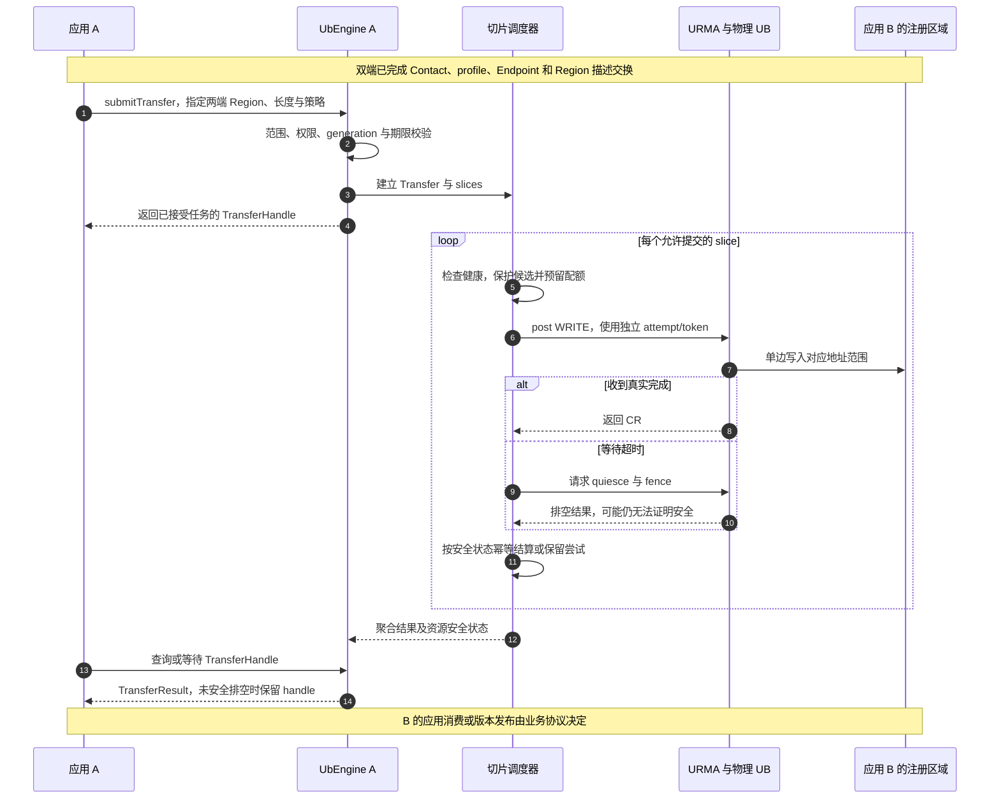
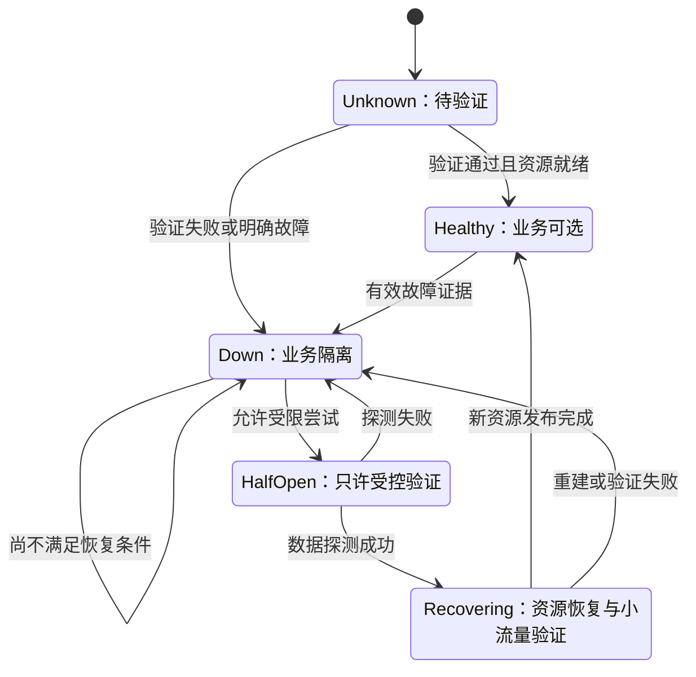

# UBTransport 独立组件化设计

> 日期：2026-10-27。
>
> 分析基线：Supercache `main_learn`，`0c08f88915d14f3bb56e057442559df96b19973a`。本文涉及的代码事实与拟新增接口分开说明。
>
> 文档性质：待实现的组件化设计。本次只新增文档，不表示独立 SDK、主动探测或物理设备恢复能力已经实现。
>
> 范围：基于物理 UB 设备与 URMA 的 CPU DRAM READ/WRITE、可配置切片传输、链路主动探测和安全恢复。这里的“单边收发”指 READ/WRITE，不包含双边 SEND/RECV。

## 1. 目标与边界

将现有 TENT 原生 UBTransport 的可复用能力抽成独立 UbEngine，使其他应用无需启动完整 TENT runtime，即可使用：

1. 物理 UB 设备/EID 发现、选择、资源创建和能力查询。
2. 本地内存注册、远端注册描述导入、连接建立和 READ/WRITE。
3. 单次操作与自动切片传输，支持完成查询、等待、取消和排空。
4. peer-specific 物理路径选择、配额和有界进展。
5. 独立于业务流量的健康探测、错误证据、路径隔离与恢复。
6. 清晰的缓冲区生命周期、结果未知和重放契约。
7. 稳定的 C++ API、可选 C ABI、独立构建及安装包。

TENT 的 UbTransport 保留原入口，改为独立引擎的适配层。避免把现有 UB 实现复制成另一份，形成两套完成处理、排空和故障修复逻辑。

本阶段不要求：

- 提供完整 URMA 原生 API 的透传封装。
- 实现 SEND/RECV、原子操作、GPU 内存或通用远端应用通知。
- 内置 Store 对象路由、复制策略、元数据共识或节点 membership。
- 强制部署 Redis、TENT 元数据服务或特定业务 RPC。
- 自动解决任意共享原地 WRITE 的 exactly-once、一致性和全局排序。
- 复刻 bonding 的所有虚拟化和消息编码。

关联设计：

- [物理 UB 分片与可靠性增强](tent-physical-ub-reliability-design.md)：资源、路径与 DMA 安全的基础依据。
- [UB 节点级故障隔离](ub-node-fault-isolation-design.md)：端口证据、status 4、节点锁存和 Client/Store 协作。
- 本文规定组件边界与对外契约；上述设计中的机制需要通过独立对象接入，不能反向依赖 Store。

## 2. 当前实现与组件化缺口

### 2.1 可直接复用的基础

| 模块 | 当前能力 | 组件化动作 |
| --- | --- | --- |
| UrmaAdapter | 发现、Context/JFC/Jetty、注册/导入、post/poll、quiesce | 作为原生边界，移除公共类型中的 TENT 名称依赖 |
| UbContext / UbJfc | 原生资源及在途计数 | 改用独立 DeviceId/ContextId，保留生命周期 |
| UbBufferManager | 多 Context 注册、导入缓存、generation、引用保留 | 替换 BufferDesc、SegmentDesc、SegmentID |
| UbEndpoint / EndpointStore | 建链状态、generation、复用、退休和隔离 | 抽出协议描述与连接注册表，增加候选租约 |
| UbTask / UbSlice | 切片、attempt、取消和完成聚合 | 使用独立 Request/Transfer 类型 |
| UbWorkers | posting/polling、选路、配额、超时和重试 | 用窄接口替代 SegmentManager/Topology |
| QuotaManager | 设备与物理 rail 额度、幂等释放 | 保留算法，替换路径身份 |
| RailMonitor | 负载、带宽与错误反馈、冷却暂停 | 保留统计，主动健康状态独立增强 |

当前 `UrmaAdapter` 已相对轻量，头文件主要依赖 Status 与标准库。但上层尚未独立：

- `UbTransport::install()` 需要 ControlService、Topology 和 Config。
- `UbWorkers` 直接接收 SegmentManager，路由通过其缓存的 SegmentDesc 和 BufferDesc 解析。
- `UbEndpoint` 使用 TENT 的 UbBootstrapDesc。
- `UbBufferManager` 接口包含 TENT 内存描述和 opcode。
- `UbSlice` 使用 TENT Request、状态枚举和 Topology::NicID。
- 构建目标 `tent_xport_ub` 链接 tent_common 与 URMA，仍属于 TENT transport 构建。

### 2.2 能力缺口不能被“抽库”掩盖

当前有冷却与 JFC poll 恢复条件，但没有完整的数据面主动探测闭环。将相同代码改名为独立库，不会自动获得以下能力：

- 物理端口/EID 的完整身份与可达性证明。
- 双端物理 profile 协商。
- 设备异步事件读取与 ACK。
- Half-Open、无业务时恢复、致命 Context 重建。
- 精确端口故障证据及节点全故障聚合。
- 所有等待路径的统一 deadline。
- 真实 UDMA fence 与未知 WRITE 重放语义的硬件证明。

这些能力需要作为组件的明确实施项和验收门槛，而不能在 SDK 宣传中直接标为“已有”。

## 3. 目标组件与依赖方向

### 3.1 组件职责

| 建议目标 | 职责 | 允许依赖 |
| --- | --- | --- |
| ub_core | 基础类型、原生资源、Region/Peer/Endpoint 注册表、单次 WR、完成分发、排空 | 标准库、URMA、必要平台库 |
| ub_transfer | 切片、任务聚合、选路、配额、deadline 与重试策略 | ub_core 的类型和接口 |
| ub_health | 端口证据、数据探测、路径状态、恢复协调 | ub_core；通过低层操作提交受限探测 |
| ub_engine | 公共 API、配置、生命周期及组件装配 | ub_core、ub_transfer、ub_health |
| ub_control_tcp，可选 | 默认 IP bootstrap、健康查询、通知传递 | 公共控制协议与 BootstrapChannel 接口 |
| tent_ub_adapter | TENT Request/Segment/Topology 与独立类型转换 | ub_engine、TENT runtime |
| 应用适配层 | peer 发现、授权描述交换、业务发布与调度 | 公共 SDK；可选择自己的控制面 |

ub_transfer 通过核心接口读取路径资格，ub_health 实现该接口并由 ub_engine 注入。禁止 ub_transfer 与 ub_health 相互链接，避免编译期循环依赖。

探测使用 ub_core 的受限操作入口，不经过普通业务健康门禁；同时保留独立预算和身份约束，不能成为绕过隔离的业务入口。

### 3.2 依赖与运行关系

图中的实体箭头表示调用或装配关系，不表示所有模块都互相链接：



### 3.3 不再依赖完整 runtime 的替换关系

| 当前依赖 | 独立组件中的替代 |
| --- | --- |
| SegmentManager | PeerRegistry、RegionRegistry、可插拔元数据刷新接口 |
| Topology::NicID | 独立 DeviceId/PortId/PathId；稳定身份与本地索引分开 |
| BufferDesc / SegmentDesc | LocalRegion、RemoteRegionDescriptor、PeerDescriptor |
| ControlClient::bootstrapUb | BootstrapChannel 与版本化握手协议 |
| TENT Request / TransferStatus | UbRequest、TransferResult、FailureDetail |
| Config 字符串路径 | 强类型 EngineOptions；TENT adapter 负责配置翻译 |
| TENT Transport::SubBatch | 独立 TransferHandle/BatchHandle |
| Store 节点选择 | 留在应用层，SDK 只提供健康与统计 |

核心库头文件不得包含 `tent/runtime/*`。可复用 Status、日志等代码可以迁移到小型公共基础层，或者在适配层转换；不能为一个错误类型强制链接整个 runtime。

## 4. 公共对象与身份

### 4.1 对象定义

| 对象 | 必要信息 | 生命周期与用途 |
| --- | --- | --- |
| Engine | options、运行模式、runtime lease | 持有组件与回收所有者 |
| Device / Port | 稳定设备身份、EID 映射、device epoch | 不把数字 index 当跨重启身份 |
| Peer | 服务实例 ID、incarnation、协议能力 | 不等同于单个 IP |
| Endpoint | 双端 EID、profile、Endpoint generation | 每次连接实例不可变，失败后退休 |
| MemoryRegion | 本地地址范围、权限、registration generation、各 Context 注册资源 | 由模块管理注册；应用仍负责内存本体 |
| RemoteRegion | owner incarnation、范围、权限、注册 generation、各设备导入描述 | 由可信交换获得，按路径延迟导入 |
| Transfer | 请求、slice 集合、总期限、重放策略、结果 | 调用者可持有轻量 handle |
| PathHealth | PathId、health epoch、状态、证据年龄、阻断原因 | 只读快照；不承诺任意 peer 可达 |

公开读写使用 Region handle 和相对 offset。实际 URMA 远端地址可以保留在私有 wire descriptor 中，但不能要求普通业务代码自行拼接 Jetty、Segment 或 native 指针。

### 4.2 身份与缓存键

```text
PeerKey = service_instance_id + incarnation

PortKey = stable_device_id + device_epoch + physical_port_id

PathKey = local Port/EID identity
        + peer incarnation
        + remote Port/EID identity
        + negotiated profile

ImportKey = local Context instance
          + peer incarnation
          + remote region_id
          + registration_generation
          + remote device identity
```

Endpoint generation 用于连接实例隔离，registration generation 用于注册隔离，port recovery epoch 用于健康证据隔离；三者不能互相替代。

设备重建、peer 重启或 Region 撤销时，失效对应缓存并延迟清理在途引用。旧对象退出前的物理占用继续计入额度。

## 5. API 与调用契约

### 5.1 API 分组

以下为设计示意，不是当前已经提供的可编译头文件：

```cpp
class UbEngine {
public:
    Result<DeviceList> listDevices();
    Result<MemoryRegion> registerMemory(const RegisterOptions&);

    Result<PeerHandle> connectPeer(const PeerContact&, BootstrapChannel&);
    Result<RemoteRegion> importRemoteRegion(
        PeerHandle, const RemoteRegionDescriptor&);

    Result<TransferHandle> read(const SingleOperation&);
    Result<TransferHandle> write(const SingleOperation&);
    Result<TransferHandle> submitTransfer(const TransferRequest&);

    Status progress(const ProgressBudget&);
    Result<TransferResult> getTransferStatus(TransferHandle) const;
    Result<TransferResult> wait(TransferHandle, const WaitOptions&);
    Status cancel(TransferHandle);
    Status drain(TransferHandle, const DrainOptions&);

    Result<PathHealthSnapshot> getPathHealth(PeerHandle) const;
    Result<FailureDetail> getFailureDetail(TransferHandle) const;
    Subscription subscribeHealth(HealthCallback);

    Status disconnectPeer(PeerHandle);
    Status unregisterMemory(MemoryRegion&);
    Status close(const CloseOptions&);
};
```

`open` 通过工厂创建 Engine，所有配置完成验证后才发布可用实例。失败回滚中无法释放的原生对象进入明确的回收所有者，不能丢弃句柄。

### 5.2 单次操作与分片传输

| 模式 | 行为 | 默认重试 |
| --- | --- | --- |
| read / write | 指定或解析一个合格 Endpoint，提交一个 READ/WRITE WR | 不隐藏地重放结果未知操作 |
| submitTransfer | 校验范围并拆片，支持多路径与完成聚合 | 按显式 retry/replay policy |
| batch | 多个独立逻辑请求统一提交和查询 | 每个请求保留结果和安全状态 |
| 恢复探测 | 专用区域、路径与预算 | 受控重建，独立于业务重试预算 |

单次长度超过该路径允许的单 WR 长度时返回明确错误；调用者需要任意长度时选择 submitTransfer。

长度与 offset 的加法、片数和 SGE 转换须检查溢出。零长度操作可定义为无 WR 的成功，但必须在 SDK 契约与所有绑定中一致处理。请求不能跨越未注册或无权限的区域。

### 5.3 提交、部分接受与结果所有权

区分纯参数拒绝和原生部分接受：

- 参数、权限、版本校验在接受前失败时，可以直接返回错误。
- 一旦任何 WR 被接受，必须返回或保留可查询的 TransferHandle，后续不能让调用者误以为没有后台访问。
- 单次原生 post 失败时，保留 accepted prefix 信息；只对未接受后缀考虑再次提交。
- 已接受项经完成或合格 fence 才结算，不能整批盲目重投。
- 部分 slice 成功的字节数不是“从起点连续有效的字节数”；只有整个传输满足成功契约，应用才可把完整结果作为有效数据。

现有 Adapter 的 posted_count、bad_wr 与引用持有机制应迁移保留，而非重新简化成一个布尔 post 成功值。

### 5.4 进展模型与完成所有权

首版支持两种明确模式：

| 模式 | 谁推进原生队列 | wait / callback 行为 |
| --- | --- | --- |
| Threaded | 模块内部 posting/poller/health 线程 | wait 等待逻辑结果，不直接抢 poll JFC |
| Manual | 应用按约定调用 progress，模块统一分发完成 | wait 可以按配置执行 progress；不能只等待无人推进的条件变量 |

每个 JFC 必须有唯一的完成消费所有者。即使开放低层操作，应用也不能同时调用原生 poll 抢走 Worker 的 CR。

token 由模块分配与分发，不能用应用裸指针作为迟到完成的唯一标识。回调在内部锁之外执行，阻塞业务回调应交给有界执行器，不能让 CQ 消费长期停顿。

健康控制流与数据进展共享底层资源时，也遵守同一个完成分发器。

getTransferStatus 返回状态快照，显式包含逻辑阶段和 ResourceSafety；它不自动转移缓冲区所有权。wait 的默认最终完成契约要求 SafeToReuse。若等待期限先到，返回 WaitExpired 并保留有效 handle，由调用者继续 progress/drain，不能把“等待超时”包装成已经可以释放缓冲区的最终完成。

### 5.5 ABI 和错误对象

C++ API 可使用 RAII 对象，但安装包须明确编译器/标准库兼容范围。可选 C ABI 使用：

- `ubc_engine_t / ubc_region_t / ubc_transfer_t` 等 opaque handle。
- 版本号和 `struct_size`。
- 固定宽度整数、明确字节单位和错误枚举。
- 附加故障详情查询，而不是修改旧结构的含义。
- 禁止异常、标准库容器或原生 URMA ABI 穿越稳定 C 边界。

## 6. 物理设备与握手协议

### 6.1 显式物理模式

独立 SDK 默认物理模式时，应明确拒绝 bonding 设备，而不是继续沿用“发现 bonding 就优先选择”的逻辑。

初始化核验：

1. 配置设备/EID 是否真实存在。
2. EID 与物理端口的映射是否满足需要的精度。
3. peer-specific 可达关系是否允许。
4. 设备是否支持所选事务模式、传输类型与优先级。
5. 消息长度、READ/WRITE、队列和 SGE 能力。
6. 独立备用路径是否满足部署要求；多个同设备 EID 不算独立故障域。

未知可达关系可以进入受控协商/探测，不直接当成健康业务路径。资源不足和端口故障是不同原因，应分开记录。

### 6.2 Profile

新增明确的 PhysicalLinkProfile，至少覆盖：

- trans_mode、tp_type。
- 各端 priority/SL 的兼容映射。
- ordering 和完成语义要求。
- fence 契约及经过验证的 provider 能力版本。
- 选定队列参数与资源上限。

当前固定 RC 和导入固定 CTP 的实现，需要改为按目标设备验证的 profile。不能宣称某个组合对所有物理设备通用，也不能仅凭抽象文档推断某组合一定无效。

只有双方支持的 profile 才能创建、导入和绑定资源。不同 peer 使用独立绑定实例，不把一套 RC Jetty 当作所有 peer 的通用端点。

### 6.3 握手顺序

建议分为两个阶段：

1. 交换 Contact：实例、协议能力、EID、候选 profile 和设备能力。
2. 选定 profile，创建本地端点后交换 per-peer Jetty ID、UASID、Endpoint generation 和关联请求 ID，再导入、绑定与确认 Ready。

Region 描述可独立发布，但只有与选定路径、owner 和 registration generation 相匹配时才导入使用。双方只交换一次本地资源数组、未确认对应关系，不能视为可靠建链。

绑定的 EEXIST 仅在能证明同一目标时作为幂等成功。保留现有目标比对与清理流程，不能把 EEXIST 一概解释成“绑定成功”。

### 6.4 控制面接口

`BootstrapChannel` 只定义交换和刷新契约，由应用 RPC 或可选 TCP 组件实现。它不是每个业务 WR 的代理：

```text
exchangeContact
negotiateProfile
exchangeEndpoint
publish / fetch / revoke RegionDescriptor
queryHealth
notifyGenerationChange
```

应用负责真实 peer 发现、控制面认证和授权边界；模块校验协议、身份、范围、权限、generation 和格式。带外描述不能作为无条件信任的 native 结构直接反序列化。

当前 SegmentDescriptor 包含 URMA API/ABI 与结构长度信息。首版可以保留同 ABI 条件下的 opaque blob，但必须明确兼容限制并拒绝不匹配，不宣称它是跨任意驱动版本的稳定 wire 格式。

旧 TENT Bootstrap v1 与新协议通过 adapter 翻译或版本协商兼容；需要新物理能力时对旧 peer 明确拒绝，不能静默省略必要字段。

## 7. 一次典型 READ/WRITE 的应用接入

### 7.1 前置操作

两端应用先创建 Engine、选择物理资源并注册需要暴露的内存，再通过自己的控制面交换 Contact 和授权 Region 描述。

公共请求使用：

```text
opcode
local_region + local_offset
remote_region + remote_offset
length
optional preferred_path / device_mask
deadline
retry / replay policy
```

READ 的本地 Region 是目标区，WRITE 的本地 Region 是源区。普通 READ/WRITE 不需要为每个请求在远端 post recv，但双方仍需建立有效 URMA 资源和授权。

### 7.2 分片 WRITE 时序



示例：有效 slice_size 为 64 KiB，一次 150 KiB 请求拆成 64、64、22 KiB。允许多个路径承接不同 slice，但不承诺均分或跨路径顺序。

一次 WRITE 的本地完成不等于远端应用已处理。需要远端消费通知时，应用使用控制面通知或后续专门协议，不将当前不支持的 native notification 当作默认能力。

## 8. 切片、调度与可靠性

### 8.1 切片参数

当前 UB 代码默认：

| 参数 | 当前内置默认 | 独立设计 |
| --- | --- | --- |
| slice_size | 65536 字节 | 保留为可配置起点，并受选中设备非零能力限制收紧 |
| max_slices_per_task | 65536 | 保留上限，改名是否调整由 API 版本决定 |
| max_retries | 8 | SDK 与 TENT 兼容配置分开；结果未知 WRITE 不因默认次数而自动允许重放 |

默认配置文件与内置默认可能不同，迁移时由 adapter 明确翻译，不能把示例配置当成所有入口的实际默认。

选择所有设备共同安全上限是首版策略；按 opcode/path 自适应切片可后续增加。slice/WR 长度不等于线上分包长度。

### 8.2 选路和额度

保留当前 NUMA、拓扑、配额、在途 WR/字节和带宽评分，先过滤不合法/不健康路径，再比较性能。

Endpoint 候选需要短期租约，避免构造后续候选时淘汰之前候选。候选数感知 cache 容量；max_endpoints=1 时也必须有界成功或失败，不能反复 defer。

额度绑定物理资源和 reservation ID，Endpoint 换代不能清零旧在途占用。释放失败的 Endpoint、Context 和 Segment 进入有界可观测隔离区。

### 8.3 统一请求期限

总期限覆盖排队、连接、Region 导入、配额等待、post、完成等待及重试。每个 defer 都检查剩余期限和取消状态。

期限到达只停止新尝试，不证明旧 DMA 已结束。若无法排空，应保留所有权和资源，并通过查询快照中的 Draining/Unproven 明确展示；wait 超时按第 5.4 节保留 handle，不能把普通完成结果返回给调用者却让其误认为地址已可释放。

### 8.4 结果与重放契约

建议结果由两个正交字段构成：

```text
ExecutionOutcome = Succeeded / NotExecuted / Unknown
ResourceSafety   = SafeToReuse / Draining / Unproven
```

再附错误 scope、raw status、尝试次数和建议动作。

- READ 重试前，旧尝试不能继续写本地目标；如要求快照，远端数据版本由应用保护。
- WRITE 结果未知时，只有源稳定、目的区独占且发布受控等契约满足，才允许重放。
- SDK 默认禁用未声明契约的未知 WRITE 透明重放。
- MEMORY/权限/不支持请求错误不应被简单当作换路可修复。
- 有明确陈旧注册证据时，先刷新 generation，再有限重试。
- 同一队列 ordering 不扩展为多路径全局顺序。

TENT adapter 可以提供显式 legacy/strict 策略：旧配置保持原语义时不宣称获得新保证；strict 要求不满足时明确拒绝，不能静默降级或隐式放宽重放约束。

## 9. 主动探测、端口事实与恢复

### 9.1 健康对象

| 层次 | 输入 | 输出 |
| --- | --- | --- |
| Device/Port | 异步事件、精确 status 4、合格 provider 查询 | 端口事实、代次与核验状态 |
| Endpoint | bind/post/poll、generation、资源错误 | 连接资格和退休要求 |
| Peer Path | 端到端专用探测、业务反馈 | Unknown/Healthy/Down/HalfOpen/Recovering |
| 可选 Node 聚合 | 完整端口清单与有效事实 | 全端口故障阻断及恢复 |

必须提供 peer-specific 路径健康。节点聚合是可选模块策略，不代替路径检查；Store 的 membership、对象迁移和副本选择仍归应用层。

### 9.2 探测设计

每条需要维护的路径准备受控 Jetty、注册区域与额度，避免业务队列满时完全无法恢复。资源规模必须有限，不能为所有潜在 peer 无上限建连。

READ 探测读取带 magic、owner incarnation 和 Region generation 的专用只读区域，校验内容。需要双向服务时双端分别验证；READ 成功不自动证明业务 WRITE 权限或所有方向均有效。

要求：

- idle 时仍能运行，不能依赖新业务偶然成功。
- 有超时、周期、jitter、并发上限和连续恢复成功门槛。
- 区分未提交的资源争用与已提交后链路失败。
- 绑定 probe ID、path/device/peer epochs，旧结果不能恢复新实例。
- 不修改业务内存，超时遵守同一排空与引用保留契约。
- 控制面 ping、空 JFC poll 和冷却到期不作为数据面恢复证据。
- 设备 async event 的读取与 ACK 必须完整，不能只导出 fd。

### 9.3 路径恢复状态机



该图是建议新增的路径状态机。旧资源安全屏障在重试/探测前检查；Recovering 只代表已经能执行受控验证，不承诺全部业务资源已重新注册。

### 9.4 端口与节点证据

按前置设计，准确归属且属于当前实例的 status 4 可以直接标记相应物理端口 BAD，不强制另做 provider 查询。

完整且非空的相关端口集合全部具有当前有效 BAD 时，可以锁存节点 UB 阻断。status 9 只触发核验，不能直接标记远端全部端口 BAD。

BAD 过期不会自动解封；任一相关端口取得合格新 GOOD 后可解除全故障阻断，但请求级路径仍需验证。无法准确归属实际物理端口时，仅更新可证明的路径范围。

provider 查询须抽象。现有 BONDP 查询读取 bonding 管理的健康记录，不能原样调用到物理 UDMA Context。缺少物理能力时报告 Unsupported/Unknown，不伪造完整端口事实。

### 9.5 致命设备重建

对设备级故障，冻结相关 EID 的新提交，按故障域退休 Endpoint。处理旧 WR 后，重建 Context/JFC、探测资源与本地注册，失效旧导入，再原子发布新 generation。

无法证明排空时保持隔离和引用，不凭重新 poll 成功就激活原 Context。恢复可以停留在 Down 并告警，不能为了缩短恢复时间提前复用地址。

## 10. 生命周期、并发与资源所有权

### 10.1 正常关闭

建议顺序：

1. 关闭新业务和新 peer/Region 发布入口。
2. 停止生成新健康探测，取消未提交任务。
3. 排空已接受业务和探测 WR，处理所有真实完成。
4. 退休 Endpoint，撤销远端导入与本地注册。
5. 停止事件、回调和 progress 所有者。
6. 释放 JFC/Context，最后归还进程级 URMA runtime lease。

close 返回 Busy/Draining 时，handle 和回收状态仍有效，调用者可继续 progress/drain，再重试 close。

### 10.2 析构与失败清理

C++ 析构不能返回错误，因此不能仅依靠析构表达“硬件尚未排空”。

建议显式 close 是正常退出要求；如果 facade 析构时仍有未安全回收资源，将完整所有权移交仍存活的进程级回收/隔离管理器并告警，禁止只丢掉最后一个 shared_ptr。该管理器本身必须有明确的退出约束和资源上限。

达到隔离资源上限时对新任务、连接或注册施加背压并告警，不能通过丢弃未排空句柄强行维持计数上限。进程退出条件与无法恢复的设备故障由部署运维策略明确处理。

引用保留只能保护注册句柄，不能阻止应用提前 free 原始内存。API 必须规定：MemoryRegion 的注销成功或对应 ResourceSafety=SafeToReuse 前，应用不得释放或重用相关内存。

### 10.3 URMA runtime 共存

一个进程可能有多个 Engine，也可能应用已自行初始化 URMA。需要明确 OwnRuntime / AttachRuntime 等所有权策略，并遵守目标 API 的进程级语义：

- 只由拥有初始化责任的一方执行最终反初始化。
- 任一 Engine 关闭不能使其他 Engine 的 native handle 失效。
- EEXIST 不能不加区分地解释为获得 runtime 或 Jetty 所有权。
- 外部初始化、模块引用计数和失败回滚都纳入测试。

### 10.4 锁与回调

不持有队列、EndpointStore、健康表锁执行 RPC、provider 慢查询、用户回调或线程 join。

保持现有 JFC/Jetty 的 post/poll/fence 同步顺序。慢资源清理移交协调器，提交前复核 epoch 与 admission，防止检查后失效的竞争。

权威故障观测不能在事件队列满时静默丢弃；使用按端口合并的 pending latch 或其他有界保留机制。统计采样允许丢弃，但要与健康证据区分。

## 11. 构建、配置与分发

### 11.1 独立构建

建议提供独立 CMake 项目及安装配置，使外部项目只需 find_package 和链接导出目标，不必 add_subdirectory 整个 Mooncake。

依赖要求：

- URMA/UDMA 和实际需要的平台线程库。
- 选定的日志、序列化与 NUMA 支持须显式声明，能保持私有的依赖不进入公共 ABI。
- 不强制链接其他 TENT Transport、Store、Redis 或完整 RPC 框架。
- bonding backend、默认 TCP 控制通道、C ABI 和测试按选项启用。
- 明确所需 C++ 标准、liburma/API/ABI 及支持的平台组合。
- 无真实 URMA 的 stub 只用于可注入测试；严格物理模式启动时明确报不可用。

### 11.2 配置结构

独立配置使用强类型对象；可以提供 JSON loader，但不把 TENT 的路径解析作为核心依赖。

建议 EngineOptions 覆盖：

```text
device selection / physical_only
runtime ownership
progress mode / thread budgets
validated physical profile
slice size / maximum slices
queue / Endpoint / import cache capacity
request deadline / retry / replay policy
probe intervals / timeout / reserve budget
port inventory / evidence validity
shutdown / quarantine limits
logging / metrics
```

单位在名字或类型中明确。设备名、EID、profile 必须来自部署真实发现与校验，不在示例中固定某个硬件型号或未经验证的恢复时间。

### 11.3 交付件

| 交付件 | 内容 |
| --- | --- |
| C++ SDK | 公共头、静态/动态库、安装元数据 |
| 可选 C ABI | opaque handles、版本化结果结构 |
| TENT adapter | 老入口与独立 Engine 的转换 |
| 控制面示例 | 应用自带交换和可选 TCP 两种 |
| 双进程示例 | 单次 READ/WRITE、分片传输、手动/线程进展 |
| 健康工具 | 设备/profile 检查、探测、故障详情和统计 |
| 兼容清单 | 支持的 provider/驱动/配置、ABI 与 profile |
| 使用文档 | 内存生命周期、权限、未知结果和回收契约 |

## 12. TENT 与上层应用如何接入

### 12.1 TENT adapter

保留现有 Transport 接口并做以下转换：

- install 配置翻译为 EngineOptions。
- TENT Segment 及 Buffer 元数据翻译为 Peer/Region 描述。
- Request/SubBatch 翻译为 Transfer/Batch。
- 状态和故障详情回传 runtime。
- 控制面握手通过 BootstrapChannel adapter 实现。
- Topology/NUMA 提示转换为独立路径候选提示。
- 取消、freeSubBatch 和 uninstall 使用统一 drain 所有者。

TENT 内部重试与独立引擎重试不能同时无约束放大次数；总 deadline、attempt 与跨 Transport 重放决策必须贯通。

### 12.2 普通应用

应用负责提供真实 peer、可信描述交换、内存本体生命周期、业务版本与发布规则。

应用无需编写 WQE、管理 Jetty、手动拆 slice 或自行实现链路恢复。若需要对象副本或跨节点重新放置，由应用在引擎报告安全状态后决策。

### 12.3 Mooncake Store

Store 可继续通过 TENT adapter 使用同一个引擎，也可在需要时直接适配 SDK。两种入口不应重复维护同一资源图。

Store 自己负责读副本 eligibility、Master 分配、迁移和发布。SDK 的健康快照是输入，不直接 Unmount 或删除对象。结果未知 WRITE、PutRevoke 与地址回收继续遵守安全屏障。

## 13. 实施阶段与验收

### 13.1 实施顺序

| 阶段 | 工作 | 可交付边界 |
| --- | --- | --- |
| A：核心抽离 | 基础类型、资源、Region、Endpoint、控制协议接口、独立构建 | 单物理路径 READ/WRITE；不宣称完整健康恢复 |
| B：传输迁移 | Task/Slice/Workers、配额、候选租约、期限和完成聚合 | 独立切片传输及安全取消/排空 |
| C：健康闭环 | 专用探测、事件、端口证据、Half-Open、设备重建 | 目标配置下的主动检测与恢复 |
| D：接入与兼容 | TENT adapter、应用样例、C ABI 按需 | 原入口可迁移，外部项目可单独链接 |
| E：硬件与规模验收 | 故障注入、资源边界、性能与版本矩阵 | 对已验证配置发布正式 SDK |

完整交付需要 B/C/D 与目标硬件验收。不能把 A 阶段包装成已有切片和可靠健康恢复的正式组件。

### 13.2 必需的确定性验证

| 场景 | 判定 |
| --- | --- |
| 外部最小项目只链接 SDK | 不引用 TENT runtime/Store，不要求其他 Transport |
| 双端 profile 或 ABI 不兼容 | 明确拒绝，不错误 Ready |
| 单次 WR 与自动切片边界 | 长度、权限、地址和片数检查一致 |
| partial post、重复 CR、迟到 token | 不重复提交已接受项，不重复终结或释放 |
| Threaded/Manual | 同一 JFC 不被抢消费；manual wait 不因无人 progress 永久卡住 |
| 小 Endpoint cache、满 quota、导入忙 | 请求期限与容量生效，无无限 defer |
| cancel/close/unregister 竞争 | 未排空资源保持，不提前释放原始内存使用权 |
| fence 部分成功与失败 | 完成不丢失，无安全证明不回收 |
| Unknown WRITE | 未声明契约时拒绝透明重放 |
| idle、单向异常、旧探测 | 主动核验可推进，旧 epoch 不恢复新实例 |
| status 4、primary EID 归属不明 | 只更新有证据的故障范围 |
| 多 Engine 与外部 URMA 初始化 | 不错误 uninit，不串用资源所有权 |
| peer 重启、设备重建、Region 撤销 | 旧句柄失效，新元数据完整发布 |
| callback 阻塞、事件压力、shutdown | 无持锁回调死锁，权威故障不静默丢失 |

这些是未来实现的测试要求，本次文档未新增或运行对应 C++ 测试。

### 13.3 真实硬件验收

验证指定 provider/驱动/profile 下的：

1. 双向 READ/WRITE、不同长度与分片、多 peer、多设备。
2. 精确设备/EID/端口映射和故障域覆盖。
3. 拔链、单向黑洞、端口 down、peer 退出和重启。
4. ACK 丢失及远端可能已执行后的未知结果。
5. poll、事件、排空并发和迟到 DMA；分别证明本地内存与远端副作用边界。
6. 无业务恢复、反复抖动、致命 Context 重建。
7. 长故障的隔离资源上限、告警和健康路径可用性。
8. 同等业务契约下与现有 TENT/bonding 配置比较吞吐、尾延迟、检测与恢复时间。

性能目标和恢复 SLO 由部署确认，不在缺少硬件测试时承诺固定带宽或毫秒级恢复。

## 14. 源码依据与交付检查

| 文件 | 核对内容 |
| --- | --- |
| [ub_transport.h](../../mooncake-transfer-engine/tent/include/tent/transport/ub/ub_transport.h) | Transport 继承、install 依赖、Request/SubBatch、notification 不支持 |
| [ub_transport.cpp](../../mooncake-transfer-engine/tent/src/transport/ub/ub_transport.cpp) | 初始化装配、Bootstrap、切片和能力收紧 |
| [urma_adapter.h](../../mooncake-transfer-engine/tent/include/tent/transport/ub/urma_adapter.h) | 原生资源接口、partial post、quiesce 契约 |
| [urma_adapter.cpp](../../mooncake-transfer-engine/tent/src/transport/ub/urma_adapter.cpp) | RC/CTP、bonding 分支、原生 CR 与资源保留 |
| [workers.h](../../mooncake-transfer-engine/tent/include/tent/transport/ub/workers.h)、[workers.cpp](../../mooncake-transfer-engine/tent/src/transport/ub/workers.cpp) | SegmentManager/Topology 依赖、调度、完成和超时 |
| [buffers.h](../../mooncake-transfer-engine/tent/include/tent/transport/ub/buffers.h) | BufferDesc/SegmentID 依赖、多 Context 注册/导入 |
| [endpoint.h](../../mooncake-transfer-engine/tent/include/tent/transport/ub/endpoint.h) | UbBootstrapDesc、generation、生命周期与排空 |
| [slice.h](../../mooncake-transfer-engine/tent/include/tent/transport/ub/slice.h) | TENT 状态/Topology 依赖、attempt 和任务聚合 |
| [context.h](../../mooncake-transfer-engine/tent/include/tent/transport/ub/context.h) | Context 故障与 poll/冷却恢复条件 |
| [params.h](../../mooncake-transfer-engine/tent/include/tent/transport/ub/params.h) | 内置切片与重试等参数 |
| [UB CMakeLists.txt](../../mooncake-transfer-engine/tent/src/transport/ub/CMakeLists.txt) | 当前静态目标及 tent_common/URMA 依赖 |

本次交付仅新增本 Markdown。独立组件、API、CMake 目标和状态机均为设计建议，不能从文档中的类型名推断当前已有相应接口。

已完成 UTF-8、文件结尾、尾随空白、冲突标记、代码围栏和 14 个相对文件链接检查。三张 Mermaid 图已使用 Mermaid 11.14.0 在 Chromium 中解析并渲染为 SVG/PNG，且检查可读性；临时渲染文件不纳入提交。

已尝试 `docs/make.bat html`，本机缺少 `sphinx-build`，未完成 Sphinx 构建；`pre-commit` 及其 Python 模块未安装，未完成对应检查。本文件位于 `docs/analyze/`，未修改站点导航。本次没有运行 C++ 测试或真实 UB 测试，第 13 节为后续实现的验收要求。
