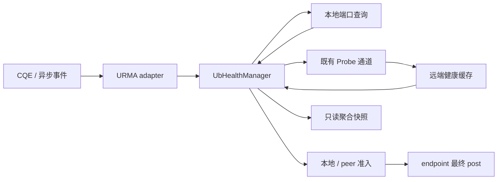

# classic UB 多端口故障隔离详细设计

> 设计状态：待实现；日期：2026-10-13。
> Mooncake 基线：`supercache-snapshot-930` / `a2f25168`。
> yuanrong 参考源码：本地 `eacc9857`；参考 issue 已通过 `ds-resolve-issue` intake 读取。
> 本文限定 `kunpeng_transport` 的 UB/URMA 路径，不代表 TENT 或 generic RDMA 的设计。

## 1. 目标与范围

实现一个闭环：**观测异常 → 核验端口事实 → 关闭相关 UB 准入 → 定向核验恢复 → 重新开放准入**。

第一阶段提供本地 context 隔离和远端 device 隔离。隔离只阻止新的 UB 操作，不改变 Master、Store 副本状态、segment ownership 或集群成员关系。

部分端口 BAD 仍允许 UB 使用，保存退化事实；全部有效端口 BAD 才建立端口隔离。端口数量来自 provider，不能硬编码为四。设备/JFC 致命故障另外关闭资源准入，不冒充“端口全部 BAD”。

本阶段不建设 Jetty 池、不调整调度权重、不实现 TCP 自动切换、不新增全局健康广播或 all-to-all 查询。后续两个特性只读取本文定义的健康快照与准入结果。

## 2. 参考资料与迁移边界

| 资料 | 使用方式 |
| --- | --- |
| [issue #28：多端口故障隔离](https://gitcode.com/hc147/yuanrong-datasystem/issues/28) | 采用端口事实判据、独立远端核验、缓存查询、固定一秒恢复检查和身份围栏 |
| [issue #30：Jetty 资源池化](https://gitcode.com/hc147/yuanrong-datasystem/issues/30) | 仅采用健康关闭不等于资源销毁的边界；池化与完整退役另行设计 |
| [issue #29：负载反馈调度](https://gitcode.com/hc147/yuanrong-datasystem/issues/29) | 仅预留端口聚合状态读取；本阶段不做节点放置或设备权重计算 |

yuanrong 当前 `ub_port_health.*`、`urma_port_status_provider.*` 和 `remote_ub_port_health_verifier.*` 作为实现参考，不链接其库，不引入 WorkerRouter、Coordinator 或 bthread 依赖。

需要区分资料与当前实现：issue #28 要求已隔离 peer 固定一秒核验、被动恢复摘要只触发独立查询；本地 yuanrong 源码存在随机化恢复查询及接受部分被动恢复证据的机制。Mooncake 本方案采用 issue #28 的独立确认契约，不照搬这些源码细节。

Mooncake 支持原生 `URMA_OPC_READ`，而 yuanrong 的核心场景通过 provider WRITE 写回数据。不能按照 GET/PUT 名称归因。错误分类必须同时看实际 opcode、发起端、远端设备和 provider 版本。

## 3. 当前实现与最小修改点

| 当前机制 | 风险/缺口 | 本方案修改 |
| --- | --- | --- |
| `UrmaContext::doProcessContextEvents()` 对 PORT_DOWN 关闭 context 并断连 | 单端口事件扩大到整个 context；断连混入资源清理 | PORT_DOWN/ACTIVE 只触发端口核验；资源 fatal 单独关闭 |
| `UbWorkerPool::monitorWorker()` 每秒 `set_active(true)` | 未确认就解除隔离 | 删除定时激活；改为推进健康任务 |
| post/poll 中“错误数 > 32 且无成功”停用 context | 任意 peer 错误可能被归因为本地全设备故障 | 阈值只能触发核验，不能建立端口隔离 |
| 初次选择检查 `active()`，缓存 endpoint 直接 post | 缓存及排队请求可能绕过隔离 | 入队前检查，最终 post 必须获取准入许可 |
| `UrmaContext::poll()` 将失败 CQE 转交重试，未结构化传递原因 | 缺少核验方向与身份 | adapter 在交还 slice 前上报结构化观测 |
| 本地 source 设备与远端 device 选择由不同位置完成 | 无统一远端过滤 | 在 UB 内增加候选过滤包装，不修改通用拓扑算法 |

代码依据：

- [ub_transport.cpp](../../mooncake-transfer-engine/src/transport/kunpeng_transport/ub_transport.cpp)：注册、提交、设备选择及被动握手。
- [ub_context.cpp](../../mooncake-transfer-engine/src/transport/kunpeng_transport/ub_context.cpp)：worker 队列、缓存 endpoint、poll、redispatch、monitor。
- [urma_endpoint.cpp](../../mooncake-transfer-engine/src/transport/kunpeng_transport/urma/urma_endpoint.cpp)：context/endpoint、CQE、异步事件与 provider 调用。
- [ub_context.h](../../mooncake-transfer-engine/include/transport/kunpeng_transport/ub_context.h)：当前 `volatile bool active_` 与 endpoint 准入。

## 4. 高内聚的模块划分

新增一个由 `UbTransport` 持有的 `UbHealthManager`，统一管理本地健康域、peer 核验任务与准入。对外仅提供观测、快照读取、post 准入和停止接口。内部状态机逻辑可用 fake provider、fake clock、fake query client 测试。

| 组件 | 责任 | 不承担的责任 |
| --- | --- | --- |
| `UbHealthManager` | 快照唯一写入、隔离状态、single-flight、定向查询调度、身份围栏 | Jetty 创建/销毁、Store 路由、数据重试 |
| `UrmaPortStatusProvider` | 调用和校验 provider ABI；将 CQE/AE 转成健康观测 | 准入决策、对端 RPC |
| `UbHealthProtocol` | 编解码 UB 健康查询、身份与摘要，适配既有 Probe 通道 | 硬件查询、全局成员状态 |
| `UbTransport / UbWorkerPool / UrmaEndpoint` | 在既有执行路径读取准入、上报事件 | 各自维护第二套隔离状态机 |

健康策略和 JSON/URMA ABI 分开。共享 `TransferMetadata` 只增加通用 Probe 扩展能力和不透明设备属性，不包含 UB 状态枚举、端口判据或定时器。

## 5. 健康域、数据结构与身份

### 5.1 隔离粒度

本地键为 `(transport_incarnation, context_incarnation)`；远端键为 `(peer, remote_transport_incarnation, remote_context_incarnation)`，device name 用于定位，不能单独作为身份。

一个 provider context 查询的是其**已启用、可用于当前路径的端口集合**。若多个 context 实际共享同一集合，adapter 在初始化时给出相同 `health_domain_id`，共享一次查询；无法证明共享时保持各自独立，不凭 device name 合并。

禁止把一个 HCA 的 all-bad 扩大为进程 all-bad。某请求是否可以执行，取决于是否还有同时满足本地注册、远端注册、拓扑约束及准入的设备候选。物理路径被固定到坏端口时，其他端口 GOOD 不自动证明这条连接可用，连接失败继续由现有 endpoint 路径处理。

### 5.2 核心数据

| 数据 | 必需字段与语义 |
| --- | --- |
| `UbPortIdentity` | `(chip_id, die_id, port_idx)`；不能只用 chip 内 port_idx 判重 |
| `UbPortSnapshot` | 完整 ports、valid、total/good/bad、health_epoch、query_seq、observed_at、verification_pending |
| `UbHealthSummary` | context 身份、resource_online、valid、total、bad、health_epoch、query_seq、verification_pending；不传播 ports 数组 |
| `UbObservation` | 来源、原始状态、opcode、本地 context、peer/context 身份、观测时间；没有跨请求借用的裸 slice 指针 |
| `UbQueryTicket` | peer/context 身份、query_generation、observation_generation、required_query_seq；用于丢弃旧结果和等待新鲜事实 |
| `UbAdmissionView` | resource_online、port_isolated、pending、decision_generation；只读派生结果 |

`health_epoch` 在有效端口集合/状态变化时递增；`query_seq` 在成功完成有效查询时递增；`observation_generation` 在产生新核验信号时递增。三者分别回答“事实是否变化”“是否完成新查询”“查询是否覆盖最新异常”，不能相互替代。

首次查询失败：valid=false、pending=true，不新增端口隔离。后续失败：保留最后有效事实并设置 pending；已有隔离不被未知结果解除。

### 5.3 新实例发现

UB 初始化生成 transport incarnation，每次 context 构造生成 context incarnation。用 `DeviceDesc` 的新增可选不透明 `transport_payload` 发布 UB 身份和查询能力，metadata 仅保存/传输字符串；UB codec 才解释内容。握手 `HandShakeDesc::payload` 同样携带并校验身份。

收到查询响应身份不匹配时，不把它直接当作恢复：丢弃结果并请求强制刷新 segment 描述。只有新描述与新握手/查询一致后才绑定新身份，关闭旧准入记录并取消旧 ticket。旧 segment/remote registration 仍按现有刷新规则重新解析，不能将旧在途请求改绑新实例。

## 6. 状态机与唯一判据

不把健康事实、资源生命周期和具体连接状态压成一个 `active` 布尔值。

| 有效端口结果 | 端口状态 | 新请求准入 | 后台动作 |
| --- | --- | --- | --- |
| 所有 GOOD | HEALTHY | 允许，仍需 resource_online | 停止持续查询 |
| 有 GOOD 且有 BAD | DEGRADED | 允许，不做本阶段降权 | 每秒查询至全部 GOOD |
| 全部 BAD | ISOLATED | 禁止相关 context/device | 每秒核验恢复 |
| 无有效结果 / pending | UNKNOWN 或保留旧事实 | 不新增隔离，也不清除旧隔离 | 合并触发，限频核验 |

建立隔离要求：有效、完整、非 pending 的新查询，`total > 0 && bad == total`。
解除隔离要求：同一身份的有效、非 pending、覆盖最新触发的查询，`good > 0`。
本地采用 provider 查询；远端必须采用独立 Query 响应。被动摘要、PORT_ACTIVE、握手成功、数据操作成功仅可触发核验，不解除端口隔离。

最终准入为：本地和远端资源均未确认 offline、本地和远端均未端口隔离、且未 stopping。远端 resource_online=false 同样需要独立 Query 确认，阻断原因仍记为资源不可用而非端口 all-bad。

DEV_FATAL、JFC_ERR、EID_CHANGE 关闭相应 resource_online；端口恢复不能将它改回 true。自动 context/EID 重建不进入本阶段，仍需明确的资源重新初始化。

## 7. 端到端流程

### 7.1 观测与归因

| 输入 | 核验动作 | 不能推导的结论 |
| --- | --- | --- |
| PORT_DOWN / PORT_ACTIVE | 触发本地端口查询 | 单口 down 等于全部 down；active 等于资源已恢复 |
| 已确认 provider 映射的 WRITE E4 | 触发本地查询 | 本端所有端口均故障 |
| WRITE E9 / ACK timeout | 定向查询目标；目标收到请求后合并本地刷新 | 远端全部端口故障 |
| READ 路径错误 | 映射未验证时同时触发本地与目标核验 | 仅依据 READ/GET 名称确定故障方 |
| 普通握手/RPC timeout | 保留路径错误；按需核验一次 | 端口 all-bad 或 worker DOWN |
| 注册/长度错误、资源背压 | 保留原错误分类 | 网络/端口故障 |

本地 UMDK 通用枚举中的状态 4 为 `URMA_CR_LOC_ACCESS_ERR`，状态 9 为 `URMA_CR_ACK_TIMEOUT_ERR`，不能全局按裸数字赋予“端口坏”含义。adapter 基于实际 provider 版本识别核验提示；无法确认的错误最多触发查询，绝不成为隔离事实。

`UrmaContext::poll()` 在完成记录仍可安全读取时提取 observation，再交还 failed slice。分类首先判断 CQE 类型；flush/suspend done 等 `user_ctx` 无效的硬件记录不得当作 `Slice*` 解引用。其资源结算留给生命周期路径，不伪造业务完成。

### 7.2 本地核验

1. 初始化首次查询成功后发布快照；失败不阻止已构造好的 transport 启动。
2. CQE、AE、Query RPC 只设置合并刷新标志；不在 post/poll 热路径直接查询 provider。
3. 每 health domain 查询 single-flight，调用开始间隔至少一秒。已有 BAD 或 pending 时持续查询，全部 GOOD 后停止。
4. provider 完成后校验完整性，原子发布不可变快照并更新准入。
5. 查询期间又出现异常时，该结果不能直接完成恢复；保留 pending 并等待下一次覆盖新触发的查询。

健康 manager 负责后台任务；现有 monitor 线程继续处理 epoll 异步事件，不承担阻塞健康 RPC。第一版本可用一个本地核验线程和有界远端执行池，不为每个 peer/context 新建线程。provider 调用是同步接口，退出时必须等待真实返回；不能靠 detach 线程释放 context。

### 7.3 远端核验

首次异常立即安排一次独立查询，按 `(peer, incarnation)` 合并，一个请求可查询该 peer 当前涉及的多个 device。只有响应中指定 device 的完整确认事实关闭对应 peer-device 准入。

确认隔离后按固定一秒目标周期调度；同一 peer 最多一个在途查询，进程最多四个并发查询。可用固定 phase offset 错峰，不以指数退避扩大正常恢复周期。执行池饱和时公平排队并记录延迟，不能承诺任意集群规模都一秒发现恢复。

RPC 失败、UNKNOWN、pending、旧 epoch 或错误身份均保留已有隔离。成功且至少一口 GOOD 时解除该 device 隔离；若远端仍部分坏，远端本地 monitor 继续检查，调用方停止该 device 的隔离轮询。

不创建完整 peer 矩阵。只管理已通信且发生触发的 peer，条目数不超过 transport 的受限 peer 容量；无法为新疑似 peer 建立任务时记录容量拒绝，保留已有确认隔离，不因此全局阻断。

### 7.4 提交与最后一次 post 检查

三个入口都必须接入：

1. `UbTransport::submitTransferTask()`：复用已有本地候选顺序，过滤关闭的 context；缓存的 request_device_id 也重新检查，不能仅检查 device_id >= 0 而忽略 found_device=false。
2. `UbWorkerPool::submitPostSend()/redispatch()`：过滤已确认隔离的远端 device，未 post 时可重选远端并重算 r_seg/endpoint；不能跳过地址注册、亲和或协议约束。
3. `UrmaEndpoint::submitPostSend()`：缓存命中、主动建链和被动建链都不能绕过最终准入许可。

用一个很小的 RAII `UbPostPermit` 同时持有本地与 peer 准入记录。准入 gate 用原子 closing 标记与许可计数保证：隔离关闭后不能再取得新许可；关闭前取得许可的有限 post 属于既有准入，允许结束。permit 只覆盖一次同步 post，不等待 CQE，不负责硬件资源删除。

上层选择只做快速过滤；最终 permit 才是准入线性化点。peer/context 替换时关闭旧记录，缓存 endpoint 不能继续获取旧记录许可。

### 7.5 隔离期间的在途操作

- 尚未 post 的 slice：如果没有合法候选，结束为失败；统一调用 staging 最终失败收敛入口后发布状态，结算 worker pending 计数恰好一次。
- 已 post 的 WR：继续 poll，保留 batch、slice、staging 和注册资源所有权，不因端口隔离调用 RESET、清零深度或制造完成。
- 本方案不增加已 post 请求的跨 HCA 交接、TCP 重放或模糊 WRITE 重放；现有重试必须通过新增健康检查，不能不断撞击已隔离路径。
- 解除端口隔离只允许后续提交；不能把旧失败结果改成成功，不能自动释放未收敛请求。

lost CQE、provider flush/delete 失败及调用方超时后的缓冲保留，是 Jetty/完成生命周期设计的必要边界。本阶段不得承诺解决这些问题；若故障测试暴露旧路径不能保持在途资源，则该生命周期修复是启用隔离功能的前置条件。

## 8. 最小控制协议扩展

复用已有 `HandShakeRequestType::Probe`，不新增监听端口或 wire message type。新增两项通用能力：

- `TransferMetadata::sendProbe(peer, request, response, deadline)` 重载；原无 payload 的 liveness probe 保持原语义。
- `registerProbeHandler(action, callback)`；分发只做 action 到 callback 的映射，UB 使用 `ub_port_health.v1`。未知 action 返回结构化 unsupported；旧进程的普通 success 响应不能被当作健康结果。

请求字段：version、query_generation、expected transport incarnation、目标 device/context identity、min_query_seq。

响应字段：version、query_generation、status、实际身份、各目标 device 的聚合摘要、required_query_seq，以及由服务端单调时钟判断的缓存新鲜性。status 至少区分 OK、PENDING、UNSUPPORTED、IDENTITY_MISMATCH。

服务端只读快照，不在现有串行握手 listener 中等待 provider。首次故障核验用两步取得新鲜事实：

1. 调用方没有核验下界时发送 min_query_seq=0；服务端取当前 query_seq+1 作为 required_query_seq，合并触发刷新并立即返回 PENDING。
2. 调用方后续沿用该下界，不能每次重试重新抬高它。服务端缓存达到下界、非 pending 且年龄不超过一秒时才返回 OK；否则保持 PENDING 并合并刷新。
3. 接受结果后清除该 ticket。隔离轮询以最后接受的 query_seq+1 为下一次下界；新故障观测使旧票据失效并重新建立下界。context incarnation 变化后旧下界无效。

同一下界的重复请求只加入已有刷新，不递增本地 observation_generation，也不使正在执行的查询反复失效；真正的新 CQE/AE 异常才产生新的异常代际。

这样避免“每次 Query 都先标 pending，导致永远不能取得 OK”，也不把故障前的健康缓存用于故障后的恢复确认。限制任意请求下界不超过当前 query_seq+1；不为每个调用方保存服务端查询状态。响应不得返回借用的 context 指针。

一次健康 RPC 总 deadline 不超过一秒，覆盖排队后剩余预算、地址解析、连接、写入和读取；现有分阶段 handshake timeout 不能冒充总 deadline。优先使用已经解析的控制地址；无法提供可取消解析时不得让解析任务永久占用受限健康执行池。

Query 使用已有可信控制通信边界；本阶段不扩大监听范围，不将其包装为新增认证系统。消息大小、device 数量及 handler 数量有上限。仅响应明确指定的本机身份和设备。

## 9. 所有权、线程与恢复一致性

| 对象 | 唯一所有者 | 读取/保护 |
| --- | --- | --- |
| manager | `UbTransport` | 初始化注入，停止后禁止新任务 |
| native context | `UrmaContext` | provider 仅借用，manager Stop/join 完成前不能销毁 |
| 本地快照 | manager | 原子发布 `shared_ptr<const ...>`，前台读取不查询硬件 |
| peer record | manager | 更新受短锁保护；post 预解析持有稳定引用，避免每 WR 查 map |
| 准入 gate | 对应 context/peer record | 原子许可；不持有 manager mutex 调用 endpoint/provider |
| Query ticket | manager | 全局单调 query_generation，完成时校验当前身份和观测代际 |

锁与回调规则：provider/RPC 调用、endpoint 操作和 join 均在 manager 状态锁外。先发布新快照再通知，不允许通知反向同步查询。handler 用受控弱引用注册，取消注册后等待活动回调退出；停止期间不能重新安排周期任务。

退出顺序：关闭健康准入和触发入口 → 注销 Probe handler → 停止并 join 核验/查询任务 → 再进入既有 worker/context 清理。manager 不替代整个 transport 的 DMA 排空协议。

状态不持久化。进程重启生成新身份，初始健康为 UNKNOWN；旧隔离只保留在旧身份记录，旧 CQE/ticket 没有修改新实例的权限。

## 10. 错误与兼容策略

新准入拒绝需可识别，建议在 TE `Status` 尾部追加 `UbUnavailable`，在旧 int 接口提供对应错误映射；不复用 InvalidArgument 或 AddressNotRegistered。请求入队后失败仍维持既有 FAILED 状态，第一版不扩展公共 TransferStatus 结构。

最少区分 local all-bad、peer all-bad、resource offline；观测日志包含本地/peer device、身份摘要、health_epoch、原始 CQE、opcode 和 decision_generation，不泄露内存数据或认证信息。

Provider 能力通过 CMake 编译探测正式声明与结构体，再在运行时识别 opcode 是否支持。不能用 `#ifdef` 检查没有同名宏的 enum，也不能复制 mock 私有 opcode 数值用于真实设备。端口结果校验 count、输出长度、完整身份唯一性、GOOD/BAD 枚举并重算计数。

能力缺失时不把 UNKNOWN 当健康或故障证明。正式开启需新 provider、新 TE 及控制协议能力同时具备。发布开关关闭时明确运行旧模式；本地查询能力不支持或目标为旧进程时，记录未覆盖状态并保留原有有限连接重试，不宣传具备完整端口恢复闭环。已确认隔离不能因能力暂时未知而解除。

避免过多调优开关：一个 UB 端口隔离启用开关；一秒周期、四个并发查询和缓存上限先作为内部有界参数，测试可注入。上线先 shadow 再 enforce，shadow 不改变准入、也不移除旧隔离逻辑；enable/enforce 时统一替换旧端口判据与定时激活。

## 11. 修改目录与实施步骤

以下均是拟修改位置，本次仅产出设计文档。

| 文件/目录 | 修改内容 |
| --- | --- |
| `include/transport/kunpeng_transport/ub_health.h` | 健康类型、manager 窄接口、provider/query 接口及许可类型 |
| `src/transport/kunpeng_transport/ub_health.cpp` | 本地事实、peer verifier、状态机、single-flight 与生命周期 |
| `include/.../urma/urma_port_status_provider.h`、`src/.../urma/urma_port_status_provider.cpp` | 正式 provider ABI 适配与观测分类 |
| `src/transport/kunpeng_transport/ub_health_protocol.cpp` | UB JSON codec 与 Probe 适配 |
| 既有 UB transport/context/endpoint 文件 | 初始化接入、观测上报、候选过滤、最终 post 准入、去除旧定时激活 |
| `transfer_metadata.h/.cpp`、设备描述 codec | 通用 Probe 扩展、不透明设备身份属性；普通 probe 保持兼容 |
| `transfer_metadata_plugin.h/.cpp` | 健康 Probe 总 deadline 所需的小范围扩展，不重构整个 RPC 栈 |
| TE Status/error 映射 | 新增可识别的 UB 准入拒绝，不改 Store 的事务策略 |
| UB CMake 与 `tests/` | provider 能力检测、纯状态单测、mock 接入及故障测试 |

分三步交付同一个特性：

1. 本地事实与准入：provider adapter、状态机、最终 post gate，删除无条件恢复和经验阈值端口隔离。
2. 远端确认闭环：身份发布、Probe 扩展、peer single-flight、一秒恢复查询；覆盖新旧端互通。
3. 故障验收与灰度：缓存绕过、排队失败、staging 收敛、在途安全及实机验证。前两步均带各自单测，不等到最后才验证。

## 12. 验证矩阵与验收边界

| 场景 | 必须满足的结果 |
| --- | --- |
| 0/4、1/4、3/4、4/4 BAD，以及非四口设备 | 只有有效 all-bad 隔离；总数不硬编码 |
| 多 chip 相同 port_idx、重复完整身份、短输出、非法枚举 | 合法跨 chip 通过；非法输出不改变最后有效事实 |
| 未知启动、查询失败、隔离后查询失败 | 不新增误隔离；不错误恢复 |
| E4/E9、READ 与 WRITE、PORT_ACTIVE | 仅按映射触发核验，普通成功不解除确认隔离 |
| 高频 CQE/RPC 同时触发 | 每 health domain single-flight，provider 最小一秒调用间隔 |
| cached endpoint、被动握手、预选 device_id、队列积压 | 不能绕过最终准入；无健康候选时有界失败 |
| 一个 HCA all-bad，另一个合法 HCA 健康 | 健康请求仍可提交；不移动已 post WR |
| 远端 all-bad → 部分 GOOD | 独立 Query 确认后恢复，不能靠 sidecar/普通 Probe 恢复 |
| 新异常发生在恢复查询期间 | 旧查询结果不能覆盖新异常，后续新查询才能恢复 |
| 多次 Query 重试等待同一下界 | 刷新可完成并返回 OK，不因重复请求永久 pending |
| peer 同地址重启、旧 metadata、旧 ticket/CQE | 明确更新身份后新实例不继承旧隔离；旧结果被丢弃 |
| 老 provider、老 TE、unsupported RPC | 明确记录能力边界，不伪造健康证明，不死循环建链 |
| 在途隔离、lost CQE、staging READ、退出 | 不清零伪造完成、不提前归还缓冲；生命周期缺口阻断 enforce |
| 查询执行池饱和 | 请求数与内存有界、公平推进、检测延迟可观察 |

测试分三层：纯状态/provider decoder UT；fake Query 与 mock post 的接入 UT；真实 URMA 的逐口断链、全口断链及恢复 ST。性能测量比较健康稳态的吞吐/p99、permit 原子开销和后台查询负载。

最小指标：健康状态迁移、provider/query 成功失败及耗时、pending 年龄、准入拒绝、旧结果丢弃、执行池排队延迟。健康状态未变化时不按请求输出重复 WARN。

验收不承诺“从断链到所有观察者恢复小于一秒”：总时延还包含 provider 状态形成、本地核验、网络、排队和远端核验。验收应分别测量这些阶段，固定一秒是正常容量下的调度目标。

## 13. 与后续特性的接口冻结点

- Jetty 生命周期只消费准入许可与关闭事件；健康模块不接管 Jetty pool 或 DMA 完成所有权。
- 负载调度只读取有效端口数量、pending、身份和 epoch；没有端口事实时不能制造零容量结论。
- 健康模块对完整 port 状态负责，其他模块不能直接调用 provider 或自行修改 isolated。
- 上层 Store 后续若需副本避让，可消费 UbUnavailable 与只读摘要；本阶段不扩展 Master 心跳/注册，也不将健康事实持久化。
