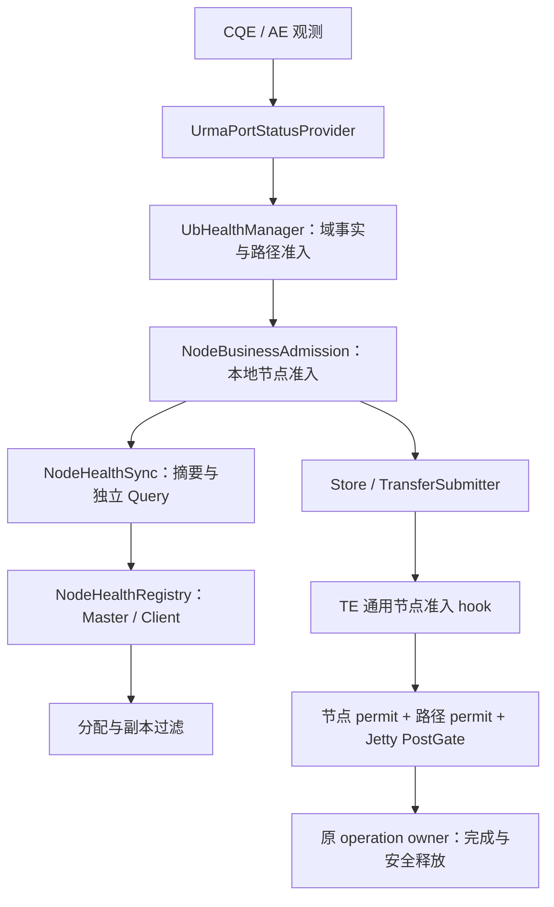
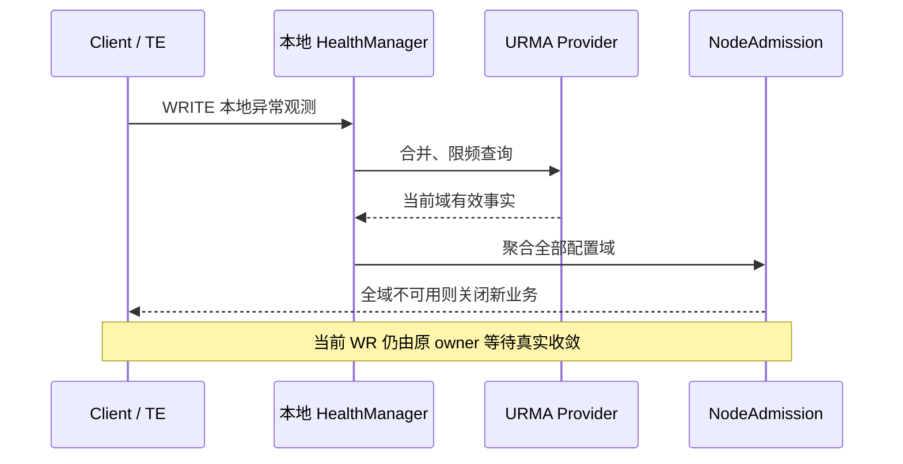
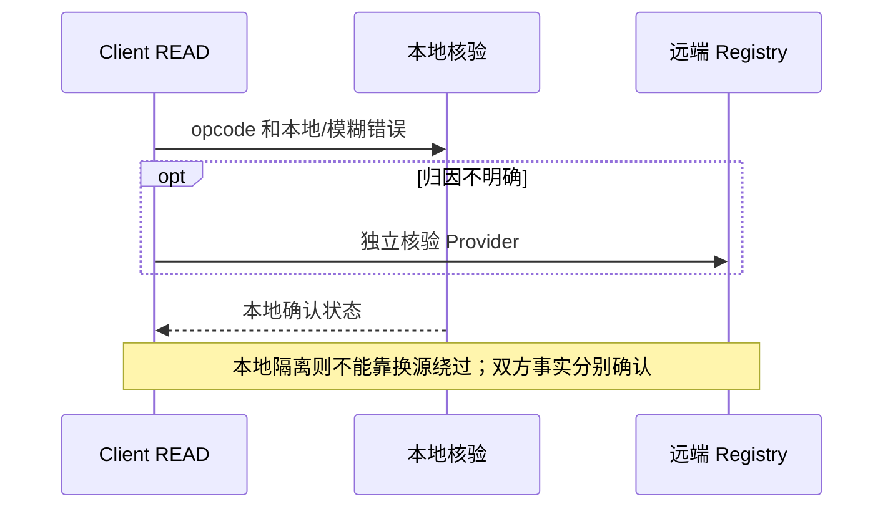
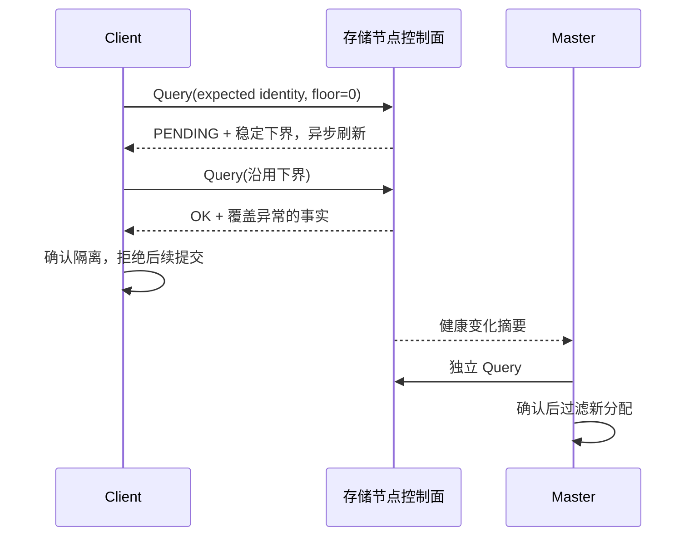
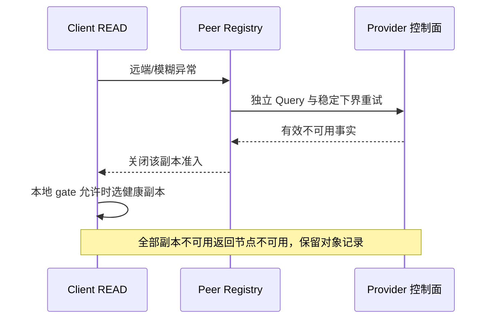
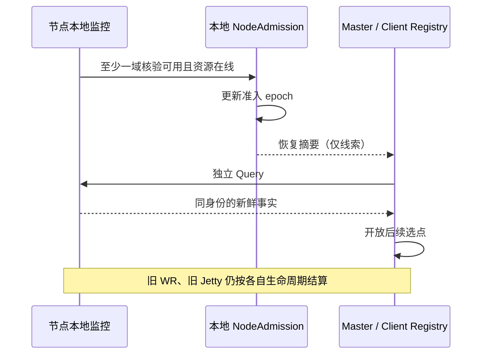
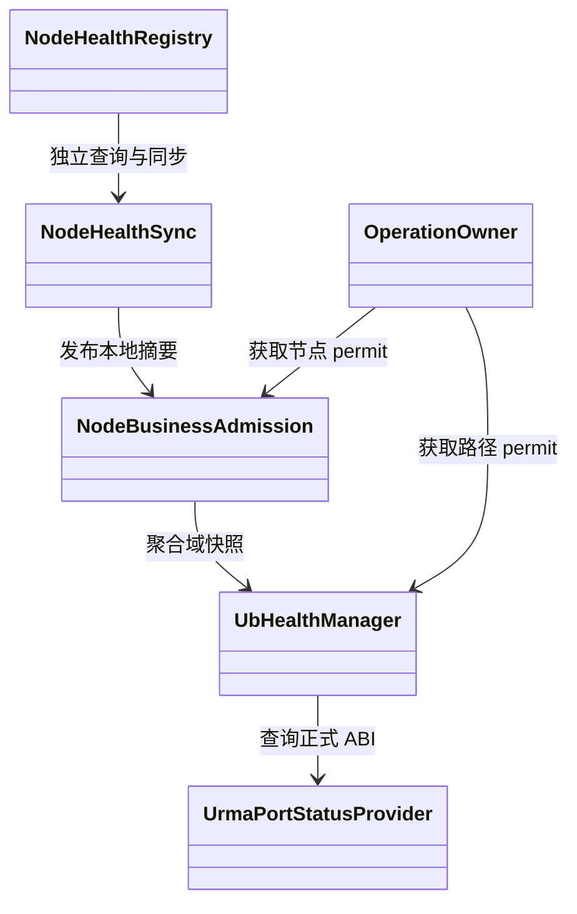

# Mooncake UB 多端口故障隔离适配设计

> 设计状态：待实现；更新日期：2026-10-15。
> 运行时代码基线：`supercache-snapshot-930` / `a2f25168`；文档提交不改变该代码基线。
> 结构参考：认证读取的 [yuanrong issue #28](https://gitcode.com/hc147/yuanrong-datasystem/issues/28)；实现对照：同级 yuanrong-datasystem `eacc9857`。
> 关联：[Jetty 池化与生命周期](ub_jetty_pool_lifecycle_design.md)、[端口故障触发的时延成本调度](ub_load_scheduling_design.md)。本文只设计故障事实、业务准入与恢复，不接管资源池或调度权重。

## 1. Story 整体设计

### 1.1 功能描述

形成“异常观测 → 端口核验 → 节点业务隔离 → 健康传播 → 选点过滤 → 核验恢复”的闭环。一个域故障先限制该域；全部配置的数据服务域确认不可用，才关闭节点新数据业务。

#### 影响范围

覆盖 Store Client、承载 segment 的存储进程、Master、TransferSubmitter、TE 的 classic kunpeng_transport URMA 路径，以及 HA/CVM 分配链路。Mooncake 的存储节点通常由挂载 segment 的 Client 进程承载，不能直接套用 yuanrong Worker 类和 RPC。

#### 用户体验

部分端口故障时继续使用合法路径；节点隔离后，新 Put/Get、批量、异步和后台数据阶段快速失败或选择健康副本。控制查询、诊断和既有操作结算继续；节点、对象和副本记录保留，恢复后无需重新挂载即可重新参与业务，资源 fatal 除外。

### 1.2 功能目标与边界

#### 成功标准

- 本地与远端都以覆盖最新异常的有效核验作为端口事实，CQE/AE 和普通心跳不直接决定节点隔离。
- Store 入口、缓存快速路径、传输提交、Master 分配与跨 Master 转发使用同一身份和准入契约，不能通过切换策略绕过隔离。
- 已接纳操作保留硬件完成与缓冲责任，不把逻辑失败等同于 DMA 已停止。

#### 恢复标准

当前节点身份下，至少一个域经有效核验满足 `good > 0 && resource_online`，才可解除全节点隔离；其他域仍异常时进入 DEGRADED。远端消费者必须独立 Query 确认，摘要、PORT_ACTIVE 或业务成功只能触发核验。

#### 隔离含义

隔离的是该进程的新数据业务，不是物理主机成员关系。一个进程挂载的所有 segment 共用节点 gate；TCP、memcpy、staging、文件路径也执行该 gate。保留元数据、数据和副本，不自动 unmount、迁移或重建。

这是对 issue #28 的明确适配：沿用事实与准入分离的闭环，但按本项目已确定的边界关闭所有新数据策略，不照搬参考实现中的部分 TCP 回退行为。

#### 非目标边界

不新增 TCP 故障检测，不设计拥塞/容量评分，不扩展通用成员服务，不重做 Jetty 生命周期。硬件核验首期只覆盖 classic URMA，不宣称 TENT/generic RDMA 已有同等能力。必要 hook 或核验能力缺失时不能启用 enforce。

### 1.3 术语说明

| 术语 | 本文含义 |
| --- | --- |
| Path Observation | CQE/AE、超时等异常线索，包含实际 opcode、执行者、对端身份与 provider 原因；不是节点故障事实 |
| Port Health Fact | provider 查询成功、身份与结果合法、覆盖最新异常的端口快照 |
| Local Node Admission | `NodeBusinessAdmission` 聚合本进程服务域，唯一写入本地节点业务状态 |
| Peer Admission | 消费者以独立 Query 确认的远端准入状态，用于选点和提交前过滤 |
| Node Health Registry | 每个 Master/Client 的带身份健康视图，独立于成员状态和 segment 挂载状态 |
| 服务域 | provider 能确定边界的已配置数据端口集合及其资源状态；同一物理端口集合可被多个 context 共享 |
| Requester / Provider | READ 的发起方/数据提供方；不能套用“Worker 总是 WRITE 回写”的方向 |
| Writer / Receiver | WRITE 的执行方/目标方；PUT 常见为发起 Client 写入存储节点 |

## 2. 场景分析

### 2.0 问题上下文：AS-IS / TO-BE

| 方面 | AS-IS：当前实现 | TO-BE：本方案 |
| --- | --- | --- |
| 故障判断 | context active、post/poll 失败与 AE 局部处理 | 观测与核验分离，聚合配置域形成节点准入 |
| 恢复 | monitor 存在周期无条件置 active 的逻辑 | 同身份有效核验恢复，fatal 需资源重建 |
| 业务隔离 | 无贯通 Store/Master/TE 的节点 gate | 本地入口、远端选点、最终 post 分层守卫 |
| 控制传播 | 普通 Probe 只证明响应，缺少端口查询协议 | 版本化 Query、摘要、完整/增量视图 |
| 生命周期 | context 故障与 WR/任务责任分散 | 隔离只停止新提交，Jetty/operation owner 负责安全收敛 |

以下 E4/E9 均为参考设计中的错误语义提示，具体映射必须由实际 SDK/provider 与 opcode 确认，不能跨版本解释裸数字。

### 2.1 UC-1 发起 Client 故障：PUT 的本地异常

Client 执行 WRITE 时得到本地故障线索，触发自身域核验。部分端口坏只关闭坏路径；全部服务域确认不可用才关闭本地 gate。当前 PUT 按实际 post/完成结果结算，后续所有新数据入口拒绝；不因单次错误隔离目标存储节点。

### 2.2 UC-2 发起 Client 故障：GET 的本地异常

Client 执行单边 READ 时，读取本地完成记录中的方向和错误类别。本地证据明确则查询自身；归因不明确则核验自身与对端，分别更新视图。不能因为 GET 失败就假定数据提供节点故障；本地隔离后不能通过换源绕过本地 gate。

### 2.3 UC-3 存储节点故障：PUT 的远端异常

Client WRITE 出现远端故障线索，对目标发起独立节点 Query。确认目标全部服务域不可用后，Client 排除该目标，Master 核验后停止新的分配。已取得的 PutStart 不能作为后续传输的永久许可；未提交部分走既有 abort，已 post 前缀按真实结果收敛。

### 2.4 UC-4 存储节点故障：GET 的远端异常

Client READ 失败后按 provider 语义核验 Provider，必要时同时核验自身。确认读源隔离后，从现有策略的健康副本中重选；对象存在但所有副本不可服务时返回节点不可用，不返回对象不存在，不建立负缓存。

### 2.5 UC-5 节点间后台任务与恢复

#### 后台复制、迁移与分层数据阶段

按实际 READ/WRITE 的执行方向识别源/目标，不套用 yuanrong RemoteGet 的固定 WRITE 模式。新任务、重试、新窗口和新 grant 均检查双方准入；已 post 的部分由原 operation owner 持有至安全完成。

#### 多域退化与节点隔离

域 A 全坏而域 B 仍可用时，节点保持 DEGRADED，只使用合法域。只有所有配置域均有有效不可用证据才进入 ISOLATED，不能通过移除故障域制造健康。

#### 节点间恢复

本地周期核验发现至少一个域可用后发布新 epoch；远端收到摘要只启动 Query，通过后恢复选择。旧实例、旧 ticket 或旧 CQE 不得恢复新实例，也不把退役 Jetty 放回池。

## 3. 方案详细设计

### 3.1 当前分支实现分析

当前 UB 路径在 `UbTransport` 选择设备并提交任务，`UbWorkerPool` 监控 context，URMA endpoint 负责 post、CQE/AE 与连接资源。它们已有局部错误处理，但没有覆盖 Store 业务入口与 Master 分配的节点级闭环。

重点缺口是：monitor 无条件恢复 active；端口状态与资源状态未形成独立事实；普通 Probe 不返回可核验健康证据；上层选点、跨策略传输和 HA 接管缺少统一隔离围栏。具体文件见 3.7，本文提出的新组件和协议均为待实现。

参考 [PeerUbAdmission](../../../yuanrong-datasystem/src/datasystem/common/object_cache/peer_ub_admission.h)、[Worker 本地健康](../../../yuanrong-datasystem/src/datasystem/worker/object_cache/worker_self_port_health.cpp)、[健康同步](../../../yuanrong-datasystem/src/datasystem/cluster/ub_health/ub_health_lease_sync.cpp)、[Client 准入](../../../yuanrong-datasystem/src/datasystem/client/object_cache/transport/transport_layer.cpp) 与 [路由过滤](../../../yuanrong-datasystem/src/datasystem/client/object_cache/routing/ub_health_filter.cpp)。跨仓链接供本地对照，在线入口为 issue #28。参考源码存在随机化恢复与部分被动恢复证据；本文采用 issue 的独立 Query 契约与固定一秒目标周期。

### 3.2 总体设计



Store 只消费通用节点摘要，不依赖 URMA 类型；TE 不依赖 Master/Client 类；Master 不直接调用 provider。端口事实、节点准入、资源生命周期各有唯一所有者，通过快照和通知协作。

#### 3.2.1 唯一隔离判据

节点身份为 `(client_id, transport_incarnation)`，不是 IP、host_id、HCA 名或 vector index。新实例必须通过 Mount/ReMount 的所有权绑定替换，健康响应不能改写 segment ownership。

初始化固定服务域集合并分配 `service_set_generation`。provider 证明多个 context 共用端口集合时按 `health_domain_id` 去重；否则独立。失败、fatal 或暂不可用域仍保留在集合中；变更集合必须显式更新代际。空集合是 NOT_READY，不能利用空集合全称判断得到 all-bad。

端口 all-bad 必须满足：`valid && !verification_pending && total > 0 && bad == total`，且查询覆盖该域最新异常。域不可用来源为已确认端口 all-bad，或经适配器确认的资源 fatal；两种原因分别记录，不能把 fatal 伪装为端口坏。

节点进入 ISOLATED 的唯一升级条件是：**非空配置服务域集合中，每个域都有覆盖最新异常的有效不可用证据**。单次 CQE、查询失败、普通心跳丢失不能满足该条件。

#### 3.2.2 Admission 状态机

| 状态 | 条件与准入 |
| --- | --- |
| NOT_READY | 未建立服务域或身份绑定，不接纳新数据 |
| AVAILABLE | 所有域资源在线且有效端口全 GOOD，允许业务 |
| DEGRADED | 至少一个域确认可用，其他域/端口退化，只允许合法路径 |
| ISOLATED | 全域确认不可用，关闭节点新数据 |
| UNKNOWN | 证据不足或待核验；不能新增 all-bad 隔离，也不能解除已有关闭 |
| REVALIDATING | HA 接管后的消费者围栏，独立核验前不参与新分配 |
| STOPPING | 退出围栏，停止新业务，继续既有责任收敛 |

UNKNOWN 描述证据状态，不能覆盖已确认的 ISOLATED；已建立可用状态在新增不确定证据下不凭空变为 all-bad，路径是否可提交仍由资源和路径 gate 决定。NOT_READY/REVALIDATING 的关闭原因也不同于已确认故障。

恢复必须同身份、同服务集合代际，且核验覆盖最新异常。至少一个域 `good > 0 && resource_online` 时，ISOLATED 才转 DEGRADED/AVAILABLE。DEV_FATAL、JFC_ERR、EID_CHANGE 形成的资源关闭必须经过明确重新初始化，端口 GOOD 不够。

#### 3.2.3 本地端口健康监控

每域维护一次在途查询，每秒最多发起一次；退化/隔离域按一秒目标周期持续核验直至全 GOOD。CQE/AE 只合并核验请求，不能无限排队。启动先建立身份、域集合和初始事实，再开放准入。

端口键用 `(chip_id, die_id, port_idx)`。校验返回长度、数量、唯一身份和枚举，再重算 total/bad；空结果或解析失败无效。`health_epoch` 表示事实变化，`query_seq` 表示成功新查询，`observation_generation` 表示新异常，三者不能互代。

删除 monitor 无条件 active 恢复。PORT_DOWN/PORT_ACTIVE 触发核验；资源 fatal 独立关闭路径并请求本地节点聚合，只有适配器确认的资源事实才能参与全域判定。

#### 3.2.4 E4/E9 统一归因

完成记录有效时提取实际 opcode、执行者、对端身份、域身份和 provider 原因。WRITE 的本地/远端提示分别指向 Writer/Receiver；READ 必须按实际 provider 定义定位 Requester/Provider，不能照抄 WRITE 方向。模糊错误核验相关双方，不能直接标坏对端。

适配器输出结构化 observation，上层不解释裸错误码。普通业务错误、超时、成功完成只提供线索；查询结果才提供端口事实。旧 incarnation 的 CQE 只能结算其原操作，不能修改当前实例状态。

#### 3.2.5 远端端口查询与恢复调度

复用 Probe action：`ub_port_health.v1` 查询域，`ub_node_health.v1` 查询节点。原 liveness Probe 保持兼容。handler 只读取快照并合并异步刷新，不在串行 listener 等待 provider。

请求带版本、`query_generation`、expected identity、服务集合代际和各域 `required_query_seq`；响应状态为 OK/PENDING/UNSUPPORTED/IDENTITY_MISMATCH。使用稳定新鲜性下界避免永远追赶：

1. 首次下界为零时，服务端返回当前各域 `query_seq + 1`，并触发合并刷新。
2. 调用方沿用该下界重试；只有达到下界、非 pending、快照年龄不超过一秒且覆盖最新异常时返回 OK。
3. 相同 ticket 不抬高下界、不增加异常代际；真实新异常使旧 ticket 失效，重新建立核验下界。集合或身份变化必须重建 ticket。

每 peer single-flight，每进程最多四个并发，一秒目标周期加固定 phase offset。使用有界公平队列，不建立全互连查询矩阵。一次 RPC 总 deadline 一秒，覆盖排队、解析、连接和收发；缓存控制地址。队列饱和记录延迟，不承诺任意规模都能一秒恢复。

Query 失败、旧身份、非法字段、摘要过期或同步分区均不能解除隔离。控制服务仍可响应，原 Probe success 不代表端口健康。

#### 3.2.6 节点健康摘要传播

`NodeHealthSync` 复用现有控制通信边界，新增版本化 `ReportUbNodeHealthV1`。变化立即合并上报，一秒周期兜底；摘要带身份、集合代际、准入 epoch、状态/原因和域聚合信息，不广播完整 ports 数组。

被动摘要用于发现变化、发起独立 Query，不能直接建立或解除远端端口隔离。接收方只有在核验完成后更新确认视图。成员心跳与健康摘要独立，缺少上报不表示节点退出。

#### 3.2.7 Master/Client 全量健康视图

通过 `GetNodeHealthChangesV1` 首次分页获取完整视图，后续按 registry 版本获取有界增量；版本缺口重新全量。增量内容仍是核验线索，不能替代消费者独立确认。

Master 所有分配入口共用 eligibility：普通/批量 PUT、定向分配、后台目标和 InterMaster 分配。实际提交前复查准入代际，隔离不删除 allocator。Client 在现有副本策略前硬过滤，缓存 descriptor、换源和最终 transfer 再检查。

业务 GetReplicaList 过滤已确认隔离副本；管理查询展示完整记录。PutStart 不授予永久准入，PutEnd/abort 允许既有事务结算。对象存在但全部副本不可服务时返回可识别的节点不可用。

HA 快照/oplog 保存身份绑定、确认准入转换及 epoch，不保存每次端口查询。接管保留 ISOLATED，其余支持能力的 UB 节点进入 REVALIDATING，逐节点核验后开放分配，不让单个无响应节点阻塞全部服务。

CVM 节点向现有 Master 视图中的参与者同步，视图变化重新同步；转发方快速过滤，目的 Master 必须自主核验和提交复查。不开辟新成员协议。

### 3.3 Use Case 时序设计

以下核验步骤均异步且有界，图中“确认”必须满足 3.2 的证据规则。

#### 3.3.1 UC-1 PUT 本地异常



#### 3.3.2 UC-2 GET 本地异常



#### 3.3.3 UC-3 PUT 远端异常



#### 3.3.4 UC-4 GET 远端异常



#### 3.3.5 UC-5 后台任务与恢复



### 3.4 核心类与数据结构

#### 3.4.1 类图



#### 3.4.2 C++ 数据结构建议

以下为字段契约草案，序列化采用现有机制，不把 URMA 类型暴露给 Store。

```cpp
struct NodeIdentity {
    ClientId client_id;                 // 沿用现有 client_id 类型
    Incarnation transport_incarnation;
};
struct UbDomainHealth {
    DomainIdentity identity;           // 含 domain/context incarnation
    bool resource_online;
    bool valid;
    bool verification_pending;
    uint32_t total;
    uint32_t bad;
    uint64_t health_epoch;
    uint64_t query_seq;
    uint64_t observation_generation;
    uint64_t verified_observation_generation;
};
struct NodeHealthSnapshot {
    NodeIdentity identity;
    uint64_t service_set_generation;
    uint64_t admission_epoch;
    BusinessState state;
    AdmissionReason reason;
    std::vector<UbDomainHealth> domains; // 有界，完整 ports 留在本地
};
struct HealthQueryTicket {
    NodeIdentity expected_identity;
    uint64_t service_set_generation;
    uint64_t query_generation;
    std::vector<DomainQueryFloor> required_query_seq;
};
```

`NodePermit`、`PathPermit` 和 Jetty `PostGate` 分别持有稳定引用与关闭代际。许可获取是本地准入线性化点；关闭之前取得许可的有限提交属于既有准入。不能把跨进程同步描述为瞬时原子关闭。

#### 3.4.3 所有权和并发模型

| 对象 | 唯一写入者/责任 |
| --- | --- |
| provider 上下文与查询结果 | context adapter；查询生命周期受 context incarnation 约束 |
| 域事实与路径 gate | `UbHealthManager`；只发布不可变快照 |
| 本地节点 gate | `NodeBusinessAdmission`；集合聚合与准入转换 |
| 远端确认视图 | `NodeHealthRegistry`；拒绝旧身份、旧 epoch 和过期 ticket |
| 查询/同步任务 | `NodeHealthSync`；有界、可取消，退出等待回调排空 |
| WR/注册/实际缓冲/batch | Jetty resource 与原 operation owner；健康模块不得代为完成或释放 |

先发布快照再通知。provider、RPC、allocator、endpoint 操作及 join 均在状态锁外执行，回调不能反向同步 Query。隔离取消未 post 工作并 Seal；不 RESET、不清零 depth、不制造 CQE。

MR 引用不等于持有实际用户内存。裸指针调用者须保持缓冲至安全完成，Store operation 须接入实际 buffer hold 并处理 BatchBusy。timeout 不是可释放许可；无法证明 DMA 收敛时保留 pending/quarantine，遵守 Jetty 文档。

### 3.5 接口适配

#### 3.5.1 URMA Provider 适配

`UrmaPortStatusProvider` 封装正式头文件与结构体。CMake 检测声明/结构体，运行时检查 opcode 支持；不能为通过编译构造私有 ABI 数字，也不能对 enum 使用无效的宏存在性判断。端口结果必须完整校验，不支持时返回 UNSUPPORTED，不能返回伪造健康。

#### 3.5.2 控制协议适配（对应参考 Proto 接口）

Mooncake 沿用现有 Probe JSON/action 与 Store 内部 RPC 序列化，不为模仿参考引入一套 DataSystem Proto。

| 接口 | 最小语义 |
| --- | --- |
| `ub_port_health.v1` / `ub_node_health.v1` | 请求身份、集合代际、query generation、下界；响应状态、真实身份、域聚合与新鲜性 |
| `ReportUbNodeHealthV1` | 合并上报本地节点摘要，仅作为远端核验触发 |
| `GetNodeHealthChangesV1` | 分页完整视图/有界版本增量，含版本缺口语义 |
| DeviceDesc 可选 `transport_payload` | 发布不透明身份与能力，通用 metadata 不解释 UB 判据 |
| HandShakeDesc `payload` | 核对 transport/domain 身份，防止旧 target/descriptor 复用 |

限制域数、消息大小、handler 数与 peer 表容量；未识别版本、未知 action 和旧 Probe success 不得当作健康。全部调用共享总 deadline，而非每个阶段各给一秒。

#### 3.5.3 C++ 接口

拟提供以下最小职责接口，名称在实现时统一：

| 组件 | 接口职责 |
| --- | --- |
| `UbHealthManager` | `Observe`、`RequestRefresh`、`ReadSnapshot`、`TryAcquirePathPermit`、`Stop` |
| `NodeBusinessAdmission` | `UpdateDomainSnapshot`、`ReadSnapshot`、`TryAcquireNodePermit`、`Close` |
| `NodeHealthRegistry` | `OnSummaryHint`、`EnsureVerified`、`IsEligible`、`ReadConfirmedSnapshot` |
| TE 通用准入 hook | 提交/新 grant 前取得通用节点许可，不依赖 Store 类和 URMA 类型 |

Client 数据入口先检查本地 gate，TransferSubmitter 在任意数据策略前检查双方节点。UB 最终 post 同时获取节点、路径和 Jetty 许可；队列唤醒、重试及后续窗口不能复用失效决策。

#### 3.5.4 错误码与报错信息

建议新增稳定错误 `NODE_DATA_ISOLATED` 与 `NODE_DATA_UNAVAILABLE`，保持既有错误数值不变。分别表达已确认隔离与当前无可服务路径/副本，和容量忙、对象不存在区分。

错误附带节点身份、原因和 admission epoch，TE/Store 显式映射。对端错误码只是 Query 线索，不能直接作为硬件事实。PutEnd/abort 保持既有事务语义，不因当前隔离丢弃已完成结果。

### 3.6 性能、可靠性与兼容性

#### 3.6.1 热路径开销

前台读取不可变快照并获取轻量 permit，不做同步 provider 查询或网络 RPC。异常与周期查询合并；完整 ports 不进入高频广播。故障摘要可触发负载方案更新，但本模块不计算成本权重、不引入拥塞信号。

#### 3.6.2 可靠性约束

远端隔离/恢复都需独立核验，失败保持既有关闭事实。Master 最终分配、Client 缓存路径和最终提交重复检查代际；不能仅在 PutStart 或首次选点过滤。

单边传输没有目标逐 WR 的业务 RPC，目标软件 gate 不能撤销已经发出的 DMA。传播与核验有延迟，需观测；提供的是消费者确认后的新准入关闭和既有责任安全收敛。

#### 3.6.3 滚动兼容

采用 `off / observe / enforce`，默认 off。observe 仅记录拟决策；enforce 要求参与数据业务的 Client、节点、Master 都具备必要能力，混合旧版本只允许 observe。公开 SDK 方法签名不变，新增内部 RPC/action 版本化。

#### 3.6.4 可观测性

记录域查询触发/合并/失败、身份不匹配、隔离原因与 epoch、业务拒绝、候选过滤、查询排队、核验/传播/恢复延迟，以及在途/quarantine 责任。日志区分 observation、confirmed fact 和 admission，不能用同一个 active 混合解释。

### 3.7 运行接入点

| 位置 | 修改职责 |
| --- | --- |
| [ub_transport.cpp](../../mooncake-transfer-engine/src/transport/kunpeng_transport/ub_transport.cpp) | manager 所有权、域注册、设备硬过滤与最终许可 |
| [ub_context.cpp](../../mooncake-transfer-engine/src/transport/kunpeng_transport/ub_context.cpp) | 监控核验、取消无条件恢复、退出顺序 |
| [urma_endpoint.cpp](../../mooncake-transfer-engine/src/transport/kunpeng_transport/urma/urma_endpoint.cpp) | provider 适配、CQE/AE 结构化观测、保留完成责任 |
| [transport.h](../../mooncake-transfer-engine/include/transport/transport.h)、[scheduler_core.cpp](../../mooncake-transfer-engine/src/scheduler_core.cpp) | 可选通用准入 hook、新 grant 守卫 |
| [transfer_metadata.cpp](../../mooncake-transfer-engine/src/transfer_metadata.cpp)、[transfer_metadata_plugin.cpp](../../mooncake-transfer-engine/src/transfer_metadata_plugin.cpp) | action 分发、能力/身份字段、总 deadline |
| [client_service.cpp](../../mooncake-store/src/client_service.cpp)、[transfer_task.cpp](../../mooncake-store/src/transfer_task.cpp) | 本地业务 gate、跨策略双方检查、缓存/重试守卫、实际 buffer hold |
| [master_service.cpp](../../mooncake-store/src/master_service.cpp)、[allocation_strategy.h](../../mooncake-store/include/allocation_strategy.h) | registry、全分配入口 eligibility、提交复查 |
| [replica_selection.h](../../mooncake-store/include/replica_selection.h) | 现有读策略前健康硬过滤，不引入新评分 |
| [rpc_service.cpp](../../mooncake-store/src/rpc_service.cpp)、[master_client.cpp](../../mooncake-store/src/master_client.cpp) | 版本化摘要/视图控制 RPC |
| [inter_master_rpc.cpp](../../mooncake-store/src/cvm/inter_master_rpc.cpp)、[master_snapshot_codec.cpp](../../mooncake-store/src/ha/snapshot/master_snapshot_codec.cpp) | 目的侧过滤、确认状态持久化与接管核验 |

新增健康组件按 TE 事实层与 Store 准入/传播层就近放置，头文件不循环依赖。该清单是实施接入范围，不表示本次修改运行时代码。

### 3.8 Use Case DryRun

| 场景 | 观测后的核验 | 判定与后续行为 |
| --- | --- | --- |
| UC-1 PUT 本地异常 | 查自身，目标不凭空标坏 | 本地全域不可用才关闭；当前事务按已 post 范围结算 |
| UC-2 GET 本地异常 | 本地明确则查自身，模糊则双方分别查 | 本地关闭时禁止换源绕过 |
| UC-3 PUT 远端异常 | Client 与 Master 各自确认目标 | 后续提交/分配过滤，旧 PutStart 不绕过 |
| UC-4 GET 远端异常 | 确认 Provider，必要时查询自身 | 换健康副本或节点不可用，保留对象存在事实 |
| UC-5 后台与恢复 | 逐域聚合；远端独立核验恢复 | 单域退化不停节点；恢复不复活旧资源 |

以上为设计推演，不是已执行测试报告。

## 4. 对外接口

### 4.1 SDK 接口

保持现有 Put/Get、批量、范围和异步签名。补充节点不可用错误契约；所有新数据入口在策略选择前执行本地准入。管理完整副本查询、健康查询和既有事务结算不因数据隔离关闭。

### 4.2 内部控制接口（对应参考 Proto 接口）

内部健康协议见 3.5.2；不新增面向用户的健康 Proto SDK。对外可见副本查询区分业务可服务列表与管理完整记录，保留既有元数据含义。旧版本不能解释新增能力时按兼容模式处理。

### 4.3 配置接口

| 配置契约 | 初始值/行为 |
| --- | --- |
| UB 隔离模式 | off；可切 observe/enforce，enforce 前检查参与者能力 |
| 域查询间隔 | 一秒，单域 single-flight；恢复目标周期一秒 |
| 远端查询并发 | 每进程最多四个，peer single-flight，有界公平队列 |
| RPC 总 deadline | 一秒，覆盖所有阶段 |
| 摘要兜底周期 | 一秒，变化立即合并上报 |

以上为待落地配置契约，最终名称沿现有配置体系确定。集合、消息和队列容量需显式上限；不新增动态评分或资源池调参配置。

## 5. 约束

- 节点键和服务集合代际贯穿注册、握手、Query、摘要与完成记录；旧身份不能修改新状态。
- 不以成员退出、segment 删除或 allocator 移除实现隔离；不自动迁移/重建副本。
- 一域故障只限制路径；全域有效不可用才建立节点故障隔离。UNKNOWN 不等于健康，也不等于确认 all-bad。
- 普通 Ping、业务成功、被动摘要、TTL 到期均不解除已确认隔离；fatal 需资源重建。
- Store gate 覆盖 TCP/memcpy/staging/文件路径；TE 仍保留最终节点/路径/Jetty 守卫。
- 查询与控制面有界运行，不能在 CQE/listener 中同步等待；控制服务和安全清理继续。
- 退出依次关闭新准入、注销并排空查询、停止未 post 生产者并 Seal、保持 CQE/AE/flush 收敛、完成 H2D/缓冲责任，最后释放 target/MR/队列/context。健康 Stop 不替代 DMA 排空。

## 6. Example

以下为语义示例，不是最终线协议；端口总数只代表各服务域自身集合。

### 6.1 存储节点健康状态示例

```json
{
  "node": {"client_id": "example-node", "transport_incarnation": "inc-2"},
  "service_set_generation": 1,
  "admission_epoch": 8,
  "state": "ISOLATED",
  "reason": "ALL_SERVICE_DOMAINS_UNAVAILABLE",
  "domains": [
    {"id": "A", "resource_online": true, "valid": true, "pending": false, "total": 2, "bad": 2, "query_seq": 12},
    {"id": "B", "resource_online": true, "valid": true, "pending": false, "total": 2, "bad": 2, "query_seq": 15}
  ]
}
```

仅当两域结果同身份、同集合代际且都覆盖各自最新异常时，该状态成立；省略的异常代际与新鲜性字段在真实协议中必须校验。

### 6.2 部分故障但不隔离

A 域 `total=2,bad=2`；B 域 `total=2,bad=1` 且资源在线，两者均为有效新鲜结果。节点为 DEGRADED，新业务可走 B 的合法路径；不能把 A 从配置集合删除。B 的 GOOD 端口若伴随未修复 fatal，则不能据此恢复节点。

### 6.3 Client 本地快速拒绝

Client 本地已确认 ISOLATED，再调用 Put/Get 时直接返回 `NODE_DATA_ISOLATED`；不继续请求新目标，也不转 TCP/memcpy。此前操作的 PutEnd/abort、健康 Query 和必要清理仍能执行。

### 6.4 读源快速拒绝

Client 缓存副本 A/B，独立确认 A 隔离后先过滤 A，再按原策略选择 B。若 A/B 均不可服务，返回 `NODE_DATA_UNAVAILABLE`，不返回 OBJECT_NOT_FOUND；管理查询仍展示两个副本及原因。

## 7. 可信软件

### 7.1 安全性 Security

复用既有可信控制通信边界；Query/摘要校验身份、版本、长度、域数和代际。健康响应不能修改 segment 所有权，避免错误身份影响分配。本文不新增独立认证体系。

### 7.2 韧性 Resilience

查询失败、同步分区和队列饱和保留已确认关闭；任务有界且可取消。HA 接管恢复关闭围栏，逐节点重验；CVM 目的 Master 自主过滤，不能依赖转发方单点判断。

### 7.3 隐私性 Privacy

健康消息仅携带节点标识、聚合状态、原因和代际，不携带对象内容或用户缓冲地址。完整端口明细留本地；诊断日志遵守现有访问和脱敏规则。

### 7.4 可靠性 Reliability

异常、事实、准入分别建模；唯一写入者与不可变快照避免多个 active 相互覆盖。结果不能跨实例复用，重试不能重放可能已接受的 WRITE。故障隔离不会提前释放实际缓冲。

### 7.5 可用性 Availability

一域故障不升级为全节点隔离，健康域和健康副本继续服务。控制面独立运行；独立核验恢复后重新开放新业务，失败节点不阻塞其他节点的核验与分配。

### 7.6 安全 Safety

逻辑 timeout 不等于硬件停止。保留稳定 completion token、注册和实际 buffer owner，无法证明安全则 quarantine。测试替身不能证明真实 provider 的 flush、target 或 DMA 屏障，必须进行 UB 实机验证。

## 8. 自验用例

以下均为实施后的验收计划；本次仅修改设计文档，不宣称已通过运行时测试。

### 8.1 分支覆盖矩阵

| 分支/竞争 | 必须验证的结果 |
| --- | --- |
| 单端口坏、单域全坏、多域全坏、空集合 | 依次退化/局部关闭/节点隔离/NOT_READY，不误判 |
| pending、非法结果、重复端口、旧身份、旧集合 | 不新增错误隔离，不解除旧关闭 |
| Query floor 重试、新异常、并发重复请求 | 下界稳定，合并刷新，新异常使旧 ticket 失效 |
| PORT_ACTIVE、普通 Ping、成功业务、摘要恢复 | 只触发核验，不直接恢复 |
| 端口恢复与 fatal 并存 | fatal 未重建前不能开放该域 |
| Put/Get、批量/范围/异步、缓存及全部策略 | 同一节点 gate 无绕过，重试/新窗口再检查 |
| PutStart 后关闭、permit 与 post 竞争 | 有限既有准入按真实结果结算，未提交阶段拒绝 |
| partial post、迟到 CQE、timeout、staging、BatchBusy | 不重复完成、不重放模糊 WRITE、不提前释放缓冲 |
| Master 普通/批量/定向/后台/跨 Master 分配 | eligibility 共用，实际提交再查代际 |
| 全部副本不可服务 | 返回节点不可用，不删除元数据、不负缓存 |
| 控制分区、摘要丢失、队列饱和 | 保留确认隔离，控制可用，任务容量受限 |
| HA 接管、CVM 视图变化、重启、旧版本混部 | 围栏正确恢复，旧实例不生效，混部不启 enforce |
| 退出与查询/CQE 回调并发 | 回调排空后再销毁 context，DMA 责任不遗失 |

UT 注入 provider、clock 与 Query；集成测试覆盖 Client/Master/TE 和协议兼容；系统测试使用真实 UB 注入端口与资源故障，并验证真实 DMA 生命周期。mock 只验证状态和协议分支。

### 8.2 五个 Use Case 验收

| UC | 验收重点 |
| --- | --- |
| UC-1 | 本地 WRITE 异常只触发核验，全域确认后关闭全部新策略 |
| UC-2 | READ 按实际方向归因；本地隔离不允许换源绕过 |
| UC-3 | 目标核验、Client 拒绝、Master 独立过滤及 PUT 事务收敛完整 |
| UC-4 | 读源过滤、缓存复查、健康副本重试及对象存在语义完整 |
| UC-5 | 后台双方 gate、多域退化、独立恢复及旧资源不复活完整 |

性能验收同时记录无故障热路径开销、异常查询合并率、恢复/传播延迟和控制队列饱和行为；不以不可证明的全局一秒原子恢复作为验收条件。

## 9. 两人并行开发与测试分工

本节按参考文档给出后续实施分工建议；本次交付仅为设计文档。

### 9.1 分工原则

A 负责本地事实和准入核心，B 负责远端核验、传播和消费者过滤。先冻结身份与证据契约，以接口和测试替身并行开发，不复制节点状态机。Jetty 负责实际完成，不归健康模块接管。

### 9.2 前置契约冻结点

共同确定 node/domain 身份、集合代际、异常与查询序号、状态与原因、permit 线性化点、Query 稳定下界、版本化序列化及错误映射。明确资源 fatal、UNKNOWN、HA REVALIDATING 与 ISOLATED 的区别。

### 9.3 开发者 A：本地端口事实、限频与节点准入

实现 provider 能力探测与校验、域 manager、观测归因、本地聚合 gate、最终 post 许可和有序 Stop。完成多域/旧身份/恢复/关闭竞争 UT，与 Jetty 方案核对实际缓冲和完成责任。

### 9.4 开发者 B：聚合摘要、远端查询与路由传播

实现 Probe action、总 deadline、有界远端任务、独立确认 registry、摘要与视图同步、Master eligibility、Client 缓存过滤，以及 HA/CVM 围栏。完成协议、分配、重启与混部集成测试。

### 9.5 并行阶段与集成顺序

1. 冻结契约，落实稳定完成与实际缓冲持有基础。
2. A 开发本地事实/准入，B 用替身开发协议/传播；接入本地业务入口与跨策略 gate。
3. 联调远端 Query、Master/Client 过滤和事务收敛，再覆盖 HA/CVM。
4. observe 运行验证事实与时延；通过完整部署能力检查和实机测试后再启 enforce。

### 9.6 文件冲突与测试门禁

新增组件就近分层，共享接口由一方维护、另一方评审；避免两方同时重写 endpoint 或 master_service。集成前检查 8.1/8.2，涉及 post/完成的改动须同时验证 Jetty 生命周期契约。能力缺失或存在业务绕过路径时禁止启用 enforce。

### 9.7 修改文件清单

#### 9.7.1 开发者 A：本地端口事实与本地准入

- kunpeng_transport 的 `ub_transport.cpp`、`ub_context.cpp`、`urma/urma_endpoint.cpp` 及配套头文件/CMake：事实、查询、身份、最终许可。
- 新增就近的 provider adapter、UbHealthManager 与 Store NodeBusinessAdmission，保持通用摘要边界。
- `client_service.cpp`、`transfer_task.cpp`：本地数据入口、跨策略双方 gate 与实际 buffer hold；通用 transport hook 的契约由双方共同评审。

#### 9.7.2 开发者 B：协议、远端核验、传播与路由

- `transfer_metadata.cpp`、`transfer_metadata_plugin.cpp` 及对应描述类型：Probe action、身份/能力与 deadline。
- 新增 Store NodeHealthRegistry/NodeHealthSync；`rpc_service.cpp`、`master_client.cpp`：版本化同步。
- `master_service.cpp`、`allocation_strategy.h`、`replica_selection.h`：统一 eligibility、提交复查和副本硬过滤。
- `cvm/inter_master_rpc.cpp`、`ha/snapshot/master_snapshot_codec.cpp` 及对应日志回放接入：跨 Master 目的侧过滤、确认状态持久化、接管重验。

具体接入文件链接见 3.7。所有改动围绕既定故障闭环展开，不增加新的调度模型、成员框架或资源池策略。
