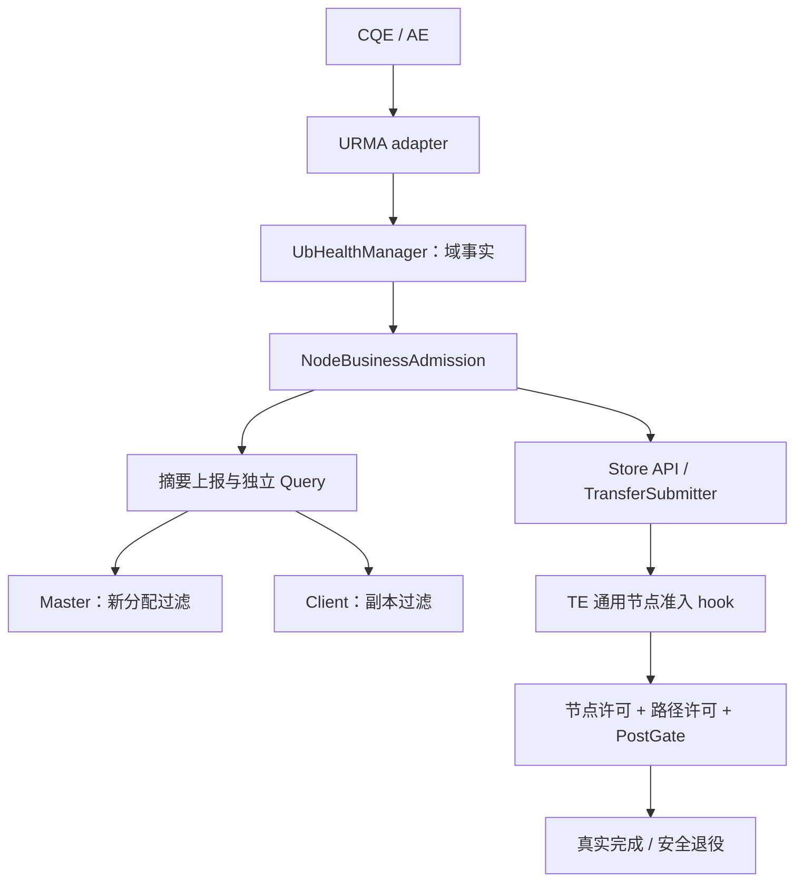

# UB 节点级业务故障隔离详细设计

> 设计状态：待实现；更新日期：2026-10-15。
> 运行时代码基线：`supercache-snapshot-930` / `a2f25168`；此前文档提交不改变运行时代码基线。
> 参考：认证读取的 [yuanrong issue #28](https://gitcode.com/hc147/yuanrong-datasystem/issues/28) 及本地 `eacc9857` 源码。
> 本文替代原 context/device 隔离方案，覆盖 Store、Client、Master、TE 和 HA/CVM。
> 关联：[Jetty 池化与生命周期](ub_jetty_pool_lifecycle_design.md)、[全链路负载调度](ub_load_scheduling_design.md)。

## 1. 目标与确定边界

形成闭环：**故障观测 → 端口/资源核验 → 节点业务准入 → 健康传播 → 新选点过滤 → 在途收敛 → 核验恢复**。

- 本轮设计 UB 节点业务隔离，不增加 TCP 故障判据；TCP、本地 memcpy、staging 和文件策略不能绕过已建立的节点隔离。
- 保留节点、segment、对象归属与已有副本。隔离不等于成员退出，不触发自动卸载、迁移、删除或副本重建。
- 一个服务域故障先局部隔离；全部配置的数据服务域确认不可用，才关闭节点业务。
- 节点隔离后停止新的 Put/Get、批量/异步和后台数据工作，控制面与安全清理保持运行。
- 覆盖单 Master、HA、CVM/多 Master，包括跨 Master 分配与转发。
- 本文为待实现设计，SDK 方法签名保持兼容，新增内部能力采用版本化接口。

硬件事实适配首先针对 classic kunpeng_transport 的 URMA 路径；通用业务 gate 可以覆盖其他策略，但不宣称 TENT 或 generic RDMA 已有同样的端口查询能力。缺少必要 hook/核验能力的部署不能开启 enforce。

仅在 URMA post 时返回错误，不能阻止 Master 继续分配，也不能阻止本地快速路径承接业务。业务策略上移，但底层最终准入和完成安全仍保留。

## 2. 参考能力与迁移边界

yuanrong 的闭环覆盖 Client 本地准入、Worker sender/receiver、Publish/Get/RemoteGet、Migration/Rebalance、健康摘要同步及客户端路由。E4/E9 只触发核验，有效端口查询确认 all-bad 才形成隔离事实。

Mooncake 的存储节点通常由挂载 segment 的 Client 进程承载；Master 分配 PUT 目标，GET 常由发起方执行单边 READ。不能机械复制 Worker RPC 结构或 WRITE 回写方向。

参考源码：[PeerUbAdmission](../../../yuanrong-datasystem/src/datasystem/common/object_cache/peer_ub_admission.h)、[Worker 本地健康](../../../yuanrong-datasystem/src/datasystem/worker/object_cache/worker_self_port_health.cpp)、[健康 lease 同步](../../../yuanrong-datasystem/src/datasystem/cluster/ub_health/ub_health_lease_sync.cpp)、[Client 本地准入](../../../yuanrong-datasystem/src/datasystem/client/object_cache/transport/transport_layer.cpp)、[Worker 健康过滤](../../../yuanrong-datasystem/src/datasystem/client/object_cache/routing/ub_health_filter.cpp)。跨仓链接用于本地对照，网站以 issue #28 为入口。

源码与 issue 有差异：当前 yuanrong 有随机化恢复查询和部分被动恢复证据。本文采用 issue 的独立 Query 确认契约，恢复目标周期固定一秒，不以普通心跳或被动摘要解除隔离。

## 3. 三层架构与唯一所有者

| 组件 | 所有者 | 核心责任 |
| --- | --- | --- |
| `UbHealthManager` | 每个 UbTransport | context/域事实、核验、路径准入、结构化观测 |
| `UrmaPortStatusProvider` | 绑定 native context 的 adapter | 正式 ABI、结果校验和 CQE/AE 分类；不决定业务隔离 |
| `NodeBusinessAdmission` | 每个 Store Client/服务进程 | 聚合服务域，唯一决定本地节点业务准入 |
| `NodeHealthRegistry` | 各 Master、Client 实例 | 带身份的远端视图、独立核验和硬过滤 |
| `NodeHealthSync` | 各控制面拥有者 | 合并上报、增量视图和有界查询任务 |
| Jetty resource / operation owner | context/任务 | WR、缓冲、注册与 batch 的唯一结算 |

Store 依赖通用事实摘要，不依赖 URMA 类型；TE 不依赖 Master/Client 类。节点聚合策略不放进 endpoint，Master 不调用 provider。端口事实、节点状态和 Jetty 生命周期不能压成一个 active。

## 4. 身份、服务域与数据结构

节点键为 `(client_id, TE transport incarnation)`；该进程挂载的全部 segment 共用节点业务准入。IP、host_id、HCA 名称和 vector index 不能代替身份，也不能按物理主机误合并独立进程。

服务域集合在初始化时固定，携带 service_set_generation。每域描述已启用、可用于数据服务的端口集合及 resource_online。provider 能证明多个 context 共享集合时用相同 health_domain_id 去重，不能证明时保持独立。

构造失败、fatal 或暂不可用的域不能被直接移出集合，制造恢复。配置变更通过显式新集合代际和注册兼容检查；空集合属于 NOT_READY，不能推导 all-bad。

| 记录 | 最小字段 |
| --- | --- |
| 域摘要 | domain/context incarnation、resource_online、valid、total/bad、health_epoch、query_seq、observation_generation、verification_pending |
| 节点摘要 | node identity、service_set_generation、business_state、reason、admission_epoch、域聚合摘要与核验状态 |
| 本地 gate | closing、active permits、decision_generation、稳定身份引用 |
| 远端 ticket | expected node/domain identity、query_generation、各域 required_query_seq |

完整 ports 数组只在本地保存。注册、握手、完成记录和健康摘要共享身份契约。新实例须经过现有 Mount/ReMount 绑定才能替换旧实例，健康响应不能自行改写 segment ownership。

端口身份用 `(chip_id, die_id, port_idx)`，不能只按 port_idx 判重。health_epoch 表示事实变化，query_seq 表示成功新查询，observation_generation 表示新异常；三者分别更新，不能互相替代。通过 DeviceDesc 新增可选不透明 transport_payload 发布身份/能力，HandShakeDesc::payload 确认同一身份；通用 metadata 不解释 UB 判据。

## 5. 状态与证据规则

| 事实 | 行为 |
| --- | --- |
| 所有域可用且端口全 GOOD | AVAILABLE |
| 至少一个域有效可用，其余退化/关闭 | DEGRADED；继续业务，过滤坏路径 |
| 每个配置域均被有效查询确认不可用 | ISOLATED；关闭节点新数据业务 |
| 无结果、查询失败、pending、非法、旧身份 | UNKNOWN/保留旧事实；不新增隔离，不解除已有隔离 |
| stopping | STOPPING；关闭新业务，保留清理 |

域 all-bad 要求 `valid && !pending && total > 0 && bad == total`。resource fatal 是独立不可用原因，PORT_DOWN/CQE 超时不能直接证明全部端口坏。节点升级要求各域证据都覆盖其最新异常，不能混用故障前快照。

恢复要求当前身份下覆盖最新异常的有效核验，至少一个域 `good > 0 && resource_online`；其余域未恢复时进入 DEGRADED。端口 GOOD 不能解除 DEV_FATAL、JFC_ERR 或 EID_CHANGE 造成的资源关闭，后者需明确重新初始化。

本地以 provider 查询确认，远端以独立 Query 确认。PORT_ACTIVE、业务成功、被动上报和普通 Ping 只能触发核验。查询失败、摘要过期或同步分区不能解除已确认隔离。

## 6. 业务行为矩阵与最终准入

| 入口 | 隔离后的新工作 | 已接纳责任 |
| --- | --- | --- |
| Put/Get、批量、范围、异步、缓存快速路径 | 返回节点不可服务，不进入新分配/拷贝/传输 | 只结算真实结果 |
| 预取、迁移、复制、promotion/offload 数据任务 | 拒绝涉及隔离源/目标的新数据阶段 | 停止未提交阶段，保留在途 owner |
| TCP、memcpy、staging、文件策略 | 同样经过节点 gate | 切换策略不释放旧 WR |
| 重试、新 grant、新窗口 | 重查节点、路径和注册身份 | 不重放可能接受的 WRITE |
| Ping、健康 Query、诊断、元数据查询 | 允许 | 不据此恢复业务 |
| PutEnd/abort、batch 清理、资源释放 | 允许既有操作控制结算 | 不提前复用 DMA 仍访问的缓冲 |
| 管理员完整副本查询 | 允许展示全部副本与隔离原因 | 不自动删除副本 |

Client 数据入口在选择策略前检查本地准入；TransferSubmitter 执行任意策略前检查双方节点。队列唤醒、重试和后续 grant 再检查。通用 TE 增加可选准入 hook，UB post 仍取得路径 permit 与 Jetty PostGate。

节点 permit 获取是本地新业务准入线性化点，关闭前取得许可的有限操作属于既有准入。跨进程传播不是瞬时原子关闭：消费者确认后关闭本地选择，最终提交重查记录，并记录核验/传播延迟。

单边操作没有可拦截每条请求的目标业务 RPC。上层选点、发起方 gate 与 provider/target 生命周期共同约束访问，不能声称目标软件 gate 能撤销已发出的 DMA。

## 7. 观测、核验与控制协议

CQE/AE 在完成记录仍有效时提取实际方向、身份和 provider 原因。READ/WRITE 按实际执行者归因；裸数值 4/9 不能跨 provider 被解释成节点坏。无法确认的错误最多触发核验。

provider 能力通过 CMake 正式声明/结构体探测，并运行时确认 opcode 支持。端口结果校验数量、输出长度、唯一身份和 GOOD/BAD 枚举后重算计数，不使用 mock 私有 ABI 数值。

每域单次在途、每秒限频；退化/隔离域每秒核验至全 GOOD。远端按 peer single-flight，进程最多四个并发，目标周期一秒，固定 phase offset 错峰。执行池饱和公平排队，记录延迟，不创建完整 peer 矩阵或无限查询表。

复用 Probe action 分发：`ub_port_health.v1` 查询域，`ub_node_health.v1` 查询节点。普通 liveness probe 保持兼容。handler 只读快照并触发异步刷新，不在串行 listener 等待 provider。

Query 带版本、query_generation、expected identity 和 required_query_seq；响应区分 OK/PENDING/UNSUPPORTED/IDENTITY_MISMATCH，返回真实身份和聚合事实。故障后使用稳定新鲜性下界：

1. 初次无下界时，返回各域 query_seq+1 并合并刷新。
2. 重试沿用下界，不重新抬高；达到下界、非 pending、缓存年龄不超过一秒才返回 OK。
3. 相同下界不制造新 observation_generation；真实异常作废旧 ticket，新身份重新建立下界。

一次 RPC 总 deadline 一秒，包含剩余排队、解析、连接和收发。优先缓存控制地址，限制消息/域数/handler/peer 表容量。普通 success、缺少能力和未知 action 均不是健康事实；沿用既有可信控制通信边界。

新增版本化 `ReportUbNodeHealthV1`、`GetNodeHealthChangesV1`。变化立即合并上报，周期一秒兜底；Client 初始分页取完整视图，后续按 registry 版本取有界增量。摘要和成员心跳独立；上报缺失不等于节点退出。

## 8. Master 分配、Client 选点与事务

Master registry 独立于 ClientStatus/SegmentStatus。所有分配入口共用 eligibility 视图：普通/批量 Put、定向分配、后台副本目标和 InterMaster 分配；提交实际分配前复查准入代际。隔离不能实现为删除 allocator 或 unmount。

业务 GetReplicaList 过滤隔离节点，管理查询保留完整副本。Client 在现有策略前硬过滤，在缓存 descriptor、transfer 与换源重试前复查。其他副本可用时换源；对象存在但所有副本暂不可服务时返回节点不可用，不返回 OBJECT_NOT_FOUND、不形成负缓存。

PutStart 返回不代表后续传输可以绕过关闭。未提交被拒绝时沿既有事务 abort；已 post 前缀按硬件实际结果结算。PutEnd 不因正在隔离直接丢弃既有成功，timeout 不能当作成功或重放许可。

新增稳定错误 `NODE_DATA_ISOLATED`、`NODE_DATA_UNAVAILABLE`，不重排既有错误数值；TE/Store 明确映射，与容量忙区分。业务错误仅触发对端核验，不能成为硬件事实。

## 9. HA、CVM 与重启

- 节点向现有 CVM Master 视图中的各服务端同步同一身份和摘要；视图变化重新同步，不建立新成员服务。
- 转发方快速过滤，目的 Master 必须自己执行 eligibility 和提交复查；跨 Master 转发不能绕过目标侧准入。
- HA 快照/oplog 保存身份绑定、确认的准入转换及 epoch，不持久化完整 ports 或每次周期查询。
- 接管保留既有 ISOLATED；其他支持新能力的 UB 节点进入 REVALIDATING，独立核验完成前不参加新分配。此状态不是新增 all-bad。
- 接管 Query 失败保持关闭；逐节点排队，不让一个无响应节点阻塞全部服务。控制注册、健康查询和既有事务结算继续。
- 重启的新实例经 Mount/ReMount 绑定；旧 Query、摘要、CQE 不能改写新记录。

本地原始端口事实不跨重启复用。HA 保存消费者已确认的关闭事实与身份围栏，接管后从当前节点重新核验，防止丢失隔离或复活旧实例。

## 10. 并发、缓冲安全与退出

节点状态由 admission 唯一写入，域事实由 manager 唯一写入，前台读不可变快照。先发布后通知；provider/RPC/allocator/endpoint 操作和 join 在状态锁外执行，回调不反向同步查询。

关闭后取消未提交工作；已 post WR 保留 completion token、task、注册和实际 buffer owner。不 RESET、清零 depth 或制造完成。恢复只允许后续提交，不改变旧任务结果，也不把退役 Jetty 放回池。

MR/record 引用不等于持有调用方内存。裸指针调用者保留缓冲至安全完成；Store operation 接入实际 buffer hold 和 batch 清理，不能忽略 BatchBusy。逻辑 timeout 与可释放许可分开，无法证实安全时保留 pending/quarantine。

退出顺序：关闭节点/路径/pool/新控制入口 → 注销并排空查询回调 → 停止未 post 生产者并 Seal → 保持 CQE/AE/flush 直到硬件收敛 → 完成 H2D/缓冲责任 → 清理 target、注册、队列与 native context。健康 Stop 不替代 DMA 排空。

## 11. 接入位置与兼容发布

| 子系统 | 接入 |
| --- | --- |
| [UbTransport](../../mooncake-transfer-engine/src/transport/kunpeng_transport/ub_transport.cpp)、context、URMA adapter | 域事实、身份、错误观测、最终许可；删除无条件恢复 |
| TransferMetadata / 控制 plugin | 通用 Probe action、总 deadline、不透明能力属性 |
| [Client](../../mooncake-store/src/client_service.cpp)、[TransferSubmitter](../../mooncake-store/src/transfer_task.cpp) | 本地业务 gate、跨策略守卫、缓存/重试复查、实际 buffer owner |
| [MasterService](../../mooncake-store/src/master_service.cpp)、allocator access | registry、统一 eligibility、提交复查与事务结算 |
| RPC wrapper / MasterClient / HA / CVM | 版本化同步、确认事实保存、接管核验与转发 |
| 通用 TE / SchedulerCore | 可选节点准入 hook、停止新 grant，保持既有完成语义 |

`off / observe / enforce` 默认 off。observe 记录事实和拟拒绝原因。enforce 要求参与数据业务的 Client/节点/Master 均支持新能力，混合旧版本只允许 observe；不能静默保留绕过 gate 的旧快速路径。

健康模块不拥有 pool，resource 不决定节点隔离，性能模型不解除隔离。Jetty 文档的 permit/完成安全契约继续有效，本文新增其上方的业务 gate。

## 12. 验证与实施顺序

| 场景 | 验收 |
| --- | --- |
| 单端口、单域全坏、多域全部不可用 | 完整确认后才升级节点隔离 |
| 任一域恢复、fatal、pending/非法/旧响应 | 正确恢复 DEGRADED；端口 GOOD 不解除 fatal |
| Put/Get、批量、异步、缓存、TCP/memcpy/文件 | 所有新数据入口执行同一 gate |
| 后台任务、重试、Master 分配、缓存读副本 | 无绕过；健康副本可换源 |
| 所有副本不可服务但对象存在 | 可识别错误，不误删或负缓存 |
| permit/关闭/post/PutEnd/abort 竞争 | 既有责任按真实结果结算 |
| partial post、迟到 CQE、timeout、staging | 不重放模糊 WRITE、不提前释放缓冲 |
| 心跳成功、摘要丢失、Query 失败、同步分区 | 控制面可用，已确认隔离不丢失 |
| HA、CVM、跨 Master、重启与新旧版本 | 保存关闭事实，目的端自主过滤，旧身份不能恢复新实例 |

UT 注入 provider/clock/query；integration 覆盖 Client/Master/TE；ST 使用真实 UB 验证多端口、fatal、target 和 DMA 屏障。mock 不能证明 provider 生命周期。

实施顺序：稳定完成与缓冲基础 → 域事实/本地节点准入 → 远端核验与传播 → Master/Client 选点 → HA/CVM → observe → enforce。

指标：隔离原因/epoch、业务拒绝数、核验触发/合并/失败、查询排队和恢复延迟、传播滞后、候选过滤及在途/quarantine 责任。负载高只能影响调度，不能制造节点故障。
