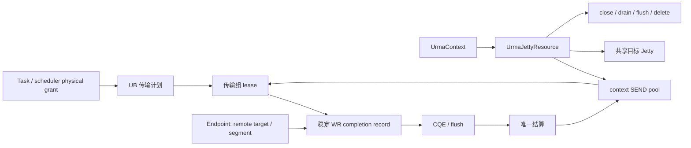
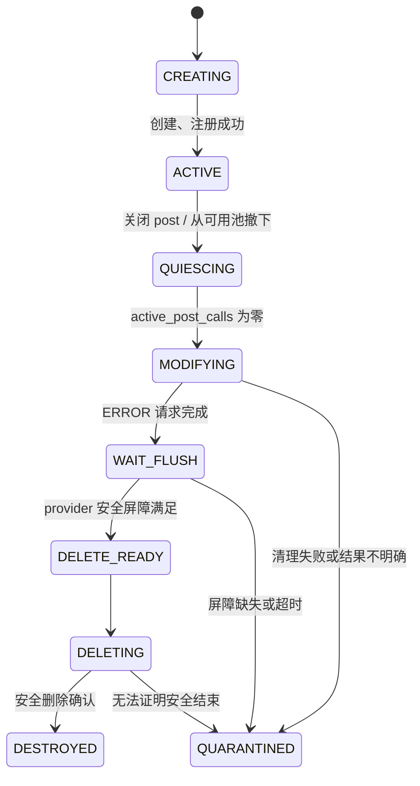

# classic UB Jetty 池化与生命周期详细设计

> 设计状态：待实现；日期：2026-10-13。
> Mooncake 基线：`supercache-snapshot-930` / `a2f25168`。
> 参考：已认证读取的 [yuanrong issue #30](https://gitcode.com/hc147/yuanrong-datasystem/issues/30)，及本地 yuanrong `eacc9857` 的 pool、lease、PostGate、flush/quarantine 实现。
> 前置契约：[UB 故障隔离设计](ub_fault_isolation_design.md)。本文仅设计 classic `kunpeng_transport`，不修改负载调度策略。

## 1. 目标与交付边界

把本地发送资源与远端连接解耦，使发送 Jetty 数量由在途传输和容量预算决定，而不是随 endpoint 数量增长。统一提交许可、WR 结算、故障退役和退出顺序，保证故障资源不会提前出租或释放。

第一版采用：**RM 模式、每 context 发送池、每 context 一个共享目标 Jetty、每传输组一个 lane lease、稳定完成 token、后台安全退役与补池**。

RC 保留 peer 绑定资源，不跨 peer 借还；但使用相同的完成身份、计数和退役规则。原生 READ 与 WRITE 均覆盖，不照搬 yuanrong 的 RPC WRITE 写回模型，也不增加 GatherWrite、新副本策略或 TCP 自动回退。

## 2. 当前实现与参考差异

| 当前 Mooncake UB 机制 | 本方案调整 |
| --- | --- |
| `UrmaEndpoint::construct()` 为每 endpoint 创建 `num_jetty_per_ep` 个 Jetty | pooled RM endpoint 仅保存远端连接；本地发送资源转到 context resource manager |
| 本地 Jetty 与 imported target 一一对应，握手要求两端数量相同 | pooled RM 将发送数量和远端共享目标标识分离，显式协商新模式 |
| `user_ctx` 保存 `Slice*`，slice 保存深度数组和 endpoint 裸指针 | `user_ctx` 保存唯一 completion token，record 保持本次传输资源责任 |
| 随机选 Jetty，深度使用 volatile 数组 | lease 固定 Jetty，原子深度和 JFC credits 随 WR 唯一结算 |
| disconnect/deconstruct 即使控制操作失败也可能清零深度 | 停止新 post 后按 provider 清理证据推进，不用软件清零模拟完成 |
| `deleteEndpointByPtr()` 在缓存锁内直接 deconstruct | 缓存移除只撤销可发现性，慢清理和 provider 操作交给资源管理器 |
| transport 析构先释放 staging；context 清理先注销 segment | 先关入口并排空硬件责任，再释放 staging、注册和 context |

代码依据：

- [urma_endpoint.cpp](../../mooncake-transfer-engine/src/transport/kunpeng_transport/urma/urma_endpoint.cpp)：construct/post、RC bind、poll、RESET/delete。
- [ub_context.cpp](../../mooncake-transfer-engine/src/transport/kunpeng_transport/ub_context.cpp)：endpoint 缓存、worker 生产与完成路径。
- [ub_transport.cpp](../../mooncake-transfer-engine/src/transport/kunpeng_transport/ub_transport.cpp)：切片、watermark 入队、staging 与退出。
- [transport.h](../../mooncake-transfer-engine/include/transport/transport.h)：batch/task/slice 所有权与计数。
- [Store transfer_task.cpp](../../mooncake-store/src/transfer_task.cpp)：等待超时与 Future 结果。

yuanrong 以单活动 context 和 RPC/逻辑传输为资源边界；Mooncake 同一 task 可涉及多个本地 HCA/远端 device，因此不能采用全进程单池或整 BatchID 共享一个 lane。

issue #30 强调封口与事件结算后归还；当前 yuanrong 源码另有超时 force-release 和 orphan 记账。第一版不迁移该优化：有未收敛 WR 的 Jetty 不回可用池，先保守退役与有界保留。

## 3. 高内聚的模块与所有权

由 `UrmaContext` 持有一个 `UrmaJettyResource`，统一拥有该 context 的发送池、共享目标、Jetty registry、完成记录、补池和退役任务。

| 对象 | 职责和所有权 |
| --- | --- |
| `SendJettyPool` | 纯容器：成员、空闲索引、借还与移除；无 provider 调用，锁由 resource 持有 |
| `UrmaJettyResource` | provider 资源唯一管理入口、容量预算、完成 registry、后台创建/清理 |
| `UrmaJetty` | native handle、身份、PostGate、生命周期、原子 WR depth；共享引用保障存活 |
| `UbLaneLease` | 一次传输组的独占发送权、生产者封口、pending WR、唯一归还/退役 |
| `UbCompletionRecord` | 一个 WR 的 token、接受状态、完成 CAS、lane、连接和注册/缓冲引用 |
| `UrmaEndpoint` | remote identity、imported target 和连接/注册缓存；pooled RM 不拥有本地发送 Jetty |

不再建立第二个进程级单例。健康模块只决定是否可准入；resource 只决定 Jetty 是否可安全使用和回收。两者通过既定 permit 和观测接口单向接入。



SEND_LANE 和 SHARED_TARGET 是软件责任角色；底层仍使用正式 URMA Jetty API，不能假设存在 send-only native 类型。

## 4. 池化模式与连接协议

### 4.1 RM 模式

每 context 预创建有界 SEND Jetty 池，固定分配到其 JFC 分片，并保留现有 NUMA/chip hint。每 context 预创建一个共享目标 Jetty，复用 context 级 JFR/接收配置，供其他 peer 导入并发起 READ/WRITE。

发送 lane 不向对端发布，不需要在每次借还时重新握手。远端 imported target 按 `(peer incarnation, remote context, target epoch)` 缓存，lease 借还不能删除它。

启用前用真实 provider 验证：RM 发送 Jetty 可顺序访问不同 target；共享目标支持原生 READ/WRITE、bonding 与当前 segment 注册属性。不能从 RM 名称直接推导所有驱动支持相同语义。

### 4.2 RC 与旧 peer

正式 URMA bind 契约限制一个 RC 本地 Jetty 绑定一个远端 Jetty。第一版保留 endpoint-owned RC Jetty，采用统一生命周期 wrapper；不实现解绑后跨 peer 复用，也不把 URMA_EEXIST 当作已绑定到正确目标的证明。

新模式需要双方能力明确匹配。在前一方案的不透明设备 payload 中发布 `pooled_rm_v1` 能力，在 `HandShakeDesc::payload` 中确认：模式、context incarnation、shared target ID、target epoch 和正式传输模式。pooled 握手不再比较发送池大小与对端目标数量。

peer 不支持或使用 RC 时采用 legacy 握手及原 Jetty 数组。模式在首个 WR 之前固定；协商失败只允许在尚未提交时重试兼容模式。能力缓存与握手不一致时刷新身份，不能在已经 post 后切换。

旧模式和新模式可以并存，但 legacy Jetty 同样占用有限 provider 总预算，防止大量旧 peer 绕过容量限制。开关默认关闭，SDK/C/Python 提交签名保持不变。

## 5. 借用粒度、封口与正常归还

### 5.1 一个 task 可以对应多个传输组

传输组键：`(physical task, local context, remote context/target epoch, direction)`。

同组的多个 slice/WR 共享一个 lease；跨 HCA、跨远端 target 或不同方向分别持有 lease。使用 SchedulerCore 时以一个 physical grant 为 task 边界，grant 之间释放再竞争资源，避免大请求长期独占 lane。未启用调度时以原 TransferTask 为边界。

BatchID 可以包含多 peer 和多 task，不强行共享一个 lane；本特性不提供整个 batch 的资源原子性或业务事务。

### 5.2 先准备计划，再允许实际 post

将既有本地选路与 worker 远端解析收敛为 UB 内部 `UbTaskPlan`，先确定目标与注册兼容性、准备可用 connection，然后冻结有界的传输组描述。它按范围迭代生成 slice，不预先分配巨大请求的全部 WR。

对一个 task/grant 所需各组进行 try-acquire：任何组缺少资源，立即归还已经取得但未 post 的 lease，暂不提交该 task。不能持有部分 lane 无限等待其他组；返回背压，或进入受限队列按 deadline 重试。其他独立 task 仍遵循既有部分 batch 成功语义。

首个 WR 前冻结逻辑 slice 数、组数和终态预期；内部重试可以增加物理 WR 记录，但不增加逻辑 slice 完成次数。这样避免 CQE 早到时把尚未构建完的 task 误判完成。metadata/握手是独立准备阶段，不持有 pool 锁或发送 lane 等待远端响应。

### 5.3 Lease 状态与 Seal

`UbLaneLease` 维护 producer count、sealed、pending_wrs、retire_requested、settled 和 lease_generation。

生产者包括继续生成窗口、worker 队列以及准备重试的路径。只有所有生产者已结束、未 post 后缀已明确处理，才由 `UbTaskPlan` 的唯一 owner 执行 Seal。`submitTransferTask()` 返回或某个窗口队列暂时为空，不等于 Seal。

正常归还必须同时满足：

```text
sealed
&& pending_wrs == 0
&& active_post_calls == 0
&& jetty.lifecycle == ACTIVE
&& !retire_requested
&& one_time_settlement_claimed
```

pending 按 WR 数量计数，不按 slice 对象数之外的业务对象、SGE 数或一次 post 调用计数。正常 lease 归还与 Jetty 退役竞争统一在线性化点处理：若先归还，随后的退役必须撤下该成员；若先退役，归还不能重新发布它。

## 6. 完成身份、partial post 与唯一计数

### 6.1 稳定 completion token

`wr.user_ctx` 改为 context 内不复用的 64-bit token，不再保存裸 Slice*。registry 使用有界、可分片的 slot/record 分配，token 单调增长并校验 context/lease/Jetty generation，回绕前停止准入。

record 持有 lane、connection、imported target、本地/远端注册资源引用及 task 的完成责任。访问 Slice/TransferTask 的前提是 batch 仍被保留；token 本身不证明业务对象或调用者分配的内存仍然存活。

### 6.2 CQE 可以早于 post 返回

post 前先注册 record、累计 pending 并预留 Jetty/JFC credits，随后获取生命周期 PostPermit 并调用 provider。record 独立保存“提交结果已明确”和“CQE 已到达”，两个事实可任意先后到达。

post 返回前不回收其 WR 描述所需状态；最终 lease 归还还需 active_post_calls 为零。普通 completion 和错误返回通过 record CAS 结算，防止早到 CQE 与回滚重复扣减。

### 6.3 partial post 的判定

| provider 结果 | 资源责任 |
| --- | --- |
| 成功 | 所有 WR 进入接受状态，等待真实完成 |
| bad_wr 可验证属于本次链表，且 provider 前缀契约已验证 | 前缀保留完成责任；只取消确定未接受的后缀 |
| bad_wr 为空、越界、链表损坏或契约不明确 | 可能接受的记录全部保留，停止该 lease 后续提交并进入退役 |

同一套 record 逻辑覆盖普通 `urma_jfs_wr_t` 与 NUMA `bondp_jfs_wr_t`。从注册的 token 查所属条目，不使用不可靠的跨数组指针运算判定后缀。

每个 WR 的 credits 只能由“确定未接受”或“硬件终结”二选一地归还。poll 不能按 nr_poll 直接扣减 JFC 总量：fake CQE、重复 CQE、未知 token 和控制事件都不是新结算的业务 WR。

### 6.4 完成发布顺序

普通 CQE 先按 token 找 record、校验身份、唯一结算硬件责任和 credits，再执行 staging/业务收敛，最后发布 task 完成；发布后不再访问可能被调用方释放的 slice/task。

READ staging 的 lane 在硬件 WR 结束后可按规则回池，但 staging 缓冲与 task 必须保留到 H2D 完成。硬件结束和消费者结束分开计数，不用 lane 生命周期代替缓冲生命周期。

flush/suspend done 等 user_ctx 无效的记录先按类型分类，通过 Jetty registry 处理；不能解引用为 Slice。flush 返回的逐 WR 记录和 JFC 普通完成共用唯一结算入口。

## 7. Jetty 生命周期与 provider 契约



### 7.1 Close 与 PostGate

健康 permit 控制“路径是否允许”，Jetty PostPermit 控制“资源是否仍允许 post”。两者分别覆盖不同故障域，所有 post 入口必须同时取得。

PostGate 用同一个原子状态表示 closing 和 active calls；BeginRetire 首先关闭 gate，然后撤下池成员并安装 pending 记录，最后 arm finalizer。已取得许可的 post 退出后才能调用 modify/flush/delete。不能只做两次无关联的 active 检查。

post permit 只覆盖同步 provider 调用，不等 CQE。provider 资源删除与完成发布都由状态机认领一次；AE、CQE、timeout、shutdown 可重复请求退役，不重复控制调用。

### 7.2 Flush 必须有证据

adapter 只对已验证 provider 提供统一 Retire/Drain 契约：modify ERROR、接收可能早到的 FLUSH_ERR_DONE、调用正式 flush 并消费逐 WR 记录，直至所有接受/可能接受责任被覆盖，再推进删除。

pending 记录必须先于 modify 安装，early flush 用 sticky 标志保存。flush 返回 0、一个 done 事件、软件 pending 变为零分别代表不同事实，任何一个都不能单独作为所有 DMA 已停止的证明。

真实 provider 必须验证屏障对发送 DMA、遗留 CQE、AE 及共享目标入站请求的保证。不能按固定等待时间解封，也不能假设 generic URMA 与所有 bonding/驱动版本的 done 含义相同。

### 7.3 Delete 失败不等于句柄仍有效

本地 UMDK `bondp_delete_jetty()` 的部分路径早退并保留对象，另一些路径在子资源删除失败后仍释放 wrapper 并返回错误。因此 adapter 不能把所有非零返回都解释成“原指针可以再次 delete”。

adapter 返回结构化结果：`HANDLE_RETAINED`、`HANDLE_CONSUMED`、`UNKNOWN`，另行说明硬件收敛是否已确认。

- retained 且正式契约允许重试：保持 wrapper/native 引用，有限后台重试。
- consumed：立即停止任何 native 指针访问；若硬件清理未完全确认，保留受影响 context/注册与缓冲责任。
- unknown：禁止再次调用该指针，进入 quarantine 并限制相关 context，等待正式恢复证据。

上游没有足够契约时禁用 pooled 模式；不通过修改 provider 私有内存或盲目重试解决兼容性。

### 7.4 ID 复用与旧事件

普通 WR token 有 generation，可以拒绝迟到/重复完成。fake CQE/AE 可能只有 local Jetty ID，软件加 generation 无法自动解决该 ID 的 ABA。

未安全删除的 ID 必须继续保留在 registry。新资源创建撞到保留 ID 时不得发布。安全删除后，还需 provider 保证旧事件排空并完成 ack，才能释放 ID 归属；无法证明时保留 tombstone 并停止相应复用，预算耗尽产生背压。

## 8. 共享目标、连接与注册生命周期

共享目标属于 context，endpoint eviction 只移除连接可发现性。仍被 WR record/lease 使用的 imported target 与 segment 继续存活；引用排空后后台 unimport，不在 SIEVE cache 锁内调用 provider。

旧 `deleteEndpointByPtr()`、disconnect 和 deconstruct 统一改为 request-close/request-retire，不先销毁后放入 waiting_list。cache active、连接 connected、Jetty ACTIVE 是三个不同状态。

共享目标失效会影响该 context 的多个 peer，故障域比独占 endpoint target 更大；第一版接受这个明确代价，不承诺所有故障都只影响一个请求。失效时撤下旧 target、关闭对应资源准入、增加 target_epoch，再创建新身份并发布。

对端在新握手/能力查询中检测 target_epoch 变化，重建新 imported target；老在途请求保持旧引用，不能原地替换指针。仅本地重建成功不等于远端已恢复。

共享目标的入站 one-sided READ/WRITE 不一定产生可枚举的本地业务 CQE。仅本地 SEND pending=0 不能证明远端 DMA 已结束；adapter 需提供停止旧目标访问并排空入站的屏障。能力不足时保留整个相关注册域/context，不先注销内存。

第一版不增加全局广播。只让已使用的 peer 按既有握手、失败后刷新和前一方案的定向控制查询更新身份。共享目标分片可后续按实测故障域需求设计，不进入首轮。

## 9. 超时、缓冲安全和有界背压

### 9.1 正常结算与异常保留

逻辑 timeout/cancel 先停止该 task 的新窗口与生产者，再 Seal 并请求退役。有未收敛 WR 的 lane 不回可用池；迟到 CQE 只能结算原 token。新请求可使用预算内的替代 lane。

正常终态只在硬件责任收敛且消费者完成后发布。若需要在硬件未结束时向上层返回业务超时，必须显式将 task、注册和实际缓冲 owner 转给内部 pending owner，不能只保留 completion record。

### 9.2 借用内存的边界

保留 MR 或 shared_ptr<record> 不能阻止调用者 free 原始内存。低层裸指针 API 的调用者仍必须保持缓冲到安全完成，TIMEOUT 是逻辑观测而非可释放许可，freeBatchID 在责任未收敛时返回 BatchBusy。

Store 的 UB 操作状态需要持有可保留的缓冲 owner、batch 清理责任及安全完成信号；析构不能忽略 BatchBusy 后放弃清理。对 transport staging、arena 分配缓冲及可保留的调用层对象，用窄的内部 `UbBufferHold` 接入其原 owner，不建立通用内存管理框架。

无法取得实际 owner 的借用缓冲不能采用 detached timeout：调用方需安全 drain 后释放；若 provider 无法完成 drain，不能同时承诺有限返回和释放该缓冲。该契约及 Store 接入是池化 enforce 的前置验收项，不能隐藏在“迟到 CQE 已处理”的描述中。

staging 释放统一在任务全部硬件责任与 H2D 消费者完成之后；一个错误窗口不能提前执行 cleanupStagingForTask，误释放仍供已 post 前缀使用的整块 staging。

### 9.3 容量预算

定义：T 为目标 SEND pool 成员数，E 为额外退役窗口，A 为池成员（idle+leased），R 为退役/待删/quarantine 唯一资源，L 为 legacy SEND，C 为创建中已预留名额。

```text
A + R + L + C <= T + E
create_count <= max(0, min(T - A, T + E - A - R - L - C))
```

resource 在同一预算锁内预留创建名额并转移状态，每个 identity 只归属一个统计桶；provider 调用在锁外。共享目标与其他 native Jetty 另计硬件总上限，结合 device max_jetty、JFC depth 和 WR credits 校验，不能只控制池容器大小。

每 `(peer incarnation, local context)` 设置同时占用 lease 的配额，正常借出时计入，唯一归还或转移到退役 owner 时结算；退役资源仍受 R 和总物理预算限制。配额通常小于 T，保留其他 peer 的使用机会；多 context 总配置也必须校验进程资源上限，不能每张卡独立放大到无界。

另设 completion record 数量和 quarantine 所持缓冲字节上限。达到任一上限停止相关新准入，不能为了满足预算释放未证实安全的对象。

空池 TryAcquire 返回可识别的背压，无同步 create、无无限等待。显式调度路径可在有界队列等待；旧路径返回资源不足。TE 不自行换协议，尤其不能把已提交 WRITE 重放成 TCP。

## 10. 初始化、补池与退出

初始化在发布 pooled 能力前完成共享目标和发送预填充，所有对象创建/注册成功才发布。配置按 context/JFC 明确分配，不由某个设备初始化修改全进程 globalConfig 来隐式影响其他 HCA。

refill 线程只为明确缺口创建新 identity，在锁外调用 provider，回锁后二次检查 stopping、generation 和预算再发布。创建失败限频重试；创建与 shutdown 并发时未发布资源仍进入正式清理，不被析构顺手丢弃。

退出顺序：

1. 关闭 transport、健康、pool 和 post 入口；停止新 handshake/import 及 refill 发布。
2. 取消未 post 队列并 Seal；让已取得许可的同步 post 退出。
3. 保持 CQE/AE/flush 处理运行，推进在途结算和 Jetty 退役。
4. 安全撤销共享目标、连接 target/segment；确认本地与入站硬件不再访问注册。
5. 等待 H2D 等消费者完成，释放 staging 与本地 buffer hold，再注销注册。
6. 排空并停止完成处理，删除 JFR、JFC/JFCE，最后销毁 native context 和 runtime。

控制操作和 join 不持有 pool/cache/registry 锁。完成线程不能等待一个必须由自己处理的 flush 事件。quarantine 未收敛时不能继续释放其依赖注册、context 或动态库；需要独立保留 owner 或由明确的 provider/context 停止屏障收敛。

## 11. 文件布局与分阶段实施

以下为拟修改位置，本次仅新增设计文档。

| 位置 | 内容 |
| --- | --- |
| `include/.../kunpeng_transport/urma/urma_jetty_resource.h` 与对应 `.cpp` | Jetty wrapper、resource owner、provider 清理结果、pool、registry 和后台任务 |
| `include/.../kunpeng_transport/ub_lane_lease.h` 与对应 `.cpp` | 纯 lease/producer/Seal/唯一结算状态机，provider 无关 |
| `include/.../kunpeng_transport/ub_completion.h` 与对应 `.cpp` | 稳定 token、WR 接受/终结状态、有界完成 registry |
| 既有 `ub_transport.cpp` / `ub_context.cpp` | task plan、跨 context 资源预留、生产者收敛、缓存回收与 staging 安全 |
| 既有 `urma_endpoint.h/.cpp` | pooled/legacy 连接模式、post adapter、CQE/AE 分类、共享目标握手 |
| `transport.h` 的 UB 私有字段与必要 hook | 替换深度/endpoint 裸引用；保留其他 transport 布局语义 |
| Store `transfer_task.*` 及实际 buffer owner 接入点 | UB 超时保留与安全完成，检查 BatchBusy；不修改存储事务 |
| config、UB CMake 与 tests | 启用开关、目标/额外容量/peer 配额、provider 契约检测与 UT/ST |

实施按安全依赖排序：

1. 生命周期基础：稳定 token、partial post、唯一 credits、PostGate、flush/delete 结果分类；先覆盖原 endpoint 模式。
2. 池与 lease：纯池、生产者封口、task plan、容量和有界背压；完成 Store 缓冲保留前置接入。
3. pooled RM 与共享目标：能力协商、epoch、target/segment 引用、RC/旧端兼容。
4. 故障与退出验证后灰度启用，最后评估池大小与 JFC 分片；不把扩大池容量当作可靠性修复。

## 12. 验证与验收

| 测试场景 | 核心判据 |
| --- | --- |
| 同 task 多 slice、多窗口 | 每传输组只 Acquire 一次，生产者结束前不 Seal/归还 |
| 多 peer/multi-HCA、scheduler grants | 不跨注册域混池，grant 完成后释放；没有部分持有等待死锁 |
| 空池、peer 配额、完成表满 | 首个 WR 前有界背压，不创建热路径 Jetty，不自动 TCP 重放 |
| CQE 早于 post 返回/Seal | 记录可定位，active call 和 producer 阻止提前复用 |
| valid bad_wr 前缀、null/越界 bad_wr | 只撤销可信未接受后缀；模糊责任保留并退役 |
| 重复 CQE、旧 token、fake CQE、AE 竞态 | 恰好一次结算，深度不负数，不解引用无效 user_ctx |
| modify 与 post 并发、early flush | 先 close/drain；early event 不丢失，不重复 finalizer |
| flush 返回 0、done 但残留记录、delete 各类失败 | 无安全屏障不释放；consumed/unknown 不重用 native 指针 |
| Jetty ID 复用/旧 local_id-only 事件 | 没有 ABA 导致新资源被错误删除或结算 |
| 超时/迟到完成/H2D 延迟 | lane 不提前回池，原缓冲不释放，消费者结束前不发布成功 |
| SIEVE eviction/主动删除/peer 重启 | 旧 target/segment 等引用排空再清理，缓存锁内无慢 provider 调用 |
| 共享目标故障和远端 epoch 缓存 | 正确关闭该资源域，旧远端不能继续使用旧目标，注册不提前注销 |
| refill 与 shutdown 并发、quarantine 积累 | 物理资源和缓冲预算有界，退出不漏发布、不破坏依赖顺序 |
| RM/RC、新新/新旧、开关关闭 | 模式在提交前确定，RC 不跨 peer 绑定，兼容路径也受总预算约束 |

UT 使用 fake provider、可控 post/flush 返回及确定性 producer 调度；integration 测试覆盖真实 mock 路径；ST 在实际 URMA 验证 RM READ/WRITE、partial post、故障替换和停机屏障。mock 不证明驱动生命周期契约。

性能评价：endpoint 数量变化时 Jetty 物理数量、顺序复用创建次数、pool/registry 锁竞争、每 WR token 成本、不同对象大小的吞吐及 p99。池化本身不保证提高带宽。

最小指标：idle/leased、retiring/quarantine/creating、唯一 native 数量、pending WR/bytes、pool-empty 和 per-peer 拒绝、late/duplicate CQE、retire/drain 耗时、refill 失败及 oldest quarantine age。

## 13. 与前后两个特性的边界

健康模块关闭准入时，先取消未 post 的任务；不因端口 all-bad 就立即销毁全部 Jetty。Jetty AE/不可用记录交资源状态机处理，端口恢复也不能把退役 Jetty 放回池。

后续负载调度可读取 context 的可用 lane、排队量与在途字节。idle lane 数不等于剩余带宽，调度不能绕过健康许可、生命周期许可或硬件 credits。

关键冻结契约：传输组粒度、单一 Seal owner、完成 token、provider 清理结果语义、共享目标 epoch、buffer hold 和容量预算。实现前需先验证实际部署 provider；契约无法证明时保持兼容模式，不能仅开启池化开关。
