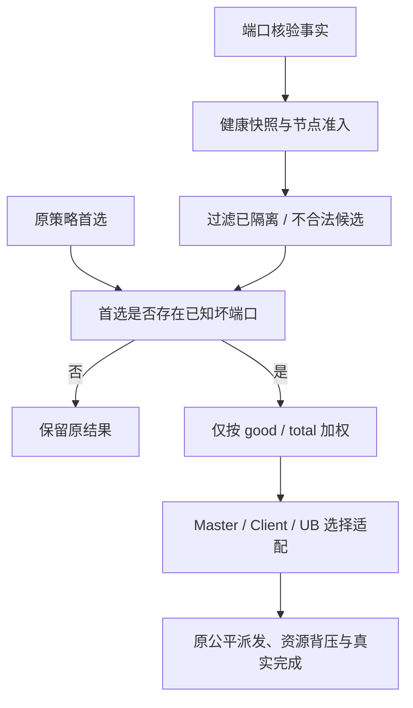

# 端口故障感知负载调度设计与实施计划

> 设计状态：待实现；更新日期：2026-10-15。
> 运行时代码基线：`supercache-snapshot-930` / `a2f25168`；本次仅修改设计文档。
> 参考：认证读取的 [yuanrong issue #29](https://gitcode.com/hc147/yuanrong-datasystem/issues/29) 及本地 `eacc9857` 源码。
> 本文替代此前按拥塞、服务耗时及容量评分的全链路方案，调度权重只由端口故障事实计算。
> 前置：[节点业务隔离](ub_fault_isolation_design.md)、[Jetty 池化与生命周期](ub_jetty_pool_lifecycle_design.md)。

## 1. 目标与范围

闭环调整为：**有效端口事实 → 原策略首选 → 已知坏端口触发 → 健康端口比例分流 → 原有执行与完成机制**。

- 原首选端口健康未知或没有坏端口时，保留原选择结果及原错误语义。
- 原首选存在已确认坏端口时，仅按候选的健康端口比例重新分配选择概率。
- 部分端口坏减少流量份额，不将候选直接隔离；全部端口坏/资源不可服务由节点隔离与路径准入处理。
- 不采集或使用 P50/P99、EWMA、吞吐、排队、backlog、Jetty 空闲数、内存空闲比例等作为新增触发条件或权重。
- 不因高延迟、拥塞或临时容量不足改变端口调度结果，不新增性能探测、负载上报或全局流量配额。
- 保持已确定的接入层次：Master 新副本放置、Client 读副本选择和 UB 设备选择。SchedulerCore 原有公平与预算策略不改。
- 不迁移已有对象，不改变 key 归属、副本数量、存储类型/位置层级、硬目标及既有副本分布约束。

“容量不参与调度”指不增加动态容量评分。真实空间校验、原分配策略、WR/JFC 安全上限和已有背压仍必须执行，不能为了按概率分流而越过资源约束。

## 2. 与 yuanrong 的对齐口径

yuanrong issue #29 的实际方案只在首选 Worker 有已知坏端口时进入加权选点，健康或未知时保持亲和；进入后原方案还结合归一化时延成本计算权重。

根据本次要求，本文对齐其**坏端口触发、健康比例分流和保留原亲和**原则，明确不采用时延成本。不是对 issue #29 完整算法的逐项复制，也不声称 yuanrong 原实现仅使用坏端口数。

原 issue 主要覆盖后续单键写入；本文沿既有 Mooncake 设计将相同纯端口规则接到节点放置、读选点与 UB 设备选择。批量请求逐项应用，保持既有部分成功/事务语义。

参考：[yuanrong Client 选点](../../../yuanrong-datasystem/src/datasystem/client/object_cache/routing/client_read_bandwidth_scheduler.cpp)、[WorkerRouter](../../../yuanrong-datasystem/src/datasystem/client/object_cache/routing/worker_router.cpp)。跨仓链接用于本地对照，网站以 issue #29 为入口。

## 3. 架构与公共组件

| 组件 | 责任 | 边界 |
| --- | --- | --- |
| UbHealthManager / NodeBusinessAdmission | 核验域事实、节点准入与恢复 | 不维护调度权重或容量 |
| NodeHealthRegistry | 身份围栏、端口聚合与不可变快照 | 不新增第二份负载事实 |
| PortWeightPolicy | 纯函数：计数校验、比例转权重、加权抽选 | 不调用 RPC/provider、不读队列或容量 |
| NodePlacementPolicy | 适配 Master 的合法节点集合与原首选 | 不代替 allocator、不改变分布约束 |
| ReplicaPortPolicy | 适配 Client 的合法读副本和原首选 | 不执行数据传输 |
| UbPortRoutePolicy | 本地/远端设备的端口加权适配 | 不持有 Jetty、不改物理端口 hint 规则 |
| SchedulerCore / Jetty resource | 既有公平、预算、实际预留和完成 | 资源忙不反馈为端口权重 |



公共 PortWeightPolicy 放在不依赖 Store/URMA 的小型公共组件中，输入为计数视图和选择种子，输出候选索引。Master/Client/UB 仅提供候选适配，不各写一套公式。

复用现有节点身份、健康同步和快照，不再新增 UbLoadTracker、NodeLoadReporter、NodeLoadRegistry、NodeLoadSummaryV1 或独立性能同步线程。

## 4. 唯一输入与聚合规则

输入至少包含 subject identity、service_set_generation/target epoch、health_epoch、valid、verification_pending、total、bad，以及既有准入结论。

权重使用已经按隔离方案接受的当前有效事实。pending 不制造新权重：如果已有同身份最后有效快照，保持其已接受权重；没有有效事实则标 UNKNOWN。旧身份、非法计数和未核验被动提示不能更新权重。

计数要求 total>0、0<=bad<=total；good=total-bad，端口数来自 provider，不硬编码四。health_epoch 表示事实变化，query_seq 仅表示新查询，不因相同事实重复查询重建权重表。

节点聚合：

- 按配置服务域集合去重汇总，不重复计算共享同一端口集合的 context。
- Node total=sum(domain total)，Node bad=sum(domain bad)；所有参与域必须有当前身份的有效计数。
- 有域缺失/未知或集合代际变化时节点权重 UNKNOWN，不拼接旧身份得到伪精确比例。
- 资源 offline、注册不兼容与节点隔离先执行硬过滤；不能把这些条件换算为额外坏端口或容量惩罚。
- 节点仍可服务但聚合权重未知时保留既有路由，不新增拒绝。

设备选择使用实际候选域的计数，不使用全节点比例替代。节点选择和节点内设备选择是不同层次，不将节点权重再次乘入设备权重。

## 5. 权重、触发和选择算法

对合法且计数有效的候选 i：

```text
good_i = total_i - bad_i
weight_i = good_i / total_i
probability_i = weight_i / sum(weight_j)
```

使用健康比例而非简单按坏端口绝对数排序，避免不同总端口数节点被错误比较；比例是本方案唯一新增权重，不是带宽或剩余容量估计。

实现用有检查的整数定点权重：SCALE=65536，good=0 时权重为零；good>0 时 weight=max(1, floor(SCALE*good/total))。中间乘加使用足够宽的整数并检查溢出，随机数在总权重区间无偏映射，遍历前缀和选中候选。

一次选择固定使用一份健康/身份快照。过程为：

1. 先按节点/路径准入、注册、类型、硬目标及原分布约束得到合法候选和原首选。
2. 原策略失败时保留原失败，不把端口调度当作错误修复器。
3. 原首选无有效计数或 bad=0，原样返回，不因其他候选的端口数更大而切换。
4. 原首选 valid 且 bad>0，开启加权分支；保留仍合法的原首选参与抽选。
5. 仅当前有效、good>0 的候选参与新加权。UNKNOWN 不被当作“全健康低负载”；其仍可参与原策略的兼容回退。
6. 无可加权候选时，只有重新通过硬准入的原首选可回退；不能放行已隔离/all-bad 路径。
7. 实际提交前重新检查身份与准入。已提交范围不因权重变化搬迁或重放。

候选数量沿用各入口既有有界候选集合和配置上限；稳定候选可按身份/health_epoch 缓存不可变定点权重。每次请求仅做本地计算，不同步查询端口、RPC 或排序性能模型。

随机种子包含进程实例盐、请求序号、操作/副本序号；不只用固定 key，防止重复请求永久选中同一候选。权重只随被接受的端口事实变化，不设置时延滞回、拥塞门限或性能探索比例。

例：首选 A=4口坏2口、B=4口全好、C=4口坏1口，权重为 0.5、1、0.75，选择份额约 22.2%、44.4%、33.3%。A 全恢复后，若它仍是原策略首选，则恢复保留原选择，不继续全局加权。

## 6. Master 新副本放置

在既有 allocation strategy 的合法候选形成后接入 PortWeightPolicy。保留存储类型、本地/远端层级、preferred/excluded、配额与副本分布约束；显式 AllocateFrom 不重定向。

原首选没有坏端口时继续原策略，包括既有 FREE_RATIO_FIRST/LOCAL_FIRST 的行为。本文不新增内存比例、pending allocation bytes 或写入服务率评分，也不改写原策略本来用于完成分配的空间判断。

进入端口加权后按抽选候选调用真实 allocator。空间不足时沿原有合法失败回退流程处理，候选去重且不超过既有候选上限；端口权重不因空间不足更新，不新增“空闲更多所以加权更多”。

批量和多副本逐项执行，剔除已使用或不符合原分布条件的候选后重新归一化。新分配只影响未来写入，不迁移已有副本；PutStart/PutEnd/abort 的成功与结算标准不变。

CVM 跨 Master 分配由实际目的 Master 自行检查身份、准入及端口权重，转发方不基于延迟/远端容量挑选 Master。保持原有转发顺序和目的端实际分配规则。

## 7. Client 读副本选择

先执行节点准入和副本合法性过滤，保持既有类型和本地快速路径层级。只在原策略允许竞争的 remote MEMORY 候选之间应用端口规则，不跨 SSD/DRAM 类型比较。

原首选端口未知/无坏口时保留原结果；已知坏口时按节点健康比例选择其他合法副本。缓存 descriptor、范围/批量/异步和换源重试共用入口。

策略由 Client 实例持有，context 仅携带当前身份/健康快照和随机种子；不再新增字节大小、P99、EWMA 或队列成本评分。不能将某个 Client 的可变状态捕获到进程级全局 scorer。

所有合法节点都忙时不据此改变端口选择；沿既有排队/失败处理。全部副本被隔离时返回节点不可服务，不因 UNKNOWN 或原亲和绕过硬过滤。

## 8. UB 设备选择与执行边界

UbTaskPlan 保留本地/远端注册范围、context/target 身份、权限、模式和拓扑约束。先得到可执行的本地候选，再在其兼容远端集合中选择，避免选到没有合法配对的 context。

本地和远端分别使用各自域的坏口触发与比例规则，不构建时延成本或将共同本地比例重复加入远端排名。完全健康/未知时维持原 Topology 的亲和、随机/轮转和重试顺序。

组首次 post 前固定选择和注册身份；健康变化只影响未提交组或后续 grant。重试重新通过健康检查，但不以队列/JFC 深度选择“更空闲”设备。

资源不足时不改变端口权重、不按空闲 lane 重选节点/HCA。支持 prepared dispatch 的路径返回零 WR、无残留预留的 DEFER；由既有有界队列/唤醒机制等待。其他路径保留原背压语义，不能把可能 post 前缀的失败当作整范围可重试。

Jetty 池化、稳定 completion token、唯一 credits、partial post、缓冲保留和安全退役沿独立 Jetty 方案实施。prepared dispatch 如尚未实现，不在本次纯端口策略中另行扩大其实现范围，也不宣称已有完整安全 DEFER。

## 9. 公平、传播与恢复

SchedulerCore 继续使用当前 intent、tenant、priority、deadline、quantum 和预算配置，不按坏口数动态修改租户权重、HIGH reserve、grant 大小或吞吐上限。

端口权重只决定流量落点。低权重且仍可服务的候选保留非零选择机会，不另加性能探测或饥饿强制切换。有限样本下的比例是统计份额，不是逐请求、逐字节的精确配额。

完全复用节点隔离的身份绑定、版本化健康同步、独立 Query 和恢复判据。不新增性能 TTL；摘要失效沿既有健康规则保留事实或转 UNKNOWN，不能擅自解除隔离。

HA 保存已确认隔离与身份；权重是有效端口事实的派生缓存，不单独持久化。接管先执行隔离方案的重新核验，事实有效后重建权重。CVM 每个消费端独立使用已接受事实，旧消息不能覆盖新 health_epoch。

开关 off/observe/enforce 默认 off；observe 记录端口触发、权重和拟选择结果。旧端没有端口事实时保留原性能策略，但节点隔离要求仍生效；原两份上层方案中的严格节点能力检查不被此处兼容回退放宽。

## 10. 修改点与交付顺序

| 修改位置 | 内容 |
| --- | --- |
| 公共端口权重组件（拟新增） | 计数验证、固定点权重、纯加权选择；不依赖 Store/URMA |
| [allocation_strategy.h](../../mooncake-store/include/allocation_strategy.h) / Master | 原候选/首选适配，保持真实空间分配与失败语义 |
| [replica_selection.h](../../mooncake-store/include/replica_selection.h) / Client | 实例级端口策略、统一缓存/批量/异步入口 |
| [ub_transport.cpp](../../mooncake-transfer-engine/src/transport/kunpeng_transport/ub_transport.cpp) / [ub_context.cpp](../../mooncake-transfer-engine/src/transport/kunpeng_transport/ub_context.cpp) | 本地/远端域选择、注册身份、未 post 重选与最终 gate |
| 节点健康 registry / RPC / HA / CVM | 复用端口摘要，派生权重缓存与接管重建 |
| SchedulerCore / Jetty resource | 保持原公平和资源约束；不增加拥塞/容量反馈选路 |

取消此前计划中的性能采样/上报链路、NodeLoadRegistry、待结算分配压力账本、P50/P99/EWMA 成本、时延门限、容量选路和低负载探索。现有诊断统计可保留，但不得进入本策略决策。

实施顺序：确认健康摘要与节点 gate → 公共纯策略及 UT → Master 新放置 → Client 读选择 → UB 域选择 → HA/CVM 与兼容回归 → observe → enforce。仅本次文档提交，不承诺运行时功能已实现。

## 11. 验证矩阵

| 场景 | 验收 |
| --- | --- |
| 原首选全好/未知，但延迟、队列或占用很高 | 不触发新加权，保留原结果 |
| 原首选部分坏，候选好口比例不同 | 按比例分流，不直接隔离部分坏候选 |
| 总口数不同、相同坏口绝对数 | 使用 good/total，不按裸坏口数误比较 |
| 候选全坏/隔离、无可加权候选 | 硬过滤生效，回退不放行隔离节点 |
| pending、旧身份、乱序/重复事实、重启 | 不产生新权重或解除隔离 |
| 多 context 共享域、未知域、集合变化 | 去重、UNKNOWN、代际重建正确 |
| 批量/多副本、硬目标、空间不足 | 原分布/事务/真实分配语义不变 |
| Client 缓存/异步/范围、节点恢复 | 同一策略，恢复后原亲和重新生效 |
| 队列满、无 lane、JFC/record 资源不足 | 不重评分、不突破预算、不重放已接受范围 |
| 多 HCA、RC/旧 peer、HA/CVM | 注册与身份正确，兼容路径不绕过准入 |

UT 注入随机种子和健康快照，验证固定点边界、输入校验、确定性选择和比例分布；分布测试使用预定大样本及容差，不依赖单次随机结果。

对同一候选、计数与随机种子，改变延迟、吞吐、队列、空闲容量或 Jetty 占用，断言选点不变。另测原分配失败后的合法回退，区分权重选择与实际资源接纳。

integration 覆盖 Master/Client/TE，ST 用真实端口故障验证流量份额下降和恢复。记录 health_epoch、触发原因、各候选 total/bad/weight、选择份额与硬准入拒绝。吞吐/p99 仅作验收观测，不反馈到算法。

验收标准：无故障/未知时不改变原策略；部分坏时按健康比例减少份额；隔离节点不承接新业务；拥塞、性能和容量不成为新增调整因素。
