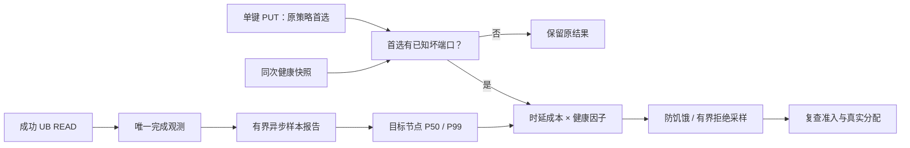

# UB 端口故障触发的时延成本加权调度设计与实施计划

> 设计状态：待实现；更新日期：2026-10-15。
> 运行时代码基线：`supercache-snapshot-930` / `a2f25168`；本次仅修改设计文档。
> 参考：认证读取的 [yuanrong issue #29](https://gitcode.com/hc147/yuanrong-datasystem/issues/29) 及本地 `eacc9857` 源码。
> 本文替代上一版纯端口比例计划：恢复归一化时延成本、非亲和惩罚、平滑反比权重、有界拒绝采样和防饥饿。
> 前置：[节点业务隔离](ub_fault_isolation_design.md)、[Jetty 池化与生命周期](ub_jetty_pool_lifecycle_design.md)。

## 1. 核心原则与第一阶段范围

**坏端口决定是否进入调度，时延成本与健康端口比例共同决定候选吸引力。**

- 原策略首选健康未知或无坏端口时，保持原结果及原错误语义；高时延本身不触发切换。
- 首选存在已知坏端口时才进入联合加权；全坏/资源不可服务由既有硬准入先过滤。
- 只恢复时延成本，不增加队列长度、拥塞程度、backlog、空闲容量、Jetty 空闲数或吞吐评分。
- 第一阶段聚焦“成功 UB 读服务反馈 → 后续单键新写入放置”，由 Master 完成 Mooncake 对等的节点选点。
- Client 读副本、UB 设备选择、批量写入保持原策略和节点健康过滤，第一阶段不对它们启用新的时延权重。
- SchedulerCore 公平、预算、quantum 和 Jetty 资源安全约束不变；不引入全局带宽配额、主动性能探测或额外 WRITE。
- 不迁移已有对象，不改变 key 归属、副本类型/数量、硬目标、配额及既有分布约束。

第一阶段只评价正常 UB MEMORY 新放置。显式 AllocateFrom 等硬目标、CXL/NoF/磁盘及其他协议维持原选择；真正空间不足仍由原 allocator 处理，不能因模型评分突破资源上限。

## 2. 元戎事实、对齐项与必要差异

yuanrong 在 Worker QueryAndGet 的 UB WRITE 回写期间计时，形成固定数据量的 P50/P99，在成功 Publish 响应反馈给 Client；Client 的单键 PREFERRED_META_OWNER 路径仅在首选有坏端口时进入加权。读/批量路径不等同于同样接入。

本方案对齐：坏端口触发、4 MiB 归一化、P99 偏重成本、200 微秒非亲和惩罚、健康比例、平滑反比权重、有界拒绝采样、初始化估计及防饥饿。上一版只用 good/total 不再作为算法。

Mooncake GET 常由 Client 发起单边 READ，目标节点没有等价 Worker WRITE 回写 RPC。发起方记录按目标节点归属的读传输阶段，Master 汇总成功样本并用于未来 PUT；不能把目标本地发送队列当作完整读服务信号。

源码对照：[成本与权重](../../../yuanrong-datasystem/src/datasystem/client/object_cache/routing/client_read_bandwidth_scheduler.cpp)、[配置](../../../yuanrong-datasystem/src/datasystem/client/object_cache/routing/client_read_bandwidth_scheduler.h)、[统计器](../../../yuanrong-datasystem/src/datasystem/common/scheduling/worker_read_bandwidth_tracker.cpp)、[Publish 反馈](../../../yuanrong-datasystem/src/datasystem/worker/object_cache/service/worker_oc_service_publish_impl.cpp)、[WorkerRouter](../../../yuanrong-datasystem/src/datasystem/client/object_cache/routing/worker_router.cpp)。跨仓链接仅用于本地对照。

必要差异明确保留：

- 回退原首选前重新检查硬准入，不照搬源码无复查的回退。
- 防饥饿必须校验有效成本和 P99 门限，遵循 issue 的设计约束；当前源码 starvation 分支对无效成本的校验不完整，不能直接照搬。
- 样本和候选绑定 incarnation/generation，重复旧版本不伪刷新年龄。
- 低流量有新样本但配额未满时允许后台周期刷新，避免永远只用初始化估计。
- 不引入此前设计的“按测量时健康比例抵消惩罚”；为拉齐元戎，成本与当前健康因子按统一公式同时参与。

## 3. 架构与公共组件

| 组件 | 归属 | 责任 |
| --- | --- | --- |
| ReadTransferObserver | TE/TransferSubmitter 适配 | 在唯一硬件完成点记录 READ 组耗时、字节和目标身份 |
| ReadLatencyReporter | 每个 Store Client | 有界取样、异步批量上报，不阻塞读数据完成 |
| NodeReadLatencyTracker | 各 Master | 每目标节点的有界样本窗口、后台 P50/P99、版本与初始化状态 |
| NodeHealthRegistry | 复用节点隔离模块 | 提供当前端口聚合、身份与业务准入 |
| LatencyHealthWeightPolicy | 小型公共纯策略组件 | 成本、亲和惩罚、健康因子、接受率和候选检查 |
| NodePlacementAdapter | Master 分配路径 | 原首选、合法候选、抽样及实际 allocator 的衔接 |



公共组件只处理整数、身份视图、候选索引和随机数，不依赖 URMA、Store Client 或 allocator。健康事实与统计成本分别拥有：tracker 不能改隔离，registry 不计算时延，policy 不发 RPC、不创建 Jetty。

第一阶段不新增 UB 设备性能路由器或第二个租户调度器，也不将节点读服务模型直接复制给每个 HCA。

## 4. 采集口径、统计和反馈

### 4.1 有效样本

只采集成功 UB READ 传输组：从 first accepted post 到 last hardware completion，按总字节归一化。包含组内窗口推进开销，但不包含请求查找、Master RPC、逻辑排队、H2D 和 PutEnd。

样本至少 256 KiB，时间大于零，身份稳定；失败、取消、重试、partial post、重复完成不入稳态窗口。失败仍沿原错误/健康通道处理，不能制造成功耗时。

逻辑 slice、物理 WR 与样本组分开，completion token 唯一结算后才完成观察；不得在发布 task 完成后解引用可能已释放的 Slice/Task。

### 4.2 数据量归一化

```text
D0 = 4 * 1024 * 1024 bytes
L = max(1, floor(t_ns * D0 / D_bytes))
```

用宽整数或溢出检查，极大值饱和。2 MiB 耗时 300 微秒折算为 600 微秒；8 MiB 耗时 800 微秒折算为 400 微秒。归一化仍受固定启动成本影响，不能等同于端到端 GET 延迟或物理剩余带宽。

### 4.3 有界窗口与反馈

发起方进程级每毫秒最多四个有效样本；不为每个目标复制一份无限配额。Master 每个活跃目标保留最多 1000 个归一化原始样本，后台计算分位数；正常配额满请求刷新，另每 100 ms 对有新样本窗口刷新一次，低流量不要求填满配额。

报告携带 observer/target incarnation、sample_seq、字节/耗时或归一化值、测量年龄和传输类型，复用版本化控制连接异步批量发送。主读数据成功不依赖报告成功；队列满可丢样本，不能丢完成责任或健康事件。

Master 验证观察者与已挂载目标身份、范围/整数和消息上限，并按 observer identity + sequence 去重。多个观察者的原始归一化样本进入目标有界窗口；不平均多个 P99 冒充全局 P99。该结果是路径观察形成的节点代理成本，仍受发起方与网络影响。

统计版本只在产生新有效快照时递增。保留测量年龄与本地接收时间两种指标，重复上报不能让旧测量看似新鲜。源码的 100 ms fresh 标记作为诊断参考，旧但同身份的有效成本仍可选择，不自动清零或置零权重。

每节点初始化 P50=200 微秒、P99=500 微秒，明确标为估计而非测量。节点重启后不复用旧实例成本，重新进入初始化；候选表和目标窗口数量受当前拓扑及配置上限约束，不创建完整 Client×节点矩阵。

## 5. 成本、健康因子与权重

所有计算统一使用纳秒。候选的归一化分位数为 P50/P99：

```text
tail_cost = floor((P50 + 3 * P99) / 4)
C = tail_cost + (is_original_preferred ? 0 : delta)
delta = 200 us
```

P99 占 75%。非亲和惩罚是固定偏好，不是逐请求测得的额外网络耗时。

P50/P99 为零、P50>P99，或 P99>G 时成本无效。门限为：

```text
G = floor(T_ns / 1000) * 600
```

T 是配置请求超时，内部 SelectionContext 携带该配置；缺省 20 ms 时 G=12 ms。通过版本化单键放置适配传递，不更改旧 RPC 编码。P99=G 允许、P99>G 不允许；归一化门限不是任意对象的 deadline 保证。

端口健康因子：

```text
h = (total - bad) / total                 # 有效当前端口事实
h = 1                                    # 健康未知的中性因子
h = 0                                    # 已知全部端口坏
R = 1000 us
S = 1000000
a = R / (R + C) * h                       # 实际接受率
w = max(1, floor(S * a))                  # 有效候选展示权重
```

成本无效、节点/路径已隔离或全部端口坏时接受率和权重均为零，不能由 max(1,...) 重新放行。健康未知的 h=1 不覆盖身份、注册与节点 gate。

端口数由 provider 决定；多 context 聚合按服务域去重，域集合/身份/计数无效时为 UNKNOWN，不把资源 fatal、拥塞或容量不足伪造为坏端口。pending 保留同身份最后接受事实，不以被动提示建立新权重。

实现优先 128-bit 中间乘积与有检查的饱和加法；实际采样使用未取整的有理接受率，不把展示权重当作必须归一化的全局流量配额。健康和成本在一次抽选中固定，接受后只复查身份与可用性，不混入新一轮成本。

## 6. 触发与有界候选选择

1. 原策略先形成首选及原状态；原路由失败不由该策略修复。
2. 原首选健康未知或 bad=0，原样返回，P99 再高也不独立触发。
3. 有已知坏端口时固定候选快照、健康快照和请求 T，进入选择。
4. 轮转检查最多两个防饥饿候选，满足条件且通过全部硬过滤和时延门限时，可以跳过概率接受。
5. 否则均匀抽一个候选，先检查身份、排除和有效成本，再以 a 为概率接受，最后执行外部可用性过滤。
6. 最多 100 次加权抽样；默认最多三个不同候选的可用性拒绝，拒绝集合最多 16。随机未接受不计外部拒绝。
7. 找不到候选时仅允许回退仍满足硬准入的原首选，保留原路由语义。P99 门限不用于新增节点隔离。
8. 真正分配和后续 transfer 再检查当前身份/节点准入；不得重放已 post 的 WRITE 前缀。

候选抽取和接受使用独立随机流，种子包含请求键、独立进程盐和递增选择序号，避免固定 key 或多个进程同序请求持续集中。

候选有效集合稳定且忽略防饥饿/有限预算时，抽样成功条件下的相对份额约为 a_i/sum(a_j)。最终流量还包含强制选与回退，不能承诺严格比例。

## 7. 防饥饿、旧统计与回退

对齐当前源码 Config，保护间隔默认 2000 ms；issue 文字示例的 1000 ms 与此不同，不能混称同一默认值。记录最近选中、反馈刷新和强制选中时间，按源码的选择饥饿/反馈饥饿条件轮转检查，使用并发 claim 防重复认领。

防饥饿只是由真实 PUT 触发的一次选择机会，不主动发送探测，不保证每节点固定周期获得请求。首选一直健康时不会进入此阶段。

防饥饿仍要求候选成本有效、P99<=G、身份/排除/可用性和业务准入通过。当前源码 starvation 模式可能接受无效成本，本方案按 issue 约束补检查。

旧统计不因 100 ms 标记过期而直接失去权重；超过时延门限的候选也不能借防饥饿越过门限。它可能在持续缺少业务时难以获得恢复样本，这是该方案边界，不额外扩大为主动探测系统。

回退是维持可用性的兼容路径，可能回到较慢但仍合法的原首选；因此 P99 门限约束正常/防饥饿新候选，不是对整个系统请求的时延上界。

## 8. 数值算例

单位统一为微秒，T=20 ms，以下候选均满足 P99 门限：

| 候选 | P50/P99 | 亲和惩罚 | h | C | 展示权重约值 |
| --- | --- | --- | --- | --- | --- |
| A，原首选 | 200/500 | 0 | 2/4 | 425 | 350877 |
| B，非首选 | 300/600 | 200 | 4/4 | 725 | 579710 |

A 存在坏端口，因此触发。B 延迟更大且带非亲和惩罚，但健康比例更好，吸引力仍高。仅两者参与、忽略回退/防饥饿时，成功抽选份额约为 A 37.7%、B 62.3%。

A 恢复为无坏口且仍是原首选时，回到原策略，不因 B 统计更好持续切换。健康未知的原首选同样不触发。

## 9. Mooncake 接入与事务边界

| 位置 | 修改 |
| --- | --- |
| [transfer_task.cpp](../../mooncake-store/src/transfer_task.cpp) / TE 观察 hook | 发起方成功 UB READ 分组、目标身份及硬件阶段观测 |
| Store 报告和 Master tracker（拟新增） | 有界原始样本、身份/序号去重、分位数和初始化状态 |
| 公共 LatencyHealthWeightPolicy（拟新增） | 统一成本、门限、健康接受率、防饥饿资格与有界抽样 |
| [allocation_strategy.h](../../mooncake-store/include/allocation_strategy.h) / [MasterService](../../mooncake-store/src/master_service.cpp) | 单键 UB MEMORY 新放置、原首选与候选适配、真实空间分配 |
| 健康 registry / 版本化 RPC / HA/CVM | 复用身份和硬准入，增加只读成本及样本控制通道 |

实际 allocator 分配前取得原策略候选顺序，不先分配再撤销以模拟选点。硬目标、配额和原副本分布规则优先；多副本剔除已使用/不合法候选，不改变原有副本成功标准。

真实分配空间不足沿原合法分配回退，不据此计算新容量权重。PutStart/PutEnd/abort 不因统计报告失败改变事务结果。SchedulerCore 和 Jetty resource 保持原公平、背压和真实完成语义，资源忙不反馈为新模型评分。

Client 读副本和 UB 设备第一阶段只保留原选路与健康 gate；后续若接入动态性能选择，须独立定义各自测量方向，不能直接复用本节点 READ 代理 P99。本次不扩大到该阶段。

## 10. HA、CVM、兼容与并发

报告只发往现有控制视图中的 Master，目的端自己维护有界节点窗口并执行新放置。CVM 跨 Master 维持原转发机制，目的 Master 使用本地合法快照；不基于 Master RPC 延迟挑选目标。

HA 接管保留节点隔离事实，时延窗口作为可重建软状态，不单独写入业务 oplog。新主使用初始化估计并继续采样；健康核验未完成的节点仍按隔离方案关闭，不能由初始化权重放行。

样本队列、候选表、窗口和拒绝集合有上限；不可变候选表携带 slot generation，活跃读者未退出不能原地复用。停止先关闭上报/新选择，排空回调，完成记录持有的 observer 不提前销毁。

provider/RPC、排序和统计不在 allocator/scheduler/pool 热路径锁内执行；新鲜度、成本、健康版本分别管理，不把摘要收到时间当作测量发生时间。

开关 off/observe/enforce 默认 off。observe 只记录拟触发、成本和选择；旧端缺少时延反馈时用初始化估计，但不放宽节点隔离能力要求。旧 RPC 保持编码，版本化适配使用新的超时 context 和报告结构。

## 11. 参数与实施顺序

| 参数 | 第一阶段默认/规则 |
| --- | --- |
| 触发 | 首选存在已知坏端口 |
| 样本最小大小 / 基准 | 256 KiB / 4 MiB |
| 样本配额 / 历史窗口 | 发起方最多四个/ms；Master 每节点 1000 个 |
| 初始化 P50/P99 | 200/500 us，明确为估计 |
| 非亲和惩罚 / 参考延迟 | 200/1000 us |
| 展示刻度 | 1000000 |
| P99 门限 | 配置请求超时的 60%；缺省 20 ms 对应 12 ms |
| 防饥饿 / 每次检查 | 2000 ms / 两个候选 |
| 加权抽样 / 可用性拒绝预算 | 100 次 / 三个不同候选，集合最多 16 |
| fresh 诊断标记 | 100 ms；不自动清零旧成本 |
| 独立拥塞、容量、吞吐评分 | 不启用 |

实施顺序：确认 READ 观测与身份 → 统计/报告 → 公共公式与候选算法 → 单键新放置 → HA/CVM/兼容 → observe → enforce。动态设备路由、批量性能选点及全局带宽控制均不列入首版。

## 12. 验证矩阵与验收

| 场景 | 验收 |
| --- | --- |
| 首选健康/未知但时延很高 | 不触发，保持原结果 |
| 首选坏口，候选计数相同但 P50/P99 不同 | 成本不同，接受率随之改变 |
| 相同分位数、亲和关系或坏口比例不同 | 按公式改变成本/健康因子 |
| P99=G、P99>G、零值/非法值、溢出 | 边界正确，正常/防饥饿不得越门限 |
| 健康未知候选、全坏/隔离候选 | 中性 h=1 不覆盖硬 gate；全坏零权重 |
| 窗口未满、纯读、无 Publish、低流量 | 仍产生有效新成本，不依赖元戎 WRITE 回写结构 |
| 多观察者、重复/乱序样本、节点重启 | 原始样本正确归属，不平均 P99、不伪刷新年龄 |
| 100 次未命中、防饥饿并发、过滤拒绝 | 预算独立有界，回退重查准入 |
| 空间不足、队列/JFC 满、partial post | 不计算容量权重，不破坏事务或重放前缀 |
| HA 接管、CVM 转发、旧端 | 目的端自主决策，初始化成本不解除隔离 |

UT 固定时钟、快照和随机流，覆盖公式、门限、防饥饿资格、无偏区间映射与有界结束。数值算例逐项断言；统计分布测试区分成功抽样比例和包括回退的最终份额。

integration 覆盖 READ 完成报告到后续 PutStart，确认单键启用而批量/读副本/设备策略不变。ST 用真实 UB 验证部分端口退化时选点变化与恢复；吞吐和队列可以观察，但不得作为新触发条件。

记录归一化 P50/P99、初始化/实测状态、health_epoch、C/h/a/w、选择模式、回退率、报告丢弃/年龄与 hard gate 拒绝。公式是相对吸引力，不承诺精确字节份额或请求 deadline。
