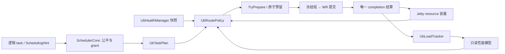

# classic UB 负载感知选路与派发详细设计

> 设计状态：待实现；日期：2026-10-13。
> Mooncake 代码基线：`supercache-snapshot-930` / `a2f25168`；此前设计文档提交不改变该运行时代码基线。
> 参考：认证读取的 [yuanrong issue #29](https://gitcode.com/hc147/yuanrong-datasystem/issues/29)，及本地 `eacc9857` 的读负载反馈和选点代码。
> 前置设计：[UB 故障隔离](ub_fault_isolation_design.md)、[Jetty 池化与生命周期](ub_jetty_pool_lifecycle_design.md)。

## 1. 目标与范围

本方案在 classic UB 内形成 **完成反馈 → 有界统计 → 合法设备对评分 → 容量预留 → 派发 → 完成结算** 闭环。

解决两个问题：多 HCA/远端 device 的随机或轮转选择缺少实际负载反馈；部分端口故障或单条路径拥塞时，剩余资源继续承受原流量，影响尾延迟。

调度分层：

- `SchedulerCore` 决定哪个租户/流量类别/逻辑 task 先获得物理 grant，复用现有公平和预算策略。
- UB 选路决定该 grant 的片段使用哪些合法本地/远端设备对。
- Jetty resource 决定本次是否能预留 lane、WR/JFC credits 和字节容量。

第一版 enforce 针对完成前两项设计的 RM 路径。RC/旧端缺少 prepared reservation 能力时维持兼容路由，允许观测但不宣称相同的动态派发闭环。不开启调度器时可以做设备选路与拒绝式背压，但不提供租户公平和前台预算保证。

不修改 Store 的 key 放置、读副本选择、Master allocation、全局成员关系或 TCP 切换。不引入远端性能广播和独立性能探测 RPC。

## 2. 参考能力与当前代码差异

issue #29 实际优化的是后续单键写入放置：Worker 从 UB 数据回写形成大小归一化 P50/P99，通过成功 Publish 响应反馈给 Client；首选 Worker 有已知坏端口时才进入加权选点。它不是剩余带宽测量，也不是所有 GET/SET 的统一流量调度。

本方案借鉴大小归一化、尾延迟成本、健康信息及有界采样；将决策对象改为 TE 设备对，反馈取自本机 completion，因此不依赖下一次 Publish 到来。

yuanrong 对照位置：[Worker 回写计时](../../../yuanrong-datasystem/src/datasystem/worker/object_cache/service/worker_query_and_get_impl.cpp)、[有界采样与分位数](../../../yuanrong-datasystem/src/datasystem/common/scheduling/worker_read_bandwidth_tracker.cpp)、[成功 Publish 反馈](../../../yuanrong-datasystem/src/datasystem/worker/object_cache/service/worker_oc_service_publish_impl.cpp)、[Client 亲和保持与候选选择](../../../yuanrong-datasystem/src/datasystem/client/object_cache/routing/client_read_bandwidth_scheduler.cpp)。这些跨仓链接用于本地对照，仓库网站以 issue #29 为参考入口。

| 当前 Mooncake 能力 | 本方案接入 |
| --- | --- |
| `Topology::selectDevice()` 的亲和、随机/轮转和重试顺序 | 保留候选合法性和基础偏好；UB 层添加策略，不向通用拓扑类写性能状态 |
| UB 首先选本地 context，worker 再选远端 device | 复用前一设计的 `UbTaskPlan`，先枚举合法设备对再冻结组 |
| Jetty/JFC 深度背压，软件队列以 slice 数计量 | 增加字节容量与真实 backlog 视图，仍受硬件 credits 约束 |
| `SchedulerCore` 的类别/租户公平、quantum、aging、deadline 优先级 | 原样复用；补齐 transport 的安全 DEFER/prepare 契约 |
| classic `getNicLoadStats()` 返回空，TENT RDMA 有 EWMA/inflight | 给 classic UB 增加自身统计，不把 TENT 数据当 UB 能力 |

代码依据：[topology.cpp](../../mooncake-transfer-engine/src/topology.cpp)、[ub_transport.cpp](../../mooncake-transfer-engine/src/transport/kunpeng_transport/ub_transport.cpp)、[ub_context.cpp](../../mooncake-transfer-engine/src/transport/kunpeng_transport/ub_context.cpp)、[scheduler_core.cpp](../../mooncake-transfer-engine/src/scheduler_core.cpp)、[scheduler_policy.cpp](../../mooncake-transfer-engine/src/scheduler_policy.cpp)。

## 3. 模块划分与依赖方向

新增 `UbLoadTracker` 和 `UbRoutePolicy`，都由 `UbTransport` 持有。不会再建设一个 UB 租户调度器或第二套 Jetty 配额管理器。

| 组件 | 责任 | 输入/输出 |
| --- | --- | --- |
| `UbLoadTracker` | 样本过滤、大小归一化、后台分位数、模型新鲜性 | 已确认完成的传输组 → 只读性能模型 |
| `UbRoutePolicy` | 亲和保持、成本评分、有界候选选择 | 合法候选、健康快照、资源视图 → route plan |
| `UbTaskPlan` | 固定地址范围/设备组、获取 reservation、绑定资源、提交 | route plan → 可提交任务或 DEFER |
| `UrmaJettyResource` | 唯一权威容量、lane/credit/字节预留和释放 | reservation ticket、实际资源视图 |
| `SchedulerCore` | 公平、类别预算、deadline 排序、grant 生命周期 | 通用 prepare 结果，不包含 UB/HCA 类型 |



Tracker 不调用 provider、不发 RPC、不修改健康状态；policy 不创建 Jetty、不直接 post；resource 不计算调度权重。上层既有 `SchedulingHint` 通过窄的内部 dispatch context 传递到 UB，普通提交使用默认类别。

## 4. 候选设备对与身份

候选键为 `(local context incarnation, peer incarnation, remote context/target epoch, opcode, registration domain)`。

候选必须先通过：

1. 本地内存范围注册有效，且 l_seg 属于该 context。
2. 远端范围由相应 buffer/tseg 覆盖，访问权限和传输模式兼容。
3. 对端 identity、target epoch 和注册描述一致。
4. 硬性设备指定、可达性和明确配置约束满足。
5. 健康及资源准入没有关闭。

NUMA 偏好等软亲和可加入成本；明确指定的硬约束不得通过“更快路径”绕过。UB chip/bonding hint 按现有合法规则生成，本阶段不自行选择物理端口。

候选静态部分随注册/metadata/拓扑变化缓存，性能快照不改变其合法性。HCA 名字和 vector index 不能代替身份；context 构造失败或重启后按明确映射查找，不能重排数组导致旧注册索引串用。

第一版只对实际使用的合法路径建立性能记录，不建立全量 peer 矩阵。候选/模型表、每次检查数量和最大组数都有上限；采样或模型缺失时仍保留健康合法的基础候选。

## 5. 反馈采集：区分排队、服务和消费者耗时

### 5.1 观测阶段

| 指标 | 测量范围 | 使用方式 |
| --- | --- | --- |
| task 排队 | enqueue → grant | 观察逻辑公平与 deadline，不计入网卡带宽 |
| bound queue 排队 | route commit → first post | 反映设备队列压力 |
| 传输组服务 | first accepted post → last hardware completion | 大小归一化性能样本；包含组内窗口推进开销 |
| READ 消费者 | last hardware completion → H2D/消费者完成 | 独立观察 staging 成本，不归为网络带宽 |
| 资源准备 | connection/registration/lane 准备阶段 | 独立观察冷启动，不混进稳态传输样本 |

在稳定 completion record/传输组的唯一结算点采集，READ 与 WRITE 分开。由于当前 slice 默认约 64 KiB，不直接对每个 slice 形成 4 MiB 归一化分位数：主要按传输组聚合，减少小 WR 固定成本和 CQE 重复偏差。

### 5.2 样本有效性

首版建议：成功组、字节数至少 256 KiB、时间为正、无重试/partial post/timeout，且身份与健康代际在测量期间一致，才进入稳态性能窗口。小组单独观测计数和延迟，不向大对象模型注入样本。

失败、取消、明确未 post 和重复 CQE 不形成成功带宽样本，但仍更新错误/资源压力指标。没有成功样本不能把仍在占用的 I/Q 字节视为零；卡死路径由真实 backlog、预算和健康核验约束。

### 5.3 有界统计与低负载刷新

completion 热路径只做时间戳、字节计数和有限 sample enqueue，不排序、不输出逐请求 INFO、不等待统计锁。队列满时丢性能样本，不能丢资源结算或健康事件。

后台按“有新样本且到达刷新周期”更新模型，不要求周期样本配额填满才刷新。建议初始窗口最多 1024 个有效样本、刷新周期 100 ms、模型有效期 5 s；这些是待压测的内部起点，不照搬 yuanrong 的默认值。

模型包含有效样本数、测量时间范围、P50/P99、EWMA、更新版本、context/peer 身份和测量时健康比例。过期后降低置信度并回到保守冷启动偏好，不将陈旧模型清零成“无限快”或零容量。

同一个分位数窗口只接纳同一健康代际与比例的样本。健康变化时开始新窗口，旧模型作为带原健康比例的临时参考，直到新窗口取得足够置信度；不能混合退化前后的样本后再用单个比例修正。低样本数的 P99 仅作保守参考，切路仍需满足滞回和容量条件。

## 6. 成本模型与健康退化

### 6.1 大小归一化

基准 `D0 = 4 MiB`，有效组字节 n、服务时间 t：

```text
normalized_time = saturating(t * D0 / n)
tail_cost = (P50 + 3 * P99) / 4
service_time_i(n) = n / D0 * adjusted_tail_cost_i
```

使用宽整数或有检查的饱和计算。tail_cost 是单位数据服务成本，不是物理网卡剩余带宽；小对象固定开销使线性换算存在误差，因此不能用归一化 P99 直接承诺任意对象 deadline。

### 6.2 避免健康比例重复惩罚

issue #29 直接叠加健康比例与延迟成本，端口退化已经进入 P99 时可能重复惩罚。本方案记录样本形成时的本地/远端健康比例。

```text
health_adjustment = min(1,
    current_local_health / sample_local_health,
    current_remote_health / sample_remote_health)
adjusted_tail_cost = tail_cost / health_adjustment
```

只对已知、有效且非零的比例计算；UNKNOWN 不制造零容量。all-bad 已由健康准入过滤，不进入除法。sample health 无法确认时不按该比例计算，保留保守模型并等待有效新样本。

新故障发生、模型仍来自全健康阶段时先收缩容量；新样本已包含退化后的服务成本时比例恢复为 1，避免再乘一次退化惩罚。恢复时不立即将旧退化样本反推成满速，通过新样本和权重平滑逐步恢复。

对于所有候选共享同一个本地 context 的情况，本地健康比例只影响公共容量，不重复作为远端排名差异；不同 HCA 候选仍比较各自的健康与容量。

### 6.3 Backlog 与预计完成成本

resource 提供互斥状态的字节计数：R=已预留未进入 worker 队列，Q=已绑定等待 post，I=已接受或可能接受且硬件未收敛。转换只移动归属，不重复计数。

```text
context_backlog = R + Q + I
drain_time = context_backlog / conservative_context_service_rate
cost_i(n) = drain_time + service_time_i(n) + soft_numa_cost + cold_start_cost
```

path I 是 context I 的子集，不再次相加。queue 前尚未绑定的 scheduler task 不算某张 HCA 的 backlog。

context service rate 根据有真实持续工作负载的完成窗口形成保守估计；空闲窗口不学习零带宽。它同样记录测量时的健康代际，退化时按上述比例修正、跨代际时重建窗口，避免 drain 使用旧的满速估计。路径成本使用本机观察到的方向性服务信号，不宣称掌握远端所有客户端的负载。

性能模型缺失时使用已有路径偏好和有界的初始服务率；不因 UNKNOWN 或新设备没有统计就直接永久排除它。

## 7. 选路流程：保留亲和，有条件调整

1. 固定本次健康/性能快照，枚举合法设备对。
2. 原有拓扑选择给出基础首选。
3. 首选健康且 backlog 正常时保持既有偏好；首选端口退化、容量紧张或预计排队超过软门限时才启用负载比较。
4. 对候选计算成本；只有收益超过绝对/相对滞回门限，才偏离软亲和。
5. 在成本接近的候选中以进程实例盐值、request key 和 grant 序号扰动选择，降低多个发起方同步集中到同一 HCA 的风险。
6. 按现有 slice 边界对有限 grant 做计划内分片，累计临时 planned bytes 更新边际成本，合并成前一方案的传输组。
7. TryPrepare 获取实际资源和字节容量；竞争失败时有限次数重选，仍不足则 DEFER。

设备选择在组第一次 post 前冻结。后续窗口继续使用同一 lease/资源身份；不能每个 post 临时改 HCA、沿用旧 r_seg，或搬迁已 post WR。

按最大 slice 数和候选上限约束计划计算，保留一个 grant 使用多个健康 HCA 的能力；不将全部大型请求强制串行到一张卡。未启用 SchedulerCore 的大 task 不声称具备相同的 grant 公平性。

有限选择失败时，仅可回退经过重新校验的合法且可预留首选；不能无条件返回旧首选。性能软门限不建立硬故障隔离。少量探索复用真实业务组，在健康、硬预算和数据语义约束内刷新冷/旧模型，不发额外小 WRITE 探测。

## 8. 有界派发与 SchedulerCore 接口

### 8.1 为什么需要 prepare

当前 SchedulerCore 先占用 grant/inflight，再调用 `submitTransferTask()`，非 OK 被记录为 dispatch_failed；同时旧 transport 可能已经 post 前缀。因此不能把所有 TooManyRequests 当作可安全重试，也不能在资源不足时把整个请求标为 FAILED。

添加可选、通用的 prepared dispatch 契约，UB 实现，其他 transport 默认仍走旧路径：

| 操作/结果 | 语义 |
| --- | --- |
| `tryPrepare(request, dispatch_context, max_bytes)` | 只基于缓存和本地预算准备，不 post WR、不等待 RPC/创建 provider 资源 |
| READY(ticket, accepted_length) | 取得有效的一次性 reservation，长度受注册、quantum 和描述符限制 |
| DEFER(reason, wake_hint) | 尚未提交任何 WR；未留下 lane、credits 或字节占用；可在原 deadline 内重试 |
| REJECT(error) | 参数、注册、身份或已确认不可用等明确错误 |
| `submitPrepared(grant, ticket)` | 非阻塞入队；COMMITTED 表示接管 ticket 和完成责任，NOT_COMMITTED 明确零 WR 且返回可回滚责任；不能跨请求重复消费 |

connection/metadata 未准备好时安排既有控制准备任务并 DEFER，不在 scheduler mutex 内做握手、DNS、provider 创建或 H2D 拷贝。静态 route 合法性与动态 reservation 需在 commit 时再次确认。

### 8.2 计费与取消

在 scheduler 短锁内选择 task、标记 PREPARING 并预留临时 grant 字节额度，再锁外 prepare；临时额度也计入全局/类别硬上限，避免并发准备超额，但不扣公平 deficit。READY 返回后只保留 accepted_length 对应额度；DEFER、REJECT 或 commit 前取消回滚全部未移交预留。只有 COMMITTED 才执行一次公平 accepted 计费并将临时额度转为正式 grant inflight。

ticket 析构只回滚仍由准备方拥有的预留。COMMITTED 后即使发生 partial post，也必须保留前缀及 credits 到硬件收敛，不能重新 replay 同一范围；错误与未 post 后缀沿既有完成语义结算。全局 grant inflight 仍由 SchedulerCore 在 grant 完成时释放，网络预算可以先结算，不能因此提前结束 H2D 或释放 task/buffer owner。

prepare 使用 request/hint 的值快照，在锁外执行；返回后按 task key、generation 和取消状态复查。task/grant 的生命周期必须被准备 owner 保留，不能把锁外的裸 Task* 当作仍然有效。取消/释放与准备结果竞争时，未接纳 ticket 自动释放；已提交 grant 沿既有安全完成路径排空。

调度器本身必须跳过本轮已 DEFER 的 task，尝试其他 ready task，避免一个阻塞 peer 形成全局队首阻塞。收到容量释放通知后再次竞争；没有通知时用有界 fallback tick，禁止紧循环重试。

### 8.3 预算分层

- 全局/租户 outstanding：复用 SchedulerCore，用于排队上限。
- 流量类别 inflight/high reserve：复用现有策略，用于逻辑服务保障。
- UB context/peer：resource 原子预留 lane、硬件 credits、R/Q/I 字节，限制单卡及单 peer 压力。
- 内部重试：与原任务共享 deadline、字节和次数预算；重试不因重复生成 WR 而获得额外优先级。

前台保留字节预算还需对应 lane 可用性：pool 容量足够时为 HIGH 保留少量 lane；单 lane 配置只能在 grant 边界公平竞争，不能承诺抢占已 post 的后台操作。背景 grant 受 quantum 限制，迁移/检查点不能占满全部资源后仍声称前台有保障。

## 9. reservation 的唯一结算

| 状态 | 容量归属 | 释放条件 |
| --- | --- | --- |
| 尚未 READY | 仅逻辑 outstanding | 取消或拒绝 |
| READY，尚未 commit | R、lane/所需预算 | ticket 回滚或移交 |
| commit，等待 post | Q | 明确未 post 取消或向 I 转移 |
| 接受/可能接受 WR | I 与硬件 credits | 唯一 CQE 或正式硬件停止屏障 |
| hardware done，H2D 未结束 | 网络预算可结算，buffer/task owner 保留 | 消费者完成 |
| quarantine | 保留相关物理/缓冲预算 | 正式安全清理确认 |

容量唯一所有者是 Jetty resource/task reservation；load tracker 读取它，不维护另一套“看起来已完成”的预算。

soft timeout、旧 epoch、失败响应或统计样本过期不能释放 I，也不能将故障资源伪装成空闲容量。retry 前需重新检查健康及注册身份，借用旧 buffers/WRITE 模糊完成的边界沿前两个设计执行。

## 10. 数值算例与行为边界

同一 1 MiB grant 有两个合法候选。假设 drain rate 与当前调整后的参考成本一致，数字只用于解释模型：

| 候选 | 参考尾成本 | 样本/当前健康 | backlog | NUMA 成本 | 预计成本 |
| --- | --- | --- | --- | --- | --- |
| A，基础首选 | 400 us / 4 MiB | 4/4 → 2/4 | 2 MiB | 0 | 400 us drain + 200 us service = 600 us |
| B | 600 us / 4 MiB | 4/4 → 4/4 | 0.5 MiB | 50 us | 75 us drain + 150 us service + 50 us = 275 us |

A 的调整后参考成本为 800 us，候选 B 有明显收益，且预算可预留时可偏离软亲和。若后来 A 的退化阶段样本本身为 800 us，sample/current 都是 2/4，则不再翻倍。

如果 B 没有合法注册、健康准入关闭或无法预留，则不能选择 B。若所有候选容量不足或正在等待健康核验，则 DEFER；明确全部 UB 路径不可用则返回 UbUnavailable，不能用更低成本绕过硬约束。

估计成本是启发式排序，不是 deadline 保证；网络竞争、其他进程和 provider 路径变化均可能使实际耗时偏离。

## 11. 身份、并发、新鲜性与退出

sample/model 带 context incarnation、peer incarnation、target epoch 和 model version；旧完成只能结算旧资源，不更新新身份的性能模型。

sample 队列和模型条目有固定上限；活跃 reservation 的身份记录不被 LRU 原地复用。无 active R/Q/I 的旧统计可被淘汰，slot 重用需 generation 校验。后台发布不可变模型快照，前台每个 grant 固定读取，不逐 WR 复制全表。

model 时间使用本进程单调时钟，记录实际测量范围，不能用反馈接收时刻把旧统计伪装成新值。本阶段不传输远端性能 timestamp，不需要跨机器时钟比较。

资源预算更新在其短锁/原子协议内，统计计算、排序、日志、metadata/provider 操作在锁外。tracker 不能从 callback 反向进入 pool 锁或同步派发。容量通知只唤醒 scheduler，不直接在 completion 线程执行调度。

停止时关闭新 dispatch，回滚未 commit ticket，按前一方案排空已提交责任；关闭 sample enqueue 并停止统计任务。tracker 清理不能先释放尚被 completion record 使用的对象，也不能恢复已关闭的健康/Jetty 准入。

## 12. 统计接口、参数与实施位置

### 12.1 最小接口

复用现有 `TransferEngine::getNicLoadStats()` 对 classic UB 暴露每 device 的实际 I 字节及有样本支持的等效 EWMA 服务率。保留现有字段语义说明，等效值不称为剩余物理带宽。现有结构没有 valid 字段，无有效模型时返回 `ewma_bandwidth_bps=0` 并明确约定为“未知”，不能解释为零容量或展示伪造满速值；内部 policy 使用单独的置信度和新鲜性。

Transport 新增默认空实现的统计 hook，classic Impl 向已安装 UB 委托；第一版不合并同名 RDMA/UB 设备造成重复记账。path backlog、样本置信度和 tail cost 通过 UB 内部只读接口/指标提供，不扩张公共 C/Python 请求格式。

配置以一个 `off / observe / enforce` 开关控制；队列字节上限及前台保留量复用/补齐既有预算配置。采样窗口、TTL、滞回和探索比例先作为可注入的内部参数，压测后再决定是否需要用户调节。

### 12.2 拟修改位置

| 位置 | 修改内容 |
| --- | --- |
| `include/.../kunpeng_transport/ub_load_tracker.h` 与对应 `.cpp` | 有界采样、后台模型、身份与新鲜性 |
| `include/.../kunpeng_transport/ub_route_policy.h` 与对应 `.cpp` | 纯候选评分、亲和保持和有界选择 |
| 既有 `ub_transport.cpp`、`ub_context.cpp` / `UbTaskPlan` | 候选设备对、分片计划、prepare 与资源绑定 |
| 前一方案的 `UrmaJettyResource` / completion 结算 | 权威字节 ledger、reservation、方向样本和容量通知 |
| `transport.h` 的内部能力接口 | 可选 prepared dispatch、通用 reservation/hint、统计 hook |
| `scheduler_core.h/.cpp` | READY/DEFER/REJECT、锁外 prepare、取消围栏和本轮跳过 |
| `transfer_engine_impl.*` / API 包装 | classic UB NIC 统计委托，保持 TENT 独立 |
| config、UB CMake、tests | 开关与预算、UT/ST 和性能基准 |

本次仅产出设计，不新增运行时代码。`Topology` 不存负载状态，`SchedulerCore` 不依赖 UB 类，Store 放置算法不进入该 diff。

## 13. 验证矩阵与发布顺序

| 场景 | 验收要求 |
| --- | --- |
| 全健康、负载低、开关 off | 原路由/协议与基本完成语义保持 |
| 单 HCA/peer 部分端口损失 | 及时调整容量估计，统计更新后不重复健康惩罚 |
| 全端口 BAD/资源 offline/注册不兼容 | 任何成本、探索和回退都不能重新放行 |
| 单 HCA 排队、热点 peer、背景迁移 | healthy 合法候选可承接；前台预算受 lane/byte 共同保障 |
| 多 HCA grant 分片、NUMA 强约束 | 不串用 l_seg/r_seg，不牺牲全部单请求多卡能力 |
| cold start、纯读、低负载、不足采样配额 | 不依赖 Publish；有样本就能周期刷新，缺失统计不永久拒绝 |
| 样本过期、peer/context 重启、旧 CQE | 降低置信度/重建模型，旧身份不污染新记录 |
| pool/JFC/record 容量耗尽 | 首 WR 前 DEFER，其他 ready task 能继续，不紧循环 |
| prepare 与 cancel/freeBatch 竞争 | ticket 与 task owner 有效，预留回滚恰好一次 |
| partial post、迟到完成、quarantine | I/credits 不提前释放，不把模糊前缀当作可重放 |
| READ staging 慢、WRITE 小对象 | H2D 不混为网卡带宽，小样本不污染大对象模型 |
| 两个发起方同步负载、模型边缘抖动 | 无持续集中或频繁跨 NUMA 切换，扰动/滞回可观察 |

验证分纯 policy/model UT、resource/scheduler 接入 UT、真实 UB 故障与拥塞 ST。UT 注入 clock、身份、健康比例、成本及 reservation 竞争；不能用 mock 吞吐证明实机收益。

发布步骤：

1. observe：完成样本、backlog 和合法候选日志，不改变实际选路；核对估计与真实阶段延迟。
2. enforce prepare：先保证无容量时安全 DEFER、唯一预算和取消收敛，再引入动态路线。
3. 设备选路灰度：部分端口退化/单卡拥塞场景优先，逐步启用多 HCA 分片与软亲和比较。
4. QoS 联调：明确启用 SchedulerCore，再验证前台/后台和多租户；保持相同日志配置测吞吐、p99、CPU 与锁竞争。

最小指标：R/Q/I 字节、每类 grant 等待、DEFER 原因与时长、sample 有效/丢弃/过期、模型版本、路由改变原因、预计/实际服务成本、lane/JFC 利用及重试放大。

故障恢复和资源安全由前两个模块负责；调度收益需实机数据验证。三个特性共享身份、准入和唯一结算契约，各自保持清晰责任。
