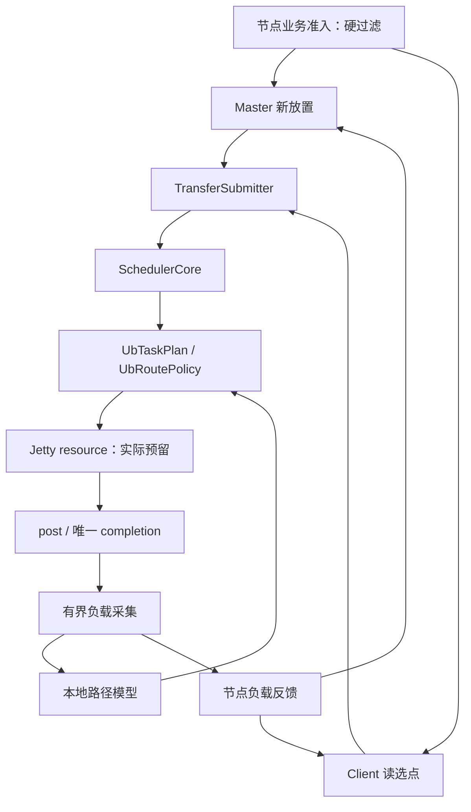

# 节点与 TE 全链路负载感知调度详细设计

> 设计状态：待实现；更新日期：2026-10-15。
> 运行时代码基线：`supercache-snapshot-930` / `a2f25168`；此前文档提交不改变运行时代码基线。
> 参考：认证读取的 [yuanrong issue #29](https://gitcode.com/hc147/yuanrong-datasystem/issues/29) 及本地 `eacc9857` 源码。
> 本文替代原仅覆盖 classic UB 设备选路的方案，增加节点新放置、读选点和 HA/CVM 衔接。
> 前置：[节点业务隔离](ub_fault_isolation_design.md)、[Jetty 池化与生命周期](ub_jetty_pool_lifecycle_design.md)。

## 1. 目标与确定范围

构建闭环：**真实完成反馈 → 有界节点/路径模型 → 合法候选评分 → 实际容量预留 → 公平派发 → 唯一结算**。

覆盖 Master 新副本放置、Client 读副本选择、SchedulerCore 公平派发和 UB 设备对选路。部分端口退化、持续排队和高延迟都可触发调整；负载低时保持原有软亲和。

不自动迁移已有对象，不改变 key 归属、存储类型优先级、副本数量和既有分布约束，不建立全局带宽配额或额外 WRITE 探测。

节点准入是硬条件，性能是软成本。任何低成本、探索、TCP fallback 或本地拷贝都不能放行隔离节点。负载高、模型缺失和统计过期不能改变节点隔离状态。

本次只产出设计，不修改运行时代码。

## 2. 参考与当前能力

yuanrong issue #29 的闭环是 Worker QueryAndGet UB 回写计时、大小归一化 P50/P99、成功 Publish 反馈及后续单键放置选点。其原算法只在首选 Worker 存在已知坏端口时触发，不是所有读写的统一调度，也不是剩余带宽测量。

本文复用有界统计、尾成本和亲和保持思想，但按用户确定范围扩展到退化或拥塞触发，反馈不依赖后续 Publish。

参考：[回写计时](../../../yuanrong-datasystem/src/datasystem/worker/object_cache/service/worker_query_and_get_impl.cpp)、[有界统计](../../../yuanrong-datasystem/src/datasystem/common/scheduling/worker_read_bandwidth_tracker.cpp)、[Publish 反馈](../../../yuanrong-datasystem/src/datasystem/worker/object_cache/service/worker_oc_service_publish_impl.cpp)、[Client 选点](../../../yuanrong-datasystem/src/datasystem/client/object_cache/routing/client_read_bandwidth_scheduler.cpp)。跨仓链接用于本地对照，网站以 issue #29 为入口。

| Mooncake 当前能力 | 设计接入 |
| --- | --- |
| Master RANDOM/FREE_RATIO_FIRST/LOCAL_FIRST 等分配策略 | 保留合法性和基本策略，增加可注入节点成本视图 |
| Client 的存储类型/位置优先级和 remote MEMORY scorer | 增加带请求 context 的实例级读策略 |
| SchedulerCore 类别/租户公平、预算、quantum、aging、deadline | 复用，补齐安全 prepared dispatch |
| Topology 亲和、随机/轮转、重试候选 | 继续提供静态候选，动态状态留在 UB |
| endpoint Jetty/JFC depth 与 slice 队列 | resource 提供唯一字节账本及真实预留 |
| classic NIC 统计返回空，TENT 有独立统计 | 增加 classic UB 自身观测，不混用 TENT 数据 |

## 3. 四层决策与模块归属

| 层次 | 决策 | 权威约束 |
| --- | --- | --- |
| Master | 新数据放到哪些节点 | 节点准入、空间、硬目标及副本分布 |
| Client | 从哪个已有副本读取 | 副本有效、准入、存储类型和位置 |
| SchedulerCore | 谁先获得多少 grant | 类别、租户、deadline、全局预算 |
| UB | grant 使用哪些设备对 | 注册、健康、Jetty/JFC、NUMA |



| 组件 | 所有者与责任 |
| --- | --- |
| `UbLoadTracker` | UbTransport；采集方向性完成，维护有界本地模型 |
| `NodeLoadReporter` | Store Client；汇总本地压力及目标观测，异步发布 |
| `NodeLoadRegistry` | 各 Master/Client；保存身份、新鲜性与观察者模型 |
| `NodePlacementPolicy` | Master；纯节点候选评价，不代替 allocator |
| `ReplicaLoadPolicy` | Client 实例；纯副本候选评价，不执行数据传输 |
| `UbRoutePolicy` | UbTransport；纯合法设备对评价，不创建 Jetty |
| `UbTaskPlan` | task/grant；固定分组、reservation、生产者和完成责任 |
| `UrmaJettyResource` | UrmaContext；lane/credits/字节与完成记录唯一所有者 |

不增加第二套租户调度器。健康模块唯一更新准入，资源模块唯一更新容量，tracker 只采样，policy 只选择。Topology 不存动态模型，SchedulerCore 不包含 UB/Store 类型。

## 4. 观测对象与统计口径

单边 READ/WRITE 不保证目标节点产生业务 CQE，不能只靠目标本地发送队列推断入站压力。

| 信号 | 采集方 | 用途 |
| --- | --- | --- |
| 方向、字节、first post 到 last hardware completion | 发起方 TE | 路径成本及目标服务观测 |
| logical queue、bound queue | scheduler/resource | 公平等待与本地设备压力 |
| R/Q/I 字节与 lane/JFC 占用 | resource | 设备背压、容量预留和 drain 估计 |
| 本地数据任务、后台队列 | Store/TE | 节点自身压力摘要 |
| 尚未结算的写入分配字节 | Master | 新放置压力，不是硬件在途字节 |
| 可用空间、身份、健康比例 | 既有资源/健康模块 | 候选合法性、模型归属和退化修正 |

任务 enqueue→grant、route commit→first post、硬件服务、H2D/消费者、业务 PutEnd 分开计时。传输组服务包含窗口推进开销，不称为纯 NIC 时间。

发起方路径耗时也受源端和网络影响，不能宣称它等于目标裸硬件性能。节点模型按 READ/WRITE、大小桶、传输类型和观察者分类，本地 memcpy、TCP、UB、磁盘不混算。

## 5. 有界采样、身份与新鲜性

- 在稳定完成记录的唯一结算点取样，不按重复 CQE 或同一逻辑 slice 的重试重复计成功。
- 成功、无重试/partial post/timeout、时间为正、身份和健康代际稳定，才进入稳态窗口。
- 大对象模型以至少 256 KiB 的组为主；默认约 64 KiB 的 slice 不逐条线性放大成大对象模型。小对象单独观察，保留原策略。
- 每模型窗口最多 1024 个有效样本，后台每 100 ms 有新样本就刷新；少于 16 个有效样本标低置信度。
- completion 热路径只做有限 enqueue/计数，不排序、格式化日志或等待 RPC。队列满丢性能样本，不丢资源结算或健康事件。
- 相同分位窗口只包含同一身份、健康代际和比例；变化后新建窗口，旧模型保留其测量条件作为临时参考。
- sample/model 带 node/context incarnation、target epoch、方向、大小桶和 model version。旧完成可结算旧资源，不能更新新身份。
- 模型 TTL 五秒。报告携带测量年龄、窗口跨度和序号；消费者用本地单调时钟计龄，不比较跨主机绝对时钟，重复序号不刷新 TTL。
- 节点 registry 分观察者保存摘要，用其有效尾成本的保守分位形成参考。不能平均不同观察者的 P99 并称为全局 P99。
- 首版每节点每分类保留最多 32 个观察者，按新鲜性淘汰；分类为 READ/WRITE × 三个大小桶（小于 256 KiB、256 KiB 至 4 MiB、至少 4 MiB）× 实际传输类型。节点表受当前拓扑和配置上限约束，路径表只记录实际活跃合法路径。

没有统计时保持 UNKNOWN/原策略，不填零伪装低负载，也不永久排除新节点。成功样本缺失时仍保留真实 R/Q/I 与错误压力。

## 6. 成本模型与稳定性

基准 D0=4 MiB，有效组字节 n、服务时间 t：

```text
normalized = saturating(t * D0 / n)
tail_cost = (P50 + 3 * P99) / 4
service(n) = n / D0 * adjusted_tail_cost
```

采用宽整数和饱和检查。小对象固定开销不满足线性假设，不用该模型承诺任意对象 deadline。

对已知非零比例，仅修正测量后新增的健康损失：

```text
adjustment = min(1,
    current_local_health / sample_local_health,
    current_remote_health / sample_remote_health)
adjusted_tail_cost = tail_cost / adjustment
```

all-bad 已被硬准入过滤；UNKNOWN 不制造零容量。新样本已含退化成本时比例为一，不重复惩罚。恢复不反推满速，靠新样本平滑学习。节点只有聚合比例、不能对应样本实际服务域时，不套用该比例除法，只使用退化触发和保守模型。

```text
device_cost = context_backlog / conservative_context_rate
            + path_service(n) + soft_numa_cost + cold_start_cost
node_cost   = directional_service(n)
            + observable_pressure_wait + soft_affinity_cost
```

context_backlog=R+Q+I；path I 是 context I 的子集，不再相加。context rate 取真实繁忙窗口，空闲不学习零速，跨健康代际重建。未绑定 scheduler 请求不算特定 HCA backlog。

Master 压力项用本 Master 管理的待结算分配字节/有置信度的方向服务率；Client 使用自身 outstanding 和可靠节点队列。不同来源可能覆盖同一操作时分别比较并取保守最大值，不直接相加。缺少可靠 rate 时保持原排序，不将字节伪装成时间。

稳定性初始参数（均为待实机验收的内部默认值）：

- 部分端口退化直接触发比较；拥塞需连续三个有效模型更新显示排队超过一毫秒，或同分类尾成本超过健康低负载基线两倍。
- 基线只在健康、低 backlog 的有效窗口更新，退化和拥塞阶段冻结；无基线时不使用两倍条件。
- 偏离软亲和需同时改善至少 20% 和 100 微秒；低负载维持原策略。
- 在接近候选中以进程盐、请求键和 grant 序号选择两个候选比较，避免多个发起方同步集中。
- 最多三次实际预留尝试；1% 真实业务组可探索冷模型，不新增读写探测、不绕过预算或健康。

## 7. Master 新副本放置

1. 节点准入、空间、排除列表、硬目标和既有副本分布先过滤。
2. 现有分配策略给出基础首选，在允许竞争的类型/位置层级内应用软成本及滞回。
3. 最终仍调用真实 allocator；评分不是空间已预留。
4. 分配成功立即增加本 Master 的 pending allocation bytes；批量按计划内增量更新，避免全部落同一旧低负载节点。
5. PutEnd/abort 或既有业务状态合法终结时按 allocation identity 唯一结算；负载记录淘汰不能释放实际数据资源。

显式 AllocateFrom 不重定向；普通 preferred 规则按原语义区分软偏好和硬约束。保持副本数量、类型和原分布约束，不将不同 segment 自动升级成新的节点反亲和策略。

既有灵活副本写入、配额和事务成功标准不因调度改变。跨 Master 由实际目的端选择和分配，转发方的成本只作参考，远程调用在本地 allocator 锁外。

## 8. Client 读副本选择

先执行副本合法性与节点硬过滤，再按现有存储类型、本地/远端层级组内评价。第一版保留本地快速路径优先，只在允许竞争的 remote MEMORY 副本之间负载择优，不跨 SSD/DRAM 层级比较不同口径。

使用本 Client 的路径经验和有置信度的节点参考；双方观测同一服务阶段时取保守参考，不累加两次。缓存 descriptor、范围/批量/异步读取和换源重试统一入口。

增加请求 context：字节数、intent、deadline、tenant 与只读健康/负载快照。新策略由 Client 实例持有；不向现有进程级全局 scorer 捕获某个 Client 的可变状态。旧无 context 入口维持兼容。

高负载不等于不可用。所有合法副本都忙时仍选可用候选，由队列预算控制；全部隔离时沿节点隔离错误返回，不以成本回退放行。

## 9. SchedulerCore、UB 计划与 prepared dispatch

复用现有类别/租户公平、quantum、aging、deadline、全局和 HIGH 预算。UB 对每个 grant 生成 UbTaskPlan：先准备 metadata/connection/import，再枚举设备对和有界分组，冻结注册及路由身份，按组 try-reserve。

候选先校验本地范围和 l_seg 所属 context、远端范围和 r_seg 权限、传输模式、节点/context/target epoch、硬设备指定和健康准入。组键为 `(physical task/grant, local context, remote target identity, direction)`。首 WR 前冻结逻辑 slice 数及组数；任一组预留失败，立即回滚所有未 post 预留，不能部分持 lane 等待其他组。commit 再检查动态身份/准入，竞争导致计划失效时仅在明确零 WR 的条件下返回 NOT_COMMITTED。

| 接口/结果 | 契约 |
| --- | --- |
| tryPrepare(request, context, max_bytes) | 仅缓存和本地预算，不 post、不等待 RPC/provider 创建 |
| READY(ticket, accepted_length) | 尚未 post，取得一次性 reservation |
| DEFER(reason, wake_hint) | 零 WR，无残留 lane/credits/字节预留 |
| REJECT(error) | 明确参数、注册、隔离或不可用错误 |
| submitPrepared → COMMITTED | 接管 ticket、生产者和完成责任，非阻塞入队 |
| NOT_COMMITTED | 明确零 WR，返回准备方可回滚责任 |

连接未准备时安排有界控制任务并 DEFER；不能持 lane/pool/scheduler 锁做握手、DNS、provider 创建或 H2D。

Scheduler 短锁内标记 PREPARING 并预留临时 grant 字节，计入全局/类别硬上限，但不扣公平 deficit；锁外 prepare，返回后复查 task identity/generation 和取消。READY 只保留 accepted_length，DEFER/取消回滚；COMMITTED 后公平 accepted 计费一次。

prepared owner 保留 task/grant 生命周期，不用锁外裸 Task*。本轮跳过 DEFER task，尝试其他 ready 请求，释放通知唤醒，fallback tick 有界。旧 submit 的错误可能已 post 前缀，不能统一按容量错误安全 replay。

组第一次 post 前固定路由，后续窗口用同一 lease；不搬迁已 post WR 或串用旧 r_seg。按 grant 有界分片并累计 planned bytes，保留多 HCA 能力，不把所有大请求串到一张卡。

## 10. 容量、完成与前后台保障

| 阶段 | 权威归属 |
| --- | --- |
| 未准备 | 仅逻辑 outstanding |
| READY 未 commit | R：已预留；ticket 可回滚 |
| commit 等待 post | Q：已绑定；向 I 转移或明确未 post 取消 |
| 接受/可能接受 | I 与硬件 credits；仅确定未接受或硬件终结结算 |
| hardware done，H2D 未完 | 网络额度可释放，buffer/task owner 仍保留 |
| quarantine | 保留相关物理/缓冲责任至安全屏障 |

资源账本由 resource/reservation 唯一更新，tracker 只读。物理重试记录与逻辑完成数分开；重复/未知 CQE、timeout 和模型过期不能释放 I。

全局 grant inflight 仍由 SchedulerCore 在完整 grant 收敛后释放，不能因网络结束提前发布 READ staging 成功。batch、注册与实际缓冲的保留沿 Jetty 方案执行。

HIGH 字节保留还需 lane 可用性；pool 足够时保留少量 HIGH lane，单 lane 只能 grant 边界竞争，不能承诺抢占在途后台操作。内部重试共享原 deadline、字节和次数预算。

本方案提供进程内公平和硬预算，不提供跨 Client 全局带宽配额。Master 压力与有扰动选点降低汇聚风险，不将它描述为接收端全局流量预留。

统计计算、排序、上报和 join 在资源锁外；completion 通知只唤醒 scheduler，不直接同步派发或反向进入 pool 锁。停止先关闭新 dispatch/采样并回滚未 commit ticket，仍保持已提交责任的完成/退役处理；被 record 使用的 tracker/task 对象不能提前销毁。活跃 reservation 身份不被统计 LRU 原地复用，slot 重用检查 generation。

## 11. 传播、接口与部署

新增 NodeLoadSummaryV1：subject/observer identity、传输方向/大小桶/类型、sample count、P50/P99/EWMA、metric_seq、测量年龄/跨度、置信度及可观测队列。健康与负载的版本、有效性、来源语义独立。

沿节点隔离控制连接增加版本化负载上报/视图增量，不改旧 RPC 二进制结构以假定兼容。变化合并、周期一秒兜底；有界队列和分页快照，热路径不等同步 RPC。

Classic UB NIC 统计暴露实际 I 和有样本支持的等效 EWMA；它不是剩余物理带宽。旧结构无 valid 时，零表示未知，内部 policy 使用明确置信度；path backlog 和 tail cost 用内部只读接口。

| 接入 | 内容 |
| --- | --- |
| [allocation_strategy.h](../../mooncake-store/include/allocation_strategy.h) / Master 分配 | 可注入节点视图、组内评价、实际分配及 pending 唯一结算 |
| [replica_selection.h](../../mooncake-store/include/replica_selection.h) / Client | 请求 context、实例级策略、统一读与缓存入口 |
| [transfer_task.cpp](../../mooncake-store/src/transfer_task.cpp) / 控制同步 | 阶段观测、后台/前台 hint、报告与实际 owner |
| [scheduler_core.cpp](../../mooncake-transfer-engine/src/scheduler_core.cpp) / Transport | prepared 契约、锁外准备、取消及容量唤醒 |
| [ub_transport.cpp](../../mooncake-transfer-engine/src/transport/kunpeng_transport/ub_transport.cpp) / context / resource | tracker、route policy、task plan、账本和唯一完成 |
| HA/CVM/RPC | 不透明版本化摘要、目的端决策和模型重建 |

HA 接管后性能模型重新学习，UNKNOWN 回退原策略，不改变已有节点隔离事实；pending pressure 从恢复后的业务状态重建。CVM 目的 Master 管理真实分配压力，不把源/目的 dummy replica 重复计为两份实际分配。

节点选点、TE 路径分别设置 off/observe/enforce，默认 off；旧端缺少负载能力时回原性能策略，但不能绕过节点隔离。UB 动态派发 enforce 以生命周期和 prepared dispatch 为前置；RC/旧 Jetty 模式只观测并保持兼容路由，首版池化 RM 才提供完整动态预留。

## 12. 验证、发布与指标

| 场景 | 验收 |
| --- | --- |
| 部分端口退化、健康节点拥塞、恢复 | 正确触发，避免重复健康惩罚 |
| 单边 READ/WRITE、纯读、不足采样 | 无目标 CQE/Publish 依赖，低置信度不伪造低负载 |
| TTL、观察者偏差、大小桶、重启/旧 CQE | 模型有界，不污染新身份，不平均 P99 冒充全局值 |
| 连续/批量分配、PutEnd/abort、硬目标 | 计划内压力生效，唯一结算且不改事务标准 |
| 缓存/批量/异步读、多 Client 同步选点 | 统一过滤，扰动/滞回抑制集中和抖动 |
| 多 HCA/NUMA、pool/JFC/record 耗尽 | 注册兼容，首 WR 前 DEFER，不队首阻塞 |
| prepare/cancel/partial post/迟到完成/H2D | owner 有效，公平和 credits 恰好结算，不重放模糊前缀 |
| 前后台、多租户、HA、CVM/跨 Master | 公平预算可解释，目的端自主决策、模型安全重建 |
| 全部忙、全部隔离、模型未知 | 忙不等于故障，探索/回退不绕过硬准入 |

UT 注入 clock、成本、健康、身份和 reservation 竞争；integration 覆盖 Master/Client/TE；ST 使用真实 UB 验证吞吐、p99、NUMA、拥塞及故障恢复。mock 不能证明实机收益或 provider 屏障。

发布：统一观测/observe → 校验成本与实际阶段耗时 → Client 读选择 → Master 新放置 → UB 设备选路 → 前后台 QoS 联调。维持相同对象/流量/日志条件比较，参数变化独立记录。

指标包括模型有效/丢弃/过期、报告滞后、选点集中度、成本与实际耗时、pending allocation bytes、R/Q/I、DEFER 原因/时长、每类 grant 等待、lane/JFC 利用、重试放大、CPU 和锁竞争。
