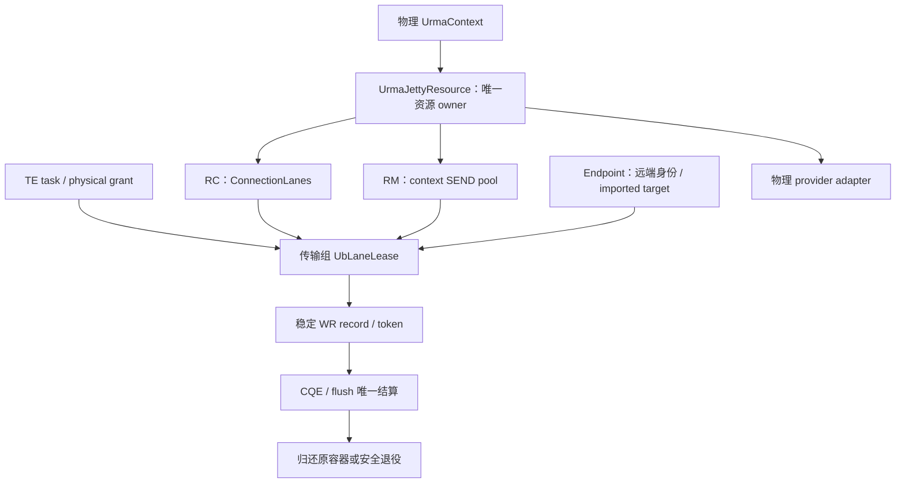
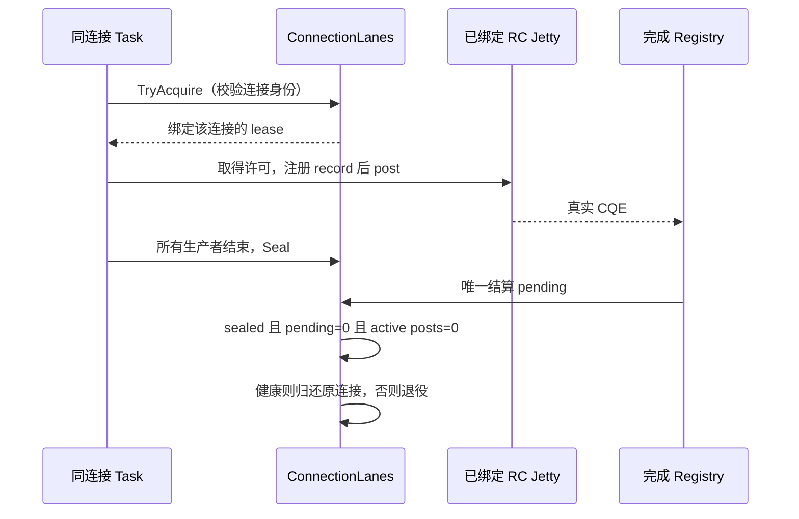
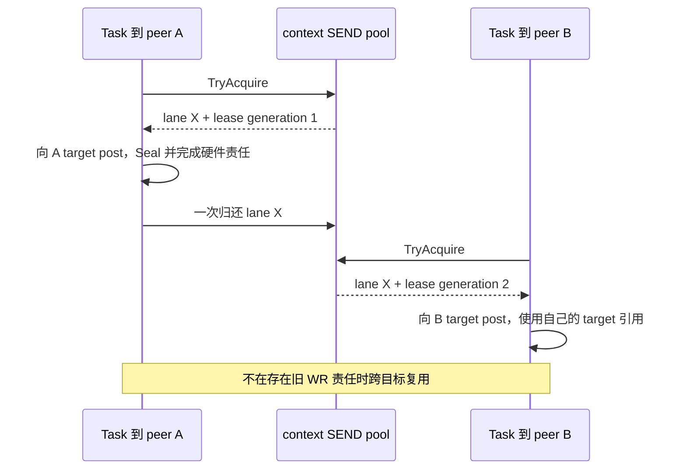
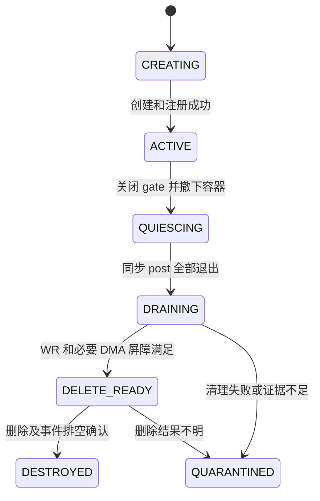

# 非 bonding 物理 UB Jetty 复用与生命周期设计（RC / RM）

> 设计状态：待实现，未完成物理 UB 实机验收；更新日期：2026-10-20。
> 当前检查工作树：`supercache-snapshot-930` / `deb2ec74`；本文不修改运行时代码。
> 本文是面向非 bonding 物理 UB 的独立方案，保留 [原 Jetty 方案](ub_jetty_pool_lifecycle_design.md) 供对照，不预设最终部署使用 RC 或 RM。
> 关联：[节点业务隔离](ub_fault_isolation_design.md)、[端口故障触发的时延成本调度](ub_load_scheduling_design.md)。原隔离文档中的 BONDP 四端口假设不自动适用于物理设备。

## 1. 目标、前提与模式选择

保留 classic TE 的 UbTransport / UrmaContext / UrmaEndpoint 分层，通过明确的使用权、稳定完成身份及安全退役，复用 Jetty 并避免故障后提前归还或释放。底层使用物理 UB provider 的标准 URMA API，不使用 ub_agg 的成员资源与 chip 扩展契约。

**非 bonding 不等于 RC；CTP 也不决定 Jetty 能否跨 peer 复用。RC 与 RM 必须分别验证、分别启用。**

| 项目 | RC 路径 | RM 路径 |
| --- | --- | --- |
| 发送资源复用边界 | 同连接、同绑定远端 Jetty | 同一物理 context 内，顺序访问不同已导入 target |
| 容器 | 连接内空闲 lane 集合 | context 级有界 SEND pool |
| 远端目标 | 保留连接绑定目标 | 每 context 一个共享目标，需 provider 和双方协议确认 |
| 发送 lane 借还 | 只归还原连接集合，不跨 peer | 满足安全条件后归还 context pool |
| 数量收益 | 避免同连接重复创建，不能承诺与 endpoint 数量解耦 | 池化发送资源不随 endpoint 数量线性增长 |
| 未满足能力 | 明确报不支持或采用已验证的原连接模式 | 禁用 pooled RM，保持已验证的 legacy 模式或报不支持 |

模式由配置、实际 provider 能力和双方握手共同确定，在首个 WR 前冻结。RC/RM 不兼容时不得静默改为另一模式；已 post 后不能回退重放。UM 不属于本方案。

不增加跨 peer 的 RC 解绑重绑、动态池大小、容量/拥塞评分、全局带宽配额或通用资源框架。保留现有 SchedulerCore 公平和 grant 边界。

## 2. 当前代码与物理路径前置条件

当前工作树按拓扑设备名创建 URMA context，但 openDevice 仍调用 BONDP_USER_CTL_SET_BONDING_MODE；NUMA 分支仍构造 bondp_jfs_wr_t。因此“选择物理设备”不代表本工作树已验证完全脱离 bonding，物理初始化适配是本方案前置工作。

| 接入点 | 必要处理 |
| --- | --- |
| [topology.cpp](../../mooncake-transfer-engine/src/topology.cpp) | 按实际 provider/能力识别物理设备，建立设备、EID、NUMA 对应；不靠名称前缀猜测，不重复枚举聚合成员 |
| [openDevice / endpoint](../../mooncake-transfer-engine/src/transport/kunpeng_transport/urma/urma_endpoint.cpp) | 物理路径跳过 BONDP 配置，校验 EID 非空、显式选择有效；查询传输模式和资源上限 |
| [urma_endpoint.h](../../mooncake-transfer-engine/include/transport/kunpeng_transport/urma/urma_endpoint.h) | 物理构建不强制依赖 urma_ubagg.h，provider 特有代码隔离 |
| [ub_transport.cpp](../../mooncake-transfer-engine/src/transport/kunpeng_transport/ub_transport.cpp) | 保留按 context 注册和 topology 选路，核对完整注册地址范围，不能截短后仍宣称全范围可用 |
| [transfer_metadata.h](../../mooncake-transfer-engine/include/transfer_metadata.h) | 身份/能力描述和版本化握手，完整远端 Jetty 身份 |

物理路径使用 urma_jfs_wr_t。NUMA 亲和通过本地 context 和可访问的远端注册选择实现，不发送 bondp_jfs_wr_t 的 chip 提示，也不把一个设备、一个 EID 和一个物理端口简单等同。

标准注册、创建 JFC/JFR/Jetty、import、post、poll 的调用框架可保留。RM/RC、CTP、priority、SGE、token、共享 JFR、资源上限均须按物理 provider 确认，不能只因 API 名称相同就照搬参数。

可参考同级 umdk 的 [标准示例](../../../umdk/src/urma/examples/urma_sample.c) 和 [perftest 资源实现](../../../umdk/src/urma/tools/urma_perftest/perftest_resources.c) 核对调用和身份交换；示例不是实际部署 provider 的安全屏障证明。

## 3. 公共架构与唯一所有权

每个物理 UrmaContext 持有 UrmaJettyResource，统一管理 native 资源和完成责任。RC/RM 仅改变 lane 容器和 target 组织，不复制生命周期状态机。

| 组件 | 职责 |
| --- | --- |
| UrmaJettyResource | native Jetty 唯一生命周期管理者；总预算、registry、创建/退役和后台任务 |
| UrmaJetty | native handle、generation、PostGate、WR depth、绑定归属与生命周期 |
| RC ConnectionLanes | 按连接 incarnation 组织固定绑定 lane，只向该连接出租 |
| RM SendJettyPool | context 内空闲索引、借还和移除；无 provider 调用 |
| UbLaneLease | 一组传输的使用权、生产者计数、Seal、pending WR、一次归还/退役 |
| UbCompletionRecord | 一个 WR 的 token、接受/完成事实及连接、注册、实际缓冲责任 |
| UrmaEndpoint | 远端身份、握手和 imported target 缓存；持有资源引用并请求关闭，不自行重复删除 native Jetty |
| PhysicalUrmaAdapter | 封装实际 provider 的能力与 post/drain/delete 结果，不解释节点业务策略 |



Resource 不访问 Master，不计算时延权重，不决定端口或节点隔离。provider、RPC、排序和 join 在状态锁外执行。endpoint eviction 只撤销可发现性，实际清理由唯一 owner 推进。

## 4. RC：连接内复用

RC 本地 Jetty 按正式 bind 契约绑定远端 Jetty。第一版保留连接目标与本地 Jetty 的绑定关系，不执行跨 peer 解绑再出租。

容器键包含 `(local context incarnation, connection incarnation, remote Jetty identity)`。同一 endpoint 多 lane 时分别记录各 lane 的绑定目标，不能仅凭 peer 地址把不同绑定资源混用。

连接准备时创建有界 lane，导入目标并 bind，成功后发布可用集合。正常请求借用空闲 lane；完成并 Seal 后归还同一连接。没有空闲 lane 时背压，不在每次请求上创建 Jetty。



连接关闭、peer 重启或绑定身份变化时，撤下该连接的 lane，禁止新借用，已借 lease 停止未 post 生产者并收敛。旧 Jetty 不放入其他连接；新连接创建新 identity。URMA_EEXIST 不能单独证明当前绑定目标正确。

RC 数量仍受活跃连接数量影响。context 预算约束创建，达到上限时拒绝/背压；不能承诺所有 peer 都预留固定资源。可安全清理空闲旧连接，但不能驱逐仍有 WR 责任的对象来腾位置。

## 5. RM：context 级池化与共享目标

只有实际 provider 验证支持 RM 发送 Jetty 顺序访问不同 target，且双方支持 pooled 协议时启用。

每个物理 context 预创建有界 SEND pool，并创建一个共享目标 Jetty。SEND_LANE / SHARED_TARGET 是软件责任角色，不假设底层存在 send-only Jetty 类型。共享 JFR 与接收配置按 provider 的正式契约建立，不能把 READ/WRITE 无业务接收 CQE 误解成无需 native 接收资源。

发送 lane 不发布给对端；对端只导入共享目标。imported target 按 peer/context incarnation、完整 Jetty 身份和 target_epoch 缓存，lease 归还不能删除 target。



共享目标故障关闭对应资源准入、撤下旧目标并更新 epoch；替代目标使用新身份。远端重新握手和 import，旧在途记录保留旧引用，不原地替换指针。

共享目标扩大故障影响范围，这是 RM 方案的明确代价。入站单边 READ/WRITE 不一定产生可枚举本地 CQE，删除目标或注销内存前必须取得停止旧访问及排空入站 DMA 的 provider 证据；只有本地 SEND pending=0 不够。

不新增 Jetty 全局广播或共享目标分片。健康同步保持由隔离模块负责。

## 6. 身份、能力协商与兼容

握手最小字段包括：协议版本、物理 provider 能力标识、传输模式、context/connection incarnation、完整 Jetty 身份（EID、ID、适用的 UASID）、注册兼容信息。RM 另携带 pooled_rm_v1、共享目标身份和 target_epoch。

- RC：保留连接绑定协议；不因加入 lease 就修改双方 Jetty 数量匹配语义，除非双方明确支持新协议。
- RM pooled：发送池大小与远端目标数量分离，握手不再要求一一对应。
- peer 只支持 legacy：仅当该 legacy 物理模式已经验证，且传输模式一致时，在零 WR 阶段选择兼容路径。
- 模式或描述符不兼容：提交前失败，不在 post 后切换，也不把 bonding 描述符当成物理描述符。

当前 raw urma_seg_t 序列化至少检查长度、ABI 和注册属性；物理 Jetty 的 UASID 不假设恒为零。地址相同但 incarnation 不同的对象必须视为不同资源。

## 7. 传输组、Seal 与正常归还

组键为 `(physical task/grant, local context incarnation, remote target/connection incarnation, direction)`。一个 task 可含多个组，不把整个多 peer BatchID 当成一个 lane。

沿既有选路形成私有 UbTaskPlan，确定连接、注册和有界组描述；不新增设备性能路由。各组 try-acquire，任一不足就归还此前已取得且未 post 的 lease，整体不提交该 task/grant，沿现有接口返回有界背压。若当前接口不能安全表达延期，则返回可识别的零 WR 错误，不宣称已有自动 DEFER；已 post 前缀不能包装成整体可重试。不能持有部分 lane 无限等待其他组。

首个 WR 前冻结逻辑完成预期。多个窗口、worker 队列和重试路径都属于生产者；只有唯一 task owner 确认生产者结束、未提交后缀处理完成，才执行 Seal。一次 submit 返回或队列暂时为空不等于封口。

正常归还条件：

```text
sealed && pending_wrs == 0 && active_post_calls == 0
&& Jetty ACTIVE && !retire_requested && settlement_claimed_once
```

RC 还要求原连接身份及绑定仍有效；RM 要求 context pool 仍开放。归还与退役共用线性化点，退役成员不能被重新发布。跨 peer 的 RM 复用只在上述条件全部满足后发生。

节点、路径、Jetty 三层许可控制不同责任。先检查双方准入，最终 post 获取本地节点许可、路径许可和 Jetty PostPermit，再核对注册及 credits。关闭前已取得许可的有限同步提交属于既有准入，不声称软件关闭能撤销在途 DMA。

## 8. 稳定完成身份与 partial post

user_ctx 保存 context 内唯一 64-bit token；有界 registry 持有 WR record，校验 context、Jetty、lease 和连接代际，不再直接存 Slice 指针。回绕前停止准入，旧 token 不用于新对象。

post 前安装 record、增加 pending 并预留 Jetty/JFC credits。record 分别保存“提交结果明确”和“CQE 已到达”，允许 CQE 早于同步 post 返回。post 调用退出前不回收 WR 描述所需状态。

| provider 返回 | 处理 |
| --- | --- |
| 成功 | 所有 WR 等待真实终结 |
| bad_wr 属于本次链，且前缀接受契约已验证 | 前缀保留；只撤销确定未接受的后缀 |
| bad_wr 为空、非法或契约不明 | 保留所有可能接受责任，停止后续提交并退役 |

一个 WR 只能由“确定未接受”或“硬件终结”二选一地归还 credits。失败、重复 CQE、未知 token、特殊控制完成不能直接按 poll 数量扣减。

CQE/AE 先分类，flush/suspend done 等无有效业务 user_ctx 的记录通过 Jetty registry 处理。普通 CQE 唯一结算后再推进 staging/业务完成；发布 task 完成后不访问可能已回收的 Slice/Task。

READ/WRITE 都覆盖。失败 READ 内容无效，staging 不执行成功 H2D；READ 重试前检查 lease/注册并收敛旧 WR，不并发写同一 buffer。WRITE 不自动重放可能已接受的前缀。

## 9. 物理 provider 的退役契约



Close、Seal、硬件 drain 和 delete 是不同阶段。pending 记录先于 modify/flush 安装，早到控制事件用 sticky 状态保存，避免事件先到而无人接收。

adapter 必须按实际物理 provider/SDK 确认：

1. ERROR/flush 的调用顺序、完成记录和特殊事件含义。
2. post 的 partial acceptance，以及 CQE/AE 是否仍会迟到。
3. RC 绑定及 RM target 的入站访问何时不可继续，注册何时可安全注销。
4. delete 成功/失败后 native handle 是否仍有效，何时可以复用 ID。

不得从 bondp_delete_jetty 的实现推导物理 provider 行为。内部可保留 HANDLE_RETAINED / HANDLE_CONSUMED / UNKNOWN 结果分类，同时独立报告硬件安全是否已确认。只有 retained 且契约允许时才重试；consumed/unknown 禁止再次解引用原 native 指针。

flush 返回零、一个 done 事件或软件 pending 为零，均不能单独代替全部 DMA 停止证据。无法证明时 quarantine，保留相应 buffer/MR/context，预算耗尽则背压，不用固定等待时间解封。

仅 local_id 的旧 AE/控制事件存在 ID ABA 风险，token generation 不能解决它。provider 未确认事件排空前保留 ID 归属或 tombstone，新资源不能覆盖旧归属。

## 10. 超时、容量与退出

逻辑 timeout/cancel 停止未 post 生产者、Seal 并进入待收敛责任；未完成的 lane 不归还。若需要提前返回逻辑错误，必须由内部 owner 持有 task、batch 和实际 buffer，不能只保留 MR 或 completion record。

裸指针调用者仍须持有内存至安全完成。Store operation 接入实际 buffer hold，freeBatchID 返回 BatchBusy 时保留清理责任。staging 和 H2D 消费者单独计数，lane 可归还不代表数据缓冲可释放。

容量采用静态 context 总预算，包含 RC 连接 lane、RM pool、legacy、retiring/quarantine 和创建中名额；共享目标另计入设备总上限。引用同一个 native 资源不重复计数。创建前预留名额，provider 调用在锁外，发布前复查 stopping/generation。

RC refill 只补原连接已定义的缺口，不能向所有 peer 无界扩建；连接已关闭则不补。RM refill 补 context pool 的静态缺口。退役责任未消除时替代资源也受额外窗口和设备上限约束。

退出顺序：关闭新业务/借用/握手/import/refill 发布 → 停未 post 生产者并 Seal → 同步 post 退出 → 持续 CQE/AE/flush 推进硬件收敛 → 安全关闭连接/目标并排空入站 → H2D/实际缓冲结束 → unimport/注销注册 → 删除 JFR/JFC/JFCE → 销毁 context/runtime。

完成线程不能等待必须由自身处理的事件；quarantine 依赖未收敛时不能继续释放其注册、context 或动态库。

## 11. 与隔离和时延调度的边界

复用节点身份、窄准入 hook 和完成值接口。物理设备健康由对应健康适配器提供，不能直接调用 BONDP_USER_CTL_QUERY_PORT_STATUS 或假造四端口 GOOD/BAD。缺少可靠事实能力时不启用依赖该事实的节点隔离 enforce；Jetty 的已确认资源故障与安全关闭仍独立执行。

节点关闭只取消未 post 阶段并 Seal，不意味着销毁全部 Jetty；节点恢复不复活退役资源。健康未知不能绕过已建立的关闭围栏。

为时延方案输出合格 READ 组的目标身份、字节数和硬件耗时值。首次 post 前预记时间，确认接受后生效；在最后硬件完成被唯一结算时复制观察值，再发布任务完成。失败、重试、partial post、timeout 标记样本不可用，排除 H2D 和池等待。

通知有界非阻塞，丢样本不丢完成责任。P50/P99、权重和 Master 选点在外部实现；不以空闲 lane、队列或 Jetty 数选择其他 peer/HCA。

## 12. 实施位置、顺序与验收

| 位置 | 主要修改 |
| --- | --- |
| topology / config / UB 构建 | 物理 provider 能力、设备/EID 选择、去除必需 BONDP 依赖，模式显式配置 |
| UrmaContext / UrmaJettyResource（新增） | 唯一资源 owner、RC/RM 容器、预算、adapter、registry 和退役 |
| UbLaneLease / UbCompletion（新增） | 组使用权、Seal、稳定 token、接受和终结唯一结算 |
| UrmaEndpoint / metadata 握手 | RC 完整绑定身份、RM 共享目标能力、epoch 和兼容检查 |
| UbTransport / UbWorkerPool | 私有提交组、最终许可、停止生产者和 staging 安全 |
| Store transfer_task 与 buffer owner | 超时保留、BatchBusy、实际缓冲责任及 READ 观测接入 |

实施顺序：先完成物理初始化和身份验证 → 在原连接模式落实稳定完成与退役 → 验证 RC 连接内 lease → 验证 RM 能力并单独实现共享目标/发送池 → 故障、退出与兼容验收后分别开启。该顺序不预定生产使用 RC 或 RM，也不要求两种模式同时启用。

| 验收场景 | 核心判据 |
| --- | --- |
| 不具备 bond 头文件/聚合设备的物理路径 | 标准 API 编译和双机通信成立，无 BONDP 调用 |
| EID 空/无效、UASID 非零、两端模式不同 | 明确失败或正确完整交换，不误建连接 |
| RC 同连接并发/重复请求、多 peer | 只在原绑定内复用，不跨 peer；总预算有界 |
| RC 连接关闭/peer 重启/绑定变化 | 旧 lease 不再出租，新连接新身份，旧责任不丢失 |
| RM 同 lane 顺序访问多个 target | 前次安全归还后复用，target 引用不串用 |
| RM 共享目标失效/epoch 变化/入站 DMA | 旧目标撤下并排空，注册不提前释放 |
| 多组资源不足、CQE 早到、Seal 竞态 | 无部分持有死锁，无提前归还或重复完成 |
| partial post、模糊 bad_wr、失败 READ/WRITE | 只撤销确定后缀，不交付无效数据、不重放模糊写 |
| 重复/迟到 CQE、控制完成、ID 复用 | 唯一结算，不解引用无效 user_ctx，无 ABA 误清理 |
| flush/delete 成功与各类失败 | 证据足够才释放，unknown 不盲目重试指针 |
| timeout、BatchBusy、H2D 延迟、shutdown/refill 竞争 | 实际缓冲和 context 不提前释放，未发布资源也安全清理 |
| 新旧 peer、RC/RM、功能关闭 | 零 WR 阶段确定模式，兼容路径仍受预算和安全规则约束 |

UT 使用可控 provider/clock/post/CQE 验证状态机；集成测试验证握手、组 owner 和 Store 缓冲责任；ST 对实际物理 provider 分别验证 RC 和 RM，未通过的模式保持关闭。mock 不证明 DMA 屏障。

性能分别衡量 RC 同连接创建次数和并发等待，以及 RM endpoint 增长时的 native Jetty 数量；同时观测吞吐、p99、退役/quarantine 及保留字节。不承诺池化必然提高带宽，也不把统计指标变成新的调度输入。
