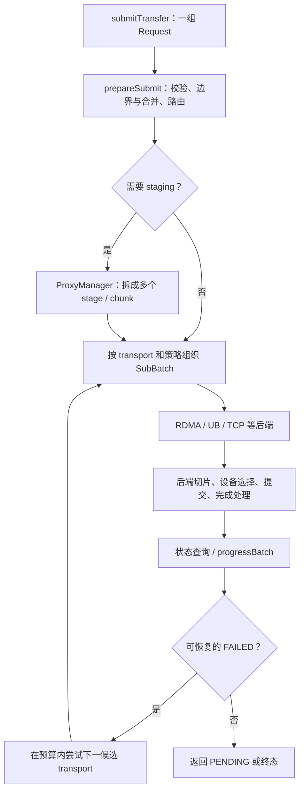
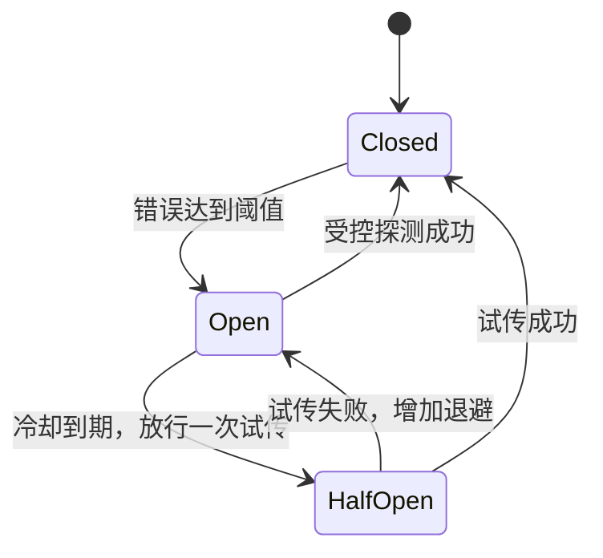

# TENT 四项核心能力的代码实现原理

## 1. 分析基线与阅读范围

- 分析日期：2026-10-20。
- 基线提交：`d855a6aed9c8d1343af008b2cd9b9f4257d62a9b`。
- 写作分支：`main_learn`。
- 分析对象：`mooncake-transfer-engine/tent/` 下的原生 TENT 实现。
- 本文通过静态阅读代码说明机制；没有执行硬件吞吐测试、故障注入或完整 C++ 测试。

本文展开四项能力：按请求选择 transport、将大传输切片并调度到多个 rail、通过中转内存组织 staged transfer、在运行时处理可恢复故障。

TENT 是 Transfer Engine NEXT。它接收内存或文件位置上的传输请求，并组织实际数据搬运。Mooncake Store 的对象路由、缓存淘汰和副本策略位于更高层，不能与这些传输机制混为一谈。

为避免把设计目标当成已经实现的通用能力，本文特别区分：

1. runtime 层的 transport 选择与 transport 内部的设备选择。
2. 已编码的 staging 模式与任意路径自动搜索。
3. 失败驱动的恢复与“链路只是慢了”的性能调度。
4. RDMA 的具体算法与 UB 的另一套实现。

文中的 `路径:行号` 均针对上述基线，之后代码变更可能使行号偏移。以 `tent/` 开头的路径相对于仓库内的 `mooncake-transfer-engine/`；文末提供完整源码路径。源码片段和伪代码会明确区分。

## 2. 先建立整体调用模型

### 2.1 从 Request 到物理工作请求

主要抽象如下：

| 抽象 | 对应内容 | 主要用途 |
|---|---|---|
| `Request` | opcode、本地指针、目标 Segment、目标位置、长度、优先级、hint、deadline、intent | 描述一次逻辑搬运 |
| `SegmentDesc / BufferDesc` | 注册内存范围、位置、可用后端及后端属性、拓扑 | 判断地址属于哪里，怎样访问 |
| `Batch / TaskInfo` | 面向调用方的一批请求及各请求运行状态 | 关联状态、恢复预算与生命周期 |
| `SubBatch` | 某个 transport 实际接收的一组任务 | runtime 与后端的边界 |
| RDMA/UB Slice | 一次逻辑请求拆成的较小执行单元 | 分流、重试和完成统计 |
| RDMA WR / URMA WR | 最终提交给设备的工作请求 | 执行具体的数据读写 |

请求语义尤其容易误解：

- `WRITE`：从本地 `source` 写入 `<target_id, target_offset>`。
- `READ`：从 `<target_id, target_offset>` 读取到本地 `source`。
- 因此，`READ` 的 `source` 实际是本地接收指针。
- 对内存 Segment，实际查找使用远端注册地址范围；`target_offset` 应理解为目标地址值，不应一律填成从零开始的数组下标。文件场景则有相应的文件位置语义。

源码入口：`tent/include/tent/common/types.h` 中的 `Request`；`tent/src/runtime/transfer_engine_impl.cpp` 中的 `getTransportType()`、`prepareSubmit()`。

### 2.2 一次提交的大体路线



这张图省略了可选 admission queue。当前 `enable_runtime_queue` 默认关闭；开启时，请求可以先排队，再由 progress worker 派发。它与后端切片调度属于不同层次。

源码定位：`tent/src/runtime/transfer_engine_impl.cpp:396`、`:2091`、`:2217`、`:2772`。

## 3. 能力一：按请求动态选择传输方式

### 3.1 选择依据来自三部分

第一部分是请求本身，包括大小、优先级、业务意图、指定策略名与 transport hint。

第二部分是 Segment 元数据。引擎通过 `SegmentManager` 获取本地或远端缓存描述，再用 `findBuffer(target_offset, length)` 定位注册内存，取得远端内存类型、transport 标签和机器标识等。

第三部分是本地运行时能力：后端是否已经安装，以及后端 `capabilities()` 能否完成 CPU、设备内存或文件之间的相应拷贝。

因此，仅在配置中写出 `"rdma"` 或 `"ub"` 并不足以保证传输能够成功；实际设备、注册资源和端点仍需满足后端要求。

源码定位：`tent/src/runtime/transfer_engine_impl.cpp:1526`；`tent/src/runtime/transport_selector.cpp:462`。

### 3.2 先匹配策略，再挑候选

`TransportSelector::matchesPolicy()` 支持以下条件：

- `segment_type`：内存或文件。
- `same_machine`：是否属于同一台机器。
- `local_memory / remote_memory`：内存类型。
- `min_size / max_size`：请求大小范围。
- `priority`：优先级精确匹配。
- `intent_type`：前台读取、后台预取、迁移、checkpoint 等。

`select()` 按 JSON 顺序寻找第一个匹配策略，然后使用其 `transports` 顺序。

```cpp
// 简化伪代码；并非可直接替换源码的实现。
policy = first_matching_policy(context);
raw_candidates = policy.transports.empty()
    ? context.buffer_transports
    : policy.transports;
candidates = reorder_with_hint(raw_candidates, request.transport_hint);
selected = nth_available_transport(candidates, transport_index);
```

没有显式策略时，`getTransportType()` 还保留 legacy 选择路径：内存请求主要依据 buffer 上的 transport 顺序，文件请求考虑 GDS/IOURING。不要假设所有请求都经过完全相同的策略分支。

`policy_name` 是另一种显式绑定：匹配到相同名称和 Segment 类型后，会绕过该策略其他匹配条件。它与普通的“按 intent 等字段匹配”语义不同。

源码定位：`tent/src/runtime/transport_selector.cpp:396`、`:529`；`tent/src/runtime/transfer_engine_impl.cpp` 的 legacy 分支。

### 3.3 transport_hint 的真实边界

当前基线中，`transport_hint` 不是绕过候选集的任意后端选择权。

`reorderWithHint()` 的核心代码为：

```cpp
if (hint == UNSPEC) return raw;
if (std::find(raw.begin(), raw.end(), hint) == raw.end()) {
    return std::nullopt;
}
```

只有 hint 已在候选集中，才把它移到队首。其余候选保留相对顺序，并排除重复的 hinted transport。

例如，策略为 `["rdma", "tcp"]`：

| hint | 结果 |
|---|---|
| `UNSPEC` | 按 RDMA、TCP 顺序 |
| `TCP` | 候选顺序变成 TCP、RDMA |
| `UB` | 不在候选集中，拒绝该选择 |

在 selector 模式下，若 hint 对应的首选后端不可用，初次选择会失败，不会直接悄悄跳过它。后续任务能否恢复，还需结合提交状态、候选集与 failover 逻辑判断。

另外，`validateTransportHint()` 在 prepare 阶段校验枚举范围和后端是否安装。这与后面的策略授权、内存能力检查是不同步骤。

源码定位：`tent/src/runtime/transport_selector.cpp:608`；`tent/src/runtime/transfer_engine_impl.cpp:1507`。

### 3.4 “可用”比“已安装”多一层

`isTransportAvailable()` 不只检查指针是否存在：

- NVLINK、SHM、TPU 要求同机。
- XPU、MLU 的本地拷贝要求同一进程的本地 Segment。
- CPU→CPU 要求 `dram_to_dram`。
- CPU→设备要求 `dram_to_gpu`。
- 设备→CPU 要求 `gpu_to_dram`。
- 设备→设备要求 `gpu_to_gpu`。
- 文件读写要求相应文件能力。
- XPU/MLU 的 host-staging 分支把网络 hop 按 CPU→CPU 检查，并限制为代码允许的网络后端。

这些检查避免把一个本地地址拷贝后端当成跨节点网络后端。

### 3.5 设备 mask 与分组提交

策略中的 `devices` 会在绑定拓扑时解析为 `device_mask`，避免每次请求都重复解析名称。

当前实现有一个需要明确的行为：如果策略列出的设备名全部无法解析，会记录错误并放宽为所有设备；它不是严格的“名称错误就禁止传输”过滤器。不要用它代替需要严格保证的隔离机制。

runtime 随后把 RDMA/UB owner 按 `device_mask`、`qp_pool` 组织同质提交组；RDMA 使用 QP pool，UB 的 QP pool 行为不能直接类比 RDMA。

源码定位：`tent/src/runtime/transport_selector.cpp` 的 `resolveDeviceMasks()`；`tent/src/runtime/transfer_engine_impl.cpp:2327`。

### 3.6 示例配置及其含义

以下是策略结构示例，假设所需后端已编译并启用，内存也已注册：

```json
{
  "policy": [
    {
      "name": "foreground-kv",
      "segment_type": "memory",
      "intent_type": "foreground_get",
      "transports": ["rdma", "ub", "tcp"]
    },
    {
      "name": "memory-default",
      "segment_type": "memory",
      "transports": ["rdma", "tcp"]
    }
  ]
}
```

前台 KV 请求先匹配第一条，其他内存请求匹配第二条。排列表示偏好及可供恢复使用的候选顺序，不表示一次请求同时向三个 transport 喷洒切片。

“动态”主要体现在按每个请求的当前上下文做选择、在失败后重新解析候选；当前跨 transport 恢复没有根据实时延迟自动判断“健康但太慢就切换”的机制。

## 4. 能力二：细粒度切片与多 rail 调度

### 4.1 为什么大请求需要切片

若把一个大请求整体固定到一张网卡，其完成速度就被该网卡限制。拆成多个 slice 后，可以：

1. 同时利用多张网卡。
2. 随每张网卡的负载调整后续分配。
3. 在单条 rail 出错时重试对应 slice。
4. 用细粒度 completion 更新带宽估计。

但每个 slice 都有 WR、CQE、排队和完成处理开销，所以切片越多并不总是越好。

### 4.2 RDMA 切片计划：限制数量并合并小尾巴

`RdmaTransport::submitTransferTasks()` 调用 `planRdmaSlices()`。

当前代码中，最大切片数一般为 64；本地内存为 CUDA 或操作为 WRITE 时为 32。基础 block 默认为 64 KiB，但可由 RDMA 配置改变。

切片算法分为四步：

1. 用基础 block 计算初始片数，并限制到 `max_slices`。
2. 按片数重新计算每片大小，再向上对齐到基础 block。
3. 用对齐后的 block 重新计算真实片数，避免空切片。
4. 若尾片小于 block 的 25%，合并到前一片。

例如，假设基础 block 特意设置为 256 KiB，请求为 1025 KiB：

- 初算为 5 片。
- 最后一片只有 1 KiB。
- 合并后为 4 片：256、256、256、257 KiB。
- 总长度保持不变，最后一片可以比名义 block 大。

这也解释了为何配额必须按实际 slice 长度扣账，不能对每片都固定扣一个 block。

零长度请求保留一片，用于正常完成任务计数；如果直接生成零片，任务可能永远无法走到完成态。

源码定位：`tent/include/tent/transport/rdma/slice.h:69`；`tent/src/transport/rdma/rdma_transport.cpp:522`、`:553`。

### 4.3 不是每个请求都预先做批量分流

当片数达到 `max_slice_count / 2`，RDMA 尝试调用 `Workers::allocateDevices()` 一次性为请求的多个 slice 分配本地设备。

如果请求覆盖多个不同位置的内存 region，整体 location 不能代表每个 slice，`allocateDevices()` 会保留逐 slice 选择路径。批量分配不能抹掉 NUMA 或 GPU 位置差异。

批量分配前还会结合远端 rail 可达性收缩本地 device mask。并非只看本地设备空闲程度。

源码定位：`tent/src/transport/rdma/rdma_transport.cpp:559`；`tent/src/transport/rdma/workers.cpp:1556`。

### 4.4 RDMA 智能调度的评分

`DeviceSelector::buildCandidates()` 先筛除：

- 不可用设备。
- 不符合 `device_mask` 的设备。
- 不满足 NUMA 限制的设备。
- 不满足优先级资源规则的设备。
- 已学习到无法对相应 GPU 执行 GPUDirect DMA 的本地 NIC。

然后计算近似评分：

```text
predicted_time = (inflight_bytes + slice_bytes) / ewma_bandwidth
score = predicted_time × numa_tier_weight + small_jitter
```

默认 NUMA 权重为 1、5、10；分数越小越优先。默认并非“绝不跨 NUMA”，而是给远端 NUMA 更高成本；`strict_local_numa` 才是进一步的严格限制。

举例，两个同 NUMA NIC 的估计带宽均为 10 GB/s：

- A 已有 20 MB 在途，新增 1 MB：约 2.1 ms。
- B 已有 1 MB 在途，新增 1 MB：约 0.2 ms。

B 更适合承担新切片。若 B 属于惩罚较大的 NUMA 层，其优势需要重新乘权重比较。

这些数值只用于解释公式，不是硬件实测。

源码定位：`tent/src/transport/rdma/quota.cpp:223`；`tent/src/transport/rdma/workers.cpp:94`。

### 4.5 单路径、加权分配与探测

`DeviceSelector::allocate()` 在智能模式下：

- 一片请求：选择评分最好的设备。
- 多片请求：按 `1 / (score + epsilon)` 的权重分配切片。
- 整数分配产生的剩余片数分配给最佳设备。
- 该分配分支每个线程每第 100 次多片调用采用轮询探测，使较少使用的设备仍能获得测量样本。

因此，“按带宽比例分片”只是近似直觉；真实权重还包含在途负载、NUMA 和其他评分因素。

关闭 `transports/rdma/enable_smart_scheduling` 时，采用基线算法：只在最高优先级的非空设备层中轮询。当前开关默认值为 `true`。

源码定位：`tent/src/transport/rdma/quota.cpp:100`、`:307`。

### 4.6 completion 怎样反馈到下一次选择

智能模式在分配时增加设备在途字节；成功完成、失败、取消或重新分配时释放对应计数。

`DeviceSelector::release()` 只有在存在正的 latency 样本时才学习带宽。失败或转移设备产生的无有效时延释放不更新带宽。

更新规则：

```text
observed_bandwidth = completed_bytes / latency_seconds
new_ewma = alpha × old_ewma + (1 - alpha) × observed_bandwidth
```

随后按理论带宽的倍率范围夹紧，避免异常样本无限放大或压低估计。

这里 `alpha` 作用于旧值。默认 `bandwidth_learning_rate=0.01`，意味着新样本权重为 99%，不能解释成“只学习新样本的 1%”。

实现还维护另一套 `transmit estimate`，供 deadline 预测使用。它以设备有已提交工作时的忙碌时间衡量吞吐，避免把队列等待再次折算进链路速率。用于选 NIC 的 EWMA 与用于预计传输时长的速率不是同一个统计序列。

源码定位：`tent/src/transport/rdma/quota.cpp:415`、`:538`；`tent/src/transport/rdma/workers.cpp` 的完成处理。

### 4.7 UB 的多 rail 选择是另一套算法

UB 复用“切片、配额、健康反馈”的思想，但没有直接调用 RDMA 的 `DeviceSelector`。

`UbWorkers::chooseAndResolveEndpoint()` 分两阶段：

1. 先对本地设备 × 远端设备组合进行 rail 级评分。
2. 按评分惰性解析少量 endpoint，再从 Ready 候选中原子获取 quota。

UB 的 `UbPathSelectionScore` 按字典序比较配额可用性、拓扑层级、规范化负载、endpoint 负载、带宽样本和重试顺序等。它不是 RDMA 的单一预计完成时间公式。

`statsIfPresent()` 不会为纯探测组合插入 rail 状态。候选解析顺序优先覆盖各本地设备，Ready 候选数量目标为 `max(2, local_device_count)`。解析失败可能增加尝试次数，不能将该数值说成 bootstrap RPC 的绝对上限。

`QuotaReservation` 在 segment 查找、导入及 post 前就取得，后续失败需要归还。物理 rail 的 quota 不随 endpoint generation 更换而重新获得一份额度。

源码定位：`tent/src/transport/ub/workers.cpp:585`、`:703`、`:772`；`tent/include/tent/transport/ub/workers.h` 中的评分结构。

## 5. 能力三：通过中转内存完成 staged transfer

### 5.1 首先识别哪些 hop 无法直接执行

`findStagingPolicy()` 根据本地和远端内存位置、后端 capabilities 以及已经安装的本地拷贝/网络后端，构造 staging 参数。

典型例子是 CUDA GPU 跨节点传输，但 RDMA 不具备相应 GPU 直访能力。支持的路径可以变为：

```text
本地 GPU → 本地 host DRAM → 网络 → 远端 host DRAM → 远端 GPU
```

只有一端需要中转时，会省略另一端的本地拷贝。

代码也包含 MNNVL、TPU、XPU、MLU 的专门规则。不同设备分支的网络后端允许集合并不完全相同：例如 XPU/MLU host-staging 选择分支当前列举 RDMA、FABRIC、TCP、HP_TCP，不能因为 TPU 支持 UB host hop 就推断所有设备 staging 都能使用 UB。

这是根据已编码规则分解请求，并非对任意内存、任意设备、任意中继服务器运行通用最短路径算法。

源码定位：`tent/src/runtime/transfer_engine_impl.cpp:1541`、`:1942`。

### 5.2 staging 参数传给谁

staging 参数包含三个位置：

```text
params[0] = 远端控制服务地址
params[1] = 本地 stage location；空字符串表示本端不需要中转
params[2] = 远端 stage location；空字符串表示对端不需要中转
```

`prepareSubmit()` 保存这些参数。`commitPreparedSubmit()` 遇到 staged owner 时，把任务交给 `ProxyManager::submit()`，而不是把原始设备地址直接交给只能处理 host 内存的网络后端。

`TaskInfo::staging` 用于让状态查询进入代理任务状态。staging 是编排步骤，本身不是新 transport；真正的各个 hop 仍由具体后端执行。

源码定位：`tent/src/runtime/transfer_engine_impl.cpp:2174`、`:2278`。

### 5.3 三类子传输怎样构造

`ProxyManager` 把 chunk 拆成以下子请求：

| 子步骤 | 地址与目标 | 执行位置 |
|---|---|---|
| Local stage | 本地原始地址与本地 stage buffer，目标是 `LOCAL_SEGMENT_ID` | 本进程 |
| Cross stage | 本地 stage buffer 与远端 stage buffer，目标是远端 Segment | 网络传输 |
| Remote stage | 远端 stage buffer 与远端原始地址，目标是远端进程的本地 Segment | 通过控制 RPC 委托远端执行 |

`submitLocalStage()` 和 `submitCrossStage()` 会分配内部 Batch，再调用 `submitStagingTransfer()`。远端 stage 使用 `ControlClient::delegate()` 或对应异步接口。

因此，数据走 RDMA/UB 等网络后端，并不意味着控制面完全不用 IP/RPC。

源码定位：`tent/src/runtime/proxy_manager.cpp:225`、`:247`、`:276`、`:289`。

### 5.4 WRITE 与 READ 的阶段顺序

WRITE 的生产者是本地原始内存，顺序为：

```text
Local stage：本地设备 → 本地 stage
Cross stage：本地 stage → 远端 stage
Remote stage：远端 stage → 远端设备
```

READ 的生产者在远端，所以顺序反过来：

```text
Remote stage：远端设备 → 远端 stage
Cross stage：远端 stage → 本地 stage
Local stage：本地 stage → 本地设备
```

这并不要求每次重写 opcode：内部 Request 对 READ/WRITE 的地址解释使同一组原始 opcode 可以表达这些 hop。

`transferSync()` 清楚展示这个顺序，适合用于理解语义；当前 `runner()` 实际调用 `transferEventLoop()`，不能把 `transferSync()` 当成唯一运行路径。

源码定位：`tent/src/runtime/proxy_manager.cpp:410`、`:814`。

### 5.5 chunk 流水线怎样工作

ProxyManager 默认 chunk 大小为 4 MiB，每个 location 的 arena 含 64 个 chunk。arena 在首次需要该 location 时分配并注册，默认总容量为 256 MiB。

单个 event-loop staging 任务使用的循环缓冲数量上限为 `min(chunk_count, 16)`。这不是整台机器的全局并发上限。

`transferEventLoop()` 把大请求按 chunk 切开，每个 chunk 维护状态：

```text
PRE → CROSS → POST → FINISH
       ↕         ↕
    INFLIGHT / INFLIGHT_REMOTE
任意阶段出错 → FAILED
```

实际过程：

1. 给每个 chunk 指定一对可复用 stage buffer。
2. 根据 READ/WRITE 决定 PRE 是本地拷贝还是远端拷贝。
3. 子 Batch 或异步 RPC 未完成时，将 chunk 留在 in-flight 状态。
4. 某个 chunk 前进时，其他 chunk 可以执行自己的阶段。
5. 同一 buffer 通过本地/远端占用集合保护，不能被两个尚未完成的 chunk 覆盖。
6. 完成最后所需阶段后才将 chunk 视为完成。
7. 整个逻辑任务在所有 chunk 成功后完成。

这样可以让某些 chunk 执行设备拷贝时，另一些 chunk 正在经过网络。流水线隐藏部分阶段延迟，但其吞吐仍受最慢阶段、buffer 数量和设备能力限制。

源码定位：`tent/include/tent/runtime/proxy_manager.h:54`；`tent/src/runtime/proxy_manager.cpp:467`、`:876`。

### 5.6 中转缓冲为什么不能失败后立即释放

网络请求或远端 delegate 可能已接收工作，但本端尚不知道它是否结束。此时立即把 stage buffer 归还会允许下一请求覆盖它，甚至释放仍被 DMA 访问的内存。

当前代码在无法 drain 时保存：

- 尚未排空的内部 Batch。
- 本地和远端 stage buffer 的占用。
- 尚未确认完成的 `RemoteStageOperation`。

这些资源进入 deferred cleanup；后续继续推进完成状态，安全时才 unpin。ProxyManager 退出时还有向引擎移交延迟清理所有权的逻辑。

这部分实现说明“自动中转”不仅是多调用一次 memcpy，还必须维护跨线程、跨 RPC 和设备 DMA 的生命周期。

源码定位：`tent/src/runtime/proxy_manager.cpp` 中的 `flushPendingCleanups()`、`runner()`、`deconstruct()`；`tent/src/runtime/remote_stage_operation.cpp`。

## 6. 能力四：在运行时处理故障与恢复

### 6.1 要分清三种不同问题

| 问题 | 处理层 | 主要机制 |
|---|---|---|
| 某个 RDMA/UB slice 或 rail 失败 | transport 内部 | retry、健康状态、换 rail、endpoint 恢复 |
| 整个 transport 的逻辑任务失败 | TransferEngineImpl | 在候选与预算内尝试其他 transport |
| 后端仍可用但负载高、变慢 | 调度/可选 deadline 预测 | 新 slice 分配调整、排队或降级；不会仅凭慢就自动跨 transport 重发 |

每一层的 retry count 含义不同。RDMA slice 重试计数与 runtime 的 `max_failover_attempts` 不能相加当作同一个全局次数。

### 6.2 RDMA rail 熔断与恢复

`RailMonitor` 记录本地 NIC 与远端 NIC 组成的 rail 状态。

默认错误窗口为 10 秒，阈值为 3 次，初始 cooldown 为 30 秒，Open 期间的探测间隔为 1 秒。配置可以改变这些值。

主要状态：



- Closed：正常放行。
- Open：普通流量避开该 rail，允许受控探测。
- Half-Open：只允许一次试传，其余请求等待或选择其他路径。
- `markRecovered()` 清除失败与退避状态。
- Half-Open 失败会加倍 cooldown，并受上限约束。
- 冷却时间到期本身不证明链路健康，必须经过一次真实试传。

`isAvailable()` 是观察接口，不能承担试传入场控制；`admit()` 才负责原子地授予 probe/trial。取消或提交前失败时需要 `cancelProbe()` 归还名额，防止 rail 永久被一个没有真正发送的探测占住。

源码定位：`tent/src/transport/rdma/rail_monitor.cpp:137`、`:196`、`:278`；`tent/src/transport/rdma/workers.cpp` 的路径生成与完成处理。

### 6.3 UB 超时恢复必须先证明旧 DMA 已终止

UB 超时没有收到 completion 时，不能直接释放旧资源并重试，否则旧 WR 可能稍后仍然写内存。

当前 `UbWorkers::scanTimeouts()` 先执行 endpoint quiesce/fence。成功 fence 后：

1. 确认旧 WR 已不会继续 DMA。
2. 将 provider 没有返回 completion 的残留 token 从 `inflight_` 移除。
3. 释放 endpoint outstanding 与物理 rail quota。
4. 再让 slice 进入重试或终态。

`releaseInflight()` 使用 `resources_released.compare_exchange_strong()` 防止 timeout 扫描与迟到 completion 双重释放。

设备级失败还有更强约束：retire 该本地设备的所有 endpoint，未排空的 endpoint 进入 quarantine；必须完成旧资源清理屏障，并满足 JFC 健康恢复条件后，context 才能重新服务。

源码定位：`tent/src/transport/ub/workers.cpp:1035`、`:1107`；`tent/src/transport/ub/endpoint_store.cpp` 的 `retireLocalDevice()`。

### 6.4 跨 transport 的恢复预算怎样保存

`prepareSubmit()` 从 runtime 配置快照复制：

- 配置 generation。
- `max_failover_attempts`，默认 3。
- `enable_auto_failover_on_poll`，默认 true。

这些值进入每个任务的 runtime policy。一个任务的后续恢复使用其保存的策略，不是每轮都无条件读取最新全局配置。

默认 3 的含义是最多进行 3 次额外 failover 解析尝试；初始提交不计入该值。候选数量不足时，会更早失败。

存在特殊接口边界：要求提交后可取消的 scatter 路径会将恢复预算设为 0，并关闭轮询自动 failover，不能把普通请求默认值套到这类路径。

源码定位：`tent/include/tent/common/config_lifecycle.h:128`；`tent/src/runtime/transfer_engine_impl.cpp:2091`。

### 6.5 提交阶段失败也可以恢复

`commitPreparedSubmit()` 调用后端 `submitTransferTasks()`。如果返回失败，runtime 会调用 `attemptSubmitStageFailover()`，尝试剩余候选。

这已经实现，不能依据旧文档中“submit-stage 不恢复”的过时段落得出相反结论。

合并请求的 owner 与 alias 尤其重要：

- 一个物理 owner 对应真正提交的数据搬运。
- 多个 public alias 只映射到该 owner。
- 恢复只重发 owner。
- alias 同步 owner 的 transport、sub-task 和状态。

否则，一次合并请求可能被每个 alias 重发一遍。部分接收语义还必须由 transport 的提交契约正确处理，不能仅从非 OK 返回值推断所有旧工作都没有开始。

源码定位：`tent/src/runtime/transfer_engine_impl.cpp:2327`、`:3039`；相关回归见 `engine_failover_e2e_test.cpp`。

### 6.6 轮询观察到失败后的状态机

`updateTaskStatusAfterPoll()` 的主要条件可简化为：

```cpp
// 简化伪代码，省略指标和 alias 同步。
if (!allow_failover || task.cancel_requested ||
    task.suppress_failover || status != FAILED ||
    task.type == UNSPEC) {
    return;
}
while (task.failover_count < task.max_failover_attempts) {
    if (resubmitTransferTask(task).ok()) {
        task.status = PENDING;
        break;
    }
}
```

`resubmitTransferTask()` 增加失败切换计数，更新候选下标，重新解析路由，分配目标后端的 SubBatch，再提交原始逻辑请求。

如果下一后端也同步拒绝，runtime 可以在同一预算内继续寻找后面的候选。若新后端接受工作，返回 PENDING，下一次 progress 再观察完成，不在该函数里无界等待。

如果选择结果包含 staging 参数，恢复会再次交给 ProxyManager，不能把原始设备内存地址直接提交给 host-only 后端。

源码定位：`tent/src/runtime/transfer_engine_impl.cpp:2966`、`:3157`。

### 6.7 为什么 getTransferStatus 有时会改变运行状态

当 `enable_auto_failover_on_poll=true` 时，查询状态可以触发内部重提交流程。因此它并不总是纯观察接口。

如果该开关关闭，`getTransferStatus()` 不自动执行这类恢复，但 `progressBatch()`、`waitTransferCompletion()`、`transferSync()` 对应的推进路径仍可以恢复。

不能依赖默认始终存在后台线程推进所有请求：独立 `enable_progress_worker` 默认关闭，runtime queue 开启时会启用它；应用也可以通过显式 progress/等待接口驱动。

### 6.8 哪些失败不能自动重放

当前代码不会无条件对所有失败重新发起数据写入：

- 用户主动取消后不应恢复。
- 参数、权限、范围或协议等永久错误不能靠换后端修好。
- 普通 TCP 的某些不确定 WRITE 结果会设置 `suppress_failover`。
- HP-TCP 对丢失 ACK 导致远端结果未知的 WRITE，以及有效的永久拒绝，也会抑制重放。
- HP-TCP 元数据过期有单独的有界刷新重试路径。
- 轮询通用跨后端逻辑要求状态为 FAILED，不是看到任意 TIMEOUT 或 CANCELED 就重发。

TENT 因而不能被描述为通用的 exactly-once 事务系统。相同内容写同一内存位置在一些 KV Cache 场景可重复，但这不等于允许所有带副作用业务安全重放。

源码定位：`tent/src/runtime/transfer_engine_impl.cpp:3070`。

## 7. 将四项能力放回一个具体场景

假设一个进程需要把远端 GPU 中的 KV Cache 读到本地 GPU：

1. 应用提交 READ，请求指明本地接收指针、远端 Segment、远端注册地址和长度。
2. runtime 获取 Segment 元数据，匹配策略并检查后端能力。
3. 如果硬件和注册资源支持直接 GPU RDMA，后端可直接执行。
4. 如果当前支持的规则要求 host staging，ProxyManager 把请求拆成远端设备到 host、host 网络传输、本地 host 到设备三阶段。
5. 网络阶段若选中 RDMA，RDMA 可以再把该 chunk 切成多个 slice，在允许的 NIC/rail 上执行。
6. slice completion 释放在途计数，产生带宽样本，影响后续 slice 的路径分配。
7. 单个 rail 出错时，transport 尝试内部恢复；失败扩大到逻辑任务时，runtime 在候选及预算内重新解析。
8. staged 路径失败时，尚未排空的中转资源由清理机制继续持有，避免过早复用。
9. 应用只有在整个逻辑请求终态成功时，才可以认为所有目标数据均可用。submit 成功只表示提交阶段被接受。

这里第 5 步揭示了两个粒度：staging 的 chunk 是编排和 buffer 复用单位，RDMA slice 是设备传输和调度单位。两者不是同一个对象。

## 8. 默认值、开关与实现边界速查

| 项目 | 当前值或行为 | 解读 |
|---|---|---|
| 构建 `USE_TENT` | 默认 OFF | 必须构建相应能力 |
| 兼容 API 启用 TENT | `MC_USE_TENT=1` | 原生 TENT API 不依赖这个兼容层开关 |
| RDMA 智能调度 | 默认 true | 关闭后采用基线轮询 |
| RDMA 基础 block | 默认 64 KiB | 对齐、片数限制和尾片合并可改变实际大小 |
| RDMA slice 计数上限 | 一般 64；CUDA 本地内存或 WRITE 为 32 | 不代表每次都会分这么多片 |
| RDMA 带宽旧值系数 | 默认 0.01 | 新样本权重约 99% |
| ProxyManager chunk / arena | 4 MiB / 64 chunks | 每个 location 按需建立 arena |
| event-loop buffer 数量 | 至多 16 组 | 属于单 staging 任务的循环复用 |
| runtime failover 预算 | 默认 3 | 受每任务策略和候选数共同限制 |
| 轮询自动 failover | 默认 true | 查询可触发恢复 |
| runtime queue | 默认 false | 与 transport 内部 slice 队列不同 |
| deadline 降级阈值 | 默认 0，关闭 | 不应当成默认行为 |
| 独立 progress worker | 默认 false | runtime queue 开启时会启用 |
| UB 选择 | 单独的 rail 评分与 quota | 不使用 RDMA 的评分公式 |
| 跨 transport 慢链路切换 | 没有通用延迟触发机制 | 不等同于失败恢复 |
| 任意多跳路径搜索 | 没有通用图搜索实现 | staging 依赖已编码设备模式 |

此前 Review 分析中发现的限制在本基线仍应保留认知：admission 的带宽按 transport 区分，但 `dispatching_bytes_` 仍是 eligible owner 的共享计数；UB 极小 endpoint cache 也可能与候选解析数量冲突。它们分别位于可选 admission 和 UB 候选生命周期路径，不应因为本文解释了设计目标，就认为这些边界已自动消失。

## 9. 对照现有测试阅读

下表是现有测试入口，不表示本次执行过这些测试：

| 能力 | 测试文件 | 阅读重点 |
|---|---|---|
| transport 策略 | `tent/tests/transport_selector_test.cpp` | 策略匹配、intent、能力、设备 mask |
| hint 与提交分组 | `tent/tests/transport_hint_test.cpp` | hint 授权、混合请求、策略分组 |
| RDMA 设备选择 | `tent/tests/device_selector_test.cpp` | 负载分配、计数、带宽估计 |
| RDMA rail 状态 | `tent/tests/rail_monitor_test.cpp` | 受控探测、Half-Open、退避和恢复 |
| staging arena | `tent/tests/stage_buffer_concurrency_test.cpp` | 共享缓冲并发所有权 |
| staging 退出 | `tent/tests/proxy_shutdown_timeout_test.cpp` | 未排空 Batch 与延迟释放 |
| runtime failover | `tent/tests/engine_failover_e2e_test.cpp` | 提交阶段、轮询阶段、alias、预算 |
| UB 数据与恢复 | `tent/tests/ub_native_data_path_test.cpp` | 缺失 completion、fence、后续进展 |
| UB 资源管理 | `tent/tests/ub_teardown_test.cpp`、`tent/tests/ub_core_test.cpp` | quarantine、设备清理、rail 配额与选择 |

其中 `engine_failover_e2e_test.cpp` 包含 `SubmitStageFailureFailsOverToSecondary`、`PollStageFailoverWithDerivedTasksRunsOnce`、`PerTaskFailoverCountsAreIndependent` 等案例；UB 的 `ProviderLostCompletionIsReclaimedAfterSuccessfulFence` 则验证成功 fence 后回收 provider 遗失 completion 的资源。

fake transport / fake URMA 能确定性验证状态与资源计数，但不能代替真实 DMA 完整性、物理设备失效和跨节点性能测试。

## 10. 推荐源码阅读顺序

以下路径均相对于仓库根目录：

1. `mooncake-transfer-engine/tent/include/tent/common/types.h`：先掌握 Request 和状态。
2. `mooncake-transfer-engine/tent/src/runtime/transfer_engine_impl.cpp`：从 `prepareSubmit()` 跟到 `commitPreparedSubmit()`。
3. `mooncake-transfer-engine/tent/src/runtime/transport_selector.cpp`：策略、hint、能力和候选。
4. `mooncake-transfer-engine/tent/include/tent/transport/rdma/slice.h`：切片计划和任务计数。
5. `mooncake-transfer-engine/tent/src/transport/rdma/rdma_transport.cpp`：请求变成 slice 的位置。
6. `mooncake-transfer-engine/tent/src/transport/rdma/quota.cpp`：设备评分、分配与带宽反馈。
7. `mooncake-transfer-engine/tent/src/transport/rdma/workers.cpp`：本地/远端 rail、post、completion 和重试。
8. `mooncake-transfer-engine/tent/src/runtime/proxy_manager.cpp`：stage 子请求、chunk 状态机与清理。
9. `mooncake-transfer-engine/tent/src/transport/rdma/rail_monitor.cpp`：rail 状态转换。
10. 回到 `transfer_engine_impl.cpp` 的 `pollTaskStatus()`、`resubmitTransferTask()`、`updateTaskStatusAfterPoll()`：把物理故障与逻辑恢复连接起来。
11. `mooncake-transfer-engine/tent/src/transport/ub/workers.cpp`：比较 UB 与 RDMA 的实现差异。

理解这条链路之后，四项能力的关系是明确的：runtime 先确定候选与编排方式，transport 再安排实际切片和设备，完成处理反馈负载与健康状态，错误则沿相应层级触发有界恢复。
