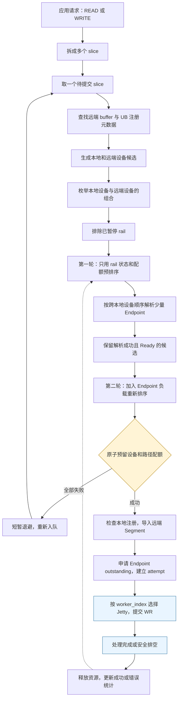
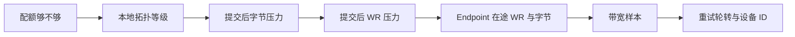
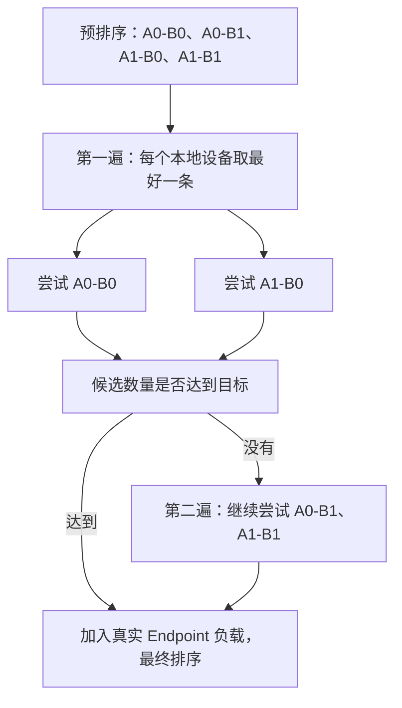
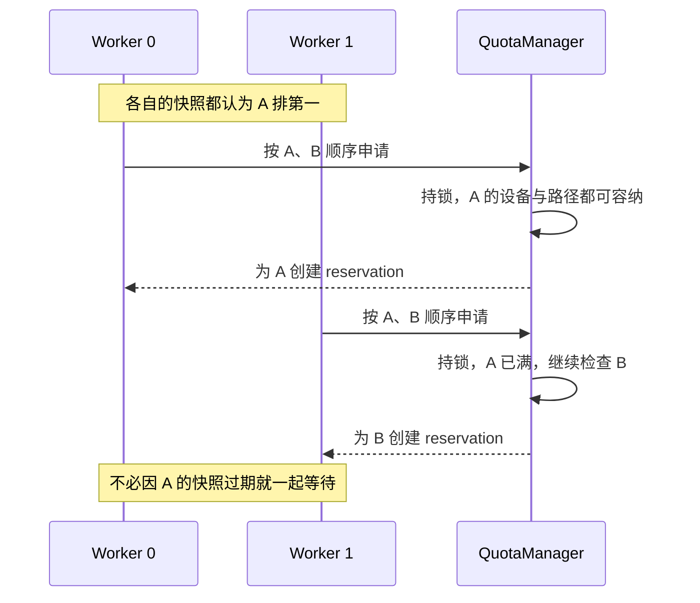
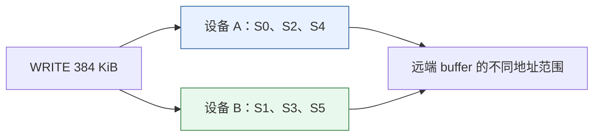

# TENT UBTransport 路径选择算法：流程图与数值推演

> 日期：2026-10-23。
>
> 分析基线：`main_learn`，`b265f86c1821dd0ceb122fb43064769ec085aa91`。
>
> 范围：当前分支原生 UBTransport 的 READ/WRITE 选路。本文解释已有代码，不把其他 Transport 的算法或待实现方案视为现状。
>
> 图表与数值用于说明算法，不是硬件测试结果。Mermaid 图可在支持 Mermaid 的 Markdown 查看器中阅读。

## 1. 先抓住三个关键点

1. 每个 slice 独立选路，前面 slice 的资源占用会影响后面 slice。
2. 使用固定优先级逐项比较；前一项已分出优劣，就不再比较后一项。
3. 先对全部设备组合预排序，只为部分候选解析 Endpoint，最后原子预留配额。

因此，多设备分流是实时占用、完成速度与策略共同产生的结果，不保证均分，也不保证按带宽比例分配。

代码中的路径表示“本地设备/EID → 某个远端 Segment 的设备/EID”。它不一定等于一条独立物理线缆。若本地选择的是 bonding 设备，provider 还可能在更低层安排实际物理路径。

相关基础与边界见 [物理 UB 可靠性设计](../docs/analyze/tent-physical-ub-reliability-design.md)；节点级阻断的待实现设计见 [UB 节点级故障隔离方案](../docs/analyze/ub-node-fault-isolation-design.md)。

## 2. 总体流程：一个 slice 怎样走到设备



这是主流程图。元数据错误、建链错误和取消等也有独立分支，不能把所有错误都理解成图中的“配额满后等待”。

READ 和 WRITE 共用这套选路框架，但本地内存的角色不同：

| 操作 | 本地内存 | 远端内存 | 本地拓扑按什么位置判断 |
| --- | --- | --- | --- |
| WRITE | 发送源 | 写入目标 | 本地源缓冲区所在内存位置 |
| READ | 接收目标 | 读取源 | 本地目标缓冲区所在内存位置 |

源码：`workers.cpp` 的 `buildRoute()`、`processPending()`，文件索引见第 12 节。

## 3. 候选生成：先确定哪些设备有资格

### 3.1 本地候选

`orderedLocalDevices()` 查询本片本地地址的内存位置，从拓扑中查找设备等级，然后排除：

- 不存在 Context 的设备。
- Context 不为 Active 的设备。
- 不在本次 `device_mask` 中的设备。

剩余设备先按 `topology_rank` 从小到大排列，同等级再按 Context 在途字节从少到多排列。

当前自动发现 UB 拓扑时，同 NUMA 设备通常进入更好的等级；其他设备进入较差等级。实际顺序也可以受加载的拓扑配置影响。

本地初排的“绝对在途字节”与最终评分的“归一化配额压力”不是同一个指标：前者参与候选枚举顺序，后者在路径比较器中具有明确优先级。

### 3.2 远端候选

`orderedRemoteDevices()` 根据目标 buffer 的注册元数据筛选：

1. 远端拓扑条目确实为 UB NIC。
2. 该 NIC 为这块 buffer 发布了 UB Segment 注册信息。
3. 先按远端 buffer 所在内存的设备等级列举，再补充其他已发布设备。
4. 去重。

远端机器有一块 UB 设备，不代表这次访问的 buffer 已经在该设备上注册。

### 3.3 双端拓扑如何进入最终选择

最终比较器中的 `topology_rank` 使用本地设备等级，没有把“本地 NUMA 距离 + 远端 NUMA 距离”计算成一个总分。

远端拓扑主要影响枚举顺序；枚举顺序还会进入后面的 `retry_order`。不能把这套算法描述成双端距离加权最短路。

此外，设备进入候选不等于已经验证 peer-specific 物理可达。后续 Endpoint 解析仍可能失败。

## 4. 排序的实质：按十个字段依次比较

`betterUbPathScore()` 的顺序如下：

| 顺序 | 字段 | 更优方向 | 直观含义 |
| --- | --- | --- | --- |
| 1 | `quota_available` | true 优先 | 当前快照能容纳本片 |
| 2 | `topology_rank` | 小优先 | 优先符合内存/设备亲和 |
| 3 | `normalized_inflight` | 小优先 | 提交后字节占用压力小 |
| 4 | `normalized_quota_wrs` | 小优先 | 提交后 WR 数占用压力小 |
| 5 | `endpoint_outstanding_wrs` | 小优先 | Endpoint 当前在途 WR 少 |
| 6 | `endpoint_outstanding_bytes` | 小优先 | Endpoint 当前在途字节少 |
| 7 | `has_bandwidth_sample` | true 优先 | 前面相同才偏好已有样本 |
| 8 | `ewma_bandwidth_bytes_per_second` | 大优先 | 前面相同才偏好完成效率高 |
| 9 | `retry_order` | 小优先 | 重试时轮转等价候选 |
| 10 | local / remote ID | 小优先 | 最后的确定性平局处理 |

这相当于比较一个有顺序的元组，不是计算加权总和。



图中从左到右优先级降低。只有左侧相同时，才会走到右侧。

### 例 1：带宽更大、负载更低，也可能落选

假设 A、B 都已成为 Ready 候选：

| 字段 | A | B |
| --- | --- | --- |
| 配额足够 | 是 | 是 |
| topology_rank | 0 | 2 |
| 提交后字节压力 | 75% | 10% |
| 带宽样本 | 20 GB/s | 80 GB/s |

A 胜出，因为在第二项拓扑等级已经分出胜负。B 的低负载和高带宽不能抵消拓扑劣势。

如果 A 本片已经无法获得配额，而 B 可以，则 B 胜出，因为第一项配额可用性优先于拓扑。

这解释了为什么跨 NUMA 设备可能长期比较空闲：在近端设备持续有额度时，当前默认策略不会仅因远端更空闲就主动均衡。

## 5. 配额压力：不是只看“现在有多少请求”

### 5.1 两层资源一起检查

`QuotaManager` 同时管理：

```text
设备层：该本地设备承接的全部路径占用
路径层：local_topology_id + remote_segment_id + remote_device_id
```

路径键不包含 Endpoint generation。Endpoint 重建不能把旧在途请求的配额清零。

这里的“设备层”按 `local_topology_id` 记账，对应 TENT 的设备/EID Context 条目；不会自动把同一原生设备的多个 EID 汇总为一个芯片级配额。

每层都限制：

- 在途字节数。
- 在途 WR 数。

对长度为 L 的本片，预判必须同时满足设备和路径的两类额度。

### 5.2 比较的是本片提交后的占用率

对于有限且大于零的上限：

```text
设备字节压力 = min(1, (设备当前字节 + L) / 设备字节上限)
路径字节压力 = min(1, (路径当前字节 + L) / 路径字节上限)

normalized_inflight = max(设备字节压力, 路径字节压力)

设备 WR 压力 = min(1, (设备当前 WR + 1) / 设备 WR 上限)
路径 WR 压力 = min(1, (路径当前 WR + 1) / 路径 WR 上限)

normalized_quota_wrs = max(设备 WR 压力, 路径 WR 压力)
```

取最大值表示以更紧张的一层为准。

占用率超过上限时，比例会截到 1，但 `can_acquire` 已经单独标记为 false。无限上限不贡献归一化压力；零上限有专门边界处理，不能套除法。

### 例 2：本地设备很空，路径仍可能繁忙

假设本片 64 KiB，两个设备的字节上限都是 2048 KiB，两条路径的字节上限都是 1024 KiB：

| 项目 | A | B |
| --- | ---: | ---: |
| 设备当前在途字节 | 1024 KiB | 512 KiB |
| 路径当前在途字节 | 128 KiB | 512 KiB |
| 提交后设备压力 | 1088 / 2048 = 53.125% | 576 / 2048 = 28.125% |
| 提交后路径压力 | 192 / 1024 = 18.75% | 576 / 1024 = 56.25% |
| 最终字节压力 | **53.125%** | **56.25%** |

假设两者拓扑相同、配额都够，A 优先。虽然 B 的本地设备总量更空，但这条 B 路径更紧张。

字节压力先于 WR 压力比较；这两个维度也没有合成一个加权分数。

### 5.3 默认配额与队列资源关联

当前安装过程按设备能力收紧实际队列参数后，构造：

```text
路径 WR 配额 = Jetty 深度 × 每 Endpoint 的 Jetty 数
路径字节配额 = 路径 WR 配额 × 有效 slice_size

设备 WR 配额 = 设备 JFC 深度 × 该 Context 的 JFC 数
设备字节配额 = 设备 WR 配额 × 有效 slice_size
```

乘法使用饱和保护。这些是 TENT 发送侧软件配额，不等同于对端实时硬件空闲量，也不是接收端 credit 协议。

## 6. 两阶段选路：为何不直接为所有路径建连接

### 6.1 第一轮只读 rail 信息

N 个本地设备与 M 个远端设备可以产生 N×M 个组合。第一轮为每个组合读取：

- 是否 paused。
- 当前配额是否容纳本片。
- 归一化压力。
- 是否有带宽样本及其数值。
- 重试轮转顺序。

这一轮不解析 Endpoint；评分中的 Endpoint WR/字节负载暂时为零。

`statsIfPresent()` 对从未出现的 rail 返回默认历史，不会因为枚举组合而为所有路径插入统计对象。未知历史不是已知故障，也不因此排除。

### 6.2 第二轮优先覆盖不同本地设备

若预排序是：

```text
A0→B0、A0→B1、A1→B0、A1→B1
```

`ubResolutionAttemptOrder()` 会给出：

```text
A0→B0、A1→B0、A0→B1、A1→B1
```

先拿每个本地设备的最好一条，再补剩余路径，避免少量候选全部挤在 A0。



图中表示枚举顺序与候选关系，不表示当前代码并发执行所有 Bootstrap RPC。

### 6.3 候选数量不等于 RPC 次数上限

目标数量为：

```cpp
resolve_limit = max(2, local_devices.size());
```

限制的是成功加入列表的候选数。只有解析成功、Endpoint Ready、rail 未暂停的路径才加入。

### 例 3：两个本地设备，为什么可能尝试三次

| 次序 | 组合 | 结果 | 已加入候选数 |
| --- | --- | --- | ---: |
| 1 | A0→B0 | 建链失败 | 0 |
| 2 | A1→B0 | Ready | 1 |
| 3 | A0→B1 | Ready | 2 |

此时达到目标 2，停止解析。如果已有 Ready Endpoint 可复用，解析不必产生新 Bootstrap RPC；反之，失败也可能已经付出 RPC 成本。

因此，正常情况下可控制连接扩散，但不能宣称“RPC 尝试总数永远不超过本地设备数”。

### 6.4 最终排序补上 Endpoint 实际负载

解析成功后重新读取：

- rail paused 状态。
- 实际配额快照。
- Endpoint 在途 WR 数和字节数。
- rail 带宽样本。

随后使用同一个比较器再次排序。只有进入候选列表的路径参加这轮；不是所有设备组合都完成建链后全局选优。

Warm Endpoint 没有一个“只要缓存命中就最高优先”的评分项。缓存命中减少解析成本，但不覆盖拓扑、压力和配额顺序。

## 7. 配额预留：并发竞争时真正决定选哪条

预排序和最终排序读取的都是会变化的快照。多个 Worker 可以同时认为 A 最优。

`tryAcquireFirst()` 在同一把配额锁下，按偏好顺序尝试；单条路径的设备额度与路径额度一起检查、一起记账。



### 例 4：排序第一名被抢满后直接落到第二名

假设 A 只剩一个 WR 名额，B 还有三个。W0、W1 都排出 A、B：

1. W0 先占用 A 的最后一个名额。
2. W1 获取锁时发现 A 容不下，不按旧快照强行提交。
3. W1 在同一次调用中尝试 B，成功预留 B。

这个锁保证的是配额提交一致性，不是把所有健康、拓扑和带宽字段都冻结成一个全局事务快照。预留时也不会重新计算全部评分，只按已经给定的顺序试额度。

若所有已解析候选都申请失败，返回 TooManyRequests，Worker 短暂等待后重新入队。当前 `deferPending()` 使用约 50 微秒等待，实际还受线程调度影响。

普通配额等待不消耗错误重试次数。持续 Endpoint 解析压力另有转换为有界重试错误的分支，不应与配额等待混为一谈。

## 8. 提交与完成怎样反过来影响后续选择

### 8.1 预留成功后还有检查

依次执行：

1. 查找选定本地设备上的注册 Segment。
2. 在该本地 Context 中导入远端 Segment。
3. 调用 `tryAcquireOutstanding()`，再次确认 Endpoint Ready、Context Active。
4. 增加 Endpoint 和 Context 在途计数，创建 attempt 与 completion token。
5. 建立 Inflight，保留 Segment 与 reservation。
6. 下发一个 READ/WRITE WR。

失败分支会按具体阶段释放本次资源或安排安全恢复。Endpoint 在排序后失效时，会释放预留并 defer；不能因为刚刚排序时 Ready 就假定永远可提交。

### 8.2 Endpoint 内如何选 Jetty

当前调用：

```cpp
auto jetty = endpoint->jetty(worker_index);
```

对应：

```cpp
jetties_[worker_index % jetties_.size()]
```

这是 Worker 到 Jetty 的映射，不是按每个 Jetty 当前负载再次选最优。多 Jetty 并不意味着每片轮询所有 Jetty。

### 8.3 完成释放资源，形成负载反馈

成功或可靠终结后，资源释放会减少：

```text
设备和 rail 的 quota usage
Endpoint 的 outstanding WR/字节
Context 的 outstanding WR/字节
```

reservation 使用唯一 ID，重复释放不会重复扣减；Inflight 的资源释放也有幂等保护。

异常路径必须等待合格完成或安全排空。不能为了让调度器看到较低负载，提前释放仍在 DMA 的资源。

## 9. 完整数值例子：384 KiB 如何分到两个设备

### 9.1 示例条件

一次 384 KiB WRITE 按 64 KiB 拆成 S0—S5。为隔离算法因素，假设：

- A、B 对应两个不同本地设备，各有一条已 Ready 的候选路径。
- 两者拓扑等级相同。
- 设备与路径配额都为 4 个 WR、256 KiB。
- 所有片依次完成选路；六片提交期间暂时没有完成释放。
- A、B 都已有样本，且 A=40 GB/s、B=20 GB/s。
- 其他比较字段不产生额外差异。

以上配额和带宽是演示输入，不是现场默认规格。

### 9.2 逐片推演

每格压力都指“如果现在向该路径提交本片”的占用率；本例 WR 与字节压力相同。

| slice | 提交前 A/B 在途片数 | A 提交后压力 | B 提交后压力 | 选择 | 首个决定因素 |
| --- | --- | ---: | ---: | --- | --- |
| S0 | 0 / 0 | 25% | 25% | A | 前面相同，A 带宽更高 |
| S1 | 1 / 0 | 50% | 25% | B | B 字节压力更低 |
| S2 | 1 / 1 | 50% | 50% | A | 前面相同，A 带宽更高 |
| S3 | 2 / 1 | 75% | 50% | B | B 字节压力更低 |
| S4 | 2 / 2 | 75% | 75% | A | 前面相同，A 带宽更高 |
| S5 | 3 / 2 | 100% | 75% | B | B 字节压力更低 |

最终：



这里出现 A/B 交替，是实时压力与平局规则共同产生的结果。代码没有为这六片预先分配轮询计划。

如果 A 更早完成，A 的占用会先下降，后续 slice 可能更常选 A。其优势既可能体现在带宽平局比较，也可能通过更快释放额度间接体现。

### 9.3 改一个条件：A 拓扑更好

仍使用相同片长和配额，但令 A rank=0，B rank=2：

| slice | 选择 | 原因 |
| --- | --- | --- |
| S0 | A | A 拓扑更好 |
| S1 | A | A 仍有配额，拓扑优先于负载 |
| S2 | A | 同上 |
| S3 | A | 本片提交后刚好达到上限 |
| S4 | B | A 本片配额不足，B 配额可用 |
| S5 | B | A 尚未完成释放，继续使用 B |

结果为 A 四片、B 两片。如果 A 期间不断完成并释放额度，则可能更多请求留在 A。

这比“按设备轮询”更偏向拓扑亲和，也说明高带宽 B 无法单凭样本覆盖 A 的拓扑优势。

## 10. 带宽、错误和重试如何进入算法

### 10.1 EWMA 带宽样本

成功完成后，以本片长度和从提交记录到处理完成的时间差计算：

```text
sample_Bps = bytes × 1,000,000,000 / latency_ns

第一个有效样本：
    EWMA = sample

之后：
    EWMA_new = alpha × sample + (1-alpha) × EWMA_old
```

当前 RailMonitor 默认 alpha=0.2。零字节或零延迟不作为带宽样本。

例如 64 KiB 用时 10 微秒：

```text
sample = 65536 / 0.000010
       = 6,553,600,000 B/s
       = 6.5536 GB/s
```

若旧 EWMA 为 8 GB/s：

```text
new = 0.2 × 6.5536 + 0.8 × 8
    = 7.71072 GB/s
```

这是 WR 完成效率，包含排队、并发及 poll 处理时机影响。它不是设备标称带宽，也不是业务 Get 的全部耗时。

当前比较器没有直接计算：

```text
预计完成时间 = (在途字节 + 本片字节) / 带宽
```

该表达式可以用于未来策略设计，但不是本分支现有排序规则。

### 10.2 错误影响可选集合

rail 记录错误和超时，在滚动窗口达到阈值后进入 paused，选路时排除。

RailMonitor 默认错误阈值为 3、窗口为 10 秒；UB 安装过程将冷却时长设置为 `endpoint_cooldown_ms`。不能把 RailMonitor 类型自身的默认冷却值当成最终 UB 配置。

当前 rail 冷却到期会解除暂停；这不是主动探测证明恢复。节点全端口证据、Half-Open 与设备重建等增强，不应被误读为当前代码已完成的能力。

### 10.3 重试只轮转后面的平局项

代码中：

```text
combinations = 本地候选数 × 远端候选数
start = retry_count % combinations
retry_order = (flat_index + combinations - start) % combinations
```

当更高优先级字段相同时，重试会改变优先组合。若另一条路径配额不足、拓扑更差或负载更高，这个轮转不能强行让它胜出。

因此不能把 retry_order 理解为整个请求的固定轮询调度器。

## 11. 阅读代码时容易混淆的边界

| 容易产生的理解 | 当前实现 |
| --- | --- |
| 综合评分就是加权求和 | 固定字段优先级，逐项比较 |
| 带宽最大就先选 | 带宽排在拓扑、配额压力和 Endpoint 负载之后 |
| 只看在途字节绝对值 | 最终比较主要使用提交后的设备/路径归一化压力 |
| 枚举到的 EID 对都可达 | 枚举是候选生成，建链可能失败 |
| 每次对全部组合建连接后选最优 | 只解析有限数量的成功候选 |
| 最多两次 RPC | 至少两个候选目标；失败可能导致更多解析尝试 |
| Ready 缓存一定压过冷连接 | 缓存减少解析成本，没有无条件优先分 |
| 多个 Jetty 每片轮询 | 当前按 worker_index 取模映射 |
| 预排序时有额度就能直接提交 | 原子预留时还要重新检查，之后还检查 Endpoint 和注册 |
| 切换 Endpoint 会重置 rail 配额/历史 | rail key 不含 Endpoint generation，旧占用与历史不会因此自动清零 |
| 没有带宽样本就不可用 | 未知样本只影响后面的平局比较 |
| 冷却到期就是硬件恢复 | 当前只是 rail 再次参与候选，不是数据面恢复证明 |
| 关闭带宽估计开关会禁用所有 rail 采样/比较 | 当前开关用于 getEstimatedBandwidth() 的对外返回；现有 Worker/比较器不据此停止样本比较 |

当前策略在同拓扑下会倾向较低资源压力，在配额允许时又保持拓扑亲和。它没有承诺全局最大吞吐、按带宽比例分流、严格公平或跨路径顺序。

## 12. 源码索引与交付验证

路径相对仓库根目录。基线固定在文首提交，后续代码变化时应重新核对函数。

| 论点 | 文件 | 函数或类型 |
| --- | --- | --- |
| 分片、配额初始化、Bootstrap、带宽导出 | `mooncake-transfer-engine/tent/src/transport/ub/ub_transport.cpp` | install、submitTransferTasks、resolveEndpoint、getEstimatedBandwidth |
| 排序字段与解析顺序 | `mooncake-transfer-engine/tent/include/tent/transport/ub/workers.h` | UbPathSelectionScore、betterUbPathScore、ubResolutionAttemptOrder |
| 候选、两阶段选择、提交、退避、完成 | `mooncake-transfer-engine/tent/src/transport/ub/workers.cpp` | orderedLocalDevices、orderedRemoteDevices、chooseAndResolveEndpoint、processPending、deferPending、handleCompletion |
| 配额定义和默认无限值 | `mooncake-transfer-engine/tent/include/tent/transport/ub/quota.h` | QuotaLimits、QuotaAvailability、QuotaReservation |
| 归一化压力、原子预留和幂等释放 | `mooncake-transfer-engine/tent/src/transport/ub/quota.cpp` | availabilityLocked、normalizedUsage、tryAcquireFirst、release |
| rail key、统计字段与默认阈值 | `mooncake-transfer-engine/tent/include/tent/transport/ub/rail_monitor.h` | UbRailKey、RailMonitorConfig、RailStats |
| EWMA、错误窗口和冷却解除 | `mooncake-transfer-engine/tent/src/transport/ub/rail_monitor.cpp` | recordSuccess、recordFailureLocked、refreshCooldownLocked |
| Endpoint 状态检查与 Jetty 映射 | `mooncake-transfer-engine/tent/src/transport/ub/endpoint.cpp` | tryAcquireOutstanding、jetty |
| 自动发现时的 UB NUMA 等级 | `mooncake-transfer-engine/tent/src/runtime/topology.cpp` | discover |

本次只增加学习文档，不修改代码、配置或现有分析文档。检查包含源码入口、图示数据与数值计算、文件格式及相对链接；不运行 C++ 构建或硬件测试。Mermaid 使用可编辑源图，本机未安装 Mermaid 渲染工具，未进行实际渲染验证；pre-commit 工具也未安装。
